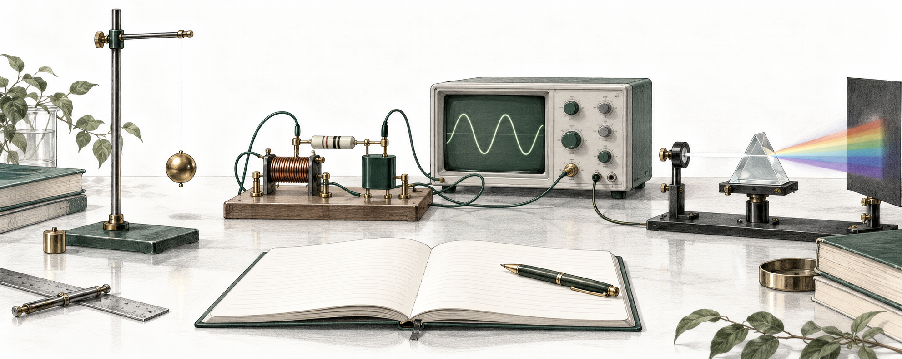
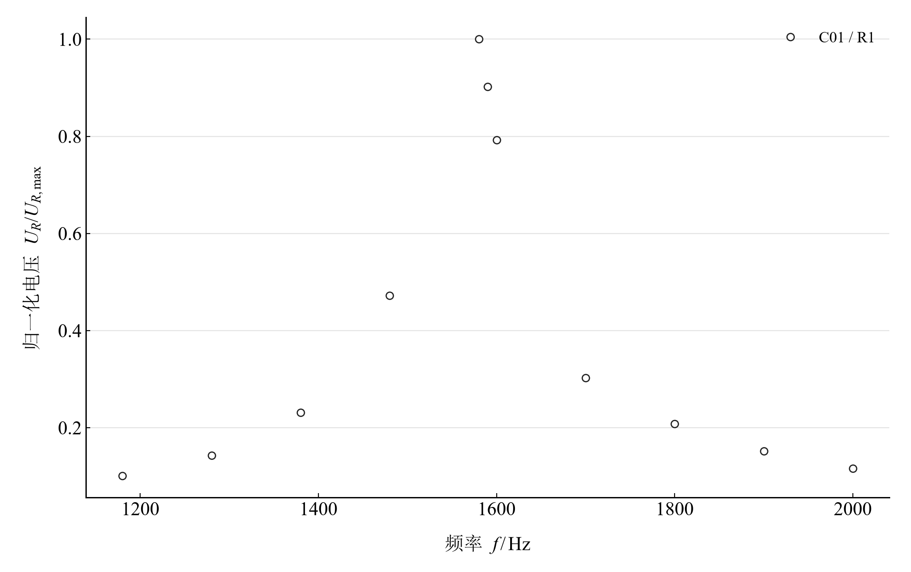
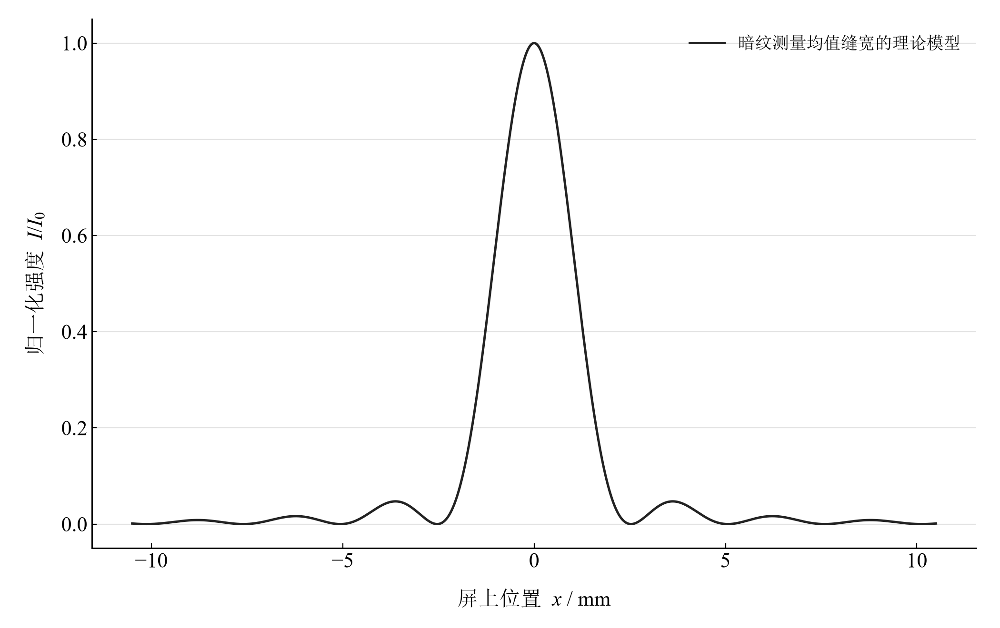

<p align="center">
  
</p>

# 普通物理实验 · General Physics Lab

**从实验记录出发，把数据处理、物理模型与计算过程放在一起。**

这里整理了淮南师范学院四门普通物理实验课程的 **45 个实验**。每个实验都有一份完整报告，以及 Python 和 Wolfram 两种实现的计算笔记本：先理解实验，再复算结果，最后通过参数变化观察模型的适用范围。

[按课程找实验](#按课程找实验) · [从三个实验开始](#从三个实验开始) · [如何打开与运行](docs/usage.md) · [源资料 PDF](pdf/README.md)



*单摆、电路与光学：从测量进入模型。*

## 这个仓库怎样使用

一份实验记录可以有三种读法。**Markdown 报告**沿原 DOCX 的章节讲清实验过程、数据处理和结论；**Jupyter Notebook**与 **Wolfram Notebook**在相应章节展开推导、计算、绘图与模型探索。两端读取同一组 CSV／JSON 输入，关键结果相互核对。

每个实验的 README 都是统一入口。根据当前目的，选择相应文件即可：

|你想做什么|选择什么|在哪里使用|
|---|---|---|
|快速读完实验、查数据与结论|**实验报告** `report.md`|GitHub 或支持数学公式的 Markdown 阅读器|
|查看图表、操作已有滑块或菜单|**Notebook 阅读版** `analysis.html`|下载后在浏览器打开，或使用[本地预览](docs/usage.md#在浏览器中查看-html)|
|逐步运行 Python、修改数据或模型|**Jupyter Notebook** `analysis.ipynb`|JupyterLab 或 VS Code|
|使用原生数学排版、符号推导与交互|**Wolfram Notebook** `.nb`／**Paclet** `.paclet`|本机 Wolfram 环境|
|对照 DOCX 转换后的报告、讲义与说明书|**源资料 PDF**|[57 份 PDF 索引](pdf/README.md)|

下载仓库后，在浏览器中打开 HTML 阅读版即可操作页面中的控件；在 Jupyter 或 Wolfram 中打开 Notebook，可以编辑并重新计算。

## 按课程找实验

课程目录提供每个实验的**报告、Python、Wolfram 和源报告 PDF**直达链接。

|课程入口|实验数|主要内容|可以先看|
|---|---:|---|---|
|[普通物理实验 1](experiments/course-01/README.md)|8|运动规律、碰撞、密度与热量测量|[单摆测重力加速度](experiments/course-01/pendulum/README.md)|
|[普通物理实验 2](experiments/course-02/README.md)|10|材料性质、振动与波、传热与流体|[弦振动](experiments/course-02/string-vibration/README.md)|
|[普通物理实验 3](experiments/course-03/README.md)|13|电路、电磁场、传感器与测量仪器|[RLC 串联谐振](experiments/course-03/rlc-resonance/README.md)|
|[普通物理实验 4](experiments/course-04/README.md)|14|折射、干涉、衍射、偏振与成像|[单缝衍射](experiments/course-04/single-slit-diffraction/README.md)|

## 从三个实验开始

### 单摆：从重复计时走到非线性运动

从有效摆长与重复计时出发，计算周期，拟合重力加速度，再查看残差。随后比较小角度近似与非线性单摆，观察初始摆角对周期和测量结果的影响。

[实验入口](experiments/course-01/pendulum/README.md) · [直接读报告](experiments/course-01/pendulum/report/report.md) · [打开 Python 笔记本](experiments/course-01/pendulum/notebooks/analysis.ipynb)

### 谐振与衍射：让数据和模型相遇

下面两张图分别展示电路实验的实测归一化响应，以及由单缝暗纹测量所得缝宽构建的理论光强分布。观测点与模型曲线的身份在图例和实验说明中区分。

<table>
  <tr>
    <td width="50%" align="center" valign="top">
      <a href="experiments/course-03/rlc-resonance/README.md"></a><br>
      <strong>RLC 串联谐振 · 实测响应</strong><br>
      比较峰值、半功率带宽与品质因数。<br>
      <a href="experiments/course-03/rlc-resonance/README.md">进入实验</a>
    </td>
    <td width="50%" align="center" valign="top">
      <a href="experiments/course-04/single-slit-diffraction/README.md"></a><br>
      <strong>单缝衍射 · 理论光强分布</strong><br>
      从暗纹位置估计缝宽，检查近轴近似。<br>
      <a href="experiments/course-04/single-slit-diffraction/README.md">进入实验</a>
    </td>
  </tr>
</table>

## 开始计算

**只阅读报告和 PDF，无需安装计算环境。** 运行 Python 笔记本需要 Python 3.11 及以上；运行 Wolfram 笔记本需要本机 Wolfram 环境。两者可以分别使用。

在 Windows PowerShell 中克隆仓库并安装 Python 环境：

```powershell
git clone https://github.com/HNNUYUXUAN/general-physics-lab.git
cd general-physics-lab
python -m venv .venv
.\.venv\Scripts\python.exe -m pip install -e ".[test]" jupyterlab
.\.venv\Scripts\python.exe -m jupyterlab
```

进入 `experiments/course-01/pendulum/notebooks/analysis.ipynb`，选择当前虚拟环境的 Python 内核，再从头运行。

安装宋体和 Times New Roman 可重现图表排版。环境配置、Wolfram 安装包和单个实验的运行方式见[使用指南](docs/usage.md)。

## 数据如何成为结论

观测值保存在每个实验的 `data/`，单位、参数和模型假设保存在 `experiment.json`。Python 模块与独立 Wolfram Paclet 分别计算，再对照未修约结果；图表、数表和报告中的结果由这些计算生成。

每个实验说明测量条件、拟合方法和不确定度的定义。Notebook 将观测数据与物理模型放在同一章节，通过数据选择、参数扫描和曲线比较理解结果。

计算方法见[数据与方法](docs/data-and-methods.md)，各实验的执行和结果对照见[验证记录](docs/delivery-summary.md)。原报告、讲义与说明书可通过[PDF 索引](pdf/README.md)查阅。

## 想继续修改或扩展

|位置|保存的内容|
|---|---|
|[`experiments/`](experiments/registry.json)|实验登记、规范数据、报告、Jupyter 与结果|
|[`src/physicslab/`](src/physicslab/)|Python 计算实现和公共工具|
|[`notebook/paclets/`](notebook/paclets/)|独立 Wolfram 包、Notebook、测试和安装包|
|[`pdf/`](pdf/README.md)|原 DOCX 转换的主报告、讲义及参考资料|
|[`docs/`](docs/usage.md)|使用、数据约定、开发方法与验收记录|

[数据与方法](docs/data-and-methods.md) · [开发与构建](docs/development.md) · [图像素材来源](docs/assets/README.md)

## 让 agent 找到并接手实验

从 [`llms.txt`](llms.txt) 了解项目，按[中英文实验目录](docs/experiment-index.md)找到物理问题，再沿[阅读指南](docs/agent-guide.md)定位原始数据、完整精度结果与计算实现。[复现指南](docs/agent-reproduction.md)提供新内核执行、双端重建和 Paclet 入口。

程序检索使用[机器目录](docs/experiments.json)与[检索命令](docs/agent-catalog.md)；一次读取可使用 [`llms-full.txt`](llms-full.txt)。引用项目见 [`CITATION.cff`](CITATION.cff)，引用具体数值同时附实验标识、指标键、来源文件和提交版本。

维护：**缪雨轩 · 淮南师范学院**
