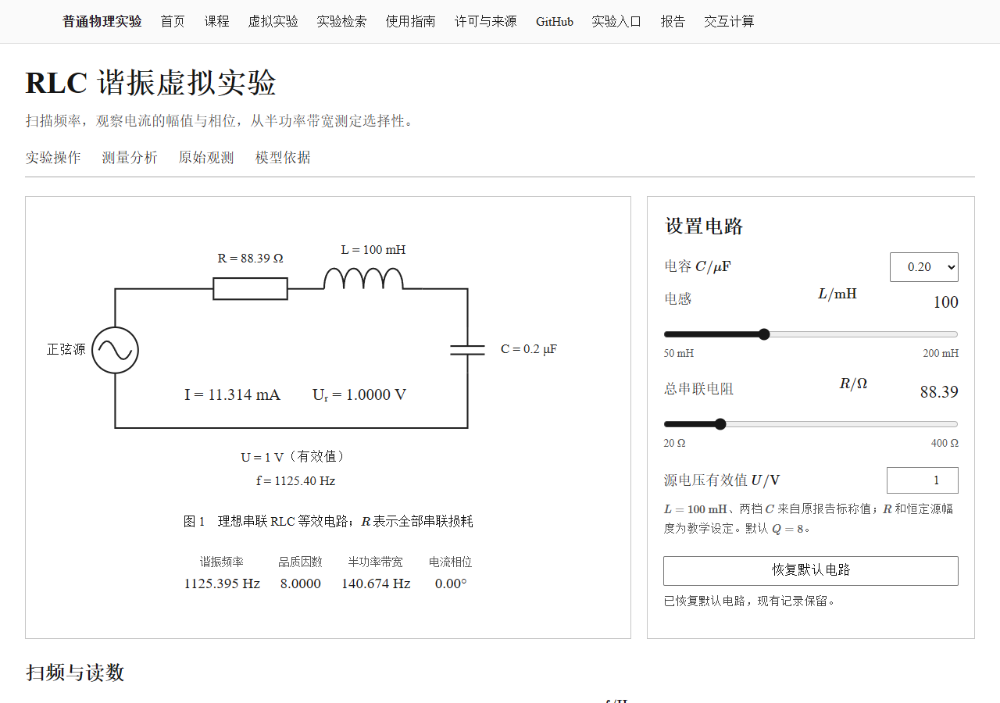
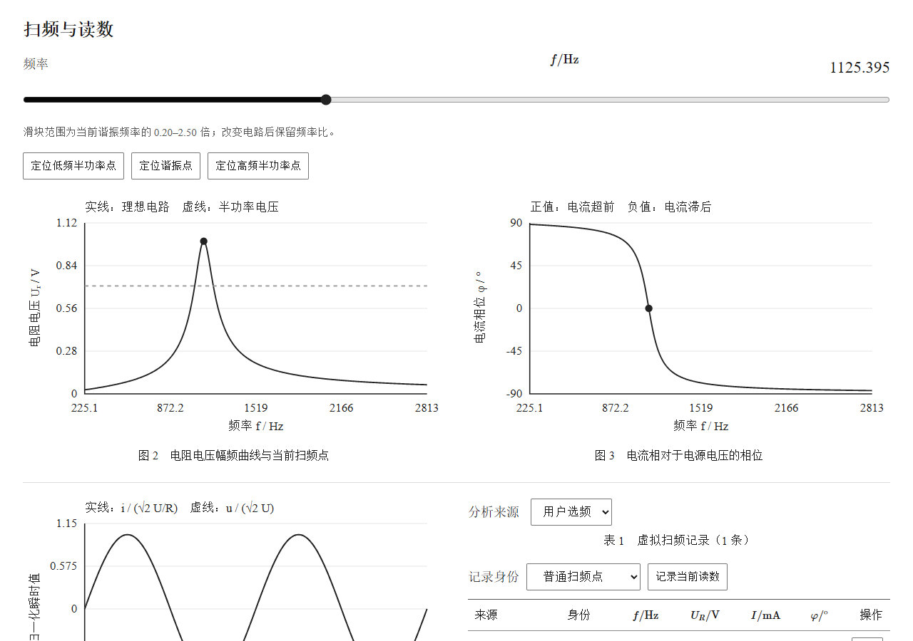
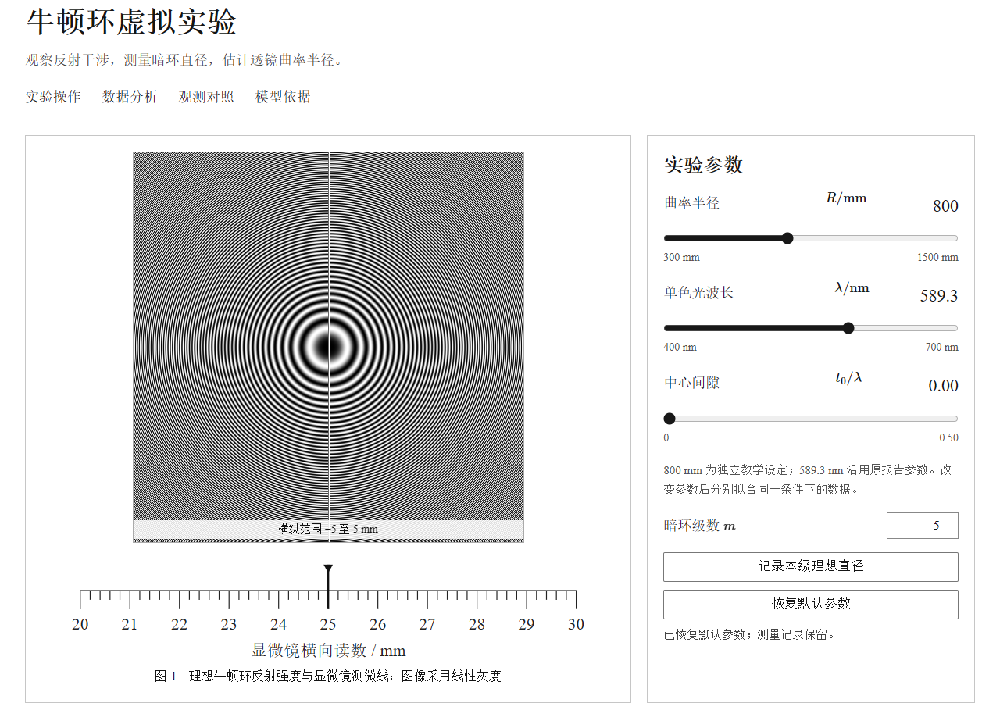
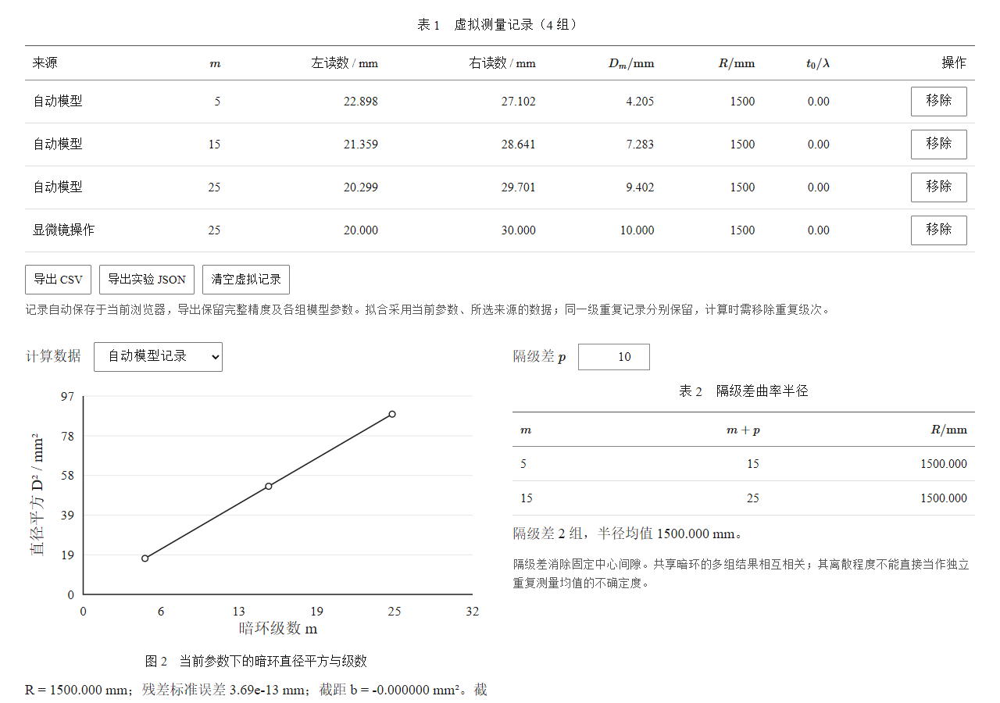
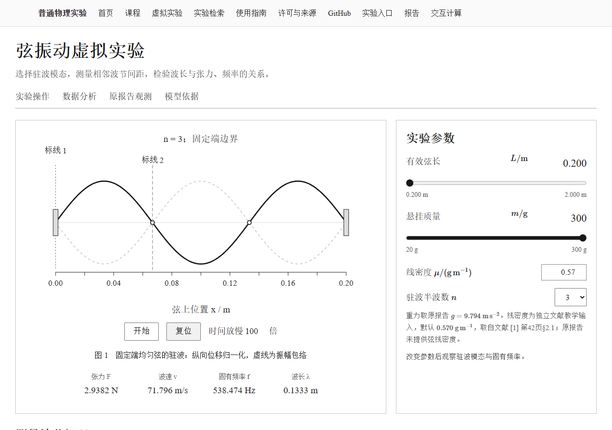
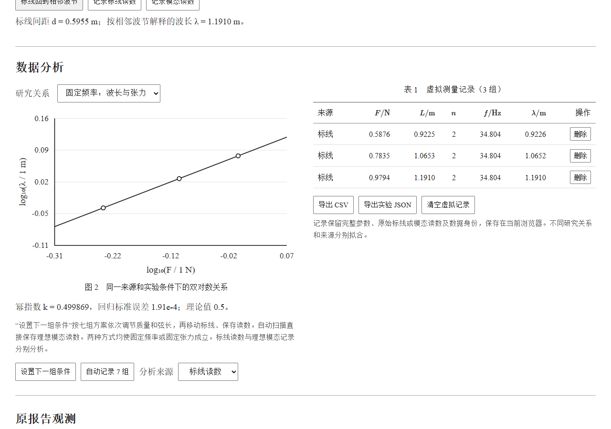

# 虚拟实验验证记录

## 跨领域先导

|实验|独立数值验证|前端验证|
|---|---|---|
|RLC串联电路谐振特性的研究|[计算记录](simulation/rlc-resonance-reference.json)|[控件、导出与字体](simulation/rlc-resonance-frontend.json)|
|牛顿环实验|[计算记录](simulation/newton-rings-reference.json)|[控件、导出与字体](simulation/newton-rings-frontend.json)|
|弦振动的研究|[计算记录](simulation/string-vibration-reference.json)|[控件、导出与字体](simulation/string-vibration-frontend.json)|

在新页面中核验默认状态、参数改变、操作读数、数据分组、无效输入、刷新恢复和真实下载。桌面视口为 1280×900，窄屏为 390×844。公式使用站点随附的 MathJax 资源。

## RLC串联电路谐振特性的研究

## 牛顿环实验

## 弦振动的研究

