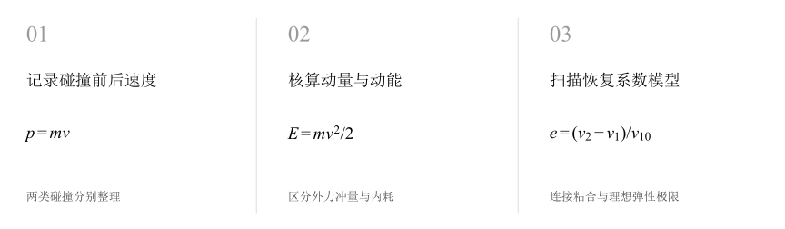
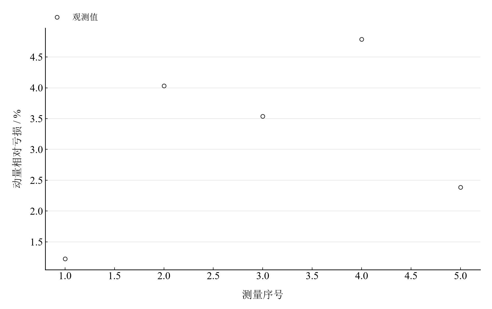
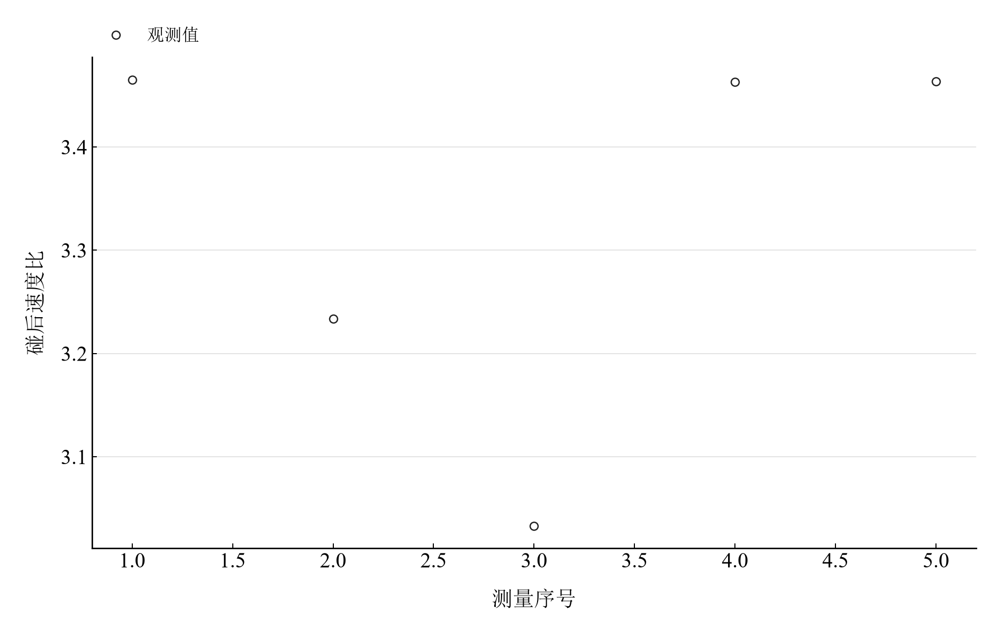

[普通物理实验 1](../README.md) · [项目首页](../../../README.md) · [使用指南](../../../docs/usage.md)

<!-- virtual-laboratory-entry -->
[在线虚拟实验](https://hnnuyuxuan.github.io/general-physics-lab/simulations/collisions/) · [模型依据与参数来源](../../../docs/collisions-model-evidence.md)

# 碰撞规律的研究

**动量与动能分开计算，读懂碰撞中的传递与耗散。**

比较气垫导轨上的粘合碰撞和弹性附件碰撞。前者对照碰前后动量与动能，后者从碰后速度比观察实际运动与理想弹性模型的差别。

[读实验报告](report/report.md) · [HTML 阅读与探索](https://hnnuyuxuan.github.io/general-physics-lab/experiments/course-01/collisions/notebooks/analysis.html) · [Python 笔记本](notebooks/analysis.ipynb) · [Wolfram 笔记本](../../../notebook/paclets/CollisionsLab/Notebooks/CollisionsLab.nb)



图 1　碰撞规律的研究：测量与计算主线

## 选择你的入口

|用途|入口|打开方式|
|---|---|---|
|阅读原理、记录、计算与结论|[Markdown 报告](report/report.md) · [排版阅读版](https://hnnuyuxuan.github.io/general-physics-lab/experiments/course-01/collisions/report/report.html)|GitHub、Markdown 阅读器或浏览器|
|浏览计算图表、操作交互控件|[HTML 阅读版](https://hnnuyuxuan.github.io/general-physics-lab/experiments/course-01/collisions/notebooks/analysis.html)|直接在线打开，也可下载到本机|
|逐步执行和修改 Python 计算|[Jupyter Notebook](notebooks/analysis.ipynb)|JupyterLab 或 VS Code|
|原生数学排版与 Wolfram 计算|[Wolfram Notebook](../../../notebook/paclets/CollisionsLab/Notebooks/CollisionsLab.nb) · [Paclet 安装包](../../../notebook/paclets/CollisionsLab/dist/CollisionsLab-0.1.0.paclet)|Wolfram 前端|
|对照原始报告|[源报告 PDF](../../../pdf/course-01/碰撞规律的研究/碰撞规律研究实验报告.pdf)|GitHub 或 PDF 阅读器|

## 从记录到物理量

重块 341.75 g、轻块 154.49 g；5 组粘合碰撞入射/共同速度、5 组弹性附件碰后速度，滑块 1 每组两次读数。

核心计算关系为：

$$
p_{\mathrm{in}}=m_1v_{10},\qquad p_{\mathrm{out}}=(m_1+m_2)v_{\mathrm c},\qquad E=\frac12mv^2.
$$

粘合碰撞中两块共同运动，动能可以耗散而动量保持。弹性附件组采用碰后速度比，与质量给出的理想比值比较。

表 1　关键计算结果

|物理量|计算值|单位|
|---|---:|---|
|非弹性动量平均相对亏损|3.1943386|%|
|非弹性动能平均损失率|35.450723|%|
|理想粘合碰撞动能损失率|31.132113|%|

粘合组平均动量亏损约 3.19%，平均动能损失约 35.45%。弹性附件组记录的是碰后速度，恢复系数的独立测量还需要对应的碰前速度；交互采用目标块初始静止的统一模型。

## 沿着图像理解结果



图 2　五组粘合碰撞观测换算的动量相对亏损



图 3　弹性附件组实测碰后速度比；滑块 1 采用同组两读数平均

完整记录、计算过程与结果讨论见[实验报告](report/report.md)。图中拟合与模型的物理含义可在 Notebook 中逐步计算。

## 在参数变化中继续探索

|操作|参数范围与默认值|观察什么|
|---|---|---|
|恢复系数滑块|0–1，默认 1|固定两块质量和示例入射速度 71.02 cm/s，观察两块碰后速度如何分配。|

在 [HTML](https://hnnuyuxuan.github.io/general-physics-lab/experiments/course-01/collisions/notebooks/analysis.html) 中操作已有控件；在 [Jupyter](notebooks/analysis.ipynb) 或 [Wolfram](../../../notebook/paclets/CollisionsLab/Notebooks/CollisionsLab.nb) 中运行全部单元，可继续修改输入与计算。

## 在本机打开

环境安装见[使用指南](../../../docs/usage.md)。在仓库根目录启动：

```powershell
.\.venv\Scripts\python.exe -m jupyterlab experiments/course-01/collisions/notebooks/analysis.ipynb
```

Wolfram 安装独立包后，通过包入口打开 Notebook。将仓库路径改为本机路径：

```wolfram
PacletInstall["D:/general-physics-lab/notebook/paclets/CollisionsLab/dist/CollisionsLab-0.1.0.paclet"];
Needs["CollisionsLab`"];
CollisionsLab`OpenNotebook[]
```

## 数据与计算实现

|内容|文件|
|---|---|
|弹性附件碰后速度|[elastic.csv](data/elastic.csv)|
|粘合碰撞速度|[inelastic.csv](data/inelastic.csv)|
|单位、参数与模型条件|[experiment.json](experiment.json)|
|Python 实现|[collisions.py](../../../src/physicslab/experiments/collisions.py)|
|Wolfram 实现|[CollisionsLab.wl](../../../notebook/paclets/CollisionsLab/Kernel/CollisionsLab.wl)|

[数据来源](data/provenance.json) · [返回课程目录](../README.md)
