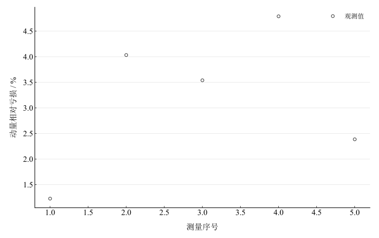
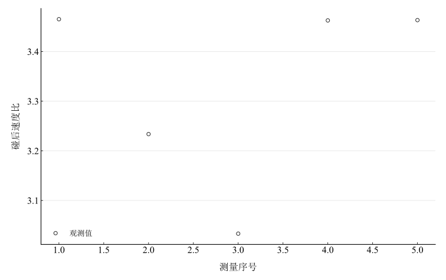

# 碰撞规律研究实验报告

淮南师范学院　电子工程学院　物理学专业　24物理1班  
姓名：缪雨轩　学号：2414050120　实验日期：2025年11月13日

## 一、实验名称

碰撞规律的研究。

## 二、实验目的

利用气垫导轨研究一维完全弹性、完全非弹性及一般非弹性碰撞；检验动量与机械能变化规律，了解恢复系数的测定，掌握光电计时和误差分析。

## 三、实验原理

### 1. 动量与恢复系数

在碰撞过程中，若外力冲量可忽略，则两滑块满足

$$
m_1v_{10}+m_2v_{20}=m_1v_1+m_2v_2.
$$

恢复系数定义为碰后分离速度与碰前接近速度之比：

$$
e=\left|\frac{v_2-v_1}{v_{10}-v_{20}}\right|.
$$

理想完全弹性碰撞 $e=1$，动能守恒；理想完全非弹性碰撞 $e=0$，碰后共同运动。动能耗散与动量变化是不同概念：内部形变能耗散本身不破坏孤立系统总动量守恒。

### 2. 本次重撞轻模型

轻块碰前静止，即 $v_{20}=0$。完全粘合时，

$$
v_{\mathrm{c}}=\frac{m_1}{m_1+m_2}v_{10},\qquad
\frac{E_{\mathrm{in}}-E_{\mathrm{out}}}{E_{\mathrm{in}}}=\frac{m_2}{m_1+m_2}.
$$

理想弹性情况下，

$$
v_1=\frac{m_1-m_2}{m_1+m_2}v_{10},\qquad
v_2=\frac{2m_1}{m_1+m_2}v_{10},\qquad
K_{\mathrm{th}}=\frac{v_2}{v_1}=\frac{2m_1}{m_1-m_2}.
$$

本次弹性组未记录 $v_{10}$，故仅能比较碰后速度比；该比较不能替代对动量、动能守恒和恢复系数的独立测量。

## 四、主要仪器设备

气垫导轨及气源、带挡光片的滑块、光电计时器、天平、弹射架或弹簧圈、尼龙搭扣或橡皮泥、游标卡尺。滑块质量含附件，$m_1=341.75\,\mathrm{g}$，$m_2=154.49\,\mathrm{g}$。

## 五、实验步骤

开启气源并调平导轨，使无碰撞滑块近似匀速运动，记录包含挡光片和碰撞附件的质量。将轻块静置于两光电门间，重块通过第一光电门后与之碰撞；粘合碰撞记录入射速度及共同速度，改变入射速度重复五次。弹性附件条件下记录碰后两滑块速度，其中滑块1有两次读数。

操作步骤还包括交换入射块进行轻撞重，但现有数据没有该组测量；本次分析限定为记录齐全的重撞轻情形。

## 六、原始数据记录

表 1　完全非弹性碰撞速度记录

{{tables.inelastic_observations}}

表 2　弹性附件条件下的碰后速度记录

{{tables.elastic_observations}}

速度统一按入射方向为正。弹性组滑块1两次读数沿用同组平均的处理方式；两次测量时刻及间隔未给出。

## 七、数据处理

### 1. 完全非弹性碰撞

系统总质量为 {{metrics.mass_total}} $\mathrm{kg}$。将速度转换为 $\mathrm{m\,s^{-1}}$，计算

$$
p_{\mathrm{in}}=m_1v_{10},\qquad
p_{\mathrm{out}}=(m_1+m_2)v_{\mathrm{c}},\qquad
\eta=\frac{p_{\mathrm{in}}-p_{\mathrm{out}}}{p_{\mathrm{in}}}\times100\%.
$$

$$
E_{\mathrm{in}}=\frac12m_1v_{10}^2,\qquad
E_{\mathrm{out}}=\frac12(m_1+m_2)v_{\mathrm{c}}^2.
$$

表 3　非弹性碰撞的动量与动能计算

{{tables.momentum}}

五组动量相对亏损平均为 {{metrics.mean_momentum_deviation}} $\%$，最大为 {{metrics.max_momentum_deviation}} $\%$；动能平均损失率为 {{metrics.mean_energy_loss}} $\%$。理想粘合模型的动能损失率为 {{metrics.theoretical_energy_loss}} $\%$。

图 1　五组非弹性碰撞的动量相对亏损

### 2. 弹性碰撞的速度比

取滑块1两次读数的平均，计算 $K_{\mathrm{exp}}=v_2/\bar v_1$，理论比值为 {{metrics.theoretical_velocity_ratio}}。相对差异保留正负号：

$$
\delta=\frac{K_{\mathrm{exp}}-K_{\mathrm{th}}}{K_{\mathrm{th}}}\times100\%.
$$

表 4　碰后速度比与条件恢复系数

{{tables.ratios}}

平均实测速度比为 {{metrics.mean_velocity_ratio}}，平均绝对相对差异为 {{metrics.mean_absolute_ratio_deviation}} $\%$。

图 2　各组碰后速度比

表4的恢复系数由额外假定动量守恒反推：

$$
v_{10}^{*}=\frac{m_1\bar v_1+m_2v_2}{m_1},\qquad
e^{*}=\frac{v_2-\bar v_1}{v_{10}^{*}}.
$$

它是模型条件量，不能再用来独立证明动量守恒。直接测定 $e$ 仍需补充碰前速度。

## 八、实验结果与讨论

完全非弹性组碰后动量均略低于碰前，平均差异 {{metrics.mean_momentum_deviation}} $\%$，动能有明显耗散。数据在量级上接近动量守恒预期，但缺少仪器不确定度和外力冲量评估，不能以任意5$\%$阈值宣布已在实验误差内验证。

弹性附件组的速度比低于理想 $e=1$ 的值，各组差异不等，不能统一概括为5$\%$以内。对一般恢复系数模型，

$$
v_1=\frac{m_1-em_2}{m_1+m_2}v_{10},\qquad
v_2=\frac{(1+e)m_1}{m_1+m_2}v_{10}.
$$

在本次质量比下，$e$ 减小会使速度比降低，与部分动能耗散的方向一致；测速偏置及两次速度读数不同时刻也可能影响比值，不能据此唯一确定恢复系数。

导轨残余摩擦、调平偏差和碰撞附近的外力作用可导致测速前后动量差异；弹簧及粘合附件的形变与内耗改变动能分配。改进应补测弹性组碰前速度、明确速度方向和时刻，检查光电门距离与测速片，并补充质量和计时器误差指标。
