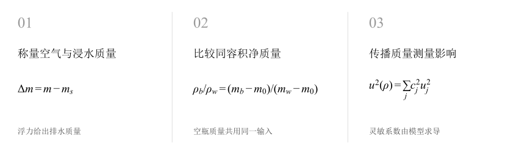
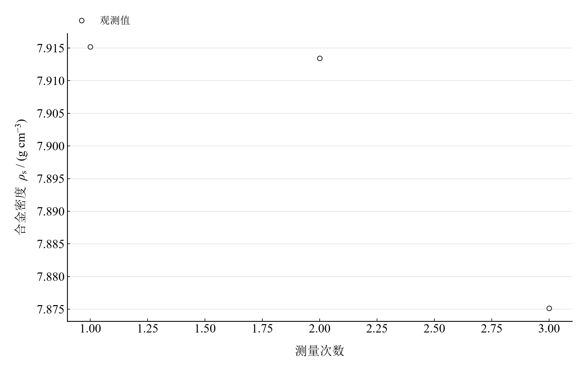
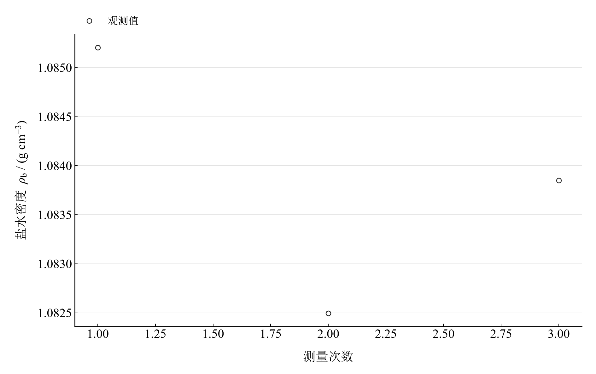
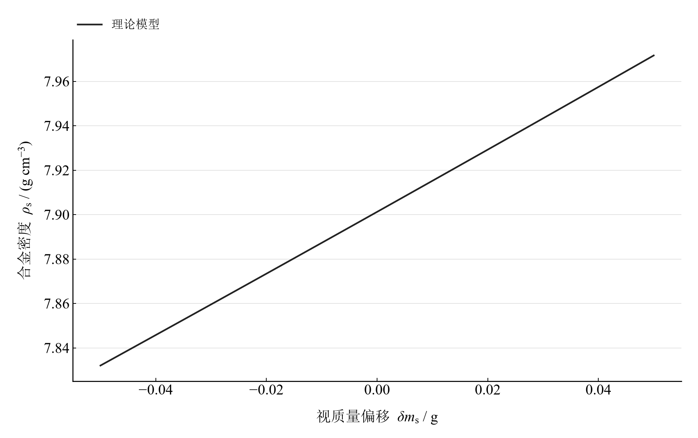

[普通物理实验 1](../README.md) · [项目首页](../../../README.md) · [使用指南](../../../docs/usage.md)

# 物质密度的测量

**用浮力测固体，用同一容积比较液体。**

空气与水中的称量差给出合金排水量，比重瓶中水与盐水的质量比给出液体密度。共同的称量方法连接两种模型，也让质量误差的传播更直观。

[读实验报告](report/report.md) · [HTML 阅读与探索](notebooks/analysis.html) · [Python 笔记本](notebooks/analysis.ipynb) · [Wolfram 笔记本](../../../notebook/paclets/DensityLab/Notebooks/DensityLab.nb)



图 1　物质密度的测量：测量与计算主线

## 选择你的入口

|用途|入口|打开方式|
|---|---|---|
|阅读原理、记录、计算与结论|[Markdown 报告](report/report.md) · [排版阅读版](report/report.html)|GitHub、Markdown 阅读器或浏览器|
|浏览计算图表、操作交互控件|[HTML 阅读版](notebooks/analysis.html)|下载后用浏览器打开|
|逐步执行和修改 Python 计算|[Jupyter Notebook](notebooks/analysis.ipynb)|JupyterLab 或 VS Code|
|原生数学排版与 Wolfram 计算|[Wolfram Notebook](../../../notebook/paclets/DensityLab/Notebooks/DensityLab.nb) · [Paclet 安装包](../../../notebook/paclets/DensityLab/dist/DensityLab-0.1.0.paclet)|Wolfram 前端|
|对照原始报告|[源报告 PDF](../../../pdf/course-01/物质密度的测量/物质密度测量实验报告.pdf)|GitHub 或 PDF 阅读器|

## 从记录到物理量

合金空气中与浸水称量各 3 次，空瓶、瓶加水、瓶加盐水各 3 次，共 15 个质量读数；温度 21.8 °C，水密度取 0.99779 g/cm³。

核心计算关系为：

$$
\rho_{\mathrm s}=\frac{m\rho_{\mathrm w}}{m-m_{\mathrm s}},\qquad \rho_{\mathrm b}=\rho_{\mathrm w}\frac{m_{\mathrm b}-m_0}{m_{\mathrm w}-m_0}.
$$

固体模型把空气质量与水中视质量之差换算为体积；液体模型在相同装液容积下比较净质量。空瓶质量同时进入两个质量差。

表 1　关键计算结果

|物理量|计算值|单位|
|---|---:|---|
|合金密度|7.9012275|g/cm³|
|盐水密度|1.0838494|g/cm³|
|比重瓶容积|16.035438|cm³|

合金密度约 7.90123 g/cm³，盐水约 1.083849 g/cm³。报告同时给出重复性分量，以及采用 0.01 g 假设误差限的条件预算；水密度、温度和称量系统修正可进一步纳入预算。

## 沿着图像理解结果



图 2　三次实际称量代入浮力模型得到的合金密度

<table>
  <tr>
    <td width="50%" align="center" valign="top"><a href="assets/readme-liquid_repeat.png"></a></td>
    <td width="50%" align="center" valign="top"><a href="assets/readme-apparent_bias.png"></a></td>
  </tr>
  <tr>
    <td align="center" valign="top">图 3　三次实际称量代入同容积模型得到的盐水密度</td>
    <td align="center" valign="top">图 4　固定其余均值后，假设水中视质量偏移对合金密度的模型响应</td>
  </tr>
</table>

完整记录、计算过程与结果讨论见[实验报告](report/report.md)。图中拟合与模型的物理含义可在 Notebook 中逐步计算。

## 在参数变化中继续探索

|操作|参数范围与默认值|观察什么|
|---|---|---|
|视质量偏移滑块|−0.05 至 0.05 g，默认 0 g|观察水中视质量变化时密度的响应，联系气泡和附加浮力的偏差方向。|

在 [HTML](notebooks/analysis.html) 中操作已有控件；在 [Jupyter](notebooks/analysis.ipynb) 或 [Wolfram](../../../notebook/paclets/DensityLab/Notebooks/DensityLab.nb) 中运行全部单元，可继续修改输入与计算。

## 在本机打开

环境安装见[使用指南](../../../docs/usage.md)。在仓库根目录启动：

```powershell
.\.venv\Scripts\python.exe -m jupyterlab experiments/course-01/density/notebooks/analysis.ipynb
```

Wolfram 安装独立包后，通过包入口打开 Notebook。将仓库路径改为本机路径：

```wolfram
PacletInstall["D:/general-physics-lab/notebook/paclets/DensityLab/dist/DensityLab-0.1.0.paclet"];
Needs["DensityLab`"];
DensityLab`OpenNotebook[]
```

## 数据与计算实现

|内容|文件|
|---|---|
|比重瓶称量记录|[liquid.csv](data/liquid.csv)|
|合金空气与浸水称量|[solid.csv](data/solid.csv)|
|单位、参数与模型条件|[experiment.json](experiment.json)|
|Python 实现|[density.py](../../../src/physicslab/experiments/density.py)|
|Wolfram 实现|[DensityLab.wl](../../../notebook/paclets/DensityLab/Kernel/DensityLab.wl)|

[数据来源](data/provenance.json) · [返回课程目录](../README.md)
