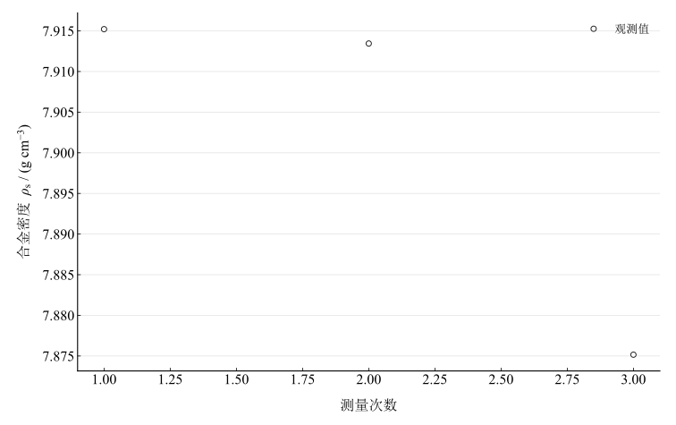
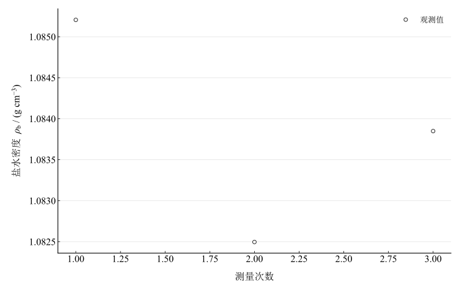
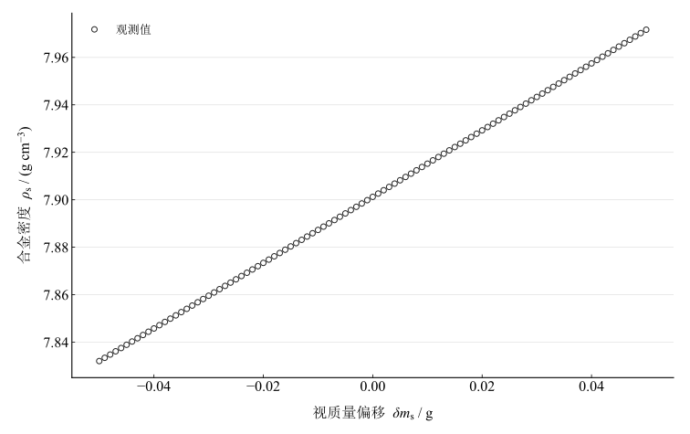

# 物质密度测量实验报告

淮南师范学院　电子工程学院　物理学专业　24物理1班  
姓名：缪雨轩　学号：2414050120　实验日期：2025年11月1日

## 一、实验名称

物质密度的测量。

## 二、实验目的

1. 掌握物理天平的使用规则，练习用流体静力称衡法测定固体密度。
2. 掌握用比重瓶法测定液体密度。
3. 学习正确记录数据，掌握不确定度估算和有效数字运算法则。

## 三、实验原理

密度是单位体积的质量，定义为 $\rho=m/V$。本实验用同温度下纯水的已知密度确定合金体积和比重瓶容积。

### 1. 流体静力称衡法测固体密度

合金在空气中的质量为 $m$，完全浸没于纯水中的视质量为 $m_{\mathrm{s}}$。按阿基米德原理，浮力对应的排水质量为 $m-m_{\mathrm{s}}$，因此

$$
V_{\mathrm{s}}=\frac{m-m_{\mathrm{s}}}{\rho_{\mathrm{w}}},\qquad
\rho_{\mathrm{s}}=\frac{m}{m-m_{\mathrm{s}}}\rho_{\mathrm{w}}.
$$

### 2. 比重瓶法测盐水密度

空瓶、装满纯水及装满盐水的总质量分别为 $m_0$、$m_{\mathrm{w}}$ 和 $m_{\mathrm{b}}$。同温度、相同装液状态下瓶内容积相同，故

$$
V_{\mathrm{p}}=\frac{m_{\mathrm{w}}-m_0}{\rho_{\mathrm{w}}},\qquad
\rho_{\mathrm{b}}=\frac{m_{\mathrm{b}}-m_0}{m_{\mathrm{w}}-m_0}\rho_{\mathrm{w}}.
$$

以上模型忽略空气浮力和吊丝排水修正，且要求液体温度稳定、物体无附着气泡。

## 四、主要仪器设备

使用双盘机械物理天平及流体静力称衡架，另备烧杯、比重瓶、温度计、合金块、待测盐水、纯水、吸水纸和细线。称量记录至 $0.01\,\mathrm{g}$；现有材料未提供经核实的天平误差限，不能仅凭记录位数确定仪器准确度。

环境温度为 $21.8\,^{\circ}\mathrm{C}$，采用纯水密度 $\rho_{\mathrm{w}}=0.99779\,\mathrm{g\,cm^{-3}}$。

## 五、实验步骤

### 1. 物理天平的调整

调节底座水平螺丝使气泡居中。将游码移至零刻度，开启止动旋钮检查指针摆动；关闭旋钮后调节横梁平衡螺母，使空载指针左右摆幅一致。加减砝码及调整装置时均先止动。

### 2. 流体静力称量

将合金块放在左盘中央，右盘由大到小加减砝码，最后调节游码，平衡后记录空气中质量。重复三次。将称衡架跨放在左盘上方并确保不接触秤盘，架上放盛有纯水的烧杯。用细线悬挂合金块使其完全浸没，不接触杯壁、杯底，排除表面气泡。再次加减砝码和移动游码，记录水中视质量，重复三次。

### 3. 比重瓶称量

称量洁净干燥的空瓶三次。装满纯水、塞好瓶塞并擦干瓶外液体，称量三次。倒去纯水，用待测盐水润洗瓶内，装满盐水后按同样方法称量三次。装液和称量过程中保持温度与瓶塞状态一致。

## 六、原始数据记录

表 1　固体（合金块）密度测量记录

| 测量次数 | $m / \mathrm{g}$ | $m_{\mathrm{s}} / \mathrm{g}$ |
| --- | --- | --- |
| 1 | 44.82 | 39.17 |
| 2 | 44.81 | 39.16 |
| 3 | 44.83 | 39.15 |
| 平均值 | 44.82 | 39.16 |

表 2　液体（盐水）密度测量记录

| 测量次数 | $m_0 / \mathrm{g}$ | $m_{\mathrm{w}} / \mathrm{g}$ | $m_{\mathrm{b}} / \mathrm{g}$ |
| --- | --- | --- | --- |
| 1 | 31.64 | 47.62 | 49.02 |
| 2 | 31.62 | 47.64 | 49 |
| 3 | 31.63 | 47.63 | 49.01 |
| 平均值 | 31.63 | 47.63 | 49.01 |

表中的平均值为三次独立记录的算术平均值；同序号只表示重复测量次序。以下估值使用各质量的平均值，不将单次密度平均值替代主结果。

## 七、数据处理

### 1. 合金密度的最佳估值

三次称量给出 $\bar m=44.82\,\mathrm{g}$、$\bar m_{\mathrm{s}}=39.16\,\mathrm{g}$，排水质量为 $5.66\,\mathrm{g}$。由此

$$
\rho_{\mathrm{s}}=\frac{44.82}{44.82-39.16}\times0.99779
=7.9012275265\,\mathrm{g\,cm^{-3}}.
$$

合金体积为 5.672536305 $\mathrm{cm^3}$。

### 2. 盐水密度的最佳估值

质量均值为 $\bar m_0=31.63\,\mathrm{g}$、$\bar m_{\mathrm{w}}=47.63\,\mathrm{g}$、$\bar m_{\mathrm{b}}=49.01\,\mathrm{g}$。同容积纯水和盐水质量分别为

$$
m_{\mathrm{water}}=47.63-31.63=16.00\,\mathrm{g},\qquad
m_{\mathrm{brine}}=49.01-31.63=17.38\,\mathrm{g}.
$$

$$
\rho_{\mathrm{b}}=\frac{17.38}{16.00}\times0.99779
=1.0838493875\,\mathrm{g\,cm^{-3}}.
$$

比重瓶在该装液条件下的容积为 16.03543832 $\mathrm{cm^3}$。

### 3. 质量的标准不确定度

对每组 $n=3$ 次读数，均值的 A 类标准不确定度为

$$
u_A(\bar x)=\sqrt{\frac{\sum_{i=1}^{n}(x_i-\bar x)^2}{n(n-1)}}.
$$

五组质量均有 $u_A=0.0057735027\,\mathrm{g}$。为评估仪器指标的影响，暂按记录位数推断的误差限 $\Delta=0.01\,\mathrm{g}$、均匀分布计算条件 B 类分量：

$$
u_B=\frac{\Delta}{\sqrt3},\qquad
u_c(\bar x)=\sqrt{u_A^2+u_B^2}=0.0081649658\,\mathrm{g}.
$$

表 3　质量标准不确定度预算（B 类及合成为条件结果）

| 质量 | $u_A / \mathrm{g}$ | $u_B / \mathrm{g}$ | $u_c / \mathrm{g}$ |
| --- | --- | --- | --- |
| $m$ | 0.0057735027 | 0.0057735027 | 0.0081649658 |
| $m_{\mathrm{s}}$ | 0.0057735027 | 0.0057735027 | 0.0081649658 |
| $m_0$ | 0.0057735027 | 0.0057735027 | 0.0081649658 |
| $m_{\mathrm{w}}$ | 0.0057735027 | 0.0057735027 | 0.0081649658 |
| $m_{\mathrm{b}}$ | 0.0057735027 | 0.0057735027 | 0.0081649658 |

### 4. 密度的不确定度传播

暂忽略水密度的不确定度，并将分别称量所得质量均值的协方差取零。合金密度的灵敏系数为

$$
\frac{\partial\rho_{\mathrm{s}}}{\partial m}
=-\rho_{\mathrm{w}}\frac{m_{\mathrm{s}}}{(m-m_{\mathrm{s}})^2},\qquad
\frac{\partial\rho_{\mathrm{s}}}{\partial m_{\mathrm{s}}}
=\rho_{\mathrm{w}}\frac{m}{(m-m_{\mathrm{s}})^2}.
$$

盐水密度直接对三个原始质量传播，保持空瓶质量在分子和分母中的同一身份：

$$
\frac{\partial\rho_{\mathrm{b}}}{\partial m_0}
=\rho_{\mathrm{w}}\frac{m_{\mathrm{b}}-m_{\mathrm{w}}}{(m_{\mathrm{w}}-m_0)^2},
$$

$$
\frac{\partial\rho_{\mathrm{b}}}{\partial m_{\mathrm{w}}}
=-\rho_{\mathrm{w}}\frac{m_{\mathrm{b}}-m_0}{(m_{\mathrm{w}}-m_0)^2},\qquad
\frac{\partial\rho_{\mathrm{b}}}{\partial m_{\mathrm{b}}}
=\frac{\rho_{\mathrm{w}}}{m_{\mathrm{w}}-m_0}.
$$

对于上述质量输入 $x_j$，按

$$
u^2(\rho)=\sum_j\left(\frac{\partial\rho}{\partial x_j}\right)^2u^2(x_j)
$$

分别代入 A 类分量和条件合成分量，得到下表。盐水质量差共用同一空瓶质量，不能把两个质量差简单当作独立输入；三组称量的重复性也纳入预算。

表 4　密度估值及标准不确定度

| 对象 | $\rho / (\mathrm{g\,cm^{-3}})$ | $u_A(\rho) / (\mathrm{g\,cm^{-3}})$ | $u_c(\rho) / (\mathrm{g\,cm^{-3}})$ |
| --- | --- | --- | --- |
| 合金块 | 7.9012275 | 0.010702634 | 0.01513581 |
| 盐水 | 1.0838494 | 0.00053250105 | 0.00075307021 |

条件结果按 $k=1$ 标准不确定度表示为

$$
\rho_{\mathrm{s}}=(7.901\pm0.015)\,\mathrm{g\,cm^{-3}},\qquad
\rho_{\mathrm{b}}=(1.08385\pm0.00075)\,\mathrm{g\,cm^{-3}}.
$$

合金和盐水的条件相对标准不确定度分别为 0.1915627602 $\%$ 和 0.06948107524 $\%$。这些数值依赖暂定仪器误差限，尚不包括未量化的系统修正，不能据此给出确定的覆盖概率。

图 1　三次称量代入模型所得合金密度

图 2　三次称量代入模型所得盐水密度

## 八、实验结果与讨论

### 1. 实验结论

在 $21.8\,^{\circ}\mathrm{C}$、水密度取 $0.99779\,\mathrm{g\,cm^{-3}}$ 的条件下，合金块密度为 $7.90123\,\mathrm{g\,cm^{-3}}$，盐水密度为 $1.083849\,\mathrm{g\,cm^{-3}}$。仅由重复性得到的标准不确定度分别为 0.01070263356 和 0.0005325010511 $\mathrm{g\,cm^{-3}}$；计入暂定 $0.01\,\mathrm{g}$ 仪器误差限后的条件结果见数据处理。合金密度处于常见铁基材料的量级，但仅凭密度不能鉴定成分；盐水密度高于纯水，与溶有盐的性质一致。

### 2. 误差分析

物理天平的调平、零点、游码及砝码操作会影响读数。记录到 $0.01\,\mathrm{g}$ 表示记录分辨程度，完整预算仍需仪器指标。合金表面气泡会增大排水量、减小视质量，使算得密度偏低；细线浸水部分同样可能产生额外浮力。应保持物体浸没、避免触壁，并控制细线浸入长度。

长时间手持比重瓶可能改变温度。液体膨胀溢出、瓶外未擦干和装液未达同一容积，都会影响总质量；纯水和盐水两次装液应保持相同温度和瓶塞状态。水密度的温度依赖与实际温度测量不确定度尚未计入。

### 3. 视质量偏移的模型敏感性

用 $\delta m_{\mathrm{s}}$ 表示对视质量施加的假设偏移，其余输入固定在均值，则

$$
\rho_{\mathrm{s}}(\delta m_{\mathrm{s}})
=\frac{\bar m\rho_{\mathrm{w}}}{\bar m-\bar m_{\mathrm{s}}-\delta m_{\mathrm{s}}}.
$$

以记录步长 $0.01\,\mathrm{g}$ 为参照，在 $-0.05$ 至 $0.05\,\mathrm{g}$ 范围扫描。该范围用于比较模型响应，未表示实际偏差已经确定。正偏移使排水质量减小、密度增大；负偏移可说明气泡等造成视质量减小时的偏差方向。

图 3　假设视质量偏移对合金密度估值的影响

