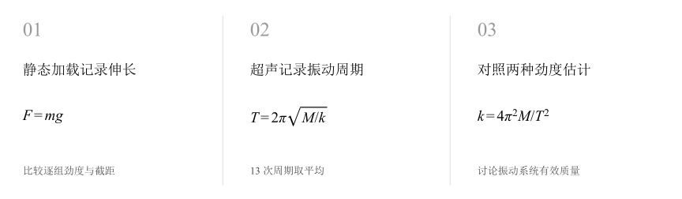
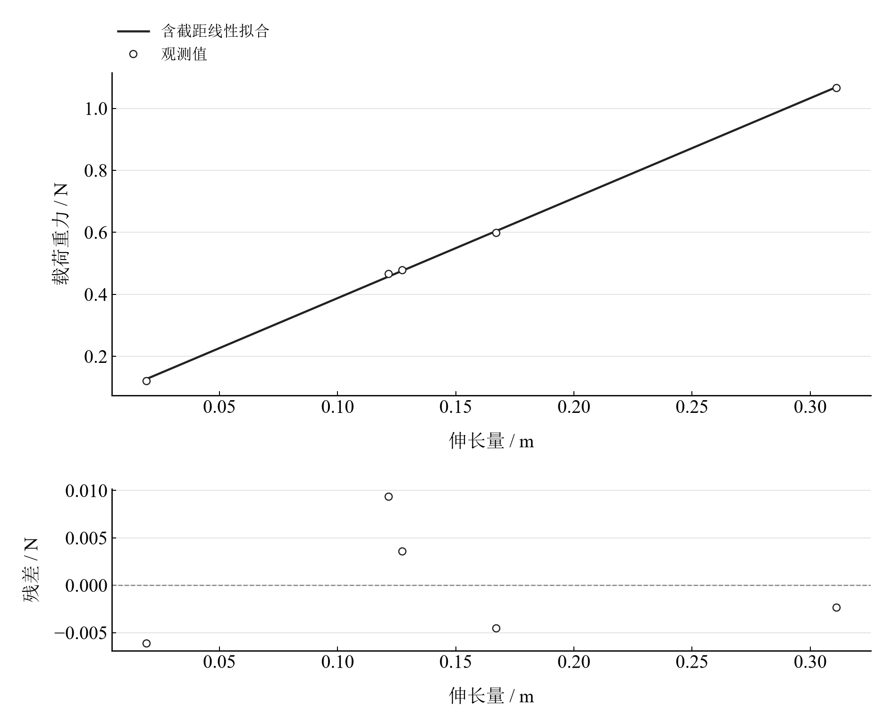
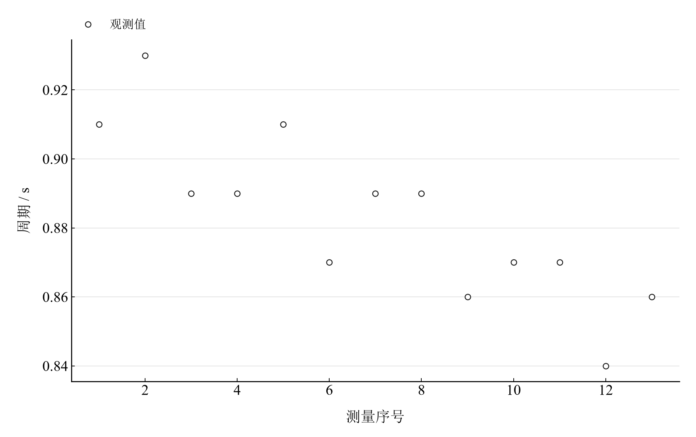

[普通物理实验 1](../README.md) · [项目首页](../../../README.md) · [使用指南](../../../docs/usage.md)

# 多普勒效应的应用

**把非接触测速用于弹簧振子，对照动态与静态劲度。**

多普勒系统记录弹簧振子的周期，静态加载记录伸长量。两种处理放在同一页，观察周期、初始位置和有效振动质量怎样影响劲度系数。

[读实验报告](report/report.md) · [HTML 阅读与探索](notebooks/analysis.html) · [Python 笔记本](notebooks/analysis.ipynb) · [Wolfram 笔记本](../../../notebook/paclets/DopplerApplicationLab/Notebooks/DopplerApplicationLab.nb)



图 1　多普勒效应的应用：测量与计算主线

## 选择你的入口

|用途|入口|打开方式|
|---|---|---|
|阅读原理、记录、计算与结论|[Markdown 报告](report/report.md) · [排版阅读版](report/report.html)|GitHub、Markdown 阅读器或浏览器|
|浏览计算图表、操作交互控件|[HTML 阅读版](notebooks/analysis.html)|下载后用浏览器打开|
|逐步执行和修改 Python 计算|[Jupyter Notebook](notebooks/analysis.ipynb)|JupyterLab 或 VS Code|
|原生数学排版与 Wolfram 计算|[Wolfram Notebook](../../../notebook/paclets/DopplerApplicationLab/Notebooks/DopplerApplicationLab.nb) · [Paclet 安装包](../../../notebook/paclets/DopplerApplicationLab/dist/DopplerApplicationLab-0.1.0.paclet)|Wolfram 前端|
|对照原始报告|[源报告 PDF](../../../pdf/course-01/多普勒效应的应用/多普勒效应的应用-实验报告.pdf)|GitHub 或 PDF 阅读器|

## 从记录到物理量

5 组静态加载记录、13 次周期；平衡基线 24.90 cm，动态系统质量 103.20 g。静态主平均沿用记录中第 2–5 组的选择。

核心计算关系为：

$$
k_{\mathrm{stat}}=\frac{mg}{\Delta x},\qquad k_{\mathrm{dyn}}=\frac{4\pi^2M}{\bar T^2}.
$$

静态比值检查力与伸长，动态周期检查惯性与回复力；带截距回归还能揭示静态基线的影响。

表 1　关键计算结果

|物理量|计算值|单位|
|---|---:|---|
|静态逐组劲度系数平均|3.6563412|N/m|
|平均周期|0.88307692|s|
|动态劲度系数|5.2244715|N/m|

动、静态劲度相对差异约 42.89%。正的弹簧有效质量使固定周期下所需劲度增大；核对加载基线、振幅和两种工况，有助于理解差异。模型扫描表示假设弹簧质量的响应。

## 沿着图像理解结果



图 2　五组静态力—伸长观测与全组线性拟合诊断



图 3　13 次实际周期记录，展示测量次序中的变化

完整记录、计算过程与结果讨论见[实验报告](report/report.md)。图中拟合与模型的物理含义可在 Notebook 中逐步计算。

## 在参数变化中继续探索

|操作|参数范围与默认值|观察什么|
|---|---|---|
|假设弹簧质量滑块|0–50 g，默认 0 g|固定观测平均周期，观察加入弹簧三分之一质量后反算劲度的变化。|

在 [HTML](notebooks/analysis.html) 中操作已有控件；在 [Jupyter](notebooks/analysis.ipynb) 或 [Wolfram](../../../notebook/paclets/DopplerApplicationLab/Notebooks/DopplerApplicationLab.nb) 中运行全部单元，可继续修改输入与计算。

## 在本机打开

环境安装见[使用指南](../../../docs/usage.md)。在仓库根目录启动：

```powershell
.\.venv\Scripts\python.exe -m jupyterlab experiments/course-01/doppler-application/notebooks/analysis.ipynb
```

Wolfram 安装独立包后，通过包入口打开 Notebook。将仓库路径改为本机路径：

```wolfram
PacletInstall["D:/general-physics-lab/notebook/paclets/DopplerApplicationLab/dist/DopplerApplicationLab-0.1.0.paclet"];
Needs["DopplerApplicationLab`"];
DopplerApplicationLab`OpenNotebook[]
```

## 数据与计算实现

|内容|文件|
|---|---|
|重复周期记录|[periods.csv](data/periods.csv)|
|静态加载与位置|[static.csv](data/static.csv)|
|单位、参数与模型条件|[experiment.json](experiment.json)|
|Python 实现|[doppler_application.py](../../../src/physicslab/experiments/doppler_application.py)|
|Wolfram 实现|[DopplerApplicationLab.wl](../../../notebook/paclets/DopplerApplicationLab/Kernel/DopplerApplicationLab.wl)|

[数据来源](data/provenance.json) · [返回课程目录](../README.md)
