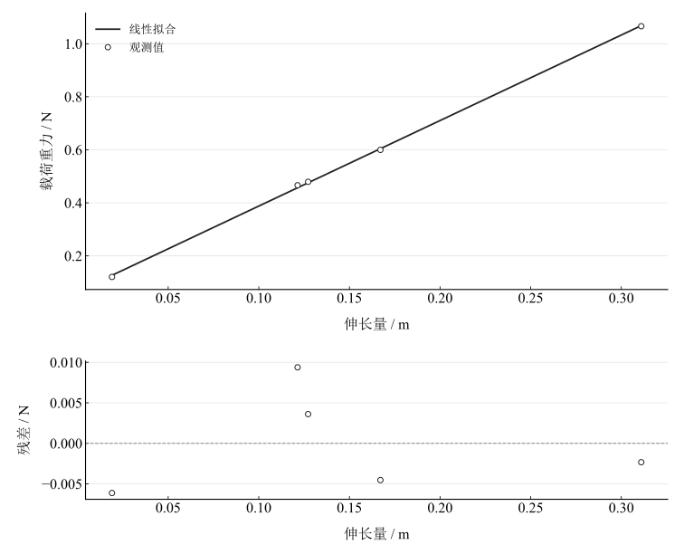
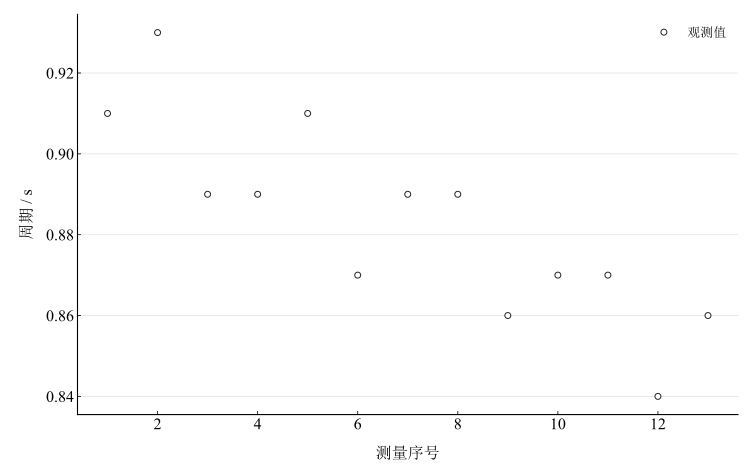

# 多普勒效应应用实验报告

淮南师范学院　电子工程学院　物理学专业　24物理1班  
姓名：缪雨轩　学号：2414050120　实验日期：2025年11月18日

## 一、实验名称

多普勒效应的应用。

## 二、实验目的

利用多普勒测速系统测量弹簧振子的简谐振动周期；计算动态劲度系数，与静态法比较并分析差异；了解多普勒效应在非接触运动测量中的应用。

## 三、实验原理

### 1. 多普勒测速

超声接收器随物体运动，接收频率发生变化，仪器通过频移计算速度。对于固定声源、沿声源方向移动的接收器，$f=f_0(1+v/u)$。记录振动速度的周期变化可确定振动周期。本次存档保留周期统计值，未保存完整频率或速度时序。

### 2. 动态法

在弹性范围、轻弹簧且阻尼很小的近似下，质量 $M$ 的振子满足

$$
M\ddot x+kx=0,\qquad T=2\pi\sqrt{\frac Mk},\qquad k_{\mathrm{dyn}}=\frac{4\pi^2M}{T^2}.
$$

### 3. 静态法

增加质量 $m$ 引起平衡位置伸长 $\Delta x=x-x_0$。在胡克定律适用且基线无偏的条件下，

$$
F=mg=k\Delta x,\qquad k_{\mathrm{stat}}=\frac{mg}{\Delta x}.
$$

初始位置和负载定义会影响逐组比值；同时拟合 $F=k\Delta x+b$ 可检查是否存在明显非零截距。

## 四、主要仪器设备

多普勒效应综合实验仪、超声发射与接收器、弹簧、砝码组、天平和支架等。实验采用 $g=9.80\,\mathrm{m\,s^{-2}}$，初始位置 $x_0=24.90\,\mathrm{cm}$；动态振动系统质量为 $M=103.20\,\mathrm{g}=0.10320\,\mathrm{kg}$。

## 五、实验步骤

### 1. 安装与静态测量

将弹簧挂于支架电磁铁挂钩孔，接收器组件挂于弹簧下端，调整光电门及发射源使振子垂直运动时保持对准，避免碰撞和摩擦。未加额外砝码时记录平衡位置 $x_0$。逐次加载不同砝码组合，每次静止后记录位置 $x_i$，计算伸长量和载荷重力。

### 2. 动态测量

称量含接收器组件、连接杆与固定配重的振动系统总质量。开启实验仪并选择变速运动或简谐振动模式，设置采样点数（约150）及采样步距。将组件从平衡位置垂直拉开，按装置要求控制在弹性范围内；操作说明给出约10–20 $\mathrm{cm}$，但本次实际振幅未单独记录。释放后避免左右摆动，启动自动测速，读取仪器统计的周期。重复起振并记录13次周期。

## 六、原始数据记录

表 1　静态法加载、位置及计算记录

| 序号 | 组合 | $m / \mathrm{g}$ | $x / \mathrm{cm}$ | $\Delta x / \mathrm{m}$ | $F / \mathrm{N}$ | $k / (\mathrm{N\,m^{-1}})$ | 源报告平均值选用 |
| --- | --- | --- | --- | --- | --- | --- | --- |
| 1 | $m_1$ | 12.3 | 26.8 | 0.019 | 0.12054 | 6.3442105 | 剔除 |
| 2 | $m_1+m_2$ | 61.2 | 41.61 | 0.1671 | 0.59976 | 3.589228 | 保留 |
| 3 | $m_1+m_2+m_3$ | 108.78 | 56 | 0.311 | 1.066044 | 3.4277942 | 保留 |
| 4 | $m_2$ | 48.9 | 37.62 | 0.1272 | 0.47922 | 3.7674528 | 保留 |
| 5 | $m_3$ | 47.58 | 37.04 | 0.1214 | 0.466284 | 3.8408896 | 保留 |

表 2　多普勒系统记录的振动周期

| 序号 | 1 | 2 | 3 | 4 | 5 | 6 | 7 |
| --- | --- | --- | --- | --- | --- | --- | --- |
| $T / \mathrm{s}$ | 0.91 | 0.93 | 0.89 | 0.89 | 0.91 | 0.87 | 0.89 |
| 序号 | 8 | 9 | 10 | 11 | 12 | 13 | — |
| $T / \mathrm{s}$ | 0.89 | 0.86 | 0.87 | 0.87 | 0.84 | 0.86 | — |

第1静态组在记录中明确标为剔除。后续主平均值保留该选择，原始读数始终保存，另给出包含该组的结果用于判断选点影响。

## 七、数据处理

### 1. 静态劲度系数

将质量换算为千克、伸长量换算为米，逐组计算 $k_i=m_i g/\Delta x_i$。源保留第2–5组，其未修约比值平均为 3.656341168 $\mathrm{N\,m^{-1}}$；若包含全部五组，则为 4.193915039 $\mathrm{N\,m^{-1}}$。

图 1　五组静态载荷与伸长量及全组线性拟合诊断

仅对源保留四组拟合 $F=k\Delta x+b$，斜率为 3.182679093 $\mathrm{N\,m^{-1}}$，截距为 0.07461377584 $\mathrm{N}$。图1全组拟合用于显示整体偏离，不替代上述主平均值或四组拟合。非零截距提示初始位置、预载或线性模型应进一步核对；尚不能将第1组偏离唯一归因于材料非线性。

### 2. 周期与动态劲度系数

13个周期之和为 11.48 $\mathrm{s}$，未修约平均周期为 0.8830769231 $\mathrm{s}$：

$$
\bar T=\frac1{13}\sum_{i=1}^{13}T_i,\qquad
k_{\mathrm{dyn}}=\frac{4\pi^2\times0.10320}{\bar T^2}.
$$

动态劲度系数为 5.224471477 $\mathrm{N\,m^{-1}}$。周期均值的 A 类标准不确定度按样本方差除以13计算；仅考虑周期重复性时，

$$
u(k_{\mathrm{dyn}})=\frac{2k_{\mathrm{dyn}}}{\bar T}u_A(\bar T).
$$

该量未包含总质量误差和计时系统误差。周期随测量序号有变化，独立同分布重复测量假设应结合起振过程复核。

图 2　13次周期记录随测量序号的变化

### 3. 动静态比较

采用源选择的静态平均值，相对差异为

$$
\delta=\frac{\vert k_{\mathrm{dyn}}-\bar k_{\mathrm{stat}}\vert }{\bar k_{\mathrm{stat}}}\times100\%.
$$

计算得 42.8879647 $\%$。静态平均值选取方式影响比较，但现有条件下两种方法仍存在明显差异。

## 八、实验结果与讨论

动态测量给出 5.224471477 $\mathrm{N\,m^{-1}}$，源保留四组静态平均给出 3.656341168 $\mathrm{N\,m^{-1}}$。系统能记录振动周期，体现多普勒测速的非接触应用；动、静态一致性尚未达到可由现有不确定度说明的程度。

对于均匀弹簧的小振动模型，弹簧自身质量 $m_{\mathrm{s}}$ 引入有效质量 $m_{\mathrm{s}}/3$：

$$
T=2\pi\sqrt{\frac{M+m_{\mathrm{s}}/3}{k}},\qquad
k=\frac{4\pi^2(M+m_{\mathrm{s}}/3)}{T^2}.
$$

在固定观测周期下，加入正的弹簧质量使反算劲度系数增大。因此，忽略弹簧质量会低估而非高估该模型中的 $k$，不能用它解释本次动态值高于静态值。弹簧质量未测得，模型扫描只展示修正方向，不给出实际校正数值。

其他可能因素包括静态基线、负载定义、振幅超出线性区、起振后衰减和两种测量工况不一致。后续需核对相同弹簧及其有效振动质量，补充静态卸载复测、实际振幅和仪器误差指标。没有完整速度时序时，不把理想正弦模型当作实测曲线。
