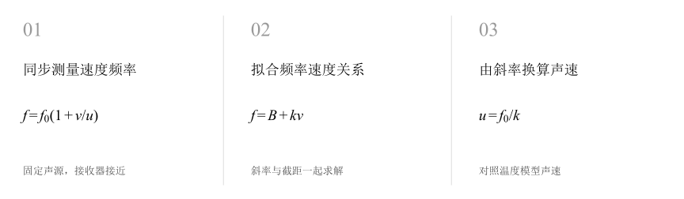
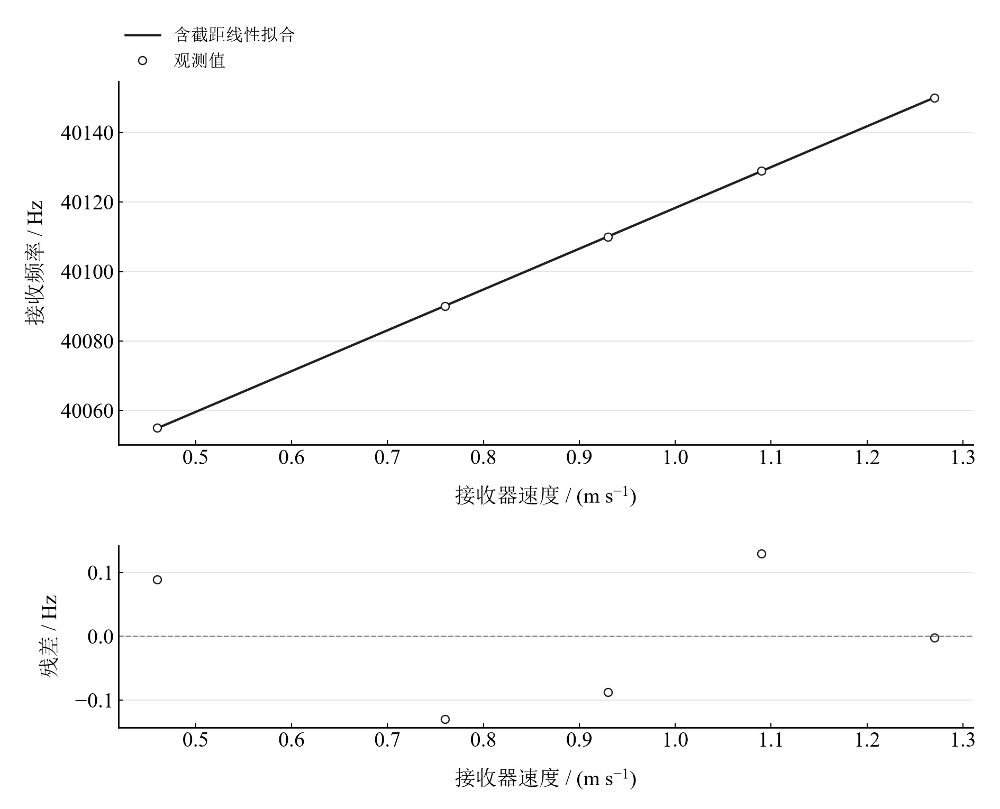

[普通物理实验 1](../README.md) · [项目首页](../../../README.md) · [使用指南](../../../docs/usage.md)

# 多普勒效应的验证

**让运动改变频率，从频率的斜率读出声速。**

固定超声声源，让接收器沿导轨接近声源。把同步记录的速度与频率画在一起，用线性回归连接多普勒频移和空气声速。

[读实验报告](report/report.md) · [HTML 阅读与探索](notebooks/analysis.html) · [Python 笔记本](notebooks/analysis.ipynb) · [Wolfram 笔记本](../../../notebook/paclets/DopplerVerificationLab/Notebooks/DopplerVerificationLab.nb)



图 1　多普勒效应的验证：测量与计算主线

## 选择你的入口

|用途|入口|打开方式|
|---|---|---|
|阅读原理、记录、计算与结论|[Markdown 报告](report/report.md) · [排版阅读版](report/report.html)|GitHub、Markdown 阅读器或浏览器|
|浏览计算图表、操作交互控件|[HTML 阅读版](notebooks/analysis.html)|下载后用浏览器打开|
|逐步执行和修改 Python 计算|[Jupyter Notebook](notebooks/analysis.ipynb)|JupyterLab 或 VS Code|
|原生数学排版与 Wolfram 计算|[Wolfram Notebook](../../../notebook/paclets/DopplerVerificationLab/Notebooks/DopplerVerificationLab.nb) · [Paclet 安装包](../../../notebook/paclets/DopplerVerificationLab/dist/DopplerVerificationLab-0.1.0.paclet)|Wolfram 前端|
|对照原始报告|[源报告 PDF](../../../pdf/course-01/多普勒效应的验证/多普勒效应验证实验报告.pdf)|GitHub 或 PDF 阅读器|

## 从记录到物理量

5 组接收器速度与频率，速度范围 0.46–1.27 m/s；声源频率 40002 Hz，环境温度 23.1 °C。

核心计算关系为：

$$
f=f_0\left(1+\frac{v}{u}\right)=B+kv,\qquad u_{\mathrm{exp}}=\frac{f_0}{k}.
$$

正速度表示接近声源。固定声源模型预期频率随接收器速度线性增大，斜率连接发射频率与传播速度。

表 1　关键计算结果

|物理量|计算值|单位|
|---|---:|---|
|实验声速|340.74148|m/s|
|温度模型声速|345.18078|m/s|
|声速相对差异|1.2860796|%|

实验声速与温度模型相差约 1.29%。回归标准误描述五点的线性离散；测速、频率基准、温度和湿度是进一步比较时的测量条件。

## 沿着图像理解结果



图 2　五组速度—频率观测及带截距线性拟合；残差用于检查线性关系

完整记录、计算过程与结果讨论见[实验报告](report/report.md)。图中拟合与模型的物理含义可在 Notebook 中逐步计算。

## 在参数变化中继续探索

|操作|参数范围与默认值|观察什么|
|---|---|---|
|接收器速度滑块|−1.5 至 1.5 m/s，默认 0|观察接近与远离时的频移，以及静止时恢复发射频率。|

在 [HTML](notebooks/analysis.html) 中操作已有控件；在 [Jupyter](notebooks/analysis.ipynb) 或 [Wolfram](../../../notebook/paclets/DopplerVerificationLab/Notebooks/DopplerVerificationLab.nb) 中运行全部单元，可继续修改输入与计算。

## 在本机打开

环境安装见[使用指南](../../../docs/usage.md)。在仓库根目录启动：

```powershell
.\.venv\Scripts\python.exe -m jupyterlab experiments/course-01/doppler-verification/notebooks/analysis.ipynb
```

Wolfram 安装独立包后，通过包入口打开 Notebook。将仓库路径改为本机路径：

```wolfram
PacletInstall["D:/general-physics-lab/notebook/paclets/DopplerVerificationLab/dist/DopplerVerificationLab-0.1.0.paclet"];
Needs["DopplerVerificationLab`"];
DopplerVerificationLab`OpenNotebook[]
```

## 数据与计算实现

|内容|文件|
|---|---|
|速度与频率记录|[observations.csv](data/observations.csv)|
|单位、参数与模型条件|[experiment.json](experiment.json)|
|Python 实现|[doppler_verification.py](../../../src/physicslab/experiments/doppler_verification.py)|
|Wolfram 实现|[DopplerVerificationLab.wl](../../../notebook/paclets/DopplerVerificationLab/Kernel/DopplerVerificationLab.wl)|

[数据来源](data/provenance.json) · [返回课程目录](../README.md)
