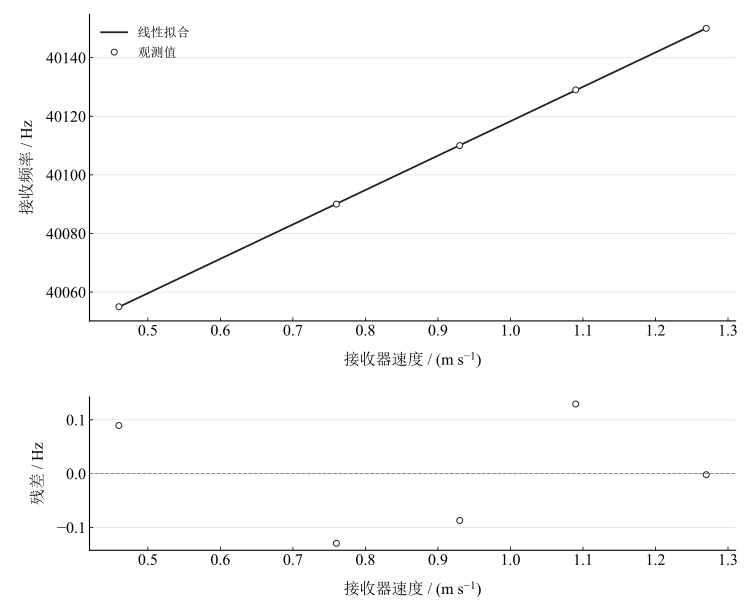

# 多普勒效应验证实验报告

淮南师范学院　电子工程学院　物理学专业　24物理1班  
姓名：缪雨轩　学号：2414050120　实验日期：2025年11月18日

## 一、实验名称

多普勒效应的验证。

## 二、实验目的

1. 测量超声接收器运动速度与接收频率的关系，验证多普勒效应。
2. 由频率—速度关系直线的斜率求声速。

## 三、实验原理

波源与接收器相对运动时，接收频率与发射频率不同。对于静止空气，设接收器朝向声源的速度为 $v_1$、声源朝向接收器的速度为 $v_2$，则

$$
f=f_0\frac{u+v_1}{u-v_2}.
$$

本实验声源固定，$v_2=0$，接收器以速度 $v$ 朝向声源运动，因此

$$
f=f_0\left(1+\frac vu\right)=B+kv,\qquad B=f_0,\quad k=\frac{f_0}{u}.
$$

通过线性拟合检验频率随速度变化的趋势，并由 $u_{\mathrm{exp}}=f_0/k$ 估计声速。温度模型采用

$$
u_{\mathrm{th}}=331.45\sqrt{1+\frac{T}{273.15}}\quad(\mathrm{m\,s^{-1}}),
$$

其中 $T$ 为摄氏温度数值。该关系近似描述空气声速的温度依赖，未对湿度和气体成分作单独修正。

## 四、主要仪器设备

多普勒效应综合实验仪（含 ZDP-I 型主机）、超声发射与接收器、光学导轨、运动小车、光电门以及红外发射与接收模块。

## 五、实验步骤

连接超声与红外调制模块并开启电源，调整光电门使小车能正常遮光测速。选择多普勒效应验证模式，记录环境温度和声源频率。使小车沿导轨朝向声源运动，由仪器同步记录各位置的瞬时速度与接收频率，逐项填入记录表。核对方向、单位以及速度和频率的对应关系，进行最小二乘拟合。

## 六、原始数据记录

环境温度 $T=23.1\,^{\circ}\mathrm{C}$，声源频率 $f_0=40002\,\mathrm{Hz}$。

表 1　接收器速度与接收频率记录

| 序号 | $v / (\mathrm{m\,s^{-1}})$ | $f / \mathrm{Hz}$ |
| --- | --- | --- |
| 1 | 0.46 | 40055 |
| 2 | 0.76 | 40090 |
| 3 | 0.93 | 40110 |
| 4 | 1.09 | 40129 |
| 5 | 1.27 | 40150 |

速度统一采用 $\mathrm{m\,s^{-1}}$，正值表示接收器向声源接近。

## 七、数据处理

### 1. 频率—速度线性拟合

以 $v$ 为横坐标、$f$ 为纵坐标，等权拟合 $f=B+kv$。令 $x_i=v_i$、$y_i=f_i$，则

$$
k=\frac{\sum_i(x_i-\bar x)(y_i-\bar y)}{\sum_i(x_i-\bar x)^2},\qquad B=\bar y-k\bar x.
$$

斜率为 117.3969205 $\mathrm{Hz}/(\mathrm{m\,s^{-1}})$，截距为 40000.90798 $\mathrm{Hz}$，相关系数为 0.9999953946。截距相对静止声源频率的差值为 -1.092022321 $\mathrm{Hz}$。

图 1　接收频率与接收器速度的线性拟合及残差

表 2　拟合预测、残差与温度模型预测

| 序号 | 模型预测频率 / Hz | 拟合残差 / Hz | 温度模型预测频率 / Hz |
| --- | --- | --- | --- |
| 1 | 40054.911 | 0.089438876 | 40055.308 |
| 2 | 40090.13 | -0.12963728 | 40090.074 |
| 3 | 40110.087 | -0.087113775 | 40109.775 |
| 4 | 40128.871 | 0.12937894 | 40128.317 |
| 5 | 40150.002 | -0.0020667562 | 40149.177 |

### 2. 实验声速与温度模型比较

使用记录的声源频率而非拟合截距计算

$$
u_{\mathrm{exp}}=\frac{40002}{k},\qquad
u_{\mathrm{th}}=331.45\sqrt{1+\frac{23.1}{273.15}}.
$$

实验声速为 340.7414762 $\mathrm{m\,s^{-1}}$，温度模型声速为 345.1807758 $\mathrm{m\,s^{-1}}$，相对差异为

$$
E=\frac{\vert u_{\mathrm{exp}}-u_{\mathrm{th}}\vert }{u_{\mathrm{th}}}\times100\%.
$$

计算得 1.286079614 $\%$。若仅传播回归斜率标准误差，则

$$
u(u_{\mathrm{exp}})=\frac{f_0}{k^2}u(k).
$$

这一条件不确定度未包含测速、频率基准、温度和环境模型误差。

## 八、实验结果与讨论

五组接收频率随接近速度增加，呈显著线性趋势，与固定声源、移动接收器的多普勒模型一致。声速估计与温度模型存在 1.286079614 $\%$ 的差异；由于只有五个点且仪器指标不完整，结论限定为现有速度范围内的趋势支持。

小车振动可能影响接收器姿态及信号稳定性；频率与速度采样若不同步，会在变速运动中引入偏差。温度测量偏差和未修正的空气湿度会影响比较用声速。导轨阻力改变速度本身，但当频率与速度同步测定时，不应把阻力直接等同于多普勒公式失效。

在模型探索中可使接收器速度取负，表示远离声源，此时频率低于 $f_0$；速度为零时恢复到发射频率。探索保持声源静止，并固定上述温度模型声速，不将负速度的模型值当作新增观测。
