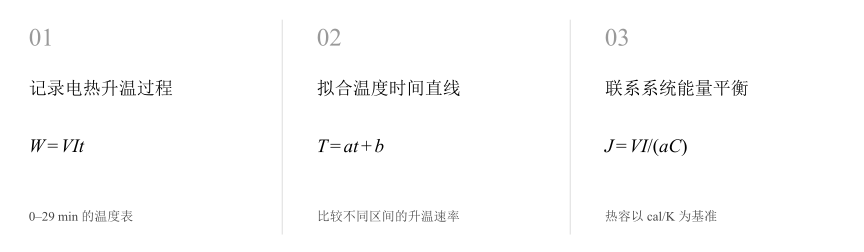
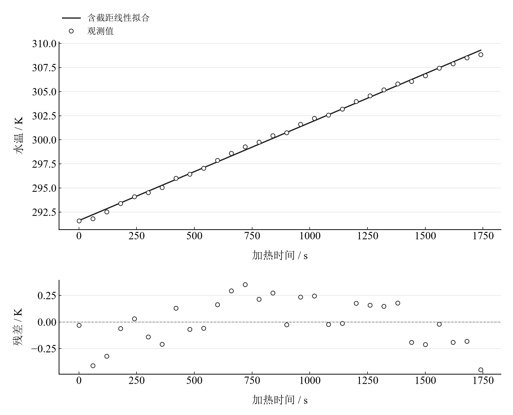

[普通物理实验 1](../README.md) · [项目首页](../../../README.md) · [使用指南](../../../docs/usage.md)

<!-- virtual-laboratory-entry -->
[在线虚拟实验](https://hnnuyuxuan.github.io/general-physics-lab/simulations/mechanical-equivalent-heat/) · [模型依据与参数来源](../../../docs/mechanical-equivalent-heat-model-evidence.md)

# 热功当量的测量

**沿着升温曲线，理解电功如何转化为热量。**

电热实验把加热时间与水温联系起来。先从保存的温度表复算升温速率，再比较不同拟合区间，理解散热、热容与热功当量的关系。

[读实验报告](report/report.md) · [HTML 阅读与探索](https://hnnuyuxuan.github.io/general-physics-lab/experiments/course-01/mechanical-equivalent-heat/notebooks/analysis.html) · [Python 笔记本](notebooks/analysis.ipynb) · [Wolfram 笔记本](../../../notebook/paclets/MechanicalEquivalentHeatLab/Notebooks/MechanicalEquivalentHeatLab.nb)



图 1　热功当量的测量：测量与计算主线

## 选择你的入口

|用途|入口|打开方式|
|---|---|---|
|阅读原理、记录、计算与结论|[Markdown 报告](report/report.md) · [排版阅读版](https://hnnuyuxuan.github.io/general-physics-lab/experiments/course-01/mechanical-equivalent-heat/report/report.html)|GitHub、Markdown 阅读器或浏览器|
|浏览计算图表、操作交互控件|[HTML 阅读版](https://hnnuyuxuan.github.io/general-physics-lab/experiments/course-01/mechanical-equivalent-heat/notebooks/analysis.html)|直接在线打开，也可下载到本机|
|逐步执行和修改 Python 计算|[Jupyter Notebook](notebooks/analysis.ipynb)|JupyterLab 或 VS Code|
|原生数学排版与 Wolfram 计算|[Wolfram Notebook](../../../notebook/paclets/MechanicalEquivalentHeatLab/Notebooks/MechanicalEquivalentHeatLab.nb) · [Paclet 安装包](../../../notebook/paclets/MechanicalEquivalentHeatLab/dist/MechanicalEquivalentHeatLab-0.1.0.paclet)|Wolfram 前端|
|对照原始报告|[源报告 PDF](../../../pdf/course-01/热功当量的测量/热功当量的测量实验报告.pdf)|GitHub 或 PDF 阅读器|

## 从记录到物理量

0–29 min 的 30 个温度读数，首尾温升 17.26 K；温度传感器采用 Pt1000。仪器记录的热功当量为 4.21 J/cal。

核心计算关系为：

$$
T=at+b,\qquad J=\frac{VI}{aC_{\mathrm{sys}}}.
$$

时间统一为秒，热容以 cal/K 表示时，热功当量单位为 J/cal。线性回归提供平均升温速率，热平衡还与环境交换有关。

表 1　关键计算结果

|物理量|计算值|单位|
|---|---:|---|
|全区间温升拟合斜率|0.010159696|K/s|
|前15点拟合斜率|0.010836905|K/s|
|后15点拟合斜率|0.0096279762|K/s|

独立回归得到约 0.01016 K/s 的升温速率；前后半段斜率存在变化。实际电压、电流及总热容齐全后，可继续代入热功当量公式。已记录的 4.21 J/cal 与温度表复算结果分别呈现。

## 沿着图像理解结果



图 2　30 个实际温度记录与全区间线性拟合及残差

完整记录、计算过程与结果讨论见[实验报告](report/report.md)。图中拟合与模型的物理含义可在 Notebook 中逐步计算。

## 在参数变化中继续探索

|操作|参数范围与默认值|观察什么|
|---|---|---|
|拟合区间下拉选择|全 30 点、前 15 点、后 15 点、中间 20 点|对照升温趋势和区间斜率，分析线性模型的稳定性。|

在 [HTML](https://hnnuyuxuan.github.io/general-physics-lab/experiments/course-01/mechanical-equivalent-heat/notebooks/analysis.html) 中操作已有控件；在 [Jupyter](notebooks/analysis.ipynb) 或 [Wolfram](../../../notebook/paclets/MechanicalEquivalentHeatLab/Notebooks/MechanicalEquivalentHeatLab.nb) 中运行全部单元，可继续修改输入与计算。

## 在本机打开

环境安装见[使用指南](../../../docs/usage.md)。在仓库根目录启动：

```powershell
.\.venv\Scripts\python.exe -m jupyterlab experiments/course-01/mechanical-equivalent-heat/notebooks/analysis.ipynb
```

Wolfram 安装独立包后，通过包入口打开 Notebook。将仓库路径改为本机路径：

```wolfram
PacletInstall["D:/general-physics-lab/notebook/paclets/MechanicalEquivalentHeatLab/dist/MechanicalEquivalentHeatLab-0.1.0.paclet"];
Needs["MechanicalEquivalentHeatLab`"];
MechanicalEquivalentHeatLab`OpenNotebook[]
```

## 数据与计算实现

|内容|文件|
|---|---|
|温度—时间记录|[temperatures.csv](data/temperatures.csv)|
|单位、参数与模型条件|[experiment.json](experiment.json)|
|Python 实现|[mechanical_equivalent_heat.py](../../../src/physicslab/experiments/mechanical_equivalent_heat.py)|
|Wolfram 实现|[MechanicalEquivalentHeatLab.wl](../../../notebook/paclets/MechanicalEquivalentHeatLab/Kernel/MechanicalEquivalentHeatLab.wl)|

[数据来源](data/provenance.json) · [返回课程目录](../README.md)
