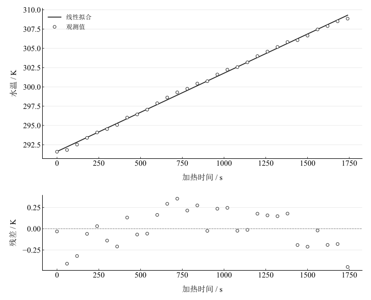

# 热功当量测量实验报告

淮南师范学院　电子工程学院　物理学专业　24物理1班  
姓名：缪雨轩　学号：2414050120　实验日期：2025年11月15日

## 一、实验名称

热功当量的测量。

## 二、实验目的

了解电热法测量热功当量的能量转换原理；学习温度—时间回归及散热修正所需条件；熟悉集成式热功当量仪与Pt1000铂电阻温度计；合理选择热学实验参量。

## 三、实验原理

### 1. 电功和系统吸热

在电压、电流稳定时，电功为

$$
W=VIt.
$$

若量热器系统总热容 $C_{\mathrm{sys}}$ 以 $\mathrm{cal\,K^{-1}}$ 计，吸收热量为

$$
Q=C_{\mathrm{sys}}(T_2-T_1),\qquad
C_{\mathrm{sys}}=m_{\mathrm{w}}c_{\mathrm{w}}+m_{\mathrm{c}}c_{\mathrm{c}}+C_{\mathrm{heater}}.
$$

热功当量为 $J=W/Q$，单位为 $\mathrm{J\,cal^{-1}}$。若热容采用 $\mathrm{J\,K^{-1}}$，上述比值为无量纲能量比，不能仍称为焦耳每卡的换算值。

### 2. 升温回归与散热

无显著热损失时，温度近似为 $T=at+b$，有

$$
J=\frac{VI}{aC_{\mathrm{sys}}}.
$$

若存在散热功率 $P_{\mathrm{loss}}$，能量方程应改为

$$
JC_{\mathrm{sys}}\frac{dT}{dt}=VI-P_{\mathrm{loss}}.
$$

线性拟合给出区间平均升温趋势，可降低随机波动影响，但不会自动确定或修正散热。定量修正还需环境温度、冷却曲线或经验证的热交换模型。

## 四、主要仪器设备

JPR热功当量实验仪（含电源和触摸屏采集系统）、含外筒与绝热层的量热器、内筒、功率电阻加热器、Pt1000铂电阻温度计及电子天平。

操作设置约为 $20.00\,\mathrm{V}$、限流 $0.495\,\mathrm{A}$。现有记录未提供加热期间实际电压、电流及水、内筒和加热器的热容数值，因此不能由这些设定值独立复算热功当量。

## 五、实验步骤

称量内筒，装入足以淹没加热器的纯水（操作建议约50–150 $\mathrm{g}$），称量筒与水总质量，安装加热棒和温度探头。在仪器中输入水质量、内筒质量及相应比热容，设定电压和限流。开始记录初温后开启加热，观察电压、电流和温度；持续加热至所需温升，停止并保存数据。操作说明建议约32 $\mathrm{min}$，本次保存的表格覆盖0–29 $\mathrm{min}$。对记录的温度—时间数据回归，并结合实际电功和总热容计算热功当量。

## 六、原始数据记录

表 1　温度—时间记录（保留原并列表结构）

{{tables.observations}}

同时保留源仪器已报告结果：斜率 $9.605\times10^{-3}\,\mathrm{K\,s^{-1}}$、截距约 $291.6\,\mathrm{K}$、热功当量 $4.21\,\mathrm{J\,cal^{-1}}$。这些数值是记录的仪器计算结果，后续独立回归由本表30个点重新执行。

## 七、数据处理

### 1. 升温曲线回归

将时间乘60转换为秒。等权拟合 $T=at+b$，得到斜率 {{metrics.heating_slope}} $\mathrm{K\,s^{-1}}$、截距 {{metrics.temperature_intercept}} $\mathrm{K}$、相关系数 {{metrics.correlation}}。相对于源仪器斜率，复算值差异为 {{metrics.source_slope_difference}} $\%$；表内数据与仪器原始采样序列或拟合区间可能不同，无法仅凭记录确定差异来源。

图 1　30点温度—时间线性拟合及残差

首尾温升为 {{metrics.total_temperature_rise}} $\mathrm{K}$，端点温升速率为 {{metrics.endpoint_slope}} $\mathrm{K\,s^{-1}}$。前15点和后15点的拟合斜率分别为 {{metrics.early_slope}} 与 {{metrics.late_slope}} $\mathrm{K\,s^{-1}}$；区间差异可用于检查升温趋势是否稳定，不能单独确定散热量。

### 2. 热功当量的可复算范围

源仪器报告 $J=4.21\,\mathrm{J\,cal^{-1}}$，比较值采用 $4.1868\,\mathrm{J\,cal^{-1}}$。本次可重复计算的是温升回归。因为缺实际 $V$、$I$ 和 $C_{\mathrm{sys}}$，不能独立计算 $VI/(aC_{\mathrm{sys}})$；不以设定值替代实测值，也不倒推一个热容再当作测得值。

### 3. 不确定度

回归参数标准误差由残差求得，可反映所选线性模型下的离散程度；温度系统误差和时间误差尚未完整计入。源记录给出0.5级电压、电流仪表及近似误差限，但量程与误差限写法需要核实：若按满量程0.5$\%$，20 $\mathrm{V}$量程对应0.10 $\mathrm{V}$，2 $\mathrm{A}$量程对应0.010 $\mathrm{A}$，与所列0.05 $\mathrm{V}$和0.005 $\mathrm{A}$不一致。Pt1000的0.01 $\mathrm{K}$分辨率也不足以直接确定总标准不确定度。

若实际输入齐全且可视为独立，在无散热模型下有

$$
\left(\frac{u(J)}J\right)^2=
\left(\frac{u(V)}V\right)^2+
\left(\frac{u(I)}I\right)^2+
\left(\frac{u(a)}a\right)^2+
\left(\frac{u(C_{\mathrm{sys}})}{C_{\mathrm{sys}}}\right)^2.
$$

现有资料不满足代入完整预算的条件，故不生成缺项的合成不确定度。

## 八、实验结果与讨论

温度在0–29 $\mathrm{min}$内整体升高并具有较强线性趋势。30点独立回归的斜率为 {{metrics.heating_slope}} $\mathrm{K\,s^{-1}}$，应与源仪器已报告斜率分别标识。源热功当量4.21 $\mathrm{J\,cal^{-1}}$可作为记录保留，其独立复算与准确度评价仍需补充电学量和热容数据。

在其他参数固定且净散热为正时，散热使升温速率小于绝热值，以 $VI/(aC_{\mathrm{sys}})$ 计算会使热功当量偏大；温升前期也可能吸收环境热量，因此应依据全过程判断热交换符号。较长加热并不保证散热误差变小，普通回归也不自动补偿热损失。

水和内筒的质量、材料比热及加热器等效热容会影响计算分母，探头滞后和搅拌不均会影响测温。后续应保存逐时电压电流、环境温度、冷却段记录及各热容输入，并核实电表精度，以建立可重复的能量与不确定度闭环。
