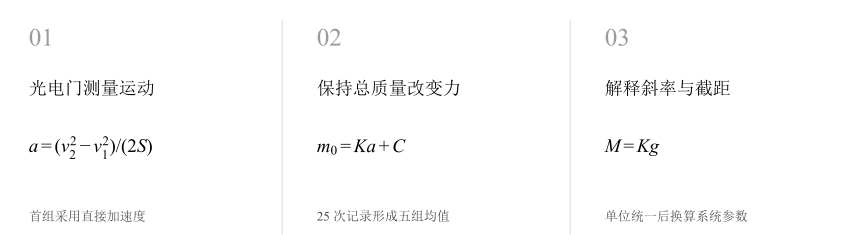
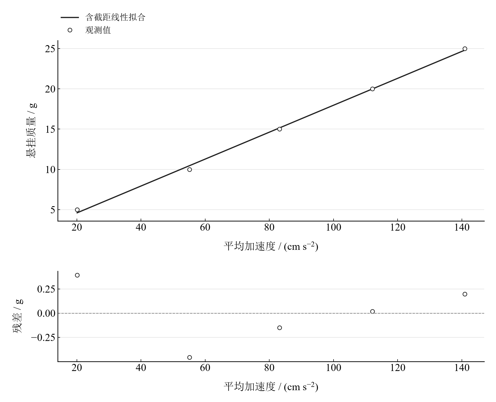
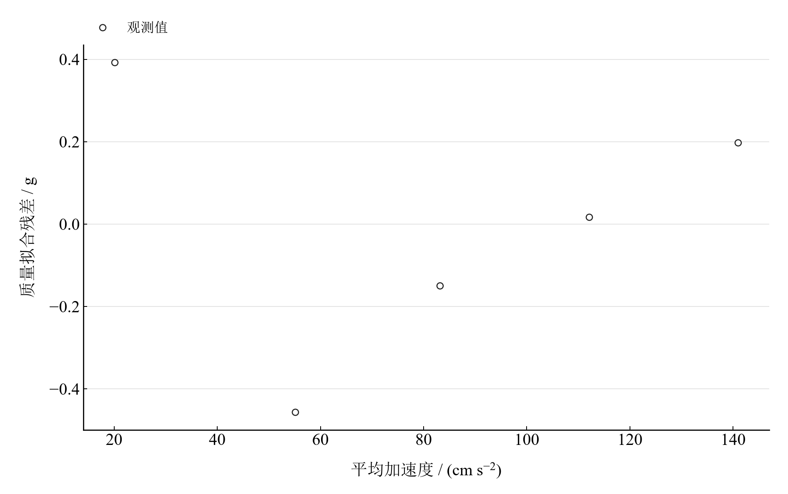

[普通物理实验 1](../README.md) · [项目首页](../../../README.md) · [使用指南](../../../docs/usage.md)

# 牛顿第二定律的验证

**转移砝码而保持总质量，让加速度响应驱动力。**

在气垫导轨上逐次增加悬挂质量，用光电门记录运动。以加速度为横轴、悬挂质量为纵轴拟合，再检查低受力端与截距的物理含义。

[读实验报告](report/report.md) · [HTML 阅读与探索](notebooks/analysis.html) · [Python 笔记本](notebooks/analysis.ipynb) · [Wolfram 笔记本](../../../notebook/paclets/NewtonSecondLawLab/Notebooks/NewtonSecondLawLab.nb)



图 1　牛顿第二定律的验证：测量与计算主线

## 选择你的入口

|用途|入口|打开方式|
|---|---|---|
|阅读原理、记录、计算与结论|[Markdown 报告](report/report.md) · [排版阅读版](report/report.html)|GitHub、Markdown 阅读器或浏览器|
|浏览计算图表、操作交互控件|[HTML 阅读版](notebooks/analysis.html)|下载后用浏览器打开|
|逐步执行和修改 Python 计算|[Jupyter Notebook](notebooks/analysis.ipynb)|JupyterLab 或 VS Code|
|原生数学排版与 Wolfram 计算|[Wolfram Notebook](../../../notebook/paclets/NewtonSecondLawLab/Notebooks/NewtonSecondLawLab.nb) · [Paclet 安装包](../../../notebook/paclets/NewtonSecondLawLab/dist/NewtonSecondLawLab-0.1.0.paclet)|Wolfram 前端|
|对照原始报告|[源报告 PDF](../../../pdf/course-01/牛顿第二定律的验证/牛顿第二运动定律验证实验报告.pdf)|GitHub 或 PDF 阅读器|

## 从记录到物理量

5 组悬挂质量，每组 5 次记录，共 25 次。门间距 0.500 m；首组直接记录加速度，其余四组由两门速度复算。

核心计算关系为：

$$
a=\frac{v_2^2-v_1^2}{2S},\qquad m_0=Ka+C,\qquad K=\frac{M}{g}.
$$

转移砝码保持运动系统总质量恒定。截距可换算为等效反向力，其来源包括摩擦、导轨倾斜与测量偏置。

表 1　关键计算结果

|物理量|计算值|单位|
|---|---:|---|
|相关系数|0.99915137|—|
|斜率推算系统质量|163.77038|g|
|截距等效阻力|0.012226903|N|

五组呈明显线性趋势。拟合推算质量约 163.77 g，属于模型参数；独立称量可进一步检查其物理意义。各组重复性与残差分别反映计时离散及线性模型的偏离。

## 沿着图像理解结果



图 2　五组悬挂质量与平均加速度观测及等权线性拟合



图 3　五组质量拟合残差，显示低受力端对直线的影响

完整记录、计算过程与结果讨论见[实验报告](report/report.md)。图中拟合与模型的物理含义可在 Notebook 中逐步计算。

## 在参数变化中继续探索

|操作|参数范围与默认值|观察什么|
|---|---|---|
|拟合组别下拉选择|全部五组，或省略任意一组|所有观测点同时保留，对比选点后的直线、斜率和截距。|

在 [HTML](notebooks/analysis.html) 中操作已有控件；在 [Jupyter](notebooks/analysis.ipynb) 或 [Wolfram](../../../notebook/paclets/NewtonSecondLawLab/Notebooks/NewtonSecondLawLab.nb) 中运行全部单元，可继续修改输入与计算。

## 在本机打开

环境安装见[使用指南](../../../docs/usage.md)。在仓库根目录启动：

```powershell
.\.venv\Scripts\python.exe -m jupyterlab experiments/course-01/newton-second-law/notebooks/analysis.ipynb
```

Wolfram 安装独立包后，通过包入口打开 Notebook。将仓库路径改为本机路径：

```wolfram
PacletInstall["D:/general-physics-lab/notebook/paclets/NewtonSecondLawLab/dist/NewtonSecondLawLab-0.1.0.paclet"];
Needs["NewtonSecondLawLab`"];
NewtonSecondLawLab`OpenNotebook[]
```

## 数据与计算实现

|内容|文件|
|---|---|
|分组光电测量记录|[observations.csv](data/observations.csv)|
|单位、参数与模型条件|[experiment.json](experiment.json)|
|Python 实现|[newton_second_law.py](../../../src/physicslab/experiments/newton_second_law.py)|
|Wolfram 实现|[NewtonSecondLawLab.wl](../../../notebook/paclets/NewtonSecondLawLab/Kernel/NewtonSecondLawLab.wl)|

[数据来源](data/provenance.json) · [返回课程目录](../README.md)
