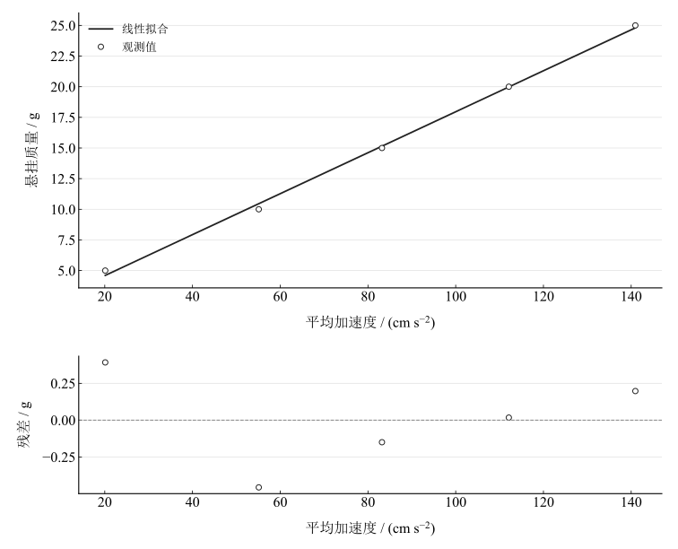

# 牛顿第二运动定律验证实验报告

淮南师范学院　电子工程学院　物理学专业　24物理1班  
姓名：缪雨轩　学号：2414050120　实验日期：2025年11月13日

## 一、实验名称

牛顿第二运动定律的验证。

## 二、实验目的

1. 学习在气垫导轨上利用光电计时系统测量物体速度与加速度。
2. 在保持系统总质量不变的条件下，研究外力与加速度的关系。
3. 掌握最小二乘法处理数据和实验误差分析的方法。

## 三、实验原理

质量恒定时，牛顿第二定律为 $F=Ma$。将滑块及配重和悬挂砝码视为运动系统，忽略轻绳质量、滑轮转动惯量和摩擦，驱动力近似为悬挂砝码重力：

$$
F=m_0g,\qquad M=M_{\mathrm{glider}}+m_0.
$$

改变悬挂质量时，将砝码从滑块转移到挂钩，使系统总质量保持不变。若存在近似恒定的等效反向力 $f$，则

$$
m_0g-f=Ma,\qquad m_0=Ka+C,\qquad K=\frac{M}{g},\quad C=\frac{f}{g}.
$$

这里的等效力还可能包含导轨倾斜、滑轮和测量偏置的影响，不能仅由截距判断其具体来源。

光电门之间距离为 $S$，对应速度为 $v_1$、$v_2$；在两门之间近似匀加速时，

$$
a=\frac{v_2^2-v_1^2}{2S}.
$$

速度由挡光片宽度与遮光时间之比估计，代表光电门附近的平均速度。使用上述公式还要求挡光片足够窄、运动加速度近似稳定。

## 四、主要仪器设备

气垫导轨、气源、滑块、两个光电门、数字毫秒计、游标卡尺、天平和五个 $5\,\mathrm{g}$ 砝码。光电门间距为 $S=50.00\,\mathrm{cm}=0.500\,\mathrm{m}$，重力加速度采用 $g=9.80\,\mathrm{m\,s^{-2}}$。

现有记录未给出独立系统称量质量、挡光片宽度以及各仪器误差限；后续不确定度只评估重复性和回归残差。

## 五、实验步骤

1. 开启气源，调节气垫导轨水平，检查滑块在无牵引状态下的运动。
2. 固定两光电门并测量间距，称量滑块和准备好的配重。
3. 将未悬挂的砝码放在滑块上。逐次将一个 $5\,\mathrm{g}$ 砝码从滑块移到挂钩，使悬挂质量依次为 $5$、$10$、$15$、$20$、$25\,\mathrm{g}$，同时保持总质量不变。
4. 每组释放滑块并记录加速度或两个光电门的速度，重复五次，避免手推和滑块碰撞。
5. 保留各次读数，分别计算各组加速度均值与 A 类标准不确定度，拟合悬挂质量与加速度关系并检查残差。

## 六、原始数据记录

表 1　悬挂质量与光电测量记录

| 组别 | $m_0 / \mathrm{g}$ | 次数 | 数据1（速度或加速度） | 数据2速度 / (cm s⁻¹) | 记录加速度 / (cm s⁻²) |
| --- | --- | --- | --- | --- | --- |
| 1 | 5 | 1 | 20.06 | — | 20.06 |
| 1 | 5 | 2 | 20.21 | — | 20.21 |
| 1 | 5 | 3 | 19.92 | — | 19.92 |
| 1 | 5 | 4 | 20.13 | — | 20.13 |
| 1 | 5 | 5 | 20.22 | — | 20.22 |
| 2 | 10 | 1 | 29.02 | 79.81 | 55.28 |
| 2 | 10 | 2 | 28.69 | 79.49 | 54.95 |
| 2 | 10 | 3 | 28.99 | 79.43 | 54.68 |
| 2 | 10 | 4 | 29.05 | 79.81 | 55.26 |
| 2 | 10 | 5 | 28.34 | 79.62 | 55.35 |
| 3 | 15 | 1 | 35.7 | 98.14 | 83.56 |
| 3 | 15 | 2 | 35.21 | 97.85 | 83.33 |
| 3 | 15 | 3 | 35.42 | 97.66 | 82.82 |
| 3 | 15 | 4 | 35.56 | 97.85 | 83.08 |
| 3 | 15 | 5 | 35.55 | 97.85 | 83.09 |
| 4 | 20 | 1 | 41.12 | 113.51 | 111.91 |
| 4 | 20 | 2 | 40.92 | 112.87 | 110.66 |
| 4 | 20 | 3 | 41.54 | 113.9 | 112.44 |
| 4 | 20 | 4 | 41.42 | 114.02 | 112.84 |
| 4 | 20 | 5 | 40.62 | 113.64 | 112.65 |
| 5 | 25 | 1 | 46.27 | 127.88 | 142.1 |
| 5 | 25 | 2 | 46.06 | 126.58 | 139 |
| 5 | 25 | 3 | 46.08 | 126.58 | 138.99 |
| 5 | 25 | 4 | 46.02 | 127.88 | 142.33 |
| 5 | 25 | 5 | 46.1 | 127.88 | 142.27 |

第一组的记录为仪器直接给出的加速度，速度未记录，表中用“—”标示。第二至第五组记录两个速度和加速度计算列。两种记录方式分别保留，未将第一组的直接加速度误作速度。

## 七、数据处理

### 1. 加速度重算与均值

有速度的各组按 $S=50.00\,\mathrm{cm}$ 重算：

$$
a_i=\frac{v_{2,i}^2-v_{1,i}^2}{100.00}\quad(\mathrm{cm\,s^{-2}}).
$$

第一组直接采用加速度读数。重算和记录列的差异如下；主分析以速度重算值为准，不提前修约。

表 2　加速度复算及相对记录列差值

| 组别 | 次数 | 采用加速度 / (cm s⁻²) | 相对记录列差值 / (cm s⁻²) |
| --- | --- | --- | --- |
| 1 | 1 | 20.06 | 0 |
| 1 | 2 | 20.21 | 0 |
| 1 | 3 | 19.92 | 0 |
| 1 | 4 | 20.13 | 0 |
| 1 | 5 | 20.22 | 0 |
| 2 | 1 | 55.274757 | -0.005243 |
| 2 | 2 | 54.95544 | 0.00544 |
| 2 | 3 | 54.687048 | 0.007048 |
| 2 | 4 | 55.257336 | -0.002664 |
| 2 | 5 | 55.361888 | 0.011888 |
| 3 | 1 | 83.569696 | 0.009696 |
| 3 | 2 | 83.348784 | 0.018784 |
| 3 | 3 | 82.828992 | 0.008992 |
| 3 | 4 | 83.101089 | 0.021089 |
| 3 | 5 | 83.1082 | 0.0182 |
| 4 | 1 | 111.93666 | 0.026657 |
| 4 | 2 | 110.6519 | -0.008095 |
| 4 | 3 | 112.47638 | 0.036384 |
| 4 | 4 | 112.84944 | 0.00944 |
| 4 | 5 | 112.64065 | -0.009348 |
| 5 | 1 | 142.12382 | 0.023815 |
| 5 | 2 | 139.00973 | 0.009728 |
| 5 | 3 | 138.9913 | 0.0013 |
| 5 | 4 | 142.35454 | 0.02454 |
| 5 | 5 | 142.28084 | 0.010844 |

每组 $n=5$，均值及均值的 A 类标准不确定度为

$$
\bar a=\frac{1}{n}\sum_{i=1}^n a_i,\qquad
u_A(\bar a)=\sqrt{\frac{\sum_{i=1}^n(a_i-\bar a)^2}{n(n-1)}}.
$$

表 3　加速度、驱动力与拟合残差汇总

| 组别 | $m_0 / \mathrm{g}$ | $F / \mathrm{N}$ | $\bar a / (\mathrm{cm\,s^{-2}})$ | $u_A(\bar a) / (\mathrm{cm\,s^{-2}})$ | 质量拟合残差 / g |
| --- | --- | --- | --- | --- | --- |
| 1 | 5 | 0.049 | 20.108 | 0.055263008 | 0.39205601 |
| 2 | 10 | 0.098 | 55.107294 | 0.12550715 | -0.45676806 |
| 3 | 15 | 0.147 | 83.191352 | 0.12535858 | -0.14996895 |
| 4 | 20 | 0.196 | 112.11101 | 0.39488505 | 0.017191351 |
| 5 | 25 | 0.245 | 140.95205 | 0.79758574 | 0.19748964 |

### 2. 最小二乘法线性拟合

以 $x_i=\bar a_i$ 为横坐标、$y_i=m_{0,i}$ 为纵坐标，等权拟合 $y=Kx+C$：

$$
K=\frac{\sum_i(x_i-\bar x)(y_i-\bar y)}{\sum_i(x_i-\bar x)^2},\qquad C=\bar y-K\bar x.
$$

$$
r=\frac{\sum_i(x_i-\bar x)(y_i-\bar y)}{\sqrt{\sum_i(x_i-\bar x)^2\sum_i(y_i-\bar y)^2}}.
$$

计算得到斜率 0.167112631 $\mathrm{g}/(\mathrm{cm\,s^{-2}})$、截距 1.247643204 $\mathrm{g}$、相关系数 0.9991513732，决定系数为 0.9983034665。拟合使用五组未修约均值；图示同时检查各组与直线的偏离。

图 1　悬挂质量与平均加速度的线性拟合及残差

令残差为 $e_i=y_i-(Kx_i+C)$，在普通线性回归模型下，残差标准差及参数标准误差为

$$
s_y=\sqrt{\frac{\sum_i e_i^2}{N-2}},\quad
u(K)=\frac{s_y}{\sqrt{\sum_i(x_i-\bar x)^2}},\quad
u(C)=s_y\sqrt{\frac1N+\frac{\bar x^2}{\sum_i(x_i-\bar x)^2}},\qquad N=5.
$$

加速度也存在测量误差，且各组重复性不同；以上为等权回归的条件标准误差，未代替完整的测量不确定度预算。

## 八、实验结果与讨论

### 1. 关系验证

悬挂质量增大时，加速度单调增大，五组数据呈较强线性相关。相关系数为 0.9991513732，并非严格等于一。首组与其余组的趋势存在可见偏离，且首组采用不同的记录模式。结果支持牛顿第二定律所预期的整体线性趋势；在缺少仪器预算和总质量实测值的条件下，尚不能据此断言所有偏差都位于测量不确定度内，也不能仅靠高相关系数证明严格正比例关系。

### 2. 截距与系统质量估算

将所拟合的常量截距解释为等效反向力，得

$$
f=C\times10^{-3}g,\qquad M=K\times100g.
$$

这里 $C$ 用克、$K$ 用 $\mathrm{g}/(\mathrm{cm\,s^{-2}})$、$g$ 用 $\mathrm{m\,s^{-2}}$，输出 $f$ 的单位为牛顿，$M$ 的单位为克。推算系统质量为 163.7703784 $\mathrm{g}$，等效阻力为 0.0122269034 $\mathrm{N}$。它们是该拟合模型下的推算量；系统质量缺少独立称量值，截距也可能受倾斜及模式偏差影响。

### 3. 首组的影响和误差来源

作为诊断，省略第一组重新拟合，斜率为 0.1745402776，截距为 0.422905104 $\mathrm{g}$，相关系数为 0.9999774498。该比较用于判断首组影响，正式结果仍保留全部五组，不将删点解释为新的实测数据。

导轨未完全调平时，沿轨重力分量形成附加驱动力；气垫不稳定、滑轮摩擦、滑轮转动惯量和细线运动都会改变有效模型。较高速度下空气阻力可能使加速度偏小。挡光片宽度、计时分辨率和门间距离误差会传递至加速度；由于两速度平方作差，速度误差的影响不能只靠重复性判定。改善实验应统一五组记录方式、补充仪器指标和系统质量称量，并检查低受力端的重复测量及导轨水平。
