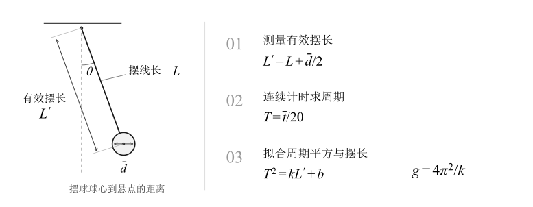
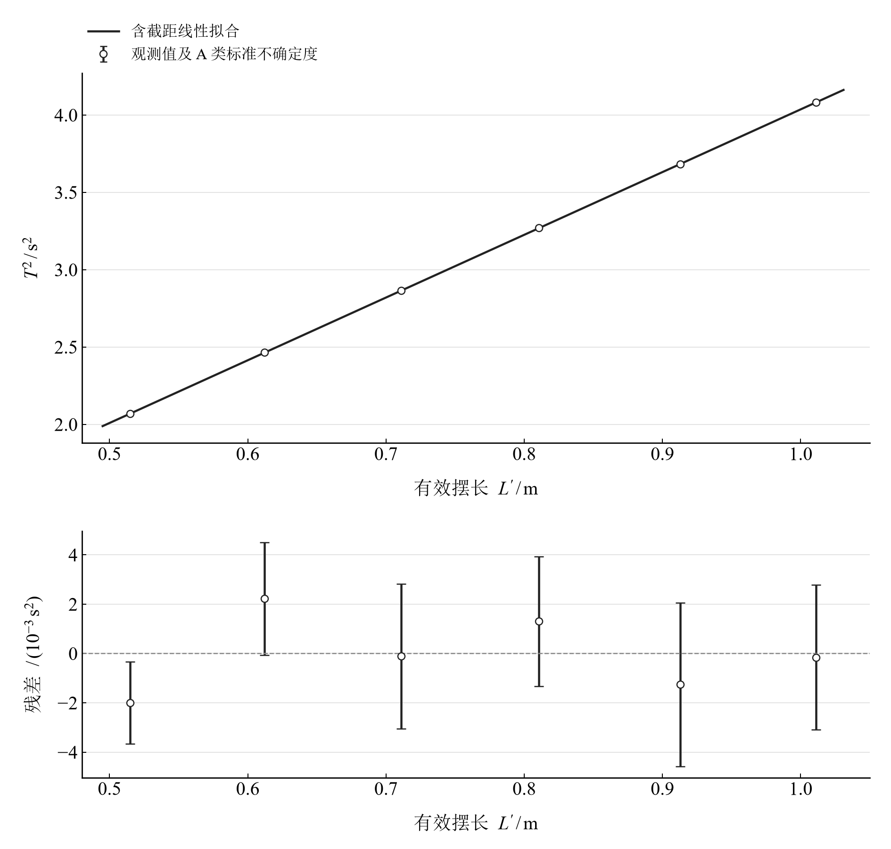
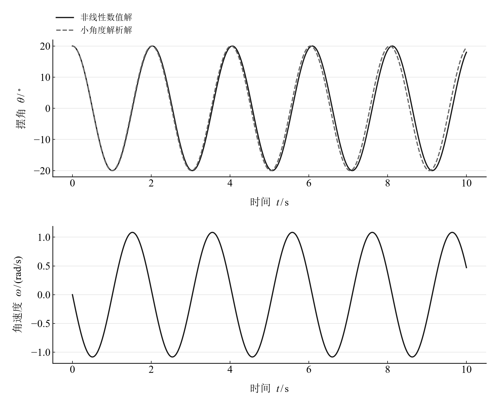
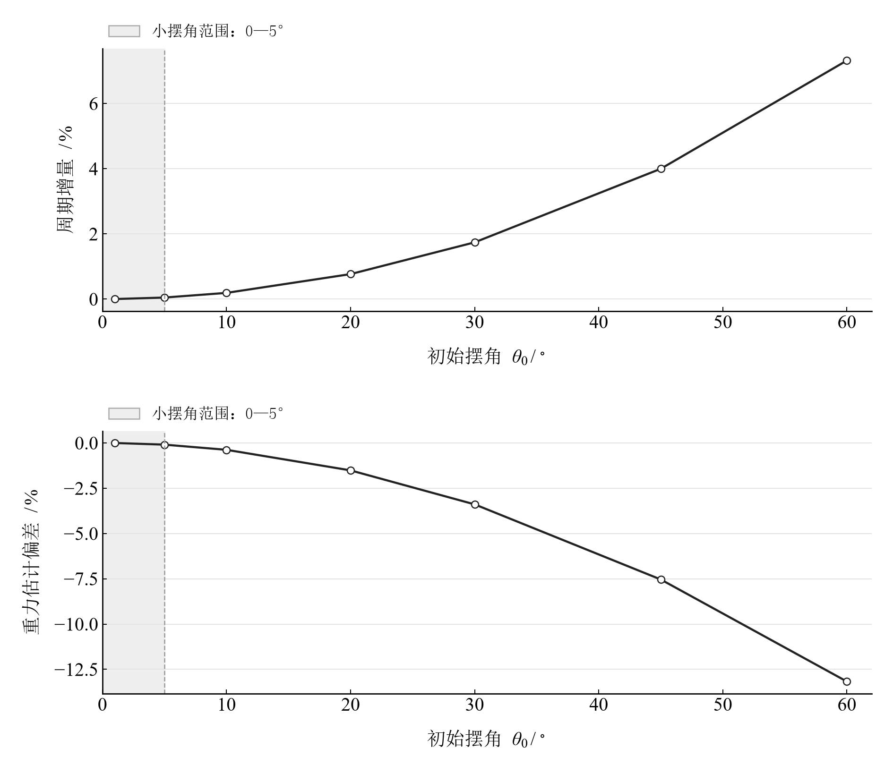

[普通物理实验 1](../README.md) · [项目首页](../../../README.md) · [使用指南](../../../docs/usage.md)

# 单摆测重力加速度

**用长度和时间测量重力，用残差和摆角理解模型。**

改变摆长、重复计时，将周期平方与有效摆长联系起来，求出重力加速度。再从小角度近似走向非线性单摆，观察摆幅如何改变周期与测量结果。

[读实验报告](report/report.md) · [浏览器交互](notebooks/analysis.html) · [Python 笔记本](notebooks/analysis.ipynb) · [Wolfram 笔记本](../../../notebook/paclets/PendulumLab/Notebooks/Pendulum.nb)



图 1　从摆长与计时读数到重力加速度

## 选择你的入口

|用途|入口|打开方式|
|---|---|---|
|阅读原理、测量记录和实验结论|[完整实验报告](report/report.md) · [排版阅读版](report/report.html)|GitHub、Markdown 阅读器或本地浏览器|
|筛选数据、改变摆角、播放运动|[HTML 交互阅读版](notebooks/analysis.html)|下载后用浏览器打开|
|逐步运行和修改 Python 计算|[Jupyter Notebook](notebooks/analysis.ipynb)|JupyterLab 或 VS Code|
|进行符号推导与原生交互计算|[Wolfram Notebook](../../../notebook/paclets/PendulumLab/Notebooks/Pendulum.nb) · [Paclet 安装包](../../../notebook/paclets/PendulumLab/dist/PendulumLab-0.1.0.paclet)|Wolfram 前端|
|对照原始实验报告|[源报告 PDF](../../../pdf/course-01/单摆测重力加速度/牛顿第二运动定律测重力加速度实验报告.pdf)|GitHub 或 PDF 阅读器|

## 从一组读数开始

实验记录包含 **6 组摆长、每组 3 次计时**，每次计时对应 **20 次全振动**；摆球直径另有 6 次测量。

取平均直径 $\bar d$ 和平均计时 $\bar t$，得到有效摆长与周期：

$$
L'=L+\frac{\bar d}{2},\qquad T=\frac{\bar t}{20}.
$$

小角度条件下，周期平方与有效摆长呈线性关系。用含截距模型拟合：

$$
T^2=kL'+b,\qquad g=\frac{4\pi^2}{k}.
$$

表 1　两种数据处理方法得到的重力加速度

|处理方法|$g/(\mathrm{m}/\mathrm{s}^2)$|计算入口|
|---|---:|---|
|各组计算后取算术平均|9.797523|[报告：逐组计算](report/report.md#1-逐组计算重力加速度)|
|含截距线性拟合|9.735218|[报告：数据处理](report/report.md#数据处理)|

两种方法对截距项和误差结构的处理不同。对照拟合曲线、残差及测量条件，可以进一步理解结果的差异。

## 让拟合与残差一起说话



图 2　周期平方与有效摆长的含截距线性拟合及残差；误差条表示重复计时传播得到的 A 类标准不确定度

Notebook 中可以选择重复计时、暂不纳入某组数据，观察拟合参数与残差如何响应。完整数据表、不确定度定义及结果讨论见[实验报告](report/report.md)。

## 把摆角放大，观察近似何时发生偏离

理想无阻尼单摆满足

$$
\ddot\theta+\frac{g}{L'}\sin\theta=0.
$$

运动示例取有效摆长 $L'=1\ \mathrm m$、初始摆角 $20^\circ$、初始角速度为零，观察 10 s 内的运动；重力参数采用实验拟合值。摆角扫描从 $1^\circ$ 延伸至 $60^\circ$，比较非线性周期与小角度近似。

<table>
  <tr>
    <td width="50%" align="center" valign="top">
      <a href="assets/readme-trajectory.png"></a>
    </td>
    <td width="50%" align="center" valign="top">
      <a href="assets/readme-amplitude-scan.png"></a>
    </td>
  </tr>
  <tr>
    <td align="center" valign="top">
      <strong>图 3　摆角与角速度</strong><br>
      比较运动波形与随时间累积的相位差。
    </td>
    <td align="center" valign="top">
      <strong>图 4　初始摆角扫描</strong><br>
      连接周期增量与重力估计偏差。
    </td>
  </tr>
</table>

## 四个交互探索

|操作|观察什么|
|---|---|
|筛选重复计时|均值、周期与重复性分量的变化|
|调整参与拟合的数据组|斜率、截距、重力估计和残差的变化|
|改变摆长与初始摆角，播放或拖动时间|摆球运动、摆角与角速度的对应关系|
|在摆角扫描中移动滑块|小角度近似的周期偏差及其对重力估计的影响|

在 [HTML](notebooks/analysis.html) 中直接操作已有控件；在 [Jupyter](notebooks/analysis.ipynb) 或 [Wolfram](../../../notebook/paclets/PendulumLab/Notebooks/Pendulum.nb) 中运行全部单元，可继续修改计算参数与模型。

## 在本机打开

安装步骤见[使用指南](../../../docs/usage.md)。在仓库根目录启动本实验的 Jupyter Notebook：

```powershell
.\.venv\Scripts\python.exe -m jupyterlab experiments/course-01/pendulum/notebooks/analysis.ipynb
```

Wolfram 可安装本实验的独立 Paclet，再通过包入口打开 Notebook。将下面的仓库路径改为本机路径：

```wolfram
PacletInstall["D:/general-physics-lab/notebook/paclets/PendulumLab/dist/PendulumLab-0.1.0.paclet"];
Needs["PendulumLab`"];
PendulumLab`PLOpenNotebook[]
```

## 数据与计算实现

|内容|文件|
|---|---|
|摆长与重复计时|[measurements.csv](data/measurements.csv)|
|摆球直径|[diameters.csv](data/diameters.csv)|
|单位、分析参数与模型条件|[experiment.json](experiment.json)|
|Python 计算模块|[pendulum.py](../../../src/physicslab/experiments/pendulum.py)|
|Wolfram 包实现|[PendulumLab.wl](../../../notebook/paclets/PendulumLab/Kernel/PendulumLab.wl)|

[单摆计算方法](../../../docs/data-and-methods.md#拟合与不确定度) · [数据来源](data/provenance.json) · [返回课程目录](../README.md)
