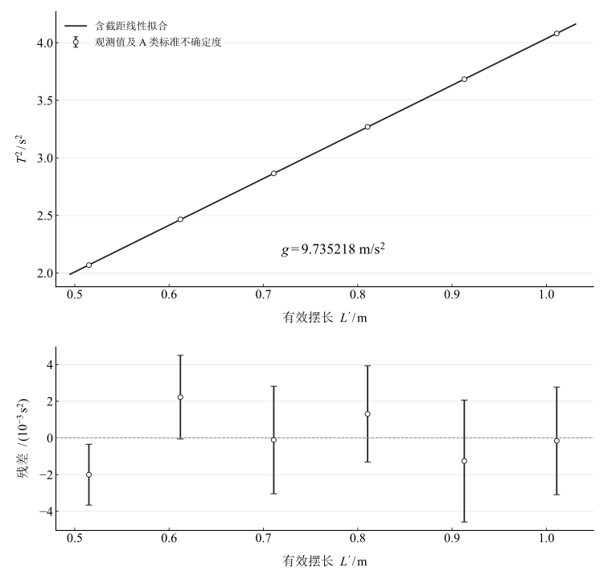

# 淮南师范学院实验报告

学院：电子工程学院　　专业：物理学　　班级：24物理1班  
学号：2414050120　　姓名：缪雨轩　　日期：2025.11.13

**实验名称：单摆测重力加速度**

## 实验目的

1. 掌握用单摆测定当地重力加速度的原理和方法。
2. 练习使用游标卡尺、米尺和电子秒表。
3. 学习用图像法（$T^2-L'$ 图）处理数据，减小偶然误差。

## 实验原理

在摆角 $\theta<5^\circ$ 的小角度条件下，单摆近似作简谐振动，其振动周期为

$$T=2\pi\sqrt{\frac{L'}{g}}.$$

其中，$L'$ 为悬点到摆球球心的距离，$g$ 为当地重力加速度。有效摆长等于摆线长 $L$ 加上摆球半径，即

$$L'=L+\frac{d}{2}.$$

将周期公式变形可得

$$T^2=\frac{4\pi^2}{g}L',\qquad g=\frac{4\pi^2L'}{T^2}.$$

测量不同摆长对应的周期，作 $T^2-L'$ 关系图。采用含截距线性模型 $T^2=kL'+b$ 拟合，斜率 $k=4\pi^2/g$，由此得到

$$g=\frac{4\pi^2}{k}.$$

## 主要仪器设备

单摆装置（底座、立柱、横梁、细线）、小钢球、游标卡尺、钢卷尺（或米尺）、电子秒表。

## 实验步骤

1. **测摆球直径。** 用游标卡尺在不同位置测量小球直径 $d$，重复测量 6 次，求平均值。
2. **安装单摆。** 取约 1 m 长的细线，一端系住小球，另一端固定在支架上。
3. **测摆长与周期。** 将摆线长度从约 50 cm 逐渐增加至 100 cm，共测 6 组。用米尺测量悬点到小球顶端的距离 $L$；使小球在小角度（小于 $5^\circ$）内摆动。经过平衡位置时开始计时，测量连续 $n=20$ 次全振动的时间。每组重复计时 3 次，求平均时间 $\bar t$，再计算 $T=\bar t/20$。
4. **改变摆长。** 依次增加摆长，重复上述测量，共记录 6 组数据。

## 原始数据记录

### 摆球直径测量

表 1　摆球直径测量记录

{{diameter_horizontal}}

### 摆长与周期测量记录表

注：$n=20$ 次全振动。读数保持原记录，平均时间、周期及周期平方由未修约读数计算后显示。

表 2　摆长与周期测量记录

{{source_measurement_table}}

## 数据处理

### 1. 逐组计算重力加速度

平均球直径 $\bar d={{diameter_cm}}\ \mathrm{cm}$，有效摆长为 $L'=L+{{radius_cm}}\ \mathrm{cm}$。按 $g_i=4\pi^2L'_i/T_i^2$ 逐组计算：

表 3　有效摆长与逐组重力加速度

{{individual_calculations}}

逐组重力加速度的算术平均值为

$$\bar g=\frac{1}{6}\sum_{i=1}^6g_i={{individual_mean}}\ \mathrm{m/s^2}.$$

### 2. 图像法（$T^2-L'$ 图）

以 $T^2$ 为纵坐标、有效摆长 $L'$ 为横坐标，令 $x_i=L'_i$、$y_i=T_i^2$。数据点为

表 4　线性拟合数据

{{fit_points}}

含截距最小二乘拟合的斜率和截距为

$$k=\frac{\sum_i(x_i-\bar x)(y_i-\bar y)}{\sum_i(x_i-\bar x)^2},\qquad b=\bar y-k\bar x.$$

计算得到 $\bar x={{x_mean}}\ \mathrm m$，$\bar y={{y_mean}}\ \mathrm{s^2}$，

$$k={{slope}}\ \mathrm{s^2/m},\qquad b={{intercept}}\ \mathrm{s^2}.$$

由斜率求重力加速度：

$$g=\frac{4\pi^2}{{{slope}}}={{gravity}}\ \mathrm{m/s^2}.$$

图 1　周期平方与有效摆长的线性拟合及残差

图中误差条表示重复计时均值经传播得到的 A 类标准不确定度。以 $9.81\ \mathrm{m/s^2}$ 作为比较值，相对差异的绝对值为

$$E=\frac{|g-9.81|}{9.81}\times100\%={{reference_abs_difference}}\%.$$

## 实验结果与讨论

### 误差分析

**系统误差。** 空气阻力、空气浮力、悬点与摆线的实际条件可能使单摆偏离理想模型。浮力会减小有效回复作用；摆球的有限尺寸与摆线连接方式也会影响模型适用性。当摆幅增大时，非线性单摆周期比小角度近似更长，用小角度公式反推 $g$ 会产生偏低的估计。实际摆角未记录，不能据此直接作数值修正。

**偶然误差。** 手动开始和停止计时的反应差异、摆长读数重复性会影响结果。连续计时 20 个周期并重复测量，可降低计时的相对影响。由本组重复计时估计

$$u_A(\bar t)=\frac{s_t}{\sqrt3},\qquad u_A(T)=\frac{u_A(\bar t)}{20},\qquad u_A(T^2)=2T\,u_A(T).$$

含截距拟合得到的重力回归标准误为 ${{gravity_se}}\ \mathrm{m/s^2}$。这是给定回归模型下的统计量；仪器误差限、长度测量不确定度和当地比较值的标定信息尚待补充，因此不能将它作为完整的合成标准不确定度。

### 结论

逐组计算的平均重力加速度为 ${{individual_mean}}\ \mathrm{m/s^2}$；采用含截距的 $T^2-L'$ 线性拟合，得到 $g={{gravity}}\ \mathrm{m/s^2}$，相对 $9.81\ \mathrm{m/s^2}$ 比较值的差异为 ${{reference_abs_difference}}\%$。两种数据处理方式受截距项和误差结构的影响不同，应结合残差、长度测量与计时条件共同判断。

