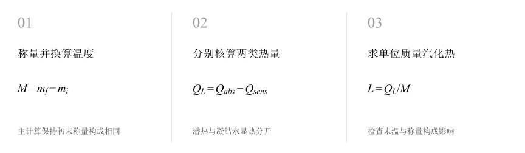
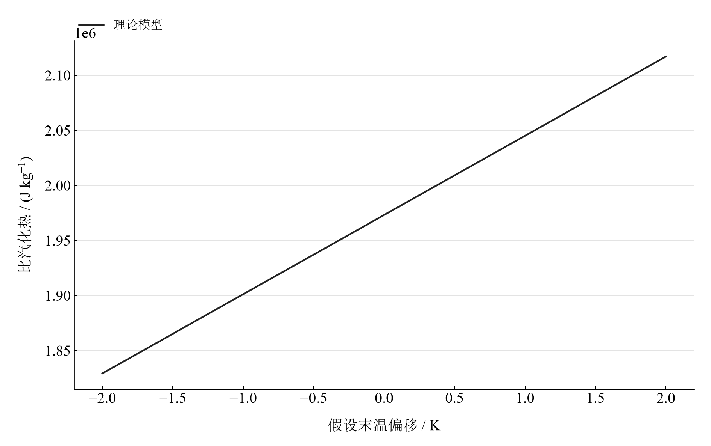

[普通物理实验 1](../README.md) · [项目首页](../../../README.md) · [使用指南](../../../docs/usage.md)

# 液体比汽化热的测量

**从蒸汽凝结的热平衡中，分离潜热与显热。**

让蒸汽进入量热器，以初末称量确定凝结质量，以传感器电压换算温度。冷水与器件吸热、凝结水降温放热分别核算，最后求单位质量潜热。

[读实验报告](report/report.md) · [HTML 阅读与探索](notebooks/analysis.html) · [Python 笔记本](notebooks/analysis.ipynb) · [Wolfram 笔记本](../../../notebook/paclets/VaporizationHeatLab/Notebooks/VaporizationHeatLab.nb)



图 1　液体比汽化热的测量：测量与计算主线

## 选择你的入口

|用途|入口|打开方式|
|---|---|---|
|阅读原理、记录、计算与结论|[Markdown 报告](report/report.md) · [排版阅读版](report/report.html)|GitHub、Markdown 阅读器或浏览器|
|浏览计算图表、操作交互控件|[HTML 阅读版](notebooks/analysis.html)|下载后用浏览器打开|
|逐步执行和修改 Python 计算|[Jupyter Notebook](notebooks/analysis.ipynb)|JupyterLab 或 VS Code|
|原生数学排版与 Wolfram 计算|[Wolfram Notebook](../../../notebook/paclets/VaporizationHeatLab/Notebooks/VaporizationHeatLab.nb) · [Paclet 安装包](../../../notebook/paclets/VaporizationHeatLab/dist/VaporizationHeatLab-0.1.0.paclet)|Wolfram 前端|
|对照原始报告|[源报告 PDF](../../../pdf/course-01/液体比汽化热的测量/液体比汽化热测量实验报告.pdf)|GitHub 或 PDF 阅读器|

## 从记录到物理量

内筒与搅拌器质量、初末总质量及 3 个温度电压条件；冷水质量 119.76 g，初末相同称量构成时凝结质量 7.80 g，温升 32.5 K。

核心计算关系为：

$$
L=\frac{C_{\mathrm{sys}}(t_2-t_1)}{M}-c_{\mathrm w}(t_3-t_2).
$$

$C_{\mathrm{sys}}$ 为水、内筒与搅拌器的总热容，$M$ 为蒸汽凝结质量。第一项是每单位凝结质量对应的系统吸热，第二项扣除凝结水从蒸汽温度降至末温释放的显热。公式中质量采用克时，结果先为 J/g。

表 1　关键计算结果

|物理量|计算值|单位|
|---|---:|---|
|默认构成条件比汽化热|1973118|J/kg|
|末态额外计搅拌器时比汽化热|4108769.9|J/kg|
|末温灵敏系数|71945.877|J/(kg·K)|

初末相同称量构成时，比汽化热约 1.973 × 10⁶ J/kg。末态若额外计入搅拌器，凝结质量和结果随之改变，表中并列两种条件。核对称量构成是确定结论的关键；温度扫描帮助判断散热引起的偏差方向。

## 沿着图像理解结果



图 2　固定质量、初温和蒸汽温度时，假设末温偏移对应的比汽化热模型响应

完整记录、计算过程与结果讨论见[实验报告](report/report.md)。图中拟合与模型的物理含义可在 Notebook 中逐步计算。

## 在参数变化中继续探索

|操作|参数范围与默认值|观察什么|
|---|---|---|
|假设末温偏移滑块|−2 至 2 K，默认 0 K|保持初温、质量和 100 °C 蒸汽温度，观察热平衡估值的变化。|

在 [HTML](notebooks/analysis.html) 中操作已有控件；在 [Jupyter](notebooks/analysis.ipynb) 或 [Wolfram](../../../notebook/paclets/VaporizationHeatLab/Notebooks/VaporizationHeatLab.nb) 中运行全部单元，可继续修改输入与计算。

## 在本机打开

环境安装见[使用指南](../../../docs/usage.md)。在仓库根目录启动：

```powershell
.\.venv\Scripts\python.exe -m jupyterlab experiments/course-01/vaporization-heat/notebooks/analysis.ipynb
```

Wolfram 安装独立包后，通过包入口打开 Notebook。将仓库路径改为本机路径：

```wolfram
PacletInstall["D:/general-physics-lab/notebook/paclets/VaporizationHeatLab/dist/VaporizationHeatLab-0.1.0.paclet"];
Needs["VaporizationHeatLab`"];
VaporizationHeatLab`OpenNotebook[]
```

## 数据与计算实现

|内容|文件|
|---|---|
|质量与测温电压|[observations.csv](data/observations.csv)|
|单位、参数与模型条件|[experiment.json](experiment.json)|
|Python 实现|[vaporization_heat.py](../../../src/physicslab/experiments/vaporization_heat.py)|
|Wolfram 实现|[VaporizationHeatLab.wl](../../../notebook/paclets/VaporizationHeatLab/Kernel/VaporizationHeatLab.wl)|

[数据来源](data/provenance.json) · [返回课程目录](../README.md)
