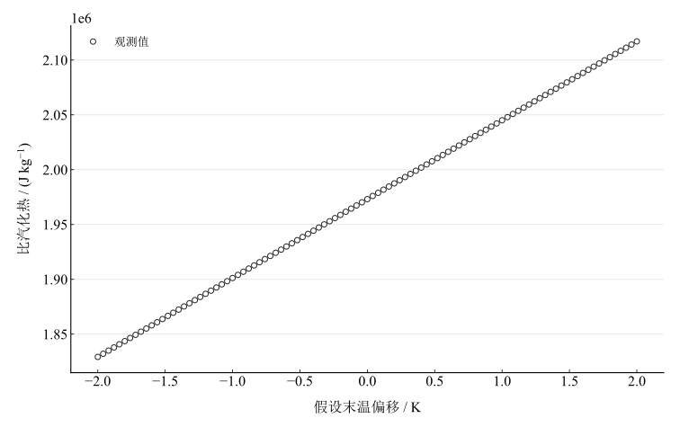

# 液体比汽化热测量实验报告

淮南师范学院　电子工程学院　物理学专业　24物理1班  
姓名：缪雨轩　学号：2414050120　实验日期：2025年11月22日

## 一、实验名称

水的汽化热的测定。

## 二、实验目的

学习AD590集成电路温度传感器的测温原理和方法；掌握混合法测定水比汽化热；练习热学数据处理和误差分析。

## 三、实验原理

比汽化热 $L$ 是单位质量液体在温度不变时汽化吸收的热量。本实验将质量为 $M$、温度为 $t_3$ 的水蒸气通入初温为 $t_1$ 的冷水。蒸汽凝结释放潜热，再降至混合末温 $t_2$ 释放显热，冷水、内筒和搅拌器吸热。忽略对环境热交换时，

$$
ML+MC_{\mathrm{w}}(t_3-t_2)=
(m_{\mathrm{w}}C_{\mathrm{w}}+m_1C_1+m_2C_2)(t_2-t_1).
$$

记系统热容为 $C_{\mathrm{sys}}$，则

$$
L=\frac{C_{\mathrm{sys}}(t_2-t_1)}M-C_{\mathrm{w}}(t_3-t_2).
$$

质量用克、比热用 $\mathrm{J\,g^{-1}\,K^{-1}}$ 时，所得 $L$ 为 $\mathrm{J\,g^{-1}}$，乘1000转为 $\mathrm{J\,kg^{-1}}$。AD590输出电流近似与绝对温度成正比，经测量电阻转换成电压；按本次采用的标定，电压的毫伏数值等于温度的开尔文数值，即 $t=U-273.15$（摄氏度数值）。实际增益、零点及其误差尚需标定资料支持。

## 四、主要仪器设备

量热器（内筒、搅拌器）、电子天平、万用表、AD590温度传感器、电阻箱和电加热蒸汽发生器。采用水比热 $4.18\,\mathrm{J\,g^{-1}\,K^{-1}}$，铝内筒比热 $0.897\,\mathrm{J\,g^{-1}\,K^{-1}}$，金属搅拌器比热近似 $0.39\,\mathrm{J\,g^{-1}\,K^{-1}}$；比较用比汽化热为 $2.25\times10^6\,\mathrm{J\,kg^{-1}}$。

## 五、实验步骤

称量内筒和搅拌器，向内筒装入约三分之二容积、低于室温的冷水，再称量初态总质量。连接温度测量电路，将探头浸入水中且不触壁底，轻轻搅拌并记录稳定初温电压。开启蒸汽发生器，沸腾后等待稳定蒸汽，插管前清除管口冷凝液滴。

将导管浸入水中约1–2 $\mathrm{cm}$，均匀搅拌并观察电压；达到计划温升后移出导管，继续搅拌，记录最高稳定末温电压。操作说明的计划值约313 $\mathrm{mV}$，本次实际最高稳定值为318.3 $\mathrm{mV}$。随即称量末态总质量，按一致的称量构成确定凝结水质量。

## 六、原始数据记录

表 1　质量和温度电压记录

| 物理量 | 符号 | 数值 | 单位 | 备注 |
| --- | --- | --- | --- | --- |
| 量热器内筒质量 | $m_1$ | 29.52 | g | — |
| 搅拌器质量 | $m_2$ | 3.84 | g | — |
| 初态筒与水质量 | $m_{\mathrm{i}}$ | 149.28 | g | 未计入搅拌器 |
| 末态总质量 | $m_{\mathrm{f}}$ | 157.08 | g | 称量构成未另注明 |
| 初温电压 | $U_1$ | 285.8 | mV | — |
| 末温电压 | $U_2$ | 318.3 | mV | 最高稳定值 |
| 蒸汽理论温度电压 | $U_3$ | 373.2 | mV | 100℃理论圆整值 |

初态总质量注明未计搅拌器；末态总质量未另注明构成。主计算沿用相同称量构成的质量差，同时给出末态额外计入搅拌器的条件结果。$U_3=373.2\,\mathrm{mV}$ 是 $100\,^{\circ}\mathrm{C}$ 的理论圆整表示，不是独立测得的蒸汽温度。

## 七、数据处理

### 1. 质量与温度

$$
m_{\mathrm{w}}=149.28-29.52=119.76\,\mathrm{g},\qquad
M=157.08-149.28=7.80\,\mathrm{g}.
$$

采用传感器标定换算，初温为 12.65 $^{\circ}\mathrm{C}$，末温为 45.15 $^{\circ}\mathrm{C}$；蒸汽温度取 $100.00\,^{\circ}\mathrm{C}$。冷水温升为 32.5 $\mathrm{K}$，凝结水温降为 54.85 $\mathrm{K}$。

### 2. 热容和能量

$$
C_{\mathrm{sys}}=119.76\times4.18+29.52\times0.897+3.84\times0.39.
$$

系统热容为 528.57384 $\mathrm{J\,K^{-1}}$。依次计算

$$
Q_{\mathrm{abs}}=C_{\mathrm{sys}}(t_2-t_1),\qquad
Q_{\mathrm{sens}}=MC_{\mathrm{w}}(t_3-t_2),\qquad
Q_L=Q_{\mathrm{abs}}-Q_{\mathrm{sens}}.
$$

表 2　混合过程热量计算

| 能量项 | 数值 / J |
| --- | --- |
| 系统吸热 | 17178.65 |
| 凝结水显热 | 1788.3294 |
| 凝结潜热 | 15390.32 |

### 3. 比汽化热与称量构成敏感性

按初末相同称量构成，

$$
L=\frac{Q_L}{M}\times1000\quad(\mathrm{J\,kg^{-1}}).
$$

得到 1973118 $\mathrm{J\,kg^{-1}}$，相对比较值的差异为 12.30586667 $\%$。若末态额外包含搅拌器而初态未包含，蒸汽质量应改为 $M'=157.08-149.28-3.84=3.96\,\mathrm{g}$，其余冷水和器件热容不变，结果如下。

表 3　两种称量构成下的条件结果

| 称量构成假设 | 凝结质量 / g | 比汽化热 / (J kg⁻¹) |
| --- | --- | --- |
| 初末均不含搅拌器（沿用源公式） | 7.8 | 1973118 |
| 仅末态额外计入搅拌器 | 3.96 | 4108769.9 |

称量构成对结果影响显著，必须核对操作记录后才能在两种情形之间确定。现有主结果保留源计算使用的同构成假设，不能据此排除另一种情况。

### 4. 末温灵敏度

固定质量、比热和初温，末温改变时，

$$
\frac{\partial L}{\partial t_2}=\frac{C_{\mathrm{sys}}}M+C_{\mathrm{w}}.
$$

该式以 $\mathrm{J\,g^{-1}\,K^{-1}}$ 表示；转为每千克后的灵敏系数为 71945.87692 $\mathrm{J\,kg^{-1}\,K^{-1}}$。以下扫描末温假设偏移 $\pm2\,\mathrm{K}$，仅比较响应，不表示实际温度误差已确定。

图 1　假设末温偏移对比汽化热条件估值的影响

## 八、实验结果与讨论

在初末称量构成相同、蒸汽温度100 ${}^{\circ}\mathrm{C}$及忽略环境热交换等条件下，比汽化热为 1973118 $\mathrm{J\,kg^{-1}}$，较比较值偏低。末态称量构成尚未核实，完整不确定度也无法由现有材料确定，因此结果应保留条件身份。

末温在实验后期高于环境时，散热会使末温偏低；正的末温灵敏系数说明该偏差使反算 $L$ 偏低。蒸汽夹带液滴时，液滴质量计入凝结质量却没有对应潜热，同样会使反算结果降低。凝结质量由两次较大总质量作差，易受称量和残留液滴影响。另需考虑AD590标定、探头热滞后、搅拌均匀性及实际气压对沸点的影响。

## 九、思考题

**为什么希望初温低于室温、末温高于室温，且两侧温差接近？**

这有助于在前期从环境吸热、后期向环境放热之间形成近似抵偿，减少净热交换。抵偿大小还取决于温差随时间的变化和换热条件，初末温差相等并不保证精确抵消。本次初温12.65 ${}^{\circ}\mathrm{C}$、末温45.15 ${}^{\circ}\mathrm{C}$；若按讨论中约15 ${}^{\circ}\mathrm{C}$室温，则两侧温差明显不对称，不能认为已充分抵偿。后续应记录完整温度及环境温度过程，配合相同称量构成核对建立修正。
