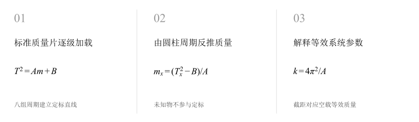
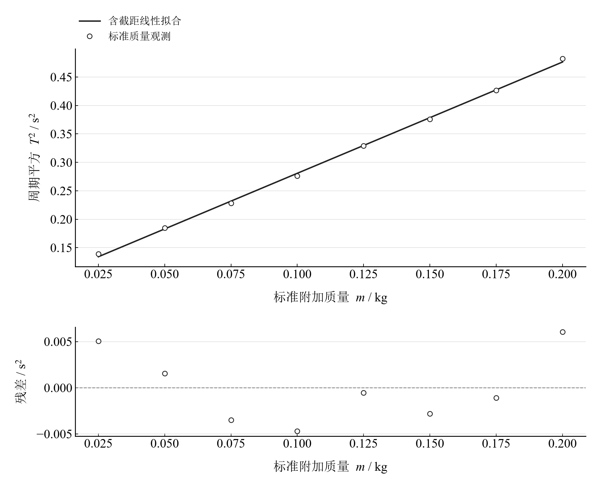

[普通物理实验 2](../README.md) · [项目首页](../../../README.md) · [使用指南](../../../docs/usage.md)

# 惯性秤的应用

**用振动周期称量质量，从定标直线反推未知物。**

标准质量片加载惯性秤，周期平方建立质量定标。再测圆柱体周期，通过同一条直线反推惯性质量，并从斜率与截距理解等效劲度和空载质量。

[读实验报告](report/report.md) · [HTML 阅读版](https://hnnuyuxuan.github.io/general-physics-lab/experiments/course-02/inertial-balance/notebooks/analysis.html) · [Python 笔记本](notebooks/analysis.ipynb) · [Wolfram 笔记本](../../../notebook/paclets/InertialBalanceLab/Notebooks/InertialBalanceLab.nb)



图 1　惯性秤的应用：测量与计算主线

## 选择你的入口

|用途|入口|打开方式|
|---|---|---|
|阅读原理、记录、计算与结论|[Markdown 报告](report/report.md) · [排版阅读版](https://hnnuyuxuan.github.io/general-physics-lab/experiments/course-02/inertial-balance/report/report.html)|GitHub、Markdown 阅读器或浏览器|
|浏览计算图表与结果|[HTML 阅读版](https://hnnuyuxuan.github.io/general-physics-lab/experiments/course-02/inertial-balance/notebooks/analysis.html)|直接在线打开，也可下载到本机|
|逐步执行和修改 Python 计算|[Jupyter Notebook](notebooks/analysis.ipynb)|JupyterLab 或 VS Code|
|原生数学排版与 Wolfram 计算|[Wolfram Notebook](../../../notebook/paclets/InertialBalanceLab/Notebooks/InertialBalanceLab.nb) · [Paclet 安装包](../../../notebook/paclets/InertialBalanceLab/dist/InertialBalanceLab-0.1.0.paclet)|Wolfram 前端|
|对照原始报告|[源报告 PDF](../../../pdf/course-02/惯性秤的应用/实验报告-惯性秤的应用.pdf)|GitHub 或 PDF 阅读器|

## 从记录到物理量

25–200 g 的 8 组标准质量周期和 1 组圆柱周期；计数器按 20 个周期测量，圆柱标称质量 190.5 g 作为比较输入。

核心计算关系为：

$$
T^2=Am+B,\qquad m_x=\frac{T_x^2-B}{A},\qquad \widetilde k=\frac{4\pi^2}{A}.
$$

小振幅下周期由附加质量、空载等效质量和悬臂劲度共同决定。前八组建立定标，圆柱只用其周期反推质量，截距保留系统空载贡献。

表 1　关键计算结果

|物理量|计算值|单位|
|---|---:|---|
|圆柱体反推惯性质量|193.60424|g|
|相对标称190.5g差异|1.6295216|%|
|等效劲度系数|20.184331|N/m|

圆柱反推质量约 193.60 g，相对标称值差约 1.63%。定标参数协方差传播得到质量分量约 1.33 g；圆柱周期和标准质量的测量分量可继续纳入预算。空载等效质量是截距外推的模型量。

## 沿着图像理解结果



图 2　八组标准质量的周期平方定标及拟合残差；圆柱标称值作为比较输入

完整记录、计算过程与结果讨论见[实验报告](report/report.md)。图中拟合与模型的物理含义可在 Notebook 中逐步计算。

## 在 Notebook 中复算

|计算步骤|观察什么|
|---|---|
|读取本实验的规范数据|读取八组标准质量及周期，建立定标直线。|
|依次执行数据处理单元|对照中间计算表，完成由圆柱周期反推质量。|
|重新绘图并查看结果|完成解释等效系统参数，检查图线与物理参数。|

在 [Jupyter](notebooks/analysis.ipynb) 或 [Wolfram](../../../notebook/paclets/InertialBalanceLab/Notebooks/InertialBalanceLab.nb) 中从头执行，即可复算图表与结果。HTML 保存相同数据的计算输出，适合直接阅读。

## 在本机打开

环境安装见[使用指南](../../../docs/usage.md)。在仓库根目录启动：

```powershell
.\.venv\Scripts\python.exe -m jupyterlab experiments/course-02/inertial-balance/notebooks/analysis.ipynb
```

Wolfram 安装独立包后，通过包入口打开 Notebook。将仓库路径改为本机路径：

```wolfram
PacletInstall["D:/general-physics-lab/notebook/paclets/InertialBalanceLab/dist/InertialBalanceLab-0.1.0.paclet"];
Needs["InertialBalanceLab`"];
InertialBalanceLab`OpenNotebook[]
```

## 数据与计算实现

|内容|文件|
|---|---|
|标准质量与圆柱周期|[observations-01.csv](data/observations-01.csv)|
|单位、参数与模型条件|[experiment.json](experiment.json)|
|Python 实现|[inertial_balance.py](../../../src/physicslab/experiments/inertial_balance.py)|
|Wolfram 实现|[InertialBalanceLab.wl](../../../notebook/paclets/InertialBalanceLab/Kernel/InertialBalanceLab.wl)|

[数据来源](data/provenance.json) · [返回课程目录](../README.md)
