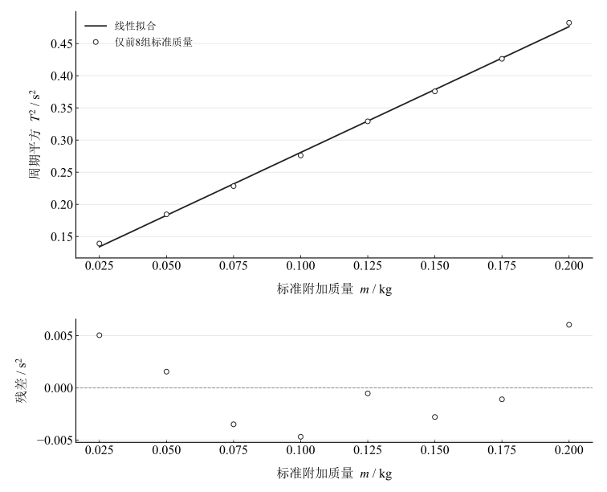

# 惯性秤的应用

## 实验名称

惯性秤的应用

## 实验目的

1.  了解惯性秤的结构和工作原理，掌握利用振动周期测量惯性质量的方法。

2.  验证惯性秤周期平方 $T^{2}$ 与附加质量 $m$ 的线性关系。

3.  利用标准质量片建立定标直线，测量圆柱体的惯性质量，并计算相对误差。

## 实验原理

惯性秤由载物台和两片平行弹性悬臂组成。载物台沿水平方向作小振幅振动时，可近似视为简谐振动。若载物台上附加质量为 $m$，振动体空载时的等效质量为 $m_{0}$，悬臂振动体的等效劲度系数为 $\widetilde{k}$，则振动周期为

$$T=2\pi \sqrt{\frac{m+m_{0}}{\widetilde{k}}}\text{.}$$

两边平方，得到

$$T^{2}=\frac{4\pi ^{2}}{\widetilde{k}}m+\frac{4\pi ^{2}m_{0}}{\widetilde{k}}\text{.}$$

令

$$T^{2}=Am+B\text{,}$$

则

$$A=\frac{4\pi ^{2}}{\widetilde{k}},\quad\quad B=\frac{4\pi ^{2}m_{0}}{\widetilde{k}}\text{.}$$

因此，先用已知质量片测量周期并建立 $T^{2}-m$ 定标直线，再由待测圆柱体的周期即可反求其惯性质量。同时有

$$\widetilde{k}=\frac{4\pi ^{2}}{A},\quad\quad m_{0}=\frac{B}{A}\text{.}$$

## 主要仪器设备

惯性秤、DHTC-1A 通用计数器、光电门、8片标准质量片（每片 $25\:g$）、待测圆柱体。

## 实验步骤

1.  调节惯性秤底座，使载物台保持水平；连接光电门与通用计数器，将周期数设置为 $n=20$。

2.  依次加入 $25∼200\:g$ 的标准质量片。质量片按"先中间、后两边、尽量对称"的原则放置。

3.  每次待质量片放稳后，轻推载物台，使初始偏角不超过 $5^{\text{∘}}$；待计数器完成20个周期测量后，记录单周期 $T$。

4.  取下标准质量片，将圆柱体放在载物台中心，按相同方法测量其周期。

5.  计算各组 $T^{2}$，采用逐差法和最小二乘法处理定标数据，求圆柱体质量、相对误差、等效劲度系数和空载等效质量。

## 原始数据记录

实验条件：周期数 $n=20$；单片标准质量 $25\:g$；圆柱体标称质量 $190.5\:g$。

表 1　标准质量片与圆柱体的周期记录及派生量

| 次数 | 1 | 2 | 3 | 4 | 5 | 6 | 7 | 8 | 9 |
| --- | --- | --- | --- | --- | --- | --- | --- | --- | --- |
| 样品 | 标准质量片 | 标准质量片 | 标准质量片 | 标准质量片 | 标准质量片 | 标准质量片 | 标准质量片 | 标准质量片 | 圆柱体 |
| 质量 / g | 25 | 50 | 75 | 100 | 125 | 150 | 175 | 200 | 190.5（标称，不定标） |
| 周期 / s | 0.372956 | 0.42954 | 0.477866 | 0.525413 | 0.573683 | 0.612982 | 0.652948 | 0.694534 | 0.681051 |
| 周期平方 / s² | 0.13909618 | 0.18450461 | 0.22835591 | 0.27605882 | 0.32911218 | 0.37574693 | 0.42634109 | 0.48237748 | 0.46383046 |
| 隔四组平方差 / s² | 0.19001601 | 0.19124232 | 0.19798518 | 0.20631866 | — | — | — | — | — |
| 隔四组质量差 / g | 100 | 100 | 100 | 100 | — | — | — | — | — |

注：逐差量按 $\Delta T_{i}^{2}=T_{i+4}^{2}-T_{i}^{2}$、$\Delta m_{i}=m_{i+4}-m_{i}$ 计算；第9组的190.5 g为圆柱体标称质量，不参与定标拟合。

## 数据处理

### （一）逐差法求斜率

仅前八组标准质量参与定标，取相隔四组的 $100\,\mathrm g$ 差得到平均斜率 $1.963905402\,\mathrm{s^2/kg}$。所有平方量从六位小数周期重新计算，未从已修约的平方表反算。

### （二）最小二乘法拟合

以千克为质量单位，带截距拟合为 $T^2=Am+B$，$A=1.955894242\,\mathrm{s^2/kg}$、$B=0.085161049\,\mathrm{s^2}$，$R^2=0.99892763$。

图 1　前八组标准质量的周期平方定标及残差

### （三）斜率不确定度

残差给出的斜率标准误为 $0.026162232\,\mathrm{s^2/kg}$。拟合中的斜率与截距相关，传播到质量时保留 $\operatorname{Cov}(A,B)=-\bar m\operatorname{Var}(A)$；未给标准质量和每组周期误差，不能作为完整定标不确定度。

### （四）圆柱体惯性质量及相对误差

圆柱周期 $T_x=0.681051\,\mathrm s$，由 $m_x=(T_x^2-B)/A$ 得 $193.604239\,\mathrm g$。标称质量 $190.5\,\mathrm g$ 未作为真值加入定标，以其作比较的相对差为 $1.62952\%$。仅传播定标参数协方差的质量分量为 $1.328156\,\mathrm g$，不含待测周期、标称值或标准质量的不确定度。

### （五）等效劲度系数与空载等效质量

$\widetilde k=4\pi^2/A=20.184331\,\mathrm{N/m}$，斜率残差传播分量为 $0.269988\,\mathrm{N/m}$。$m_0=B/A=43.540723\,\mathrm g$，保留参数协方差时定标分量为 $2.223410\,\mathrm g$。

## 实验结果与讨论

前八组标准质量的 $T^2-m$ 关系近似线性。圆柱反推惯性质量约 $193.60\,\mathrm g$，相对标称值差约 $1.63\%$。标称值未附校准不确定度，不能将其直接称为真值；同样不能以偏差较小单独证明准确度。

等效劲度系数约 $20.18\,\mathrm{N/m}$、空载等效质量约 $43.54\,\mathrm g$。周期数据随附加质量的变化支持简谐模型作为该范围的近似；没有空载独立测量，$m_0$ 是定标截距外推的等效参数。

质量片偏心放置、扭转振动、过大初始振幅、光电门触发、悬臂内耗、空气阻力和台面振动均会影响周期。应保持质量片居中对称、小振幅和相同触发条件，并补充每组重复周期和标准质量校准信息。
