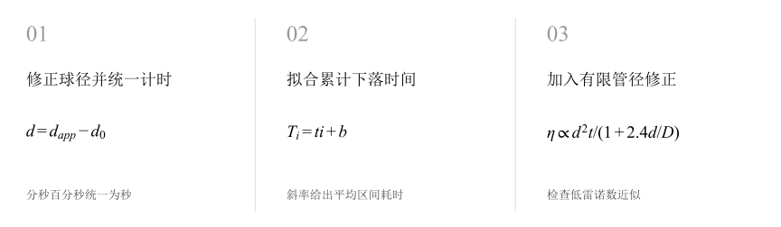
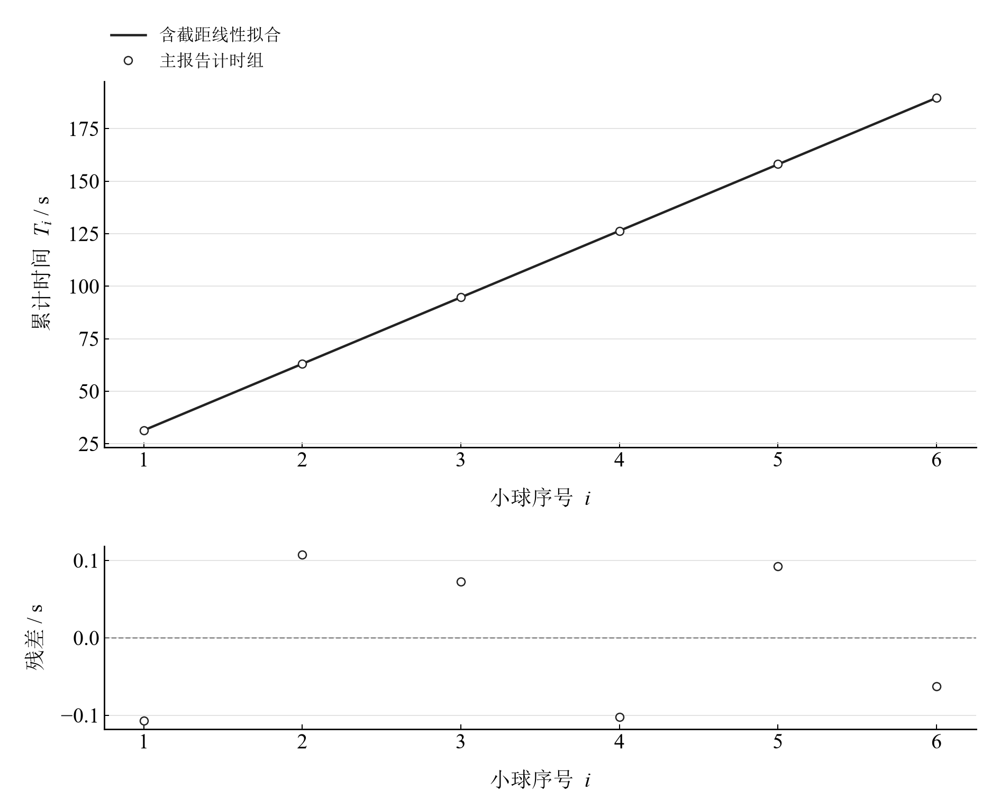
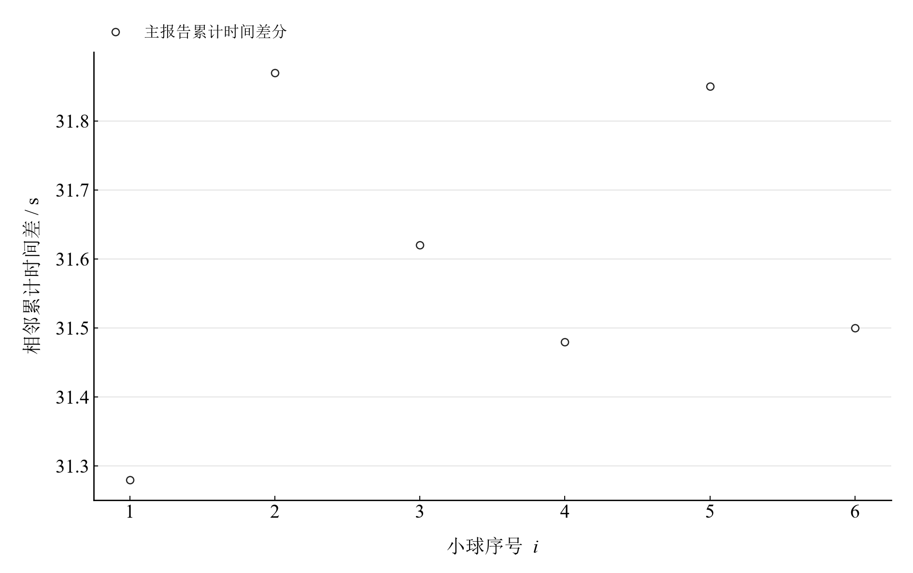

[普通物理实验 2](../README.md) · [项目首页](../../../README.md) · [使用指南](../../../docs/usage.md)

<!-- virtual-laboratory-entry -->
[在线虚拟实验](https://hnnuyuxuan.github.io/general-physics-lab/simulations/liquid-viscosity/) · [模型依据与参数来源](../../../docs/liquid-viscosity-model-evidence.md)

# 液体粘度系数的测量

**从小球的缓慢下落，估计液体的黏滞阻力。**

小钢球沿玻璃管下落，连续计时形成累计记录。由时间直线的斜率求平均下落时间，结合直径零差与管壁修正，计算蓖麻油黏度。

[读实验报告](report/report.md) · [HTML 阅读版](https://hnnuyuxuan.github.io/general-physics-lab/experiments/course-02/liquid-viscosity/notebooks/analysis.html) · [Python 笔记本](notebooks/analysis.ipynb) · [Wolfram 笔记本](../../../notebook/paclets/LiquidViscosityLab/Notebooks/LiquidViscosityLab.nb)



图 1　液体粘度系数的测量：测量与计算主线

## 选择你的入口

|用途|入口|打开方式|
|---|---|---|
|阅读原理、记录、计算与结论|[Markdown 报告](report/report.md) · [排版阅读版](https://hnnuyuxuan.github.io/general-physics-lab/experiments/course-02/liquid-viscosity/report/report.html)|GitHub、Markdown 阅读器或浏览器|
|浏览计算图表与结果|[HTML 阅读版](https://hnnuyuxuan.github.io/general-physics-lab/experiments/course-02/liquid-viscosity/notebooks/analysis.html)|直接在线打开，也可下载到本机|
|逐步执行和修改 Python 计算|[Jupyter Notebook](notebooks/analysis.ipynb)|JupyterLab 或 VS Code|
|原生数学排版与 Wolfram 计算|[Wolfram Notebook](../../../notebook/paclets/LiquidViscosityLab/Notebooks/LiquidViscosityLab.nb) · [Paclet 安装包](../../../notebook/paclets/LiquidViscosityLab/dist/LiquidViscosityLab-0.1.0.paclet)|Wolfram 前端|
|对照原始报告|[源报告 PDF](../../../pdf/course-02/08-液体粘度系数的测量/实验报告-液体粘滞系数的测量.pdf)|GitHub 或 PDF 阅读器|

## 从记录到物理量

6 个直径读数及 6 个累计时间，温度 25 °C；测量区间 0.200 m，管内径 20.0 mm，正零差修正后球径 0.990 mm。

核心计算关系为：

$$
T_i=ti+b,\qquad \eta=\frac{(\rho-\rho_0)gd^2t}{18L(1+2.4d/D)}.
$$

斯托克斯模型采用低雷诺数、轴向收尾运动。有限管径因子修正管壁引起的阻力增强，累计计时模型以同区间的累计耗时为前提。

表 1　关键计算结果

|物理量|计算值|单位|
|---|---:|---|
|累计时间斜率|31.655143|s|
|有限管径修正黏度|0.51710216|Pa·s|
|按当前估计计算的雷诺数|0.011491274|—|

有限管径修正后黏度约 0.5171 Pa·s，估计雷诺数约 0.01149。报告传播了指定直径与时间分量；温度、密度、距离、管径及收尾状态影响测量的完整解释。

## 沿着图像理解结果



图 2　六个实际累计时间与序号的带截距拟合及残差



图 3　六个累计读数的相邻差，观察单次计时的离散

完整记录、计算过程与结果讨论见[实验报告](report/report.md)。图中拟合与模型的物理含义可在 Notebook 中逐步计算。

## 在 Notebook 中复算

|计算步骤|观察什么|
|---|---|
|读取本实验的规范数据|将分、秒、百分秒读数统一换算为秒。|
|依次执行数据处理单元|对照中间计算表，完成拟合累计下落时间。|
|重新绘图并查看结果|完成加入有限管径修正，检查图线与物理参数。|

在 [Jupyter](notebooks/analysis.ipynb) 或 [Wolfram](../../../notebook/paclets/LiquidViscosityLab/Notebooks/LiquidViscosityLab.nb) 中从头执行，即可复算图表与结果。HTML 保存相同数据的计算输出，适合直接阅读。

## 在本机打开

环境安装见[使用指南](../../../docs/usage.md)。在仓库根目录启动：

```powershell
.\.venv\Scripts\python.exe -m jupyterlab experiments/course-02/liquid-viscosity/notebooks/analysis.ipynb
```

Wolfram 安装独立包后，通过包入口打开 Notebook。将仓库路径改为本机路径：

```wolfram
PacletInstall["D:/general-physics-lab/notebook/paclets/LiquidViscosityLab/dist/LiquidViscosityLab-0.1.0.paclet"];
Needs["LiquidViscosityLab`"];
LiquidViscosityLab`OpenNotebook[]
```

## 数据与计算实现

|内容|文件|
|---|---|
|材料与装置参数|[observations-01.csv](data/observations-01.csv)|
|钢球直径读数|[observations-02.csv](data/observations-02.csv)|
|连续累计计时|[observations-03.csv](data/observations-03.csv)|
|单位、参数与模型条件|[experiment.json](experiment.json)|
|Python 实现|[liquid_viscosity.py](../../../src/physicslab/experiments/liquid_viscosity.py)|
|Wolfram 实现|[LiquidViscosityLab.wl](../../../notebook/paclets/LiquidViscosityLab/Kernel/LiquidViscosityLab.wl)|

[数据来源](data/provenance.json) · [返回课程目录](../README.md)
