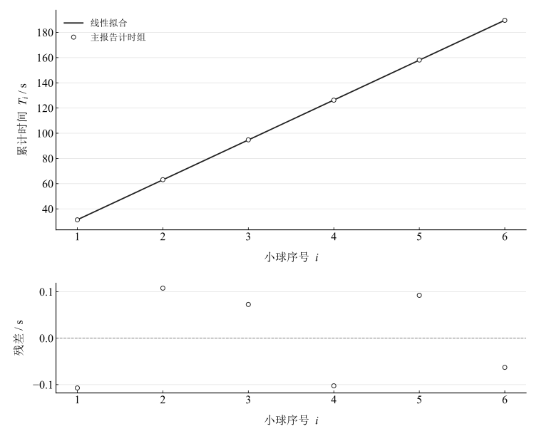
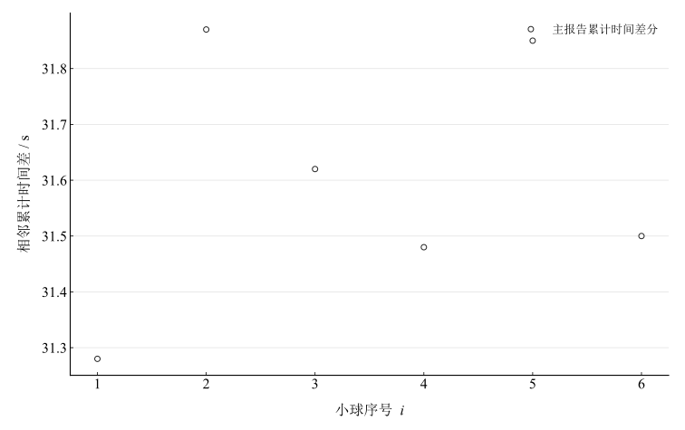

# 液体粘度系数的测量

## 实验名称

液体粘滞系数的测量

## 实验目的

1.  理解液体粘滞现象和斯托克斯定律，掌握落球法测定液体粘滞系数的基本原理。

2.  掌握螺旋测微器、秒表和落球法粘滞系数测量仪的规范操作方法。

3.  学会对连续计时数据进行逐差法和最小二乘法处理，并完成直接测量量与间接测量量的不确定度评定。

4.  分析有限管径、人工计时和小球运动状态等因素对测量结果的影响。

## 实验原理

### **（一）斯托克斯定律**

半径较小、表面光滑的钢球在粘滞液体中下落时，受到重力、浮力和粘滞阻力。小球达到收尾速度 $v_{0}$ 后近似做匀速直线运动。斯托克斯定律给出的粘滞阻力为：

$$f = 3\pi\eta dv_{0}$$

式中，$\eta$ 为液体粘滞系数，$d$ 为小球直径。小球匀速下落时满足：

$$mg = F_{\text{浮}} + f$$

由此得到无限广延液体中的粘滞系数：

$$\eta = \frac{\left( \rho - \rho_{0} \right)gd^{2}}{18v_{0}}$$

其中，$\rho$ 为钢球密度，$\rho_{0}$ 为液体密度。

### **（二）有限管径修正**

实际实验中小球在内径为 $D$ 的玻璃管内下落，管壁会增大粘滞阻力。取小球通过测量区间 $L$ 的时间为 $t$，有 $v_{0} = L/t$，考虑管壁修正后：

$$\eta = \frac{\left( \rho - \rho_{0} \right)gd^{2}t}{18L\left( 1 + 2.4\frac{d}{D} \right)}$$

### **（三）连续计时与最小二乘法**

六个小球依次通过相同测量区间，秒表连续运行。设第 $i$ 次累计时间为 $T_{i}$，则理论上：

$$T_{i} = ti + b$$

其中斜率 $t$ 即一个小球通过测量区间的平均时间，$b$ 表示启动时刻造成的截距偏差。用最小二乘法拟合 $T_{i} - i$ 直线，可综合利用全部累计时间并减小随机计时误差。

## 主要仪器设备

落球法粘滞系数测定仪、蓖麻油、小钢球、螺旋测微器、秒表、镊子、钢盘和温度测量装置。

## 实验步骤

1.  调节实验装置，使盛有蓖麻油的玻璃管保持竖直，确认液体中无明显气泡和杂质。

2.  检查螺旋测微器零点，记录零点误差；依次测量六个小钢球的直径。

3.  将小球用镊子放入液体中央，避免贴近管壁或带入气泡。

4.  以玻璃管 $0\text{～}20\ cm$ 刻度段作为测量区间。第一个小球到达起始刻度时启动秒表，到达终止刻度时记录累计时间；秒表不清零，依次完成六个小球的连续计时。

5.  记录温度、量筒内径和测量距离，采用逐差法与最小二乘法求平均下落时间，计算粘滞系数及其不确定度。

## 原始数据记录

### **（一）实验条件**

表 1　实验条件

| 物理量 | 符号 | 数值 | 单位 |
| --- | --- | --- | --- |
| 待测液体 | — | 蓖麻油 | — |
| 测试温度 | T | 25 | ℃ |
| 钢球密度 | ρ | 7.8×10³ | kg/m³ |
| 蓖麻油密度 | ρ₀ | 0.95×10³ | kg/m³ |
| 重力加速度 | g | 9.8 | m/s² |
| 玻璃管内径 | D | 20.0 | mm |
| 匀速测量距离 | L | 20.0 | cm |
| 螺旋测微器零点误差 | d₀ | +0.005 | mm |
| 秒表分辨力 | Δt | 0.01 | s |

### **（二）小球直径记录**

原始记录中的直径写为 $0.0995\ cm$，统一换算为 $0.995\ mm$。螺旋测微器为正零差，故修正直径 $d_{i} = d_{\text{视}i} - d_{0}$。

表 2　钢球直径读数与零差修正

| 测量次数 | 1 | 2 | 3 | 4 | 5 | 6 |
| --- | --- | --- | --- | --- | --- | --- |
| 原始读数 / cm | 0.0995 | 0.0995 | 0.0995 | 0.0995 | 0.0995 | 0.0995 |
| 直径视值 / mm | 0.995 | 0.995 | 0.995 | 0.995 | 0.995 | 0.995 |
| 修正直径 / mm | 0.99 | 0.99 | 0.99 | 0.99 | 0.99 | 0.99 |

### **（三）连续计时记录**

表 3　本组连续计时与单位换算

| 测量次数 | 1 | 2 | 3 | 4 | 5 | 6 |
| --- | --- | --- | --- | --- | --- | --- |
| 原始累计读数 | 31.28 s | 1′03″15 | 1′34″77 | 2′06″25 | 2′38″10 | 3′09″60 |
| 累计时间 / s | 31.28 | 63.15 | 94.77 | 126.25 | 158.1 | 189.6 |
| 单次差 / s | 31.28 | 31.87 | 31.62 | 31.48 | 31.85 | 31.5 |

## 数据处理

### （一）小球直径及其不确定度

原记录 $0.0995\,\mathrm{cm}$ 换算为 $0.995\,\mathrm{mm}$，减正零差 $0.005\,\mathrm{mm}$ 后均值 $d=0.990\,\mathrm{mm}$。六个记录相同只使记录样本的 A 类分量为零，不证明小球完全一致。按给定示值误差限 $0.005\,\mathrm{mm}$ 的均匀分布，$u_B(d)=0.0028868\,\mathrm{mm}$。

### （二）下落时间处理

只使用所列 $31.28$ 至 $189.60\,\mathrm s$ 六个累计值，分秒百分秒按秒转换，不拼接其他计时组。

表 4　三间隔逐差计算

| i | 1 | 2 | 3 |
| --- | --- | --- | --- |
| 三间隔累计差 / s | 94.97 | 94.95 | 94.83 |
| 单次平均 / s | 31.656667 | 31.65 | 31.61 |

逐差平均为 $31.63888889\,\mathrm s$。累计时间带截距拟合 $T_i=ti+b$ 得 $t=31.65514286\,\mathrm s$、$b=-0.26800000\,\mathrm s$，残差斜率标准误 $0.02708113\,\mathrm s$。沿用记录将 $0.01\,\mathrm s$ 作为均匀误差限，合成后 $u(t)=0.02768973\,\mathrm s$。此处理未另计人为反应或小球投放空档；累计模型以这些值代表同一测量区间的累计耗时为前提。

图 1　累计时间与小球序号的拟合及残差

图 2　六个累计值的相邻差分

### （三）粘滞系数计算

取 $\rho=7800\,\mathrm{kg/m^3}$、$\rho_0=950\,\mathrm{kg/m^3}$、$g=9.8\,\mathrm{m/s^2}$、$L=0.200\,\mathrm m$、$D=0.0200\,\mathrm m$，测量区间平均速度为 $0.006318089\,\mathrm{m/s}$，壁修正因子为 $1+2.4d/D=1.118800$。由有限管径式得到

$$
\eta=\frac{(\rho-\rho_0)gd^2t}{18L(1+2.4d/D)}=0.51710216\,\mathrm{Pa\,s}.
$$

### （四）粘滞系数不确定度

仅考虑所给直径和时间两分量，传播结果为 $0.00289114\,\mathrm{Pa\,s}$，可按相同末位展示为约 $(0.517\pm0.003)\,\mathrm{Pa\,s}$。密度、管径、下落距离、温度及壁修正模型的不确定度未给出；这是指定分量下的部分结果，不是完整不确定度。

### （五）斯托克斯条件检验

$\mathrm{Re}=\rho_0vd/\eta=0.01149127\ll1$，支持低雷诺数近似；它不能单独证明进入测量区间前已经达到收尾速度。

## 实验结果与讨论

### （一）实验结果

以所列 $25^\circ\mathrm C$ 及给定密度、长度、正零差修正为条件，黏度估计约 $0.517\,\mathrm{Pa\,s}$。只含直径和时间指定分量时，标准不确定度约 $0.003\,\mathrm{Pa\,s}$。

### （二）数据处理方法讨论

逐差和拟合结果相近，同属这六个累计值的两种处理，不能作为独立测量互证。拟合保留截距；必须确认连续计时定义与小球释放间隔不会向下落时间加入未记录的空档。

### （三）误差分析

直径平方、人工判定、小球球形度与同值记录、偏轴壁效应、未达到收尾速度、温度不均匀及距离管径误差均可能影响结果。没有依据把照片的其他两组计时混入本组或据相同直径认定真实离散为零。

### （四）改进措施

充分恒温、排气泡、沿轴释放；多方向测量各球直径，使用光电门或视频记录每个区间的独立耗时；纳入管径、下落距离和密度不确定度。

### （五）实验结论

主记录在有限管径与低雷诺数模型下得到黏度约 $0.517\,\mathrm{Pa\,s}$，结论依赖记录计时定义及温度、材料参数；完整系统误差仍需补充测量。
