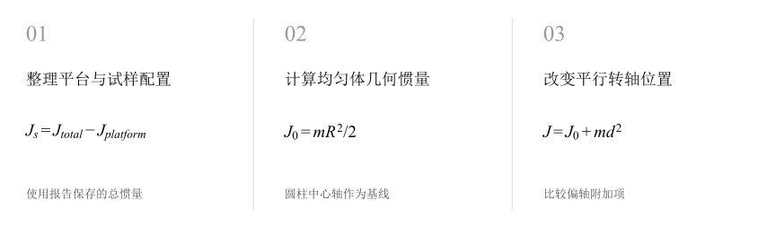
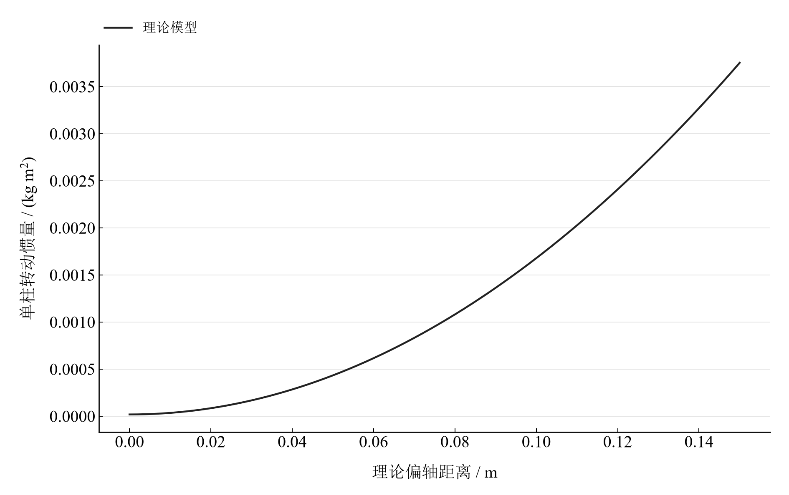

[普通物理实验 2](../README.md) · [项目首页](../../../README.md) · [使用指南](../../../docs/usage.md)

# 刚体转动惯量

**把质量移离转轴，观察转动惯量怎样按距离平方增加。**

以空平台、同轴圆环和对称圆柱配置理解转动惯量。比较报告保存的总惯量之差与几何理论，再沿平行轴定理扫描圆柱位置。

[读实验报告](report/report.md) · [HTML 阅读与探索](notebooks/analysis.html) · [Python 笔记本](notebooks/analysis.ipynb) · [Wolfram 笔记本](../../../notebook/paclets/MomentOfInertiaLab/Notebooks/MomentOfInertiaLab.nb)



图 1　刚体转动惯量：测量与计算主线

## 选择你的入口

|用途|入口|打开方式|
|---|---|---|
|阅读原理、记录、计算与结论|[Markdown 报告](report/report.md) · [排版阅读版](report/report.html)|GitHub、Markdown 阅读器或浏览器|
|浏览计算图表、操作交互控件|[HTML 阅读版](notebooks/analysis.html)|下载后用浏览器打开|
|逐步执行和修改 Python 计算|[Jupyter Notebook](notebooks/analysis.ipynb)|JupyterLab 或 VS Code|
|原生数学排版与 Wolfram 计算|[Wolfram Notebook](../../../notebook/paclets/MomentOfInertiaLab/Notebooks/MomentOfInertiaLab.nb) · [Paclet 安装包](../../../notebook/paclets/MomentOfInertiaLab/dist/MomentOfInertiaLab-0.1.0.paclet)|Wolfram 前端|
|对照原始报告|[源报告 PDF](../../../pdf/course-02/05-刚体转动惯量/实验报告-刚体转动惯量的测定.pdf)|GitHub 或 PDF 阅读器|

## 从记录到物理量

圆环与圆柱的几何质量数据、6 组已报角加速度（每组 4 个值）及 3 个已报总惯量；圆柱质量 0.166 kg、半径 0.015 m、偏轴距离 0.100 m。

核心计算关系为：

$$
J_{\mathrm{ring}}=\frac{m(R_{\mathrm o}^2+R_{\mathrm i}^2)}{2},\qquad J(d)=\frac{mR^2}{2}+md^2.
$$

同轴圆环采用均匀环模型；两个相同圆柱对称放置，附加总惯量的一半对应单柱。几何模型提供质量分布与转轴位置的明确关系。

表 1　关键计算结果

|物理量|计算值|单位|
|---|---:|---|
|已报总惯量之差所得圆环惯量|0.004206|kg·m²|
|几何模型圆环惯量|0.00554265|kg·m²|
|几何模型单柱偏轴惯量|0.001678675|kg·m²|

圆环已报总惯量之差约 0.004206 kg·m²，几何模型约 0.005543 kg·m²。当前复算包括几何惯量、已报角加速度均值和总惯量差；完整动力学重算需要遮光计时表与悬挂质量。

## 沿着图像理解结果



图 2　单柱平行轴定理的理论扫描：偏轴距离 0–0.15 m 对应的惯量

完整记录、计算过程与结果讨论见[实验报告](report/report.md)。图中拟合与模型的物理含义可在 Notebook 中逐步计算。

## 在参数变化中继续探索

|操作|参数范围与默认值|观察什么|
|---|---|---|
|理论偏轴距离滑块|0–0.15 m，默认 0.100 m|固定单柱质量与半径，观察惯量的平方增长和中心轴极限。|

在 [HTML](notebooks/analysis.html) 中操作已有控件；在 [Jupyter](notebooks/analysis.ipynb) 或 [Wolfram](../../../notebook/paclets/MomentOfInertiaLab/Notebooks/MomentOfInertiaLab.nb) 中运行全部单元，可继续修改输入与计算。

## 在本机打开

环境安装见[使用指南](../../../docs/usage.md)。在仓库根目录启动：

```powershell
.\.venv\Scripts\python.exe -m jupyterlab experiments/course-02/moment-of-inertia/notebooks/analysis.ipynb
```

Wolfram 安装独立包后，通过包入口打开 Notebook。将仓库路径改为本机路径：

```wolfram
PacletInstall["D:/general-physics-lab/notebook/paclets/MomentOfInertiaLab/dist/MomentOfInertiaLab-0.1.0.paclet"];
Needs["MomentOfInertiaLab`"];
MomentOfInertiaLab`OpenNotebook[]
```

## 数据与计算实现

|内容|文件|
|---|---|
|试样质量与几何|[geometry.csv](data/geometry.csv)|
|单位、参数与模型条件|[experiment.json](experiment.json)|
|Python 实现|[moment_of_inertia.py](../../../src/physicslab/experiments/moment_of_inertia.py)|
|Wolfram 实现|[MomentOfInertiaLab.wl](../../../notebook/paclets/MomentOfInertiaLab/Kernel/MomentOfInertiaLab.wl)|

[数据来源](data/provenance.json) · [返回课程目录](../README.md)
