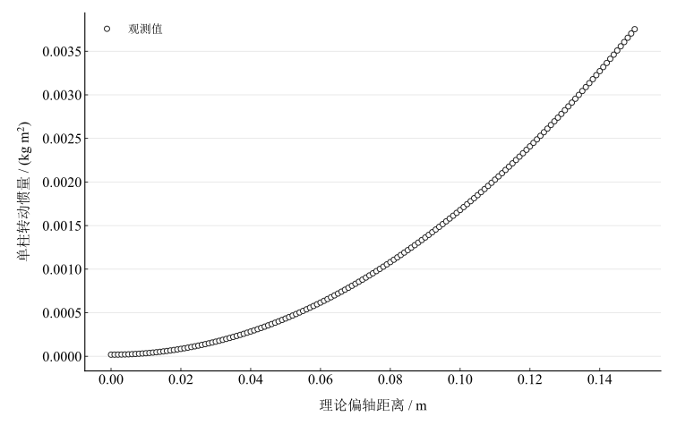

# 刚体转动惯量测定实验报告

淮南师范学院　电子工程学院　物理学专业

## 一、实验名称

刚体转动惯量的测定。

## 二、实验目的

学习恒力矩法测转动惯量；研究质量分布和转轴位置的影响；利用圆柱偏轴配置理解平行轴定理；学习遮光计时与角加速度计算。

## 三、实验原理

### 1. 恒力矩转动

定轴转动满足 $M=J\beta$。设平台无悬挂砝码时匀减速角加速度为 $\beta_1<0$，悬挂质量 $m$ 后角加速度为 $\beta_2>0$，塔轮半径为 $R$。联立砝码平动与刚体转动方程，在两过程摩擦力矩相同的条件下，

$$
J_1=\frac{mR(g-R\beta_2)}{\beta_2-\beta_1}.
$$

加载试样后，分别用 $\beta_3$、$\beta_4$ 表示减速和加速过程，有

$$
J_2=\frac{mR(g-R\beta_4)}{\beta_4-\beta_3},\qquad
J_{\mathrm{sample}}=J_2-J_1.
$$

### 2. 遮光计时

每半圈一次遮光，$k$ 次信号对应角位移 $k\pi$。匀变速模型为

$$
k\pi=\omega_0t+\frac12\beta t^2.
$$

两组记录消去初角速度得到

$$
\beta=\frac{2\pi(k_nt_m-k_mt_n)}{t_mt_n^2-t_m^2t_n}.
$$

按第1与5、第2与6、第3与7、第4与8次配对，计算四个角加速度再取平均。

### 3. 几何惯量和平行轴定理

均匀圆环的理论惯量为

$$
J_{\mathrm{ring}}=\frac12m_{\mathrm{ring}}(R_{\mathrm{out}}^2+R_{\mathrm{in}}^2).
$$

均匀实心圆柱中心轴惯量为 $J_0=mR^2/2$，平行偏轴距离 $d$ 时，

$$
J(d)=J_0+md^2.
$$

## 四、主要仪器设备

ZKY-ZS刚体转动惯量实验仪、网络型转动惯量测试仪、光电门、细线、砝码及托、圆环、两个相同圆柱和金属载物盘。塔轮标称半径25 $\mathrm{mm}$；悬挂砝码质量未在现有可用记录中明确给出。

## 五、实验步骤

调底座水平，调整滑轮使细线与塔轮槽相切且减少摩擦。空载平台先不挂砝码，轻拨后记录1–8次遮光时间，再挂砝码记录加速时间。圆环同轴放置，重复减速、加速计时。两圆柱对称放置于距轴100 $\mathrm{mm}$处，再记录两过程。用对半逐差计算角加速度，代入动力学模型并与几何理论比较。

## 六、原始数据记录

现有可用材料包含几何数据、已计算的逐差角加速度及已报告总惯量，缺少遮光次数—时间原始表。角加速度只能复核已报数值的平均，动力学惯量不能从原始计时独立重算。与本实验无关的热学参数和热电势数据不进入下列记录。

表 1　试样几何与质量记录

{{tables.geometry}}

表 2　已报逐差角加速度与复算平均（单位$\mathrm{rad\,s^{-2}}$）

{{tables.beta}}

表 3　已报告的总转动惯量

{{tables.reported_totals}}

表2和表3是已有计算结果，保持其身份，不当作新的原始计时或独立测量。

## 七、数据处理

### 1. 角加速度平均

逐行对四个已报角加速度求平均。空载平台减速、加速均值分别为 {{metrics.beta_mean_1}} 和 {{metrics.beta_mean_2}} $\mathrm{rad\,s^{-2}}$；加载圆环为 {{metrics.beta_mean_3}}、{{metrics.beta_mean_4}} $\mathrm{rad\,s^{-2}}$；加载两柱为 {{metrics.beta_mean_5}}、{{metrics.beta_mean_6}} $\mathrm{rad\,s^{-2}}$。已报数值经过四位小数修约，均值不包含原始计时细节。

### 2. 已报总惯量差与几何理论

圆环结果由0.009830−0.005624得到；两柱结果由0.008434−0.005624得到，再除以二为单柱结果。几何理论独立采用表1数据计算。

表 4　由已报总惯量作差的结果与几何理论比较

{{tables.comparison}}

圆环理论值为 {{metrics.ring_inertia_theory}} $\mathrm{kg\,m^2}$；单柱中心轴理论值为 {{metrics.cylinder_center_inertia}} $\mathrm{kg\,m^2}$，100 $\mathrm{mm}$偏轴附加项为 {{metrics.parallel_axis_contribution}} $\mathrm{kg\,m^2}$，偏轴理论值为 {{metrics.cylinder_offset_inertia_theory}} $\mathrm{kg\,m^2}$。

### 3. 偏轴模型

固定单柱质量0.166 $\mathrm{kg}$、半径0.015 $\mathrm{m}$，按 $J(d)=J_0+md^2$ 扫描理论偏轴距离。图中的曲线为几何模型，不是不同孔位的实测扫描。

图 1　固定圆柱质量与半径时的平行轴模型

## 八、实验结果与讨论

已报总惯量作差得到圆环 {{metrics.ring_inertia_from_reported_totals}} $\mathrm{kg\,m^2}$、单柱 {{metrics.cylinder_inertia_from_reported_totals}} $\mathrm{kg\,m^2}$，相对几何理论的有符号差异为 {{metrics.ring_relative_deviation}} $\%$ 和 {{metrics.cylinder_relative_deviation}} $\%$。两者均偏低；原始计时和悬挂质量缺失，无法独立核实这些差异的测量来源。

加载后角加速度较小，与相同驱动力矩下惯量增大的预期方向一致。单柱的 $md^2$ 项远大于中心轴项，说明偏轴距离对惯量的重要性。只有一个偏轴位置且没有中心轴实测，尚不能定量验证 $J-J_0$ 随 $d^2$ 的关系；多孔位重复测量是进一步验证所必需的。

摩擦力矩可能随转速和载荷改变，使减速和加速过程不能完全消去摩擦。细线厚度、重叠和打滑改变塔轮有效半径，滑轮摩擦、砝码摆动及线弹性也影响角加速度。圆环偏心和两柱孔位不对称改变实际惯量；触发误差与初始扰动影响逐差。完整复算应补充原始计时、砝码质量、有效力臂及仪器精度，而不从已报惯量倒推缺失参数再作为测量值。
