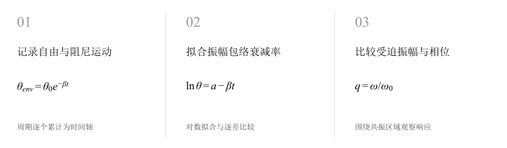
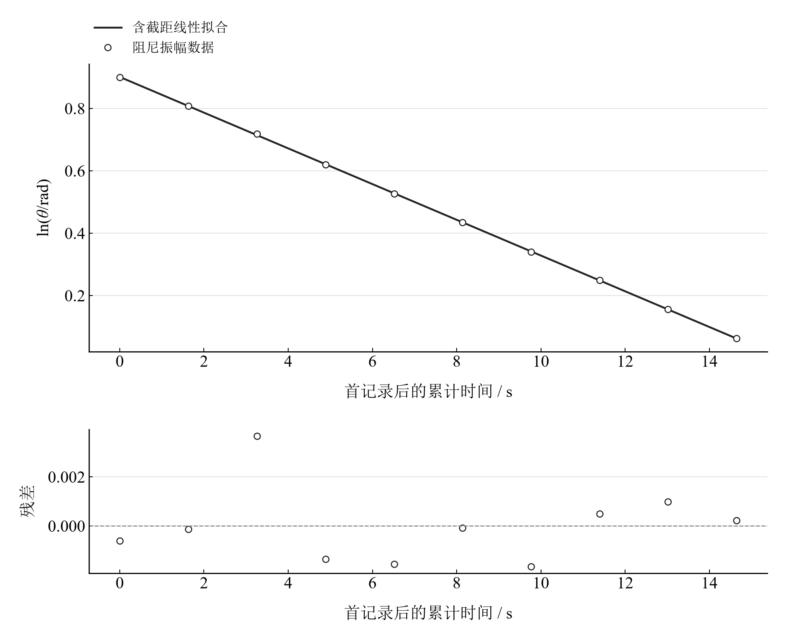
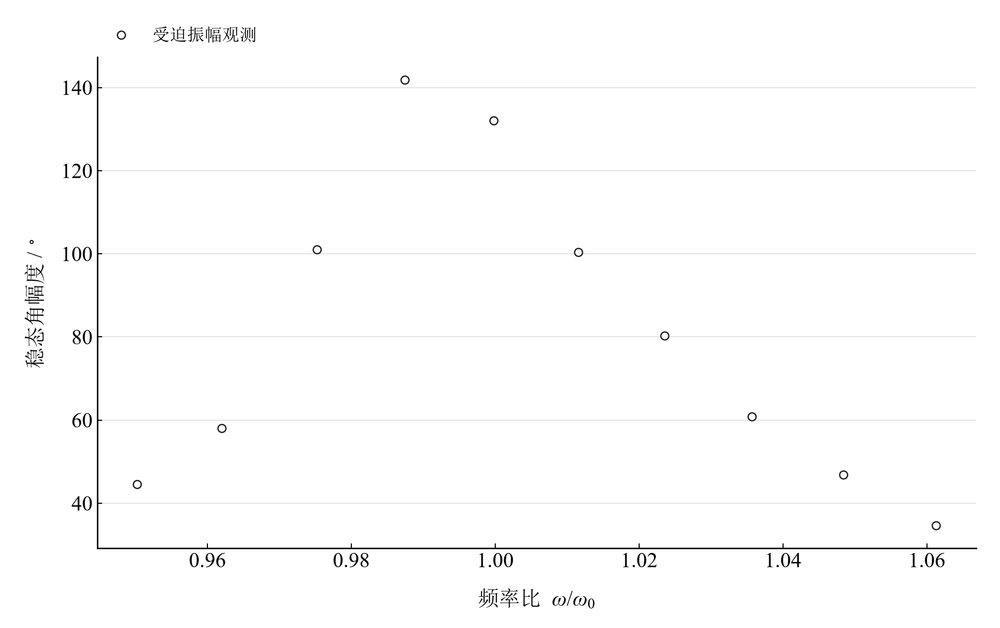
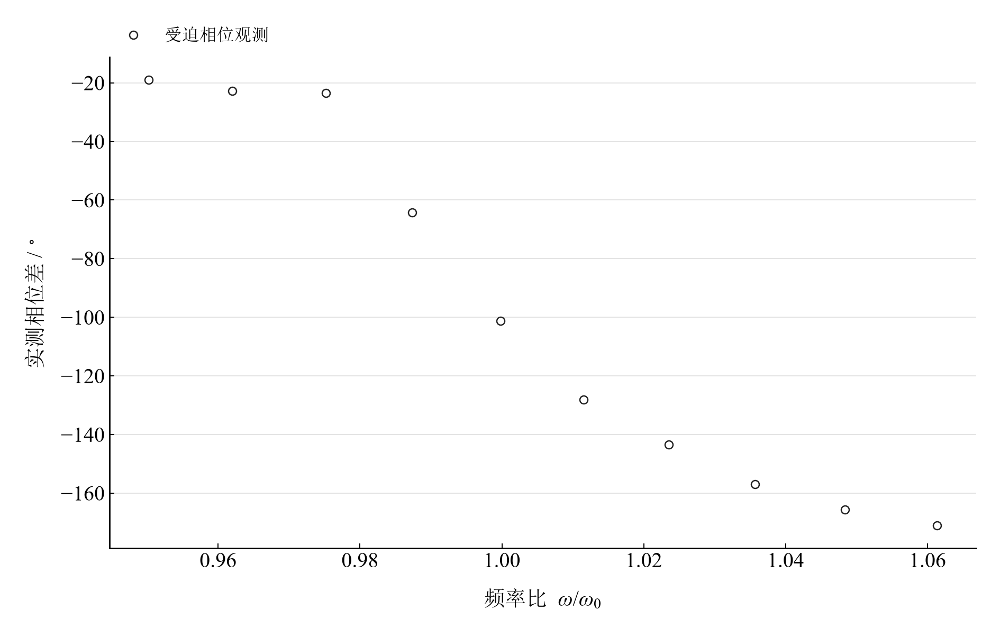

[普通物理实验 2](../README.md) · [项目首页](../../../README.md) · [使用指南](../../../docs/usage.md)

# 波尔共振实验

**从指数衰减走向共振峰，连起振幅与相位。**

同一弹性摆轮经历自由、阻尼与受迫振动。对数振幅给出衰减率，频率扫描显示共振附近振幅与相位的同步变化，再用线性响应模型探索阻尼的作用。

[读实验报告](report/report.md) · [HTML 阅读与探索](notebooks/analysis.html) · [Python 笔记本](notebooks/analysis.ipynb) · [Wolfram 笔记本](../../../notebook/paclets/PohlResonanceLab/Notebooks/PohlResonanceLab.nb)



图 1　波尔共振实验：测量与计算主线

## 选择你的入口

|用途|入口|打开方式|
|---|---|---|
|阅读原理、记录、计算与结论|[Markdown 报告](report/report.md) · [排版阅读版](report/report.html)|GitHub、Markdown 阅读器或浏览器|
|浏览计算图表、操作交互控件|[HTML 阅读版](notebooks/analysis.html)|下载后用浏览器打开|
|逐步执行和修改 Python 计算|[Jupyter Notebook](notebooks/analysis.ipynb)|JupyterLab 或 VS Code|
|原生数学排版与 Wolfram 计算|[Wolfram Notebook](../../../notebook/paclets/PohlResonanceLab/Notebooks/PohlResonanceLab.nb) · [Paclet 安装包](../../../notebook/paclets/PohlResonanceLab/dist/PohlResonanceLab-0.1.0.paclet)|Wolfram 前端|
|对照原始报告|[源报告 PDF](../../../pdf/course-02/波尔共振实验/实验报告-波尔共振实验.pdf)|GitHub 或 PDF 阅读器|

## 从记录到物理量

12 组自由振幅—周期、10 组阻尼振幅—周期，以及 10 组受迫周期、幅度和相位记录；受迫与衰减测量采用阻尼档 2。

核心计算关系为：

$$
\theta_{\mathrm{env}}=\theta_0e^{-\beta t},\qquad H(q)=\frac{1}{\sqrt{(1-q^2)^2+(2\beta q/\omega_0)^2}}.
$$

衰减时间轴由逐个周期累计，振幅换算为弧度后取对数。归一化受迫响应采用 $q=\omega/\omega_0$，以静态位移为幅度基准，相位用四象限反正切。

表 1　关键计算结果

|物理量|计算值|单位|
|---|---:|---|
|振幅包络衰减率|0.057277281|s⁻¹|
|已测幅度最大点频率比|0.98739394|—|
|已测最大幅度|141.9|°|

衰减率约 0.05728 s⁻¹，已测最大幅度 141.9° 出现在频率比约 0.9874。测点峰值与连续理论峰位分别比较；周期的幅度依赖和共振附近采样间隔会影响峰值定位。

## 沿着图像理解结果



图 2　十组阻尼振幅经弧度和累计时间换算后的对数衰减拟合

<table>
  <tr>
    <td width="50%" align="center" valign="top"><a href="assets/readme-forced-amplitude.png"></a></td>
    <td width="50%" align="center" valign="top"><a href="assets/readme-forced-phase.png"></a></td>
  </tr>
  <tr>
    <td align="center" valign="top">图 3　十个实际受迫测点的幅频响应，横轴采用逐点指定参考周期</td>
    <td align="center" valign="top">图 4　十个实际受迫测点的相频响应，展示共振区域的相位转变</td>
  </tr>
</table>

完整记录、计算过程与结果讨论见[实验报告](report/report.md)。图中拟合与模型的物理含义可在 Notebook 中逐步计算。

## 在参数变化中继续探索

|操作|参数范围与默认值|观察什么|
|---|---|---|
|衰减率比例滑块|实测拟合值的 0.5–2 倍，默认 1 倍|同时观察归一化幅频峰宽、峰高与相频转变，固定自由表平均周期。|

在 [HTML](notebooks/analysis.html) 中操作已有控件；在 [Jupyter](notebooks/analysis.ipynb) 或 [Wolfram](../../../notebook/paclets/PohlResonanceLab/Notebooks/PohlResonanceLab.nb) 中运行全部单元，可继续修改输入与计算。

## 在本机打开

环境安装见[使用指南](../../../docs/usage.md)。在仓库根目录启动：

```powershell
.\.venv\Scripts\python.exe -m jupyterlab experiments/course-02/pohl-resonance/notebooks/analysis.ipynb
```

Wolfram 安装独立包后，通过包入口打开 Notebook。将仓库路径改为本机路径：

```wolfram
PacletInstall["D:/general-physics-lab/notebook/paclets/PohlResonanceLab/dist/PohlResonanceLab-0.1.0.paclet"];
Needs["PohlResonanceLab`"];
PohlResonanceLab`OpenNotebook[]
```

## 数据与计算实现

|内容|文件|
|---|---|
|自由振幅与周期|[observations-01.csv](data/observations-01.csv)|
|阻尼振幅与周期|[observations-02.csv](data/observations-02.csv)|
|受迫周期、幅度与相位|[observations-03.csv](data/observations-03.csv)|
|单位、参数与模型条件|[experiment.json](experiment.json)|
|Python 实现|[pohl_resonance.py](../../../src/physicslab/experiments/pohl_resonance.py)|
|Wolfram 实现|[PohlResonanceLab.wl](../../../notebook/paclets/PohlResonanceLab/Kernel/PohlResonanceLab.wl)|

[数据来源](data/provenance.json) · [返回课程目录](../README.md)
