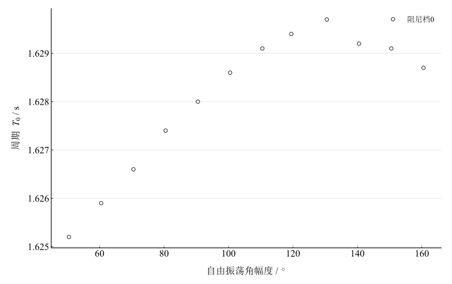
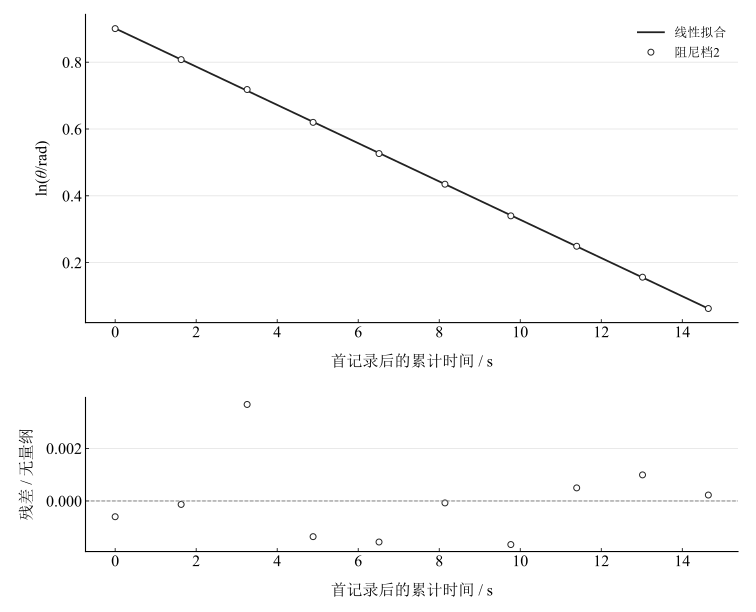
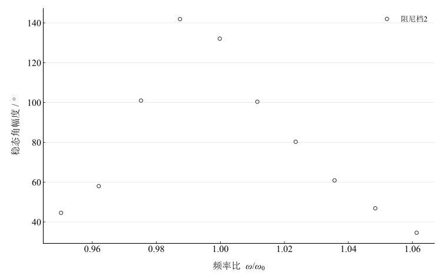
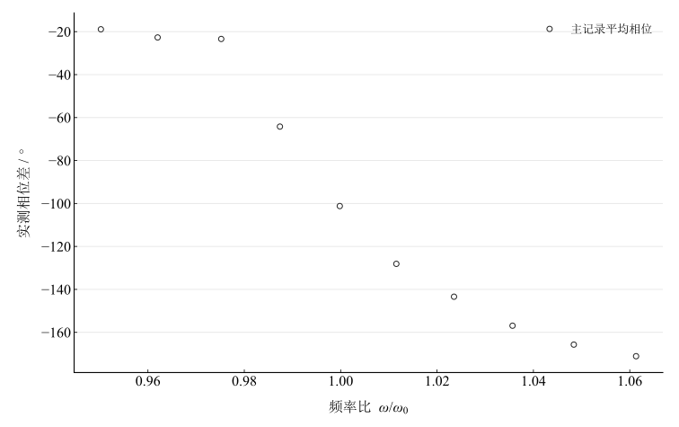
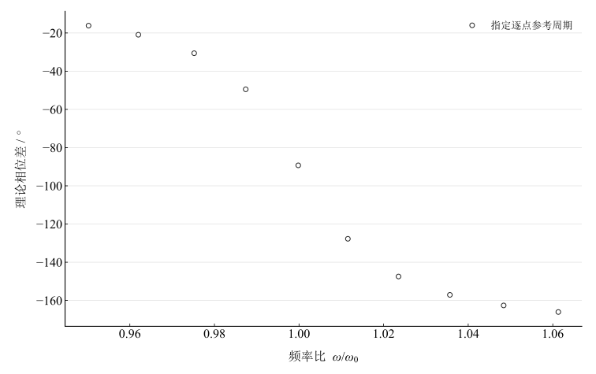

# 波尔共振实验

## 实验名称

波尔共振实验

## 实验目的

1. 观察弹性摆轮的自由振荡、阻尼振荡和受迫振荡现象。

2. 测定阻尼档2时系统的阻尼系数，并用最小二乘法进行不确定度评定。

3. 测量受迫振动的幅频特性和相频特性，分析共振峰和相位变化规律。

## 实验原理

### **（一）运动方程**

摆轮在回复力矩、阻尼力矩和周期性强迫力矩共同作用下的运动方程为：

$$J\frac{d^{2}\theta }{dt^{2}}+b\frac{d\theta }{dt}+k\theta =M_{0}\cos\omega t$$

式中 $J$ 为摆轮转动惯量，$b$ 为阻尼系数，$k$ 为弹性力矩系数，$M_{0}$和$\omega$分别为强迫力矩的幅值和圆频率。令：

$$\omega _{0}=\sqrt{\frac{k}{J}},\quad\quad 2\beta =\frac{b}{J}$$

### **（二）自由振荡与阻尼振荡**

无强迫力矩时，系统作衰减振动，角振幅包络随时间按指数规律减小：

$$\theta \left( t \right)=\theta _{0}e^{-\beta t}\cos\left( \omega _{f}t+\alpha \right),\quad\quad \omega _{f}=\sqrt{\omega _{0}^{2}-\beta ^{2}}$$

相隔 $n$ 个周期取两次振幅，可由振幅衰减求阻尼系数：

$$\beta =\frac{1}{nT}\ln\frac{\theta _{i}}{\theta _{i+n}}$$

### **（三）受迫振动的幅频与相频特性**

达到稳定状态后，摆轮与强迫力矩同频振动，其稳态角振幅为：

$$\theta \left( \omega \right)=\frac{m}{\sqrt{\left( \omega _{0}^{2}-\omega ^{2} \right)^{2}+4\beta ^{2}\omega ^{2}}}$$

其中 $m=M_0/J$ 为单位转动惯量的驱动力矩幅值；此符号不表示质量。

相位差计算采用四象限反正切，保证相位在 $0^\circ$ 至 $-180^\circ$ 范围内连续变化：

$$\varphi =\operatorname{atan2}\!\left\lbrack -\beta T_{0}^{2}T\text{,\:}\pi \left( T^{2}-T_{0}^{2} \right) \right\rbrack$$

由于$\omega =2\pi /T$、$\omega _{0}=2\pi /T_{0}$，实验作图的横坐标可写为：

$$\frac{\omega }{\omega _{0}}=\frac{T_{0}}{T}$$

振幅达到极大值时的共振圆频率满足：

$$\omega _{r}=\sqrt{\omega _{0}^{2}-2\beta ^{2}}$$

因此存在阻尼时，共振峰对应的$\omega /\omega _{0}$略小于1。

## 主要仪器设备

DH0306型波尔共振实验仪，包括弹性摆轮、蜗卷弹簧、光电门、光电编码器、步进电机、偏心轮连杆机构及电磁阻尼线圈。

## 实验步骤

1. 自由振荡：阻尼档0，将摆轮转至约160°后释放，记录50°---160°范围内的$\theta$和$T_{0}$。

2. 阻尼振荡：阻尼档2，将摆轮转至约150°后释放，记录连续10次振幅及周期。

3. 强迫振荡：阻尼档2，逐点改变电机周期；待振幅和相位稳定后记录并作幅频、相频曲线。

## 原始数据记录

### **（一）自由振荡：振幅$\theta$与固有周期$T_{0}$的关系（阻尼档0）**

表 1　阻尼档0的幅度与周期

| $\theta$ / ° | $T_0$ / s | $\theta$ / ° | $T_0$ / s | $\theta$ / ° | $T_0$ / s |
| --- | --- | --- | --- | --- | --- |
| 160.5 | 1.6287 | 150.5 | 1.6291 | 140.5 | 1.6292 |
| 130.5 | 1.6297 | 119.5 | 1.6294 | 110.5 | 1.6291 |
| 100.5 | 1.6286 | 90.5 | 1.628 | 80.5 | 1.6274 |
| 70.5 | 1.6266 | 60.5 | 1.6259 | 50.5 | 1.6252 |

### **（二）阻尼振荡数据（阻尼档2）**

表 2　阻尼档2的振幅衰减记录

| $i$ | $\theta_i$ / ° | $T_i$ / s | $i+5$ | $\theta_{i+5}$ / ° | $T_{i+5}$ / s | $\ln(\theta_i/\theta_{i+5})$ |
| --- | --- | --- | --- | --- | --- | --- |
| 1 | 141 | 1.6289 | 6 | 88.5 | 1.6265 | 0.46575734 |
| 2 | 128.5 | 1.6288 | 7 | 80.5 | 1.6259 | 0.46767172 |
| 3 | 117.5 | 1.6283 | 8 | 73.5 | 1.6252 | 0.46915293 |
| 4 | 106.5 | 1.6277 | 9 | 67 | 1.6246 | 0.46345237 |
| 5 | 97 | 1.6271 | 10 | 61 | 1.6239 | 0.46383711 |

说明：角度换算为弧度后进行 $\ln\theta$ 与 $t$ 的线性拟合；取第一组记录时刻为 $t=0$。

### **（三）受迫振动幅频与相频特性数据（阻尼档2）**

表 3　受迫振动记录与重算模型量

| 受迫周期 / s | 幅度 / ° | 指定参考周期 / s | 实测相位 / ° | 重算理论相位 / ° | $\omega/\omega_0$ |
| --- | --- | --- | --- | --- | --- |
| 1.71 | 44.6 | 1.6249 | -18.9 | -16.174684 | 0.95023392 |
| 1.69 | 58 | 1.6258 | -22.7 | -20.936197 | 0.96201183 |
| 1.67 | 101 | 1.6286 | -23.4 | -30.598136 | 0.97520958 |
| 1.65 | 141.9 | 1.6292 | -64.2 | -49.49563 | 0.98739394 |
| 1.63 | 132.1 | 1.6297 | -101.2 | -89.290154 | 0.99981595 |
| 1.61 | 100.4 | 1.6286 | -128.1 | -127.72978 | 1.0115528 |
| 1.59 | 80.3 | 1.6274 | -143.4 | -147.46087 | 1.023522 |
| 1.57 | 60.9 | 1.626 | -156.9 | -157.0793 | 1.0356688 |
| 1.55 | 46.9 | 1.625 | -165.7 | -162.60025 | 1.0483871 |
| 1.53 | 34.6 | 1.6238 | -171.1 | -166.0377 | 1.0613072 |

注：$T_0$ 按原记录所列参考周期作为模型参数；其中三点幅度超出自由表范围，不能由普通内插核验。$\varphi$实取仪器两次稳定读数的平均值。

## 数据处理

### （一）逐差法计算阻尼系数

按前后相隔五个周期的五组振幅比，取对数均值除以 $5\bar T$，得到 $\beta_{\mathrm{pair}}=0.057291099\,\mathrm{s}^{-1}$。该参数是包络指数中的衰减率，量纲为逆秒。

### （二）最小二乘法计算阻尼系数

首个振幅记录记为 $t=0$，随后记录时刻按前一记录的周期逐个累计；角幅度先转弧度，再拟合 $\ln(\theta/\mathrm{rad})=a-\beta t$。得到 $a=0.90113286$、$\beta=0.057277281\,\mathrm{s}^{-1}$，残差标准误 $0.000112647\,\mathrm{s}^{-1}$，$R^2=0.99996906$。该标准误未包含周期、编码器及幅度标尺系统误差。

### （三）图像与规律分析

图 1　阻尼档0的自由振荡周期与幅度

图 2　阻尼档2的对数振幅衰减拟合及残差

图 3　已测受迫振动幅频响应

图 4　已测受迫振动相频响应

图 5　指定逐点参考周期下的理论相频响应

理论相位用四象限 $\operatorname{atan2}(-2\beta\omega,\omega_0^2-\omega^2)$ 求取，以度展示。实验与模型相位均方根差为 $6.87248^\circ$。逐点 $T_0$ 为所列模型参数，不作为额外独立测量；自由表外三点无法按普通内插确认这些参数。

## 实验结果与讨论

### （一）阻尼系数

阻尼档2的包络指数衰减率约 $0.05728\,\mathrm{s}^{-1}$，与同组逐差处理接近。对数拟合支持指数衰减作为该数据的近似，但两种方法并不独立。

### （二）幅频特性

已测幅度最大值 $141.9^\circ$ 位于频率比 $0.9873939$。用自由表平均周期及拟合衰减率计算的线性定参数理论峰频比为 $0.9997797$，与已测最大点有差别，不能仅以“有阻尼峰小于1”认定已定量验证。共振附近周期步长 $0.020\,\mathrm s$ 较粗，且周期随幅度变化，会限制峰值定位及定参数模型。

### （三）相频特性

实测相位从约 $-19^\circ$ 降至 $-171^\circ$，共振区域变化明显；模型呈相同总体趋势，局部差别仍需等待稳态、相位判定与参考周期信息解释。

### （四）误差分析

蜗卷弹簧幅度依赖、尚未稳定的过渡过程、编码器与光电门对准、参考周期的内插或外推、频率测点稀疏均可能影响结果。没有单次相位原始记录和完整仪器分量，不伪造重复值或合成完整不确定度。

### （五）结论

所列振幅包络近似指数衰减，受迫幅频曲线出现峰值，相位跨过约 $-90^\circ$；弱阻尼线性模型提供趋势解释，但峰位与定参数理论仍存在差别。衰减率以 $\mathrm{s}^{-1}$ 报告。
