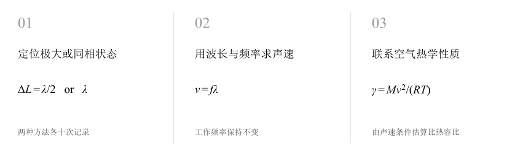
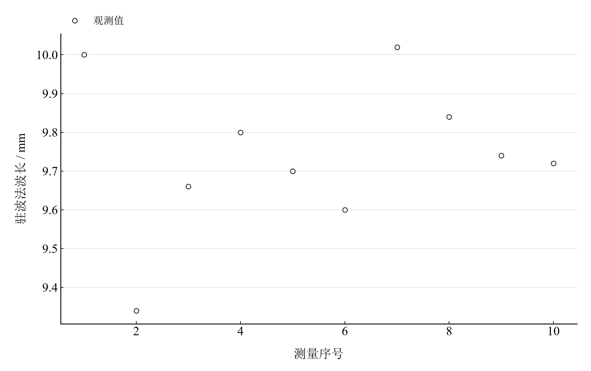
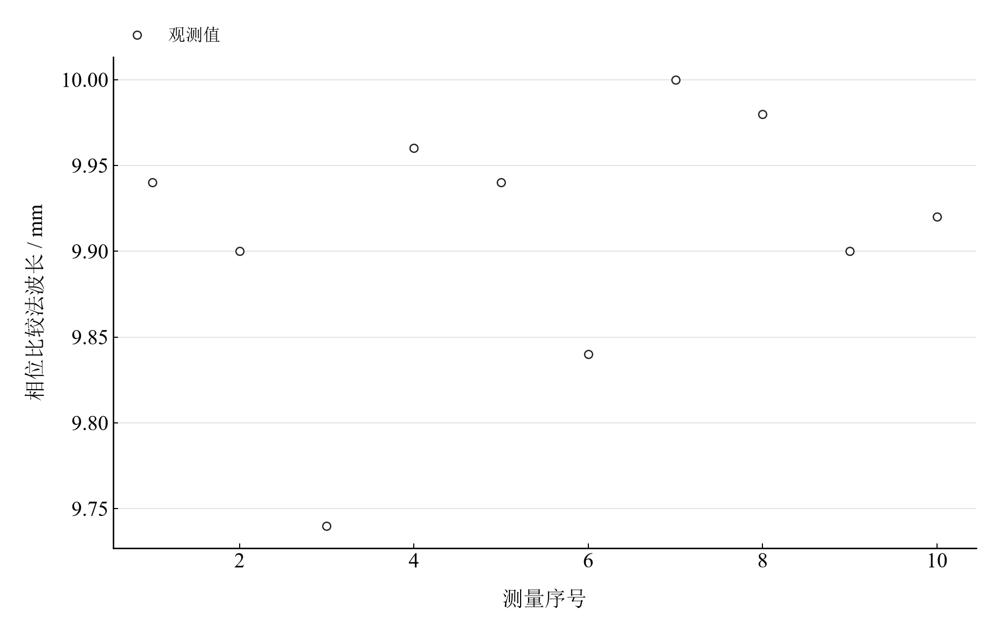

[普通物理实验 2](../README.md) · [项目首页](../../../README.md) · [使用指南](../../../docs/usage.md)

<!-- virtual-laboratory-entry -->
[在线虚拟实验](https://hnnuyuxuan.github.io/general-physics-lab/simulations/sound-speed/) · [模型依据与参数来源](../../../docs/sound-speed-model-evidence.md)

# 声速的测量

**从驻波极大与同相位置，用两条路径测声速。**

固定超声频率，分别用振幅极大位置和相位恢复判断波长。对两组重复记录独立统计，比较重复性、声速和空气比热容比。

[读实验报告](report/report.md) · [HTML 阅读与探索](https://hnnuyuxuan.github.io/general-physics-lab/experiments/course-02/sound-speed/notebooks/analysis.html) · [Python 笔记本](notebooks/analysis.ipynb) · [Wolfram 笔记本](../../../notebook/paclets/SoundSpeedLab/Notebooks/SoundSpeedLab.nb)



图 1　声速的测量：测量与计算主线

## 选择你的入口

|用途|入口|打开方式|
|---|---|---|
|阅读原理、记录、计算与结论|[Markdown 报告](report/report.md) · [排版阅读版](https://hnnuyuxuan.github.io/general-physics-lab/experiments/course-02/sound-speed/report/report.html)|GitHub、Markdown 阅读器或浏览器|
|浏览计算图表、操作交互控件|[HTML 阅读版](https://hnnuyuxuan.github.io/general-physics-lab/experiments/course-02/sound-speed/notebooks/analysis.html)|直接在线打开，也可下载到本机|
|逐步执行和修改 Python 计算|[Jupyter Notebook](notebooks/analysis.ipynb)|JupyterLab 或 VS Code|
|原生数学排版与 Wolfram 计算|[Wolfram Notebook](../../../notebook/paclets/SoundSpeedLab/Notebooks/SoundSpeedLab.nb) · [Paclet 安装包](../../../notebook/paclets/SoundSpeedLab/dist/SoundSpeedLab-0.1.0.paclet)|Wolfram 前端|
|对照原始报告|[源报告 PDF](../../../pdf/course-02/04-声速的测量/实验报告-声速的测量.pdf)|GitHub 或 PDF 阅读器|

## 从记录到物理量

驻波法与相位比较法各 10 个波长记录；频率 36015 Hz，温度 26.5 °C，比较用声速 347.21 m/s。

核心计算关系为：

$$
v=f\bar\lambda,\qquad \gamma=\frac{Mv^2}{RT}.
$$

相邻驻波极大间距为半波长，相邻同相位置间距为整波长。数据表保留的是已换算波长，两种定位方式分别计算均值和重复性。

表 1　关键计算结果

|物理量|计算值|单位|
|---|---:|---|
|驻波法声速|350.85813|m/s|
|相位比较法声速|356.98068|m/s|
|两法声速算术平均（描述量）|353.91941|m/s|

两法声速分别约 350.86 m/s 与 356.98 m/s，相位比较法的波长重复离散较小。描述性平均列于表中；各方法的条件预算和定位系统效应在报告中分别讨论。

## 沿着图像理解结果



图 2　驻波法十次已记录波长，展示定位重复性



图 3　相位比较法十次已记录波长，与驻波法独立统计

完整记录、计算过程与结果讨论见[实验报告](report/report.md)。图中拟合与模型的物理含义可在 Notebook 中逐步计算。

## 在参数变化中继续探索

|操作|参数范围与默认值|观察什么|
|---|---|---|
|假设波长标度滑块|0.98–1.02，默认 1|同时改变两法的长度标度，观察声速随标度线性响应；比热容比随标度平方变化。|

在 [HTML](https://hnnuyuxuan.github.io/general-physics-lab/experiments/course-02/sound-speed/notebooks/analysis.html) 中操作已有控件；在 [Jupyter](notebooks/analysis.ipynb) 或 [Wolfram](../../../notebook/paclets/SoundSpeedLab/Notebooks/SoundSpeedLab.nb) 中运行全部单元，可继续修改输入与计算。

## 在本机打开

环境安装见[使用指南](../../../docs/usage.md)。在仓库根目录启动：

```powershell
.\.venv\Scripts\python.exe -m jupyterlab experiments/course-02/sound-speed/notebooks/analysis.ipynb
```

Wolfram 安装独立包后，通过包入口打开 Notebook。将仓库路径改为本机路径：

```wolfram
PacletInstall["D:/general-physics-lab/notebook/paclets/SoundSpeedLab/dist/SoundSpeedLab-0.1.0.paclet"];
Needs["SoundSpeedLab`"];
SoundSpeedLab`OpenNotebook[]
```

## 数据与计算实现

|内容|文件|
|---|---|
|两种方法波长记录|[wavelengths.csv](data/wavelengths.csv)|
|单位、参数与模型条件|[experiment.json](experiment.json)|
|Python 实现|[sound_speed.py](../../../src/physicslab/experiments/sound_speed.py)|
|Wolfram 实现|[SoundSpeedLab.wl](../../../notebook/paclets/SoundSpeedLab/Kernel/SoundSpeedLab.wl)|

[数据来源](data/provenance.json) · [返回课程目录](../README.md)
