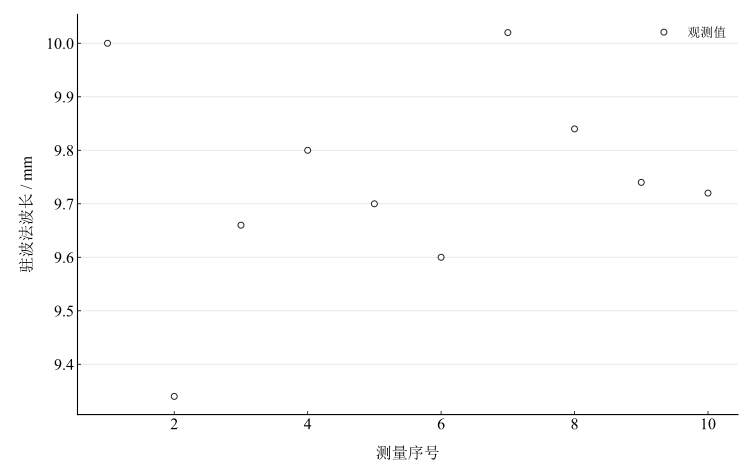
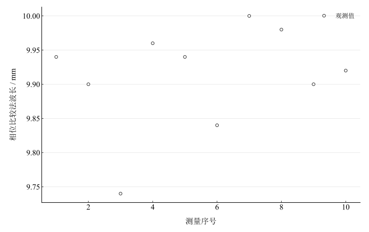

# 声速测量实验报告

淮南师范学院　电子工程学院　物理学专业

## 一、实验名称

声速的测量。

## 二、实验目的

掌握超声驻波法和相位比较法测声速；使用信号发生器、示波器及数显位移标尺测频率与波长；用重复测量和标准不确定度比较两法的重复性与准确度；由声速估算空气比热容比。

## 三、实验原理

### 1. 声速和波长

均匀介质中，$v=\lambda f$。超声发射波经接收换能器反射形成驻波，相邻振幅极大位置相隔半波长：

$$
L_{n+1}-L_n=\frac\lambda2.
$$

相位比较法将发射与接收信号送入示波器两通道，接收器移动后相位关系恢复同一状态时，间距对应整数个波长；相邻同相位置有 $L_{n+1}-L_n=\lambda$。可用双踪波形或李萨如图判断相位。

### 2. 温度与比热容比

只考虑温度时，声速近似随绝对温度平方根变化：$v=v_0\sqrt{T/T_0}$。本实验比较用声速明确采用347.21 $\mathrm{m\,s^{-1}}$，不另补缺失的基准模型参数。

$$
\gamma=\frac{c_p}{c_v}=\frac{Mv^2}{RT}.
$$

采用空气摩尔质量 $M=28.96\times10^{-3}\,\mathrm{kg\,mol^{-1}}$、$R=8.31\,\mathrm{J\,mol^{-1}\,K^{-1}}$，比较值为 $\gamma=1.402$。

## 四、主要仪器设备

超声声速测定仪、信号发生器、示波器和数显位移标尺。标尺分辨率0.01 $\mathrm{mm}$，波长误差限按记录取0.005 $\mathrm{mm}$；发生器分辨率0.001 $\mathrm{kHz}$，频率误差限0.0005 $\mathrm{kHz}$。实际位移定位和相位判读还可能具有额外系统效应。

## 五、实验步骤

连接发射端、接收端、信号发生器和示波器，换能器间距大于50 $\mathrm{mm}$，起始约100 $\mathrm{mm}$。在34–40 $\mathrm{kHz}$范围寻找幅度较大且稳定的频率，本次采用36015 $\mathrm{Hz}$。固定频率，沿同一方向缓慢移动接收端，寻找连续振幅极大位置并转换为波长，记录十次。相位法将两信号送双通道或X–Y显示，寻找连续同相状态并换算波长，同样记录十次。避免反向移动回程差，记录温度并计算两法声速及比热容比。

## 六、原始数据记录

工作频率 $f=36015\,\mathrm{Hz}$，室温26.5 ${}^{\circ}\mathrm{C}$，绝对温度299.65 $\mathrm{K}$，比较用声速347.21 $\mathrm{m\,s^{-1}}$。以下为已由原始位置换算的波长，完整位置序列未保存。

表 1　驻波法波长记录

| 测量次数 | 1 | 2 | 3 | 4 | 5 | 6 | 7 | 8 | 9 | 10 | 平均值 / mm |
| --- | --- | --- | --- | --- | --- | --- | --- | --- | --- | --- | --- |
| $\lambda_1 / \mathrm{mm}$ | 10 | 9.34 | 9.66 | 9.8 | 9.7 | 9.6 | 10.02 | 9.84 | 9.74 | 9.72 | 9.742 |

表 2　相位比较法波长记录

| 测量次数 | 1 | 2 | 3 | 4 | 5 | 6 | 7 | 8 | 9 | 10 | 平均值 / mm |
| --- | --- | --- | --- | --- | --- | --- | --- | --- | --- | --- | --- |
| $\lambda_2 / \mathrm{mm}$ | 9.94 | 9.9 | 9.74 | 9.96 | 9.94 | 9.84 | 10 | 9.98 | 9.9 | 9.92 | 9.912 |

所有20个读数均保留，驻波法第2次9.34 $\mathrm{mm}$没有主观删去。

## 七、数据处理

### 1. 平均波长与声速

$$
\bar\lambda=\frac1{10}\sum_{i=1}^{10}\lambda_i,\qquad v=\bar\lambda f.
$$

驻波法平均波长为 9.742 $\mathrm{mm}$，声速为 350.85813 $\mathrm{m\,s^{-1}}$；相位比较法平均波长为 9.912 $\mathrm{mm}$，声速为 356.98068 $\mathrm{m\,s^{-1}}$。两法算术平均为 353.919405 $\mathrm{m\,s^{-1}}$，只作为描述量，不因简单平均而认为共同系统误差被消除。

表 3　声速与比热容比结果及参考比较

| 方法 | 平均波长 / mm | 声速 / (m s⁻¹) | 参考声速 / (m s⁻¹) | 声速差异 / % | 比热容比 | 比热容比差异 / % |
| --- | --- | --- | --- | --- | --- | --- |
| 驻波法 | 9.742 | 350.85813 | 347.21 | 1.0506984 | 1.4316813 | 2.1170656 |
| 相位比较法 | 9.912 | 356.98068 | 347.21 | 2.8140549 | 1.4820835 | 5.7120909 |

图 1　驻波法十次波长记录

图 2　相位比较法十次波长记录

### 2. 标准不确定度

波长均值的A类分量按样本标准差除以 $\sqrt{10}$ 计算，源给定波长B类分量为 $0.005/\sqrt3$ $\mathrm{mm}$。频率仅有一个记录，取 $u(f)=0.5/\sqrt3$ $\mathrm{Hz}$，不生成A类分量。按独立输入近似，

$$
u(\lambda)=\sqrt{u_A^2+u_B^2},\qquad
\frac{u(v)}v=\sqrt{\left(\frac{u(\lambda)}{\bar\lambda}\right)^2+\left(\frac{u(f)}f\right)^2}.
$$

表 4　重复性与条件标准不确定度

| 方法 | 波长样本标准差 / mm | 波长均值A类 / mm | 波长条件合成 / mm | 声速标准不确定度 / (m s⁻¹) | 比热容比标准不确定度 |
| --- | --- | --- | --- | --- | --- |
| 驻波法 | 0.19651407 | 0.062143204 | 0.062210217 | 2.2405027 | 0.018284802 |
| 相位比较法 | 0.075542483 | 0.02388863 | 0.024062419 | 0.86661274 | 0.0071958653 |

### 3. 比热容比

将未修约声速代入 $\gamma=Mv^2/(RT)$，得到驻波法 1.43168126、相位比较法 1.482083515。仅计声速贡献时，$u(\gamma)/\gamma=2u(v)/v$。温度、摩尔质量和空气组成误差未计入，这不是完整的比热容比预算。

## 八、实验结果与讨论

驻波法声速为 350.85813 $\mathrm{m\,s^{-1}}$，相对参考差异 1.050698425 $\%$；相位法为 356.98068 $\mathrm{m\,s^{-1}}$，差异 2.814054895 $\%$。相位法样本标准差较小、重复性较好，驻波法中心值更接近给定参考值。重复性与准确度的区别在这里很明显，单看散点集中程度不足以评价准确度。

驻波极值附近变化平缓，波形抖动影响定位。相位判读受通道相移、触发及人工判读影响，可产生集中的系统偏移；机构回程差应通过单向移动控制。换能器声学等效位置与机械端面并不总一致，但固定零点偏移在理想位置差中会抵消，不能不加区分地将其直接加到波长上。频率标定、温度、湿度和气流也影响声速比较。

比热容比与声速平方成正比，声速的相对系统偏差在计算中被放大。改进应保存原始定位序列、明确波节及同相计数、核查仪器标度与相位通道，并补充环境和温度不确定度。模型探索采用假设的波长乘法标度，显示共同标度误差如何同时改变两法结果，而不改变原始记录。
