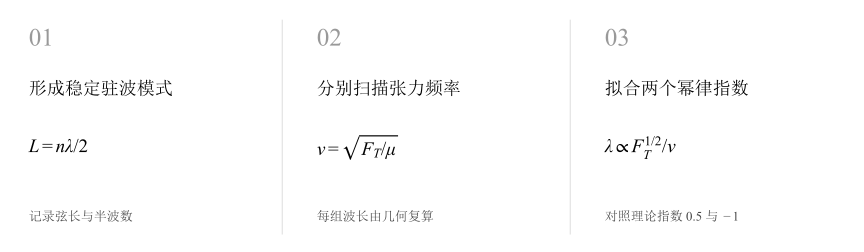
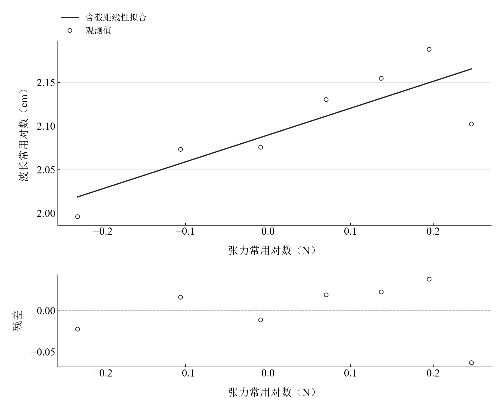
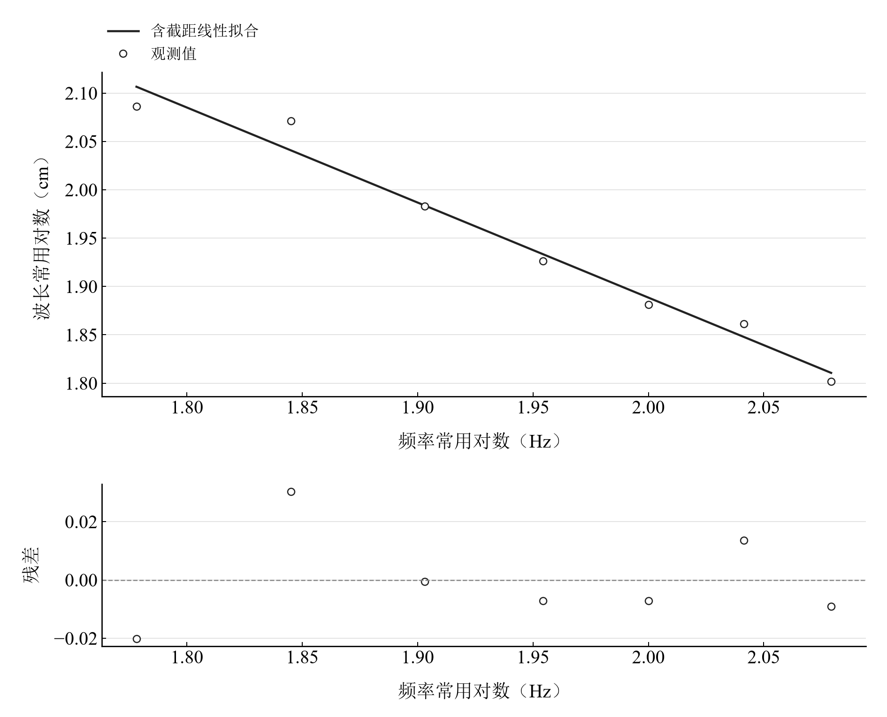

[普通物理实验 2](../README.md) · [项目首页](../../../README.md) · [使用指南](../../../docs/usage.md)

# 弦振动的研究

**用波节数读出波长，用对数斜率检验弦上的幂律。**

调节弦长形成驻波，分别改变张力与频率。由有效长度和半波数重算波长，在双对数坐标上比较平方根和反比规律，并切换驻波模式观察边界条件。

[读实验报告](report/report.md) · [HTML 阅读与探索](https://hnnuyuxuan.github.io/general-physics-lab/experiments/course-02/string-vibration/notebooks/analysis.html) · [Python 笔记本](notebooks/analysis.ipynb) · [Wolfram 笔记本](../../../notebook/paclets/StringVibrationLab/Notebooks/StringVibrationLab.nb)



图 1　弦振动的研究：测量与计算主线

## 选择你的入口

|用途|入口|打开方式|
|---|---|---|
|阅读原理、记录、计算与结论|[Markdown 报告](report/report.md) · [排版阅读版](https://hnnuyuxuan.github.io/general-physics-lab/experiments/course-02/string-vibration/report/report.html)|GitHub、Markdown 阅读器或浏览器|
|浏览计算图表、操作交互控件|[HTML 阅读版](https://hnnuyuxuan.github.io/general-physics-lab/experiments/course-02/string-vibration/notebooks/analysis.html)|直接在线打开，也可下载到本机|
|逐步执行和修改 Python 计算|[Jupyter Notebook](notebooks/analysis.ipynb)|JupyterLab 或 VS Code|
|原生数学排版与 Wolfram 计算|[Wolfram Notebook](../../../notebook/paclets/StringVibrationLab/Notebooks/StringVibrationLab.nb) · [Paclet 安装包](../../../notebook/paclets/StringVibrationLab/dist/StringVibrationLab-0.1.0.paclet)|Wolfram 前端|
|对照原始报告|[源报告 PDF](../../../pdf/course-02/03-弦振动的研究/实验报告-弦振动的研究.pdf)|GitHub 或 PDF 阅读器|

## 从记录到物理量

固定 60 Hz 的 7 组张力数据，固定 100 g 悬挂总质量的 7 组频率数据；频率范围 60–120 Hz，波长由弦长与半波数复算。

核心计算关系为：

$$
\lambda=\frac{2L}{n}=\frac{1}{\nu}\sqrt{\frac{F_{\mathrm T}}{\mu}}.
$$

张力扫描的理论幂指数为 1/2，频率扫描为 −1。对数采用相对于 1 N、1 Hz 和 1 cm 的无量纲数值，便于比较拟合斜率。

表 1　关键计算结果

|物理量|计算值|单位|
|---|---:|---|
|张力幂指数|0.30785476|—|
|频率幂指数|-0.98304059|—|
|第一驻波记录推算传播速度|59.46|m/s|

频率指数约 −0.983，接近反比趋势；张力指数约 0.308，偏离平方根趋势。张力表末组长度 63.3 cm、半波数 1 对应波长 126.6 cm，与源派生栏的 166.6 cm 有差别，图表采用长度和半波数复算值。

## 沿着图像理解结果



图 2　固定频率时七组观测复算的张力—波长双对数关系及拟合



图 3　固定张力时七组观测复算的频率—波长双对数关系及拟合

完整记录、计算过程与结果讨论见[实验报告](report/report.md)。图中拟合与模型的物理含义可在 Notebook 中逐步计算。

## 在参数变化中继续探索

|操作|参数范围与默认值|观察什么|
|---|---|---|
|驻波模式下拉选择|n = 1、2、3、4，默认 n = 2|固定弦长 0.991 m、传播速度 59.46 m/s，查看两端波节与归一化位移。|

在 [HTML](https://hnnuyuxuan.github.io/general-physics-lab/experiments/course-02/string-vibration/notebooks/analysis.html) 中操作已有控件；在 [Jupyter](notebooks/analysis.ipynb) 或 [Wolfram](../../../notebook/paclets/StringVibrationLab/Notebooks/StringVibrationLab.nb) 中运行全部单元，可继续修改输入与计算。

## 在本机打开

环境安装见[使用指南](../../../docs/usage.md)。在仓库根目录启动：

```powershell
.\.venv\Scripts\python.exe -m jupyterlab experiments/course-02/string-vibration/notebooks/analysis.ipynb
```

Wolfram 安装独立包后，通过包入口打开 Notebook。将仓库路径改为本机路径：

```wolfram
PacletInstall["D:/general-physics-lab/notebook/paclets/StringVibrationLab/dist/StringVibrationLab-0.1.0.paclet"];
Needs["StringVibrationLab`"];
StringVibrationLab`OpenNotebook[]
```

## 数据与计算实现

|内容|文件|
|---|---|
|固定张力频率扫描|[frequency.csv](data/frequency.csv)|
|固定频率张力扫描|[tension.csv](data/tension.csv)|
|单位、参数与模型条件|[experiment.json](experiment.json)|
|Python 实现|[string_vibration.py](../../../src/physicslab/experiments/string_vibration.py)|
|Wolfram 实现|[StringVibrationLab.wl](../../../notebook/paclets/StringVibrationLab/Kernel/StringVibrationLab.wl)|

[数据来源](data/provenance.json) · [返回课程目录](../README.md)
