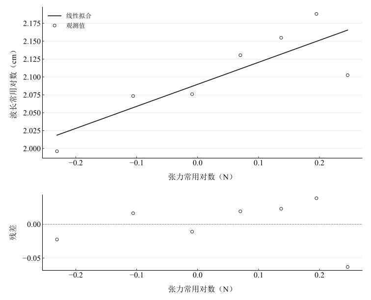
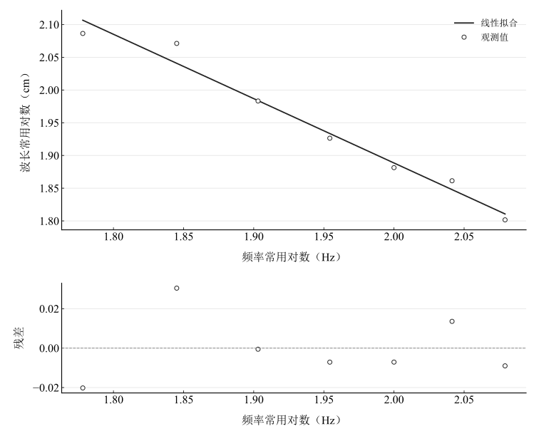

# 弦振动研究实验报告

淮南师范学院　电子工程学院　物理学专业

## 一、实验名称

弦振动的研究。

## 二、实验目的

观察驻波并测量波长；研究固定频率时波长与张力平方根关系、固定张力时波长与频率反比关系；学习双对数线性化和最小二乘法。

## 三、实验原理

### 1. 驻波

相反方向传播的同频横波叠加形成驻波，波节位置固定，相邻波腹反向振动。若坐标从固定端波节起，理想两端固定弦可写为

$$
y(x,t)=A\sin\left(\frac{n\pi x}{L}\right)\cos(\omega t),\qquad
L=\frac{n\lambda}{2},\qquad\lambda=\frac{2L}{n}.
$$

原理中的余弦空间形式与正弦形式只差坐标原点；展示模型明确采用波节原点。

### 2. 波速及幂律

对于张力 $F_{\mathrm{T}}$、线密度 $\mu$ 的均匀弦，

$$
v=\sqrt{\frac{F_{\mathrm{T}}}{\mu}},\qquad
v=\lambda\nu,\qquad
\lambda=\frac1\nu\sqrt{\frac{F_{\mathrm{T}}}{\mu}}.
$$

固定频率时，$\lambda\propto F_{\mathrm{T}}^{1/2}$；固定张力时，$\lambda\propto\nu^{-1}$。采用以1 $\mathrm{cm}$、1 $\mathrm{N}$和1 $\mathrm{Hz}$为基准的无量纲数值作常用对数，理论斜率分别为0.5和−1。

## 四、主要仪器设备

弦振动实验仪、低频信号发生器、电磁振动器、滑轮、砝码及托盘、挂钩和米尺。取 $g=9.794\,\mathrm{m\,s^{-2}}$。张力实验固定频率60 $\mathrm{Hz}$，频率实验固定砝码和挂钩总质量100 $\mathrm{g}$。

## 五、实验步骤

将弦一端接振动器、另一端绕过滑轮接砝码托盘，调水平并开启信号源。固定60 $\mathrm{Hz}$，逐次改变悬挂总质量，调有效弦长形成稳定驻波，记录质量、长度和半波数。随后固定总质量100 $\mathrm{g}$，频率依次为60–120 $\mathrm{Hz}$，每次调弦长形成清晰驻波并记录长度与半波数。由几何关系算波长、重力算张力，分别拟合两组双对数关系。

## 六、原始数据记录

表 1　固定频率时的质量、长度和半波数及复算量

| 物理量 | 1 | 2 | 3 | 4 | 5 | 6 | 7 |
| --- | --- | --- | --- | --- | --- | --- | --- |
| 质量 / g | 60 | 80 | 100 | 120 | 140 | 160 | 180 |
| 弦长 / cm | 99.1 | 118.4 | 119.1 | 67.5 | 71.4 | 77.1 | 63.3 |
| 半波数 | 2 | 2 | 2 | 1 | 1 | 1 | 1 |
| 复算波长 / cm | 99.1 | 118.4 | 119.1 | 135 | 142.8 | 154.2 | 126.6 |
| 张力 / N | 0.58764 | 0.78352 | 0.9794 | 1.17528 | 1.37116 | 1.56704 | 1.76292 |
| 波长常用对数 | 1.9960737 | 2.0733517 | 2.0759118 | 2.1303338 | 2.1547282 | 2.1880844 | 2.1024337 |
| 张力常用对数 | -0.23088865 | -0.10594991 | -0.0090399003 | 0.070141346 | 0.13708814 | 0.19508008 | 0.2462326 |

表 2　固定张力时的频率、长度和半波数及复算量

| 物理量 | 1 | 2 | 3 | 4 | 5 | 6 | 7 |
| --- | --- | --- | --- | --- | --- | --- | --- |
| 频率 / Hz | 60 | 70 | 80 | 90 | 100 | 110 | 120 |
| 弦长 / cm | 122 | 117.8 | 96.2 | 84.4 | 76.1 | 109 | 95 |
| 半波数 | 2 | 2 | 2 | 2 | 2 | 3 | 3 |
| 复算波长 / cm | 122 | 117.8 | 96.2 | 84.4 | 76.1 | 72.666667 | 63.333333 |
| 波长常用对数 | 2.0863598 | 2.0711453 | 1.9831751 | 1.9263424 | 1.8813847 | 1.8613352 | 1.8016323 |
| 频率常用对数 | 1.7781513 | 1.845098 | 1.90309 | 1.9542425 | 2 | 2.0413927 | 2.0791812 |

表1最后一组原始长度63.30 $\mathrm{cm}$、半波数1，因此波长应为126.60 $\mathrm{cm}$；记录中的派生波长166.60 $\mathrm{cm}$与公式冲突。此处保留原始长度和半波数并复算，不把长度反改为83.30 $\mathrm{cm}$。该点的测量原始记录仍需核对，现有数据不能确定错误出在哪一栏。

## 七、数据处理

### 1. 几何波长与张力

各点按 $\lambda_i=2L_i/n_i$ 和 $F_{\mathrm{T},i}=m_i g$ 计算，保留未修约数值进入对数。110 $\mathrm{Hz}$的波长由109.00 $\mathrm{cm}$和3个半波得到 $72.666\ldots$ $\mathrm{cm}$，不提前修约为72.70 $\mathrm{cm}$。

### 2. 最小二乘与标准误差

令 $y=\log_{10}(\lambda/1\,\mathrm{cm})$，自变量分别取 $\log_{10}(F_{\mathrm{T}}/1\,\mathrm{N})$ 与 $\log_{10}(\nu/1\,\mathrm{Hz})$，拟合 $y=kx+b$：

$$
k=\frac{\sum_i(x_i-\bar x)(y_i-\bar y)}{\sum_i(x_i-\bar x)^2},\qquad
b=\bar y-k\bar x,
$$

$$
u(k)=\sqrt{\frac{\sum_i(y_i-kx_i-b)^2}{(N-2)\sum_i(x_i-\bar x)^2}}.
$$

表 3　复算双对数拟合结果

| 关系 | 斜率 | 标准误差 | 相关系数 | 相对理论差异 / % |
| --- | --- | --- | --- | --- |
| 波长—张力 | 0.30785476 | 0.09114491 | 0.83383397 | 38.429047 |
| 波长—频率 | -0.98304059 | 0.069672497 | -0.98767373 | 1.695941 |

张力幂指数为 0.3078547636，相对理论0.5的差异为 38.42904729 $\%$；频率幂指数为 -0.9830405903，相对理论−1的差异为 1.695940967 $\%$。标准误差只描述回归离散，不含长度、频率和张力的完整测量误差。

图 1　复算波长与张力的双对数拟合及残差

图 2　复算波长与频率的双对数拟合及残差

## 八、实验结果与讨论

可观察波节和波腹，并由长度与半波数建立波长记录。频率增大时波长整体减小，幂指数接近−1，支持固定张力下的反比趋势。张力组最后点的原始与派生量冲突显著影响斜率；按原始长度复算后，不沿用0.447及其“基本验证平方根关系”的原结论。应先核对该点，才能对张力幂律一致性作可靠判断。

滑轮摩擦、砝码晃动和弦的伸长可使实际张力偏离 $mg$；半波数识别、有效端点和共振峰定位也会影响波长。频率设定稳定性与长度判读误差应分别评估，不能仅凭两组拟合差异判断哪一个仪器一定更准确。

理想驻波探索固定第一记录的弦长0.991 $\mathrm{m}$，并由该点波长和60 $\mathrm{Hz}$频率推算传播速度；切换半波数时共振频率随之改变。位移使用归一化幅值，因未记录实际振幅和线密度，展示不代表新增实测时序。
