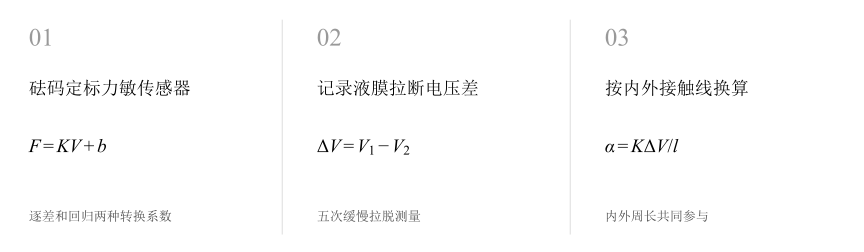
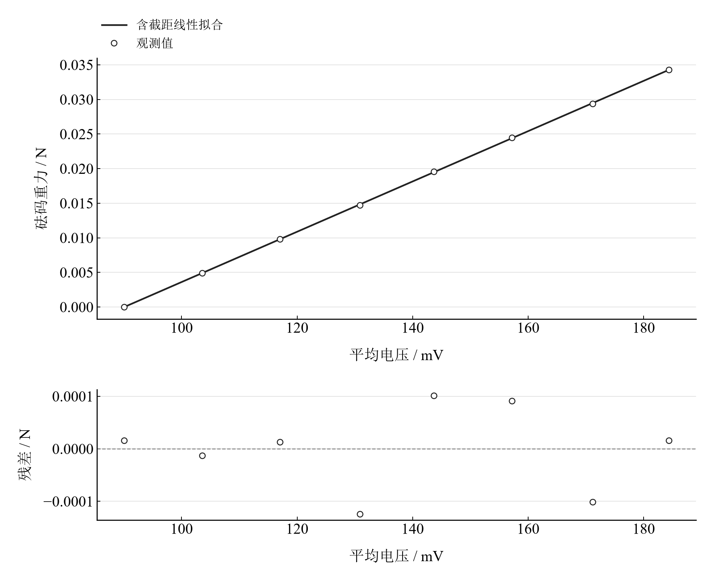
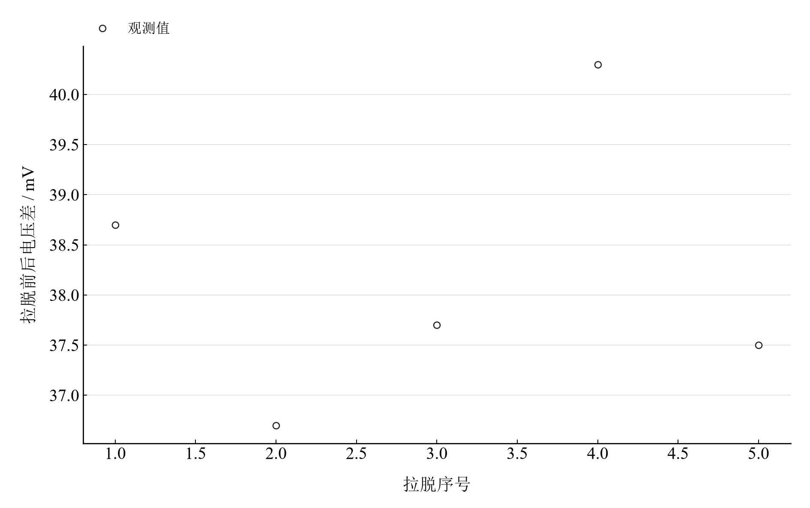

[普通物理实验 2](../README.md) · [项目首页](../../../README.md) · [使用指南](../../../docs/usage.md)

<!-- virtual-laboratory-entry -->
[在线虚拟实验](https://hnnuyuxuan.github.io/general-physics-lab/simulations/surface-tension/) · [模型依据与参数来源](../../../docs/surface-tension-model-evidence.md)

# 表面张力系数的测定(拉脱法)

**让液膜的拉力变成电压，再换算表面张力。**

先用砝码定标力敏传感器，再记录吊环拉断液膜前后的电压差。将拉力与吊环内外接触线长度对应起来，比较两种定标方法的影响。

[读实验报告](report/report.md) · [HTML 阅读与探索](https://hnnuyuxuan.github.io/general-physics-lab/experiments/course-02/surface-tension/notebooks/analysis.html) · [Python 笔记本](notebooks/analysis.ipynb) · [Wolfram 笔记本](../../../notebook/paclets/SurfaceTensionLab/Notebooks/SurfaceTensionLab.nb)



图 1　表面张力系数的测定(拉脱法)：测量与计算主线

## 选择你的入口

|用途|入口|打开方式|
|---|---|---|
|阅读原理、记录、计算与结论|[Markdown 报告](report/report.md) · [排版阅读版](https://hnnuyuxuan.github.io/general-physics-lab/experiments/course-02/surface-tension/report/report.html)|GitHub、Markdown 阅读器或浏览器|
|浏览计算图表、操作交互控件|[HTML 阅读版](https://hnnuyuxuan.github.io/general-physics-lab/experiments/course-02/surface-tension/notebooks/analysis.html)|直接在线打开，也可下载到本机|
|逐步执行和修改 Python 计算|[Jupyter Notebook](notebooks/analysis.ipynb)|JupyterLab 或 VS Code|
|原生数学排版与 Wolfram 计算|[Wolfram Notebook](../../../notebook/paclets/SurfaceTensionLab/Notebooks/SurfaceTensionLab.nb) · [Paclet 安装包](../../../notebook/paclets/SurfaceTensionLab/dist/SurfaceTensionLab-0.1.0.paclet)|Wolfram 前端|
|对照原始报告|[源报告 PDF](../../../pdf/course-02/01-表面张力系数的测定(拉脱法)/实验报告-表面张力系数的测定.pdf)|GitHub 或 PDF 阅读器|

## 从记录到物理量

8 个载荷等级的增减重电压、5 次拉脱读数，以及内外径各 5 次测量；温度约 20 °C，平均拉脱电压差 38.18 mV。

核心计算关系为：

$$
F=K\Delta V,\qquad l=\pi(D_{\mathrm{in}}+D_{\mathrm{out}}),\qquad \alpha=\frac{K\Delta V}{l}.
$$

充分润湿时吊环内外两侧均有液膜拉力。电压差消除吊环自身重量对应的静态基线，模型忽略附着液体的重量。

表 1　关键计算结果

|物理量|计算值|单位|
|---|---:|---|
|逐差法表面张力系数|0.065192321|N/m|
|回归标定表面张力系数|0.065012968|N/m|
|条件标准不确定度|0.0010736136|N/m|

逐差结果约 0.06519 N/m，与指定参考值 0.0728 N/m 相差约 10.45%。标准不确定度采用读数重复性和分辨力量化条件；润湿、附着液体与传感器迟滞属于模型和操作因素。

## 沿着图像理解结果



图 2　八个实际载荷等级的平均电压与重力定标及线性拟合



图 3　五次实际拉脱前后电压差，展示重复测量离散

完整记录、计算过程与结果讨论见[实验报告](report/report.md)。图中拟合与模型的物理含义可在 Notebook 中逐步计算。

## 在参数变化中继续探索

|操作|参数范围与默认值|观察什么|
|---|---|---|
|定标方法下拉选择|逐差定标、最小二乘定标|保持五次拉脱读数与吊环尺寸相同，比较转换系数引起的结果变化。|

在 [HTML](https://hnnuyuxuan.github.io/general-physics-lab/experiments/course-02/surface-tension/notebooks/analysis.html) 中操作已有控件；在 [Jupyter](notebooks/analysis.ipynb) 或 [Wolfram](../../../notebook/paclets/SurfaceTensionLab/Notebooks/SurfaceTensionLab.nb) 中运行全部单元，可继续修改输入与计算。

## 在本机打开

环境安装见[使用指南](../../../docs/usage.md)。在仓库根目录启动：

```powershell
.\.venv\Scripts\python.exe -m jupyterlab experiments/course-02/surface-tension/notebooks/analysis.ipynb
```

Wolfram 安装独立包后，通过包入口打开 Notebook。将仓库路径改为本机路径：

```wolfram
PacletInstall["D:/general-physics-lab/notebook/paclets/SurfaceTensionLab/dist/SurfaceTensionLab-0.1.0.paclet"];
Needs["SurfaceTensionLab`"];
SurfaceTensionLab`OpenNotebook[]
```

## 数据与计算实现

|内容|文件|
|---|---|
|载荷与定标电压|[calibration.csv](data/calibration.csv)|
|吊环内外径|[diameters.csv](data/diameters.csv)|
|拉脱前后电压|[pulls.csv](data/pulls.csv)|
|单位、参数与模型条件|[experiment.json](experiment.json)|
|Python 实现|[surface_tension.py](../../../src/physicslab/experiments/surface_tension.py)|
|Wolfram 实现|[SurfaceTensionLab.wl](../../../notebook/paclets/SurfaceTensionLab/Kernel/SurfaceTensionLab.wl)|

[数据来源](data/provenance.json) · [返回课程目录](../README.md)
