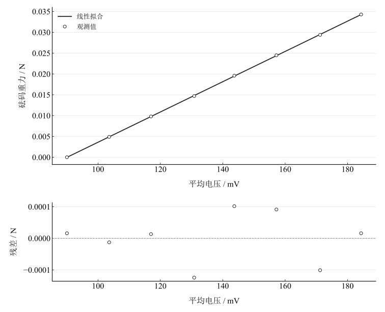
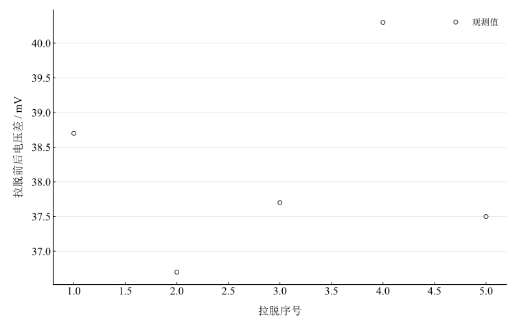

# 表面张力系数测定实验报告

淮南师范学院　电子工程学院　物理学专业

## 一、实验名称

表面张力系数的测定（吊环拉脱法）。

## 二、实验目的

用砝码定标硅压阻力敏传感器，求转换系数并掌握定标方法；观察拉脱过程，理解表面张力的微观成因与宏观表现；测量室温纯水表面张力系数并分析不确定度和误差。

## 三、实验原理

### 1. 液体表面张力

液体内部的分子作用近似对称，表面层作用不对称使液面有收缩趋势。长度为 $l$ 的液面分界线两侧作用力满足 $f=\alpha l$，其中 $\alpha$ 为表面张力系数，单位 $\mathrm{N\,m^{-1}}$，随液体种类、纯度、温度及表面状态变化。

### 2. 吊环拉脱法

洁净圆筒金属吊环缓慢离开液面，内外两侧形成液膜。峰值总拉力包含吊环重量、附着液体重量和两侧液面拉力；忽略薄膜附着液体的重量，拉断前后电压差 $V=V_1-V_2$ 对应表面张力：

$$
KV=\pi(D_{\mathrm{in}}+D_{\mathrm{out}})\alpha,\qquad
\alpha=\frac{K\bar V}{L},\qquad L=\pi(D_{\mathrm{in}}+D_{\mathrm{out}}).
$$

### 3. 传感器定标

同一载荷的增重与减重电压取平均 $V_i=(V_i^++V_i^-)/2$。每次增加500 $\mathrm{mg}$，跨四点逐差对应2000 $\mathrm{mg}$：

$$
\delta V_i=V_{i+4}-V_i,\qquad
\overline{\delta V}=\frac14\sum_{i=1}^4\delta V_i,\qquad
K=\frac{0.002g}{\overline{\delta V}}.
$$

另以重力 $F$ 对平均电压 $V$ 作线性回归，斜率给出转换系数 $K_{\mathrm{LS}}$。

## 四、主要仪器设备

DH4607C液体表面张力系数测定仪、硅压阻力敏传感器、砝码及托盘、金属吊环、升降台、温度计、游标卡尺、金属镊子和纯水。室温约20 ${}^{\circ}\mathrm{C}$，$g=9.794\,\mathrm{m\,s^{-2}}$；电压最小记录步长0.1 $\mathrm{mV}$，卡尺分度值0.02 $\mathrm{mm}$。

## 五、实验步骤

预热约15 $\mathrm{min}$，将砝码盘挂在传感器梁端，调零至电压稳定。记录空载电压，按0.5 $\mathrm{g}$逐次增加到3.5 $\mathrm{g}$，再逆序减重，在相同载荷记录两组电压。测吊环内、外径各五次。将洁净干燥且调平的吊环挂好，抬高液面使下沿浸没，缓慢降低液面，记录液膜拉断前峰值和拉断后静止电压，重复五次。计算定标逐差、回归系数和表面张力，并检查迟滞及拉脱重复性。

## 六、原始数据记录

表 1　传感器增重、减重与定标记录

{{tables.calibration}}

表 2　拉脱前后电压记录

{{tables.pulls}}

表 3　吊环内外径记录

{{tables.diameters}}

平均值与逐差为程序由原始电压、直径重新计算的派生列，不作为额外观测。

## 七、数据处理

### 1. 转换系数

四组逐差平均为 {{metrics.calibration_difference}} $\mathrm{mV}$，逐差转换系数为 {{metrics.conversion_difference}} $\mathrm{N\,mV^{-1}}$。最小二乘转换系数为 {{metrics.conversion_regression}} $\mathrm{N\,mV^{-1}}$，标定相关系数为 {{metrics.calibration_correlation}}。截距为 {{metrics.calibration_intercept}} $\mathrm{N}$，反映原始电压的非零基线。

图 1　砝码重力与平均电压的线性定标及残差

### 2. 周长与表面张力

采用未修约内外径均值，接触线总长度为 {{metrics.contact_length}} $\mathrm{m}$。拉脱读数差平均为 {{metrics.mean_pull_difference}} $\mathrm{mV}$，逐差定标给出 $\alpha=$ {{metrics.surface_tension}} $\mathrm{N\,m^{-1}}$，回归定标给出 {{metrics.surface_tension_regression}} $\mathrm{N\,m^{-1}}$。两种标定方法的差异与拉脱读数离散性应分别检查。

图 2　五次拉脱前后电压差

### 3. 条件标准不确定度

重复数据均值的A类标准不确定度为

$$
u_A(\bar x)=\sqrt{\frac{\sum_i(x_i-\bar x)^2}{n(n-1)}}.
$$

量化误差暂按独立读数、半分辨力半宽和均匀分布处理。单次电压标准不确定度为 $u_q(V)=0.1/\sqrt{12}$ $\mathrm{mV}$。由于每个标定平均由两次读数组成，逐差再对四对平均，其量化分量为 $u_q(\overline{\delta V})=u_q(V)/2$；五次拉脱差平均的分量为 $u_q(\bar V)=\sqrt{2/5}\,u_q(V)$。直径均值按五次独立量化读数传播。系统性零漂和迟滞不会因这一假设自动消除。

表 4　主要物理量的条件不确定度预算

{{tables.uncertainty}}

$$
\frac{u(\alpha)}{\alpha}=\sqrt{
\left(\frac{u(K)}K\right)^2+
\left(\frac{u(\bar V)}{\bar V}\right)^2+
\left(\frac{u(L)}L\right)^2}.
$$

计算得到 $u(\alpha)=$ {{metrics.conditional_uncertainty}} $\mathrm{N\,m^{-1}}$。该预算忽略砝码质量和重力加速度的不确定度，并未量化润湿条件、液膜重量和仪器漂移，因此应标为条件标准不确定度，不给出覆盖概率。

## 八、实验结果与讨论

逐差法得到表面张力系数 {{metrics.surface_tension}} $\mathrm{N\,m^{-1}}$，条件标准不确定度为 {{metrics.conditional_uncertainty}} $\mathrm{N\,m^{-1}}$。与20 ${}^{\circ}\mathrm{C}$参考值0.0728 $\mathrm{N\,m^{-1}}$相比，相对差异为 {{metrics.relative_deviation}} $\%$。差异明显超过重复性和量化读数贡献，提示还需检查系统效应，不能靠增加次数消除。

传感器响应高度线性，但增减重最大相差约2.4 $\mathrm{mV}$，说明回程差或迟滞需要关注。平均处理可减小相反方向的部分偏差，不保证完全消除漂移。五次拉脱差38.7、36.7、37.7、40.3和37.5 $\mathrm{mV}$中，第4次偏大，可能与液面运动、峰值捕捉或扰动有关；本次仍保留所有拉脱记录。

吊环油污和灰尘改变润湿，倾斜使液膜不能沿周界同时破裂；液面下降过快、环境气流和桌面振动影响峰值。读数刷新及峰值保持响应也会影响拉断前读数。改进时应控制吊环清洁水平、稳定升降速度，复测定标漂移，并补充砝码和传感器准确度资料。
