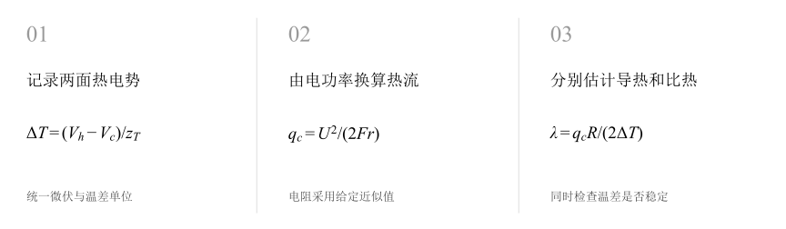
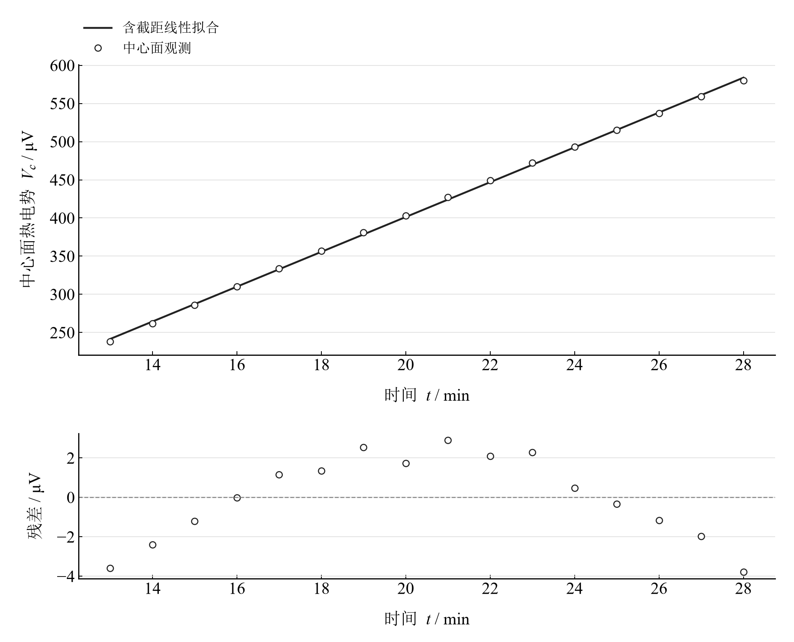
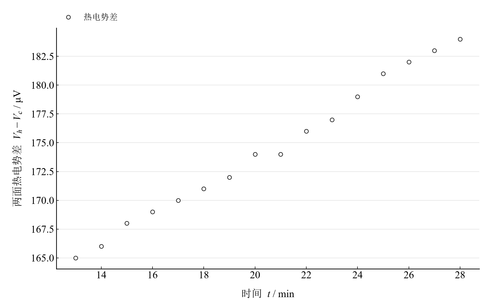

[普通物理实验 2](../README.md) · [项目首页](../../../README.md) · [使用指南](../../../docs/usage.md)

# 固体导热系数的测量

**同时看升温速率与两面温差，理解准稳态导热。**

铜—康铜热电偶记录加热面与中心面的热电势。中心面的斜率连接比热容，两面之差连接导热系数，双线索共同检验准稳态近似。

[读实验报告](report/report.md) · [HTML 阅读版](notebooks/analysis.html) · [Python 笔记本](notebooks/analysis.ipynb) · [Wolfram 笔记本](../../../notebook/paclets/ThermalConductivityLab/Notebooks/ThermalConductivityLab.nb)



图 1　固体导热系数的测量：测量与计算主线

## 选择你的入口

|用途|入口|打开方式|
|---|---|---|
|阅读原理、记录、计算与结论|[Markdown 报告](report/report.md) · [排版阅读版](report/report.html)|GitHub、Markdown 阅读器或浏览器|
|浏览计算图表与结果|[HTML 阅读版](notebooks/analysis.html)|下载后用浏览器打开|
|逐步执行和修改 Python 计算|[Jupyter Notebook](notebooks/analysis.ipynb)|JupyterLab 或 VS Code|
|原生数学排版与 Wolfram 计算|[Wolfram Notebook](../../../notebook/paclets/ThermalConductivityLab/Notebooks/ThermalConductivityLab.nb) · [Paclet 安装包](../../../notebook/paclets/ThermalConductivityLab/dist/ThermalConductivityLab-0.1.0.paclet)|Wolfram 前端|
|对照原始报告|[源报告 PDF](../../../pdf/course-02/07-固体导热系数的测量/实验报告-固体导热系数的测量.pdf)|GitHub 或 PDF 阅读器|

## 从记录到物理量

13–28 min 的 16 组中心面、加热面微伏读数，跨度 15 min；加热电压 18.02 V，电阻采用讲义近似值 110 Ω。

核心计算关系为：

$$
q_c=\frac{U^2}{2Fr},\qquad \lambda=\frac{q_cR}{2\Delta T},\qquad c=\frac{q_c}{\rho Rv}.
$$

热电常数为 40 μV/K。中心面斜率换算为温升速率 v，两面热电势差换算为温差；厚度、面积和电阻共同进入热流模型。

其中 $F$ 为修正后的传热面积，$r$ 为加热电阻，$R$ 为试样厚度，$v$ 为中心面的升温速率。

表 1　关键计算结果

|物理量|计算值|单位|
|---|---:|---|
|末端温差下导热系数|0.23302103|W/(m·K)|
|给定参数下比热容|2006.5085|J/(kg·K)|
|两面热电势差相对增加|11.515152|%|

末端温差对应导热系数约 0.233 W/(m·K)，给定参数下比热容约 2007 J/(kg·K)。两面差从 165 增至 184 μV，约增长 11.52%；温差漂移是解释准稳态估计时的重要条件。

## 沿着图像理解结果



图 2　十六组实际中心面热电势及其时间回归和残差



图 3　同组加热面与中心面读数之差，展示准稳态近似中的漂移

完整记录、计算过程与结果讨论见[实验报告](report/report.md)。图中拟合与模型的物理含义可在 Notebook 中逐步计算。

## 在 Notebook 中复算

|计算步骤|观察什么|
|---|---|
|读取本实验的规范数据|统一热电势的微伏单位，并换算温度与温差。|
|依次执行数据处理单元|对照中间计算表，完成由电功率换算热流。|
|重新绘图并查看结果|完成分别估计导热和比热，检查图线与物理参数。|

在 [Jupyter](notebooks/analysis.ipynb) 或 [Wolfram](../../../notebook/paclets/ThermalConductivityLab/Notebooks/ThermalConductivityLab.nb) 中从头执行，即可复算图表与结果。HTML 保存相同数据的计算输出，适合直接阅读。

## 在本机打开

环境安装见[使用指南](../../../docs/usage.md)。在仓库根目录启动：

```powershell
.\.venv\Scripts\python.exe -m jupyterlab experiments/course-02/thermal-conductivity/notebooks/analysis.ipynb
```

Wolfram 安装独立包后，通过包入口打开 Notebook。将仓库路径改为本机路径：

```wolfram
PacletInstall["D:/general-physics-lab/notebook/paclets/ThermalConductivityLab/dist/ThermalConductivityLab-0.1.0.paclet"];
Needs["ThermalConductivityLab`"];
ThermalConductivityLab`OpenNotebook[]
```

## 数据与计算实现

|内容|文件|
|---|---|
|样品与热流参数|[observations-01.csv](data/observations-01.csv)|
|两面热电势记录|[observations-02.csv](data/observations-02.csv)|
|单位、参数与模型条件|[experiment.json](experiment.json)|
|Python 实现|[thermal_conductivity.py](../../../src/physicslab/experiments/thermal_conductivity.py)|
|Wolfram 实现|[ThermalConductivityLab.wl](../../../notebook/paclets/ThermalConductivityLab/Kernel/ThermalConductivityLab.wl)|

[数据来源](data/provenance.json) · [返回课程目录](../README.md)
