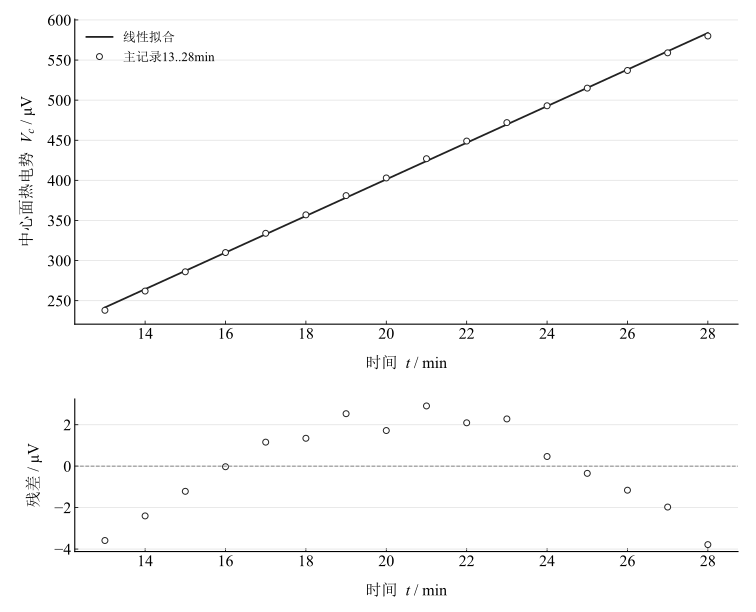
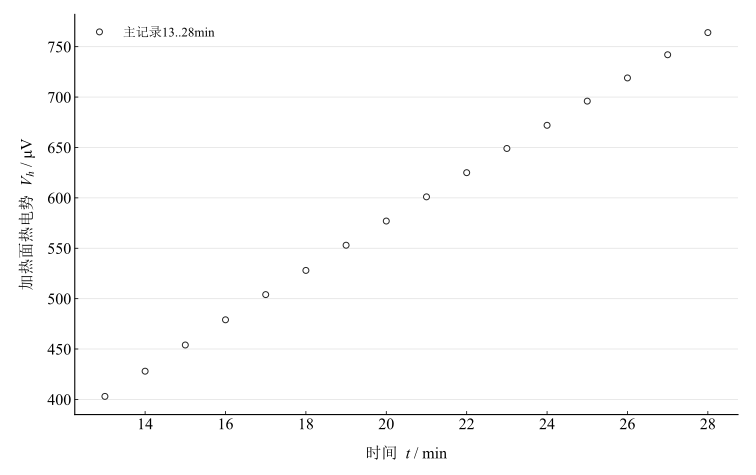
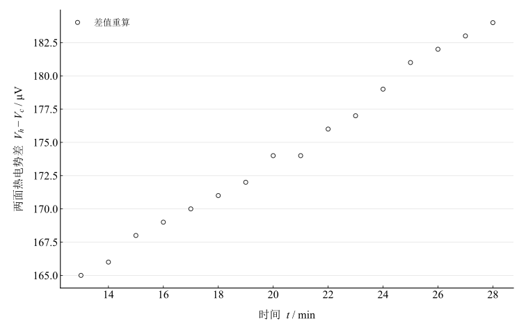

# 固体导热系数的测量

## 实验名称

固体导热系数的测量

## 实验目的

1.  了解准稳态法测量不良导体导热系数和比热容的基本原理。

2.  学习铜---康铜热电偶测量温度差的方法，掌握热电势与温度差之间的换算关系。

3.  通过逐差法和最小二乘法求取试样中心面的温升速率，并分析实验结果及主要误差来源。

## 实验原理

### **（一）准稳态导热原理**

在试样受热过程中，当加热面与中心面之间的温度差近似保持不变，同时试样整体以近似恒定速率升温时，可认为系统进入准稳态。在该状态下，穿过试样的热流密度近似恒定。两片并联加热器的加热电压为 $U$，每片加热器的电阻为 $r$，边缘修正后的加热面积为 $F$，则热流密度为：

$$q_{c}=\frac{U^{2}}{2Fr}$$

其中：

$$F=A\times 0.09\times 0.09$$

式中，$A=0.85$ 为加热面积修正系数。

### **（二）热电偶测温原理**

铜---康铜热电偶的热电常数为 $z_{T}=0.04\,\mathrm{mV/K}$。若加热面与中心面的温差热电势为 $V_{t}$，则两面温度差为：

$$\Delta t=\frac{V_{t}}{z_{T}}$$

### **（三）导热系数计算**

设每片试样厚度为 $R$，由准稳态传热关系可得：

$$\lambda =\frac{q_{c}R}{2\Delta t}$$

式中，$\lambda$ 的单位为 $\mathrm{W/(m\,K)}$。

### **（四）中心面温升速率和比热容**

若中心面热电势为 $V_{c}$，则中心面温升速率为：

$$v=\frac{dt}{d\tau }=\frac{1}{z_{T}}\frac{dV_{c}}{d\tau }$$

实验中可采用逐差法或最小二乘法求得 $v$。试样比热容为：

$$c=\frac{q_{c}}{\rho Rv}$$

其中，$\rho$ 为试样密度。

## 主要仪器设备

数显准稳态法比热导热系数实验仪、有机玻璃试样、加热膜、铜---康铜热电偶、保温杯及配套连接导线。

## 实验步骤

### **（一）安装试样并连接线路**

1.  将冷却至室温的中心面试样和加热面试样放入样品架，使中心面热电偶位于四块试样的中心位置。

2.  转动螺杆旋钮，使加热膜、热电偶、待测试样和隔热层紧密接触，但不得过度压紧。

3.  按实验讲义要求连接加热面、中心面和保温杯各接线端，检查极性无误后接通仪器。

### **（二）加热和记录数据**

1.  调节加热电压至约 $18 V$，本次实测加热电压为 $18.02 V$。

2.  启动加热，每隔 $1 min$ 记录一次中心面热电势 $V_{c}$ 和加热面热电势 $V_{h}$。

3.  观察两面热电势差和中心面热电势升高速率，选择最接近准稳态的连续 $16$ 个每分钟读数进行处理。

4.  根据所选数据计算温差、导热系数、温升速率和比热容，并绘制相应变化曲线。

## 原始数据记录

实验条件如下表。

表 1　实验条件

{{tables.table1}}

仪器显示屏热电势单位为 $\mu V$。

表 2　热电势原始记录与重算差值

{{tables.table2}}

其中：

$$V_{t}=V_{h}-V_{c}$$

$$\Delta V_{i}=V_{c\text{,}i+1}-V_{c\text{,}i}$$

$$\Delta U_{i}=V_{c\text{,}i+8}-V_{c\text{,}i}$$

## 数据处理

### （一）加热面积和热流密度

采用所列 $U=18.02\,\mathrm V$、$r=110\,\Omega$、修正系数 $0.85$ 和边长 $0.09\,\mathrm m$，得到 $F=0.0068850\,\mathrm m^2$，$q_c=U^2/(2Fr)=214.379349\,\mathrm{W/m^2}$。电阻为讲义近似值，不是另行确认的实测量。

### （二）温度差和导热系数

明确换算 $z_T=0.04\,\mathrm{mV/K}=40\,\mu\mathrm{V/K}$。末端差 $184\,\mu\mathrm V$ 对应 $4.60\,\mathrm K$。按 $\lambda=q_cR/(2\Delta T)$，末端温差得到 $0.2330210\,\mathrm{W/(m\,K)}$，平均温差得到 $0.2457950\,\mathrm{W/(m\,K)}$。两者差异体现选取温差的影响。

### （三）逐差法计算温升速率

取 $8\,\mathrm{min}$ 隔距的八组中心面热电势差，均值 $182.625\,\mu\mathrm V$，换算 $v_1=182.625/(40\times8\times60)=0.009511719\,\mathrm{K/s}$。

### （四）最小二乘法计算温升速率及不确定度

带截距拟合 $V_c/\mu\mathrm V=22.81323529(t/\mathrm{min})+(-54.98382353)$，$R^2=0.99960130$。温升速率为斜率先除以 $60$ 再除以 $40\,\mu\mathrm{V/K}$，得到 $v_2=0.009505515\,\mathrm{K/s}$，仅残差传播标准误为 $0.000050736\,\mathrm{K/s}$。缺热电偶标定与时间系统分量，不能作为完整不确定度。

### （五）比热容计算

按给定密度 $1124\,\mathrm{kg/m^3}$、厚度 $0.010\,\mathrm m$，由 $c=q_c/(\rho Rv_2)$ 得 $2006.5085\,\mathrm{J/(kg\,K)}$，高于指定参考范围 $1424$ 至 $1549\,\mathrm{J/(kg\,K)}$。该差异不能由拟合标准误单独解释。

### （六）实验曲线

图 1　中心面热电势与时间的拟合及残差

图 2　加热面热电势随时间的变化

图 3　两面热电势差随时间的变化

### （七）主要计算结果汇总

表 3　给定参数下的导热与比热计算结果

{{tables.table3}}

## 实验结果与讨论

### （一）关于准稳态的判定

所列 $13$ 至 $28\,\mathrm{min}$ 为 $16$ 个等间隔读数，实际跨度 $15\,\mathrm{min}$。中心温升近似线性，但两面差从 $165$ 增至 $184\,\mu\mathrm V$，增加 $11.515\%$，未达到严格恒定温差；中心面的高拟合优度不能单独证明温度场已准稳态。

### （二）关于导热系数测量结果

末端估计约 $0.233\,\mathrm{W/(m\,K)}$，平均温差估计约 $0.246\,\mathrm{W/(m\,K)}$，均依赖给定电阻、面积及近似温场模型。位于指定参考范围内不能替代仪器和样品校准。

### （三）关于比热容测量结果

比热容约 $2.01\times10^3\,\mathrm{J/(kg\,K)}$。逐差与拟合接近是同一数据的两种处理的一致性，不能排除电阻、厚度、密度及散热的共同误差。

### （四）误差分析

实际电阻未确认，$q_c\propto1/r$ 的误差会同时影响导热和比热。温差持续漂移、接触热阻、边缘散热、热电偶微伏级零漂及有效厚度均可能影响结果，当前无法唯一归因。未将其他照片或时间序列与本组记录混合。

### （五）实验结论

在本组 $13$ 至 $28\,\mathrm{min}$ 微伏读数及给定近似参数下，末端导热系数约 $0.233\,\mathrm{W/(m\,K)}$，比热容约 $2.01\times10^3\,\mathrm{J/(kg\,K)}$；温差尚有漂移且完整系统分量缺失，结论保留准稳态近似的限制。
