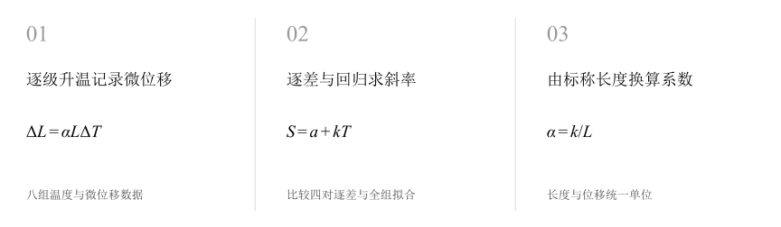
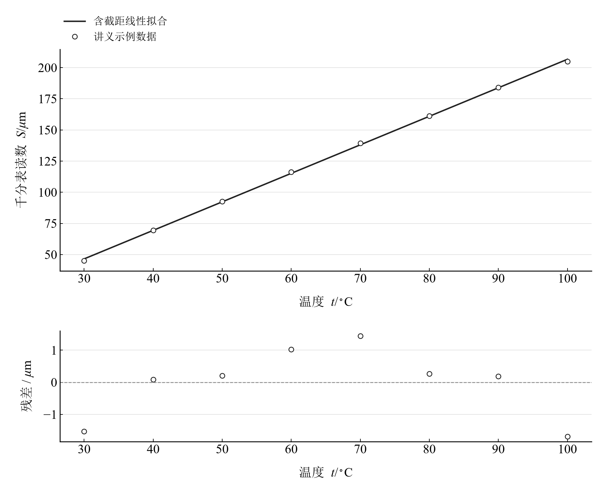

[普通物理实验 2](../README.md) · [项目首页](../../../README.md) · [使用指南](../../../docs/usage.md)

# 金属线膨胀系数的测量

**用微米级伸长连接温度变化与材料膨胀。**

温度逐级升高，千分表记录金属杆伸长。对等温差配对与整组回归分别计算线胀系数，让两种算法在同一数据上形成直观对照。

[读实验报告](report/report.md) · [HTML 阅读版](notebooks/analysis.html) · [Python 笔记本](notebooks/analysis.ipynb) · [Wolfram 笔记本](../../../notebook/paclets/ThermalExpansionLab/Notebooks/ThermalExpansionLab.nb)



图 1　金属线膨胀系数的测量：测量与计算主线

## 选择你的入口

|用途|入口|打开方式|
|---|---|---|
|阅读原理、记录、计算与结论|[Markdown 报告](report/report.md) · [排版阅读版](report/report.html)|GitHub、Markdown 阅读器或浏览器|
|浏览计算图表与结果|[HTML 阅读版](notebooks/analysis.html)|下载后用浏览器打开|
|逐步执行和修改 Python 计算|[Jupyter Notebook](notebooks/analysis.ipynb)|JupyterLab 或 VS Code|
|原生数学排版与 Wolfram 计算|[Wolfram Notebook](../../../notebook/paclets/ThermalExpansionLab/Notebooks/ThermalExpansionLab.nb) · [Paclet 安装包](../../../notebook/paclets/ThermalExpansionLab/dist/ThermalExpansionLab-0.1.0.paclet)|Wolfram 前端|
|对照原始报告|[源报告 PDF](../../../pdf/course-02/06-金属线膨胀系数的测量/实验报告-金属线胀系数的测量.pdf)|GitHub 或 PDF 阅读器|

## 从记录到物理量

30–100 °C 的 8 组温度与千分表读数，间隔 10 °C；标称紫铜棒长度 150 mm。这组读数与配套讲义示例相同，用于数据处理复算。

核心计算关系为：

$$
\Delta L=\alpha L\Delta T,\qquad S=a+kT,\qquad \alpha=\frac{k}{L}.
$$

在有限温区内将线胀系数视为常量，初始读数进入截距，伸长对温度的斜率连接标称长度与材料参数。

表 1　关键计算结果

|物理量|计算值|单位|
|---|---:|---|
|逐差平均线胀系数|$1.5270833\times10^{-5}$|K⁻¹|
|最小二乘线胀系数|$1.5253175\times10^{-5}$|K⁻¹|
|相对指定参考中值偏差|11.575799|%|

逐差与回归得到约 15.27 × 10⁻⁶ K⁻¹ 和 15.25 × 10⁻⁶ K⁻¹。拟合残差分量描述这组示例数据的线性离散；有效受热长度、温度滞后和传动结构属于进一步测量的条件。

## 沿着图像理解结果



图 2　与讲义示例同值的八组温度—读数数据及线性拟合和残差

完整记录、计算过程与结果讨论见[实验报告](report/report.md)。图中拟合与模型的物理含义可在 Notebook 中逐步计算。

## 在 Notebook 中复算

|计算步骤|观察什么|
|---|---|
|读取本实验的规范数据|读取八组温度与微位移，确认温差与位移的单位。|
|依次执行数据处理单元|对照中间计算表，完成逐差与回归求斜率。|
|重新绘图并查看结果|完成由标称长度换算系数，检查图线与物理参数。|

在 [Jupyter](notebooks/analysis.ipynb) 或 [Wolfram](../../../notebook/paclets/ThermalExpansionLab/Notebooks/ThermalExpansionLab.nb) 中从头执行，即可复算图表与结果。HTML 保存相同数据的计算输出，适合直接阅读。

## 在本机打开

环境安装见[使用指南](../../../docs/usage.md)。在仓库根目录启动：

```powershell
.\.venv\Scripts\python.exe -m jupyterlab experiments/course-02/thermal-expansion/notebooks/analysis.ipynb
```

Wolfram 安装独立包后，通过包入口打开 Notebook。将仓库路径改为本机路径：

```wolfram
PacletInstall["D:/general-physics-lab/notebook/paclets/ThermalExpansionLab/dist/ThermalExpansionLab-0.1.0.paclet"];
Needs["ThermalExpansionLab`"];
ThermalExpansionLab`OpenNotebook[]
```

## 数据与计算实现

|内容|文件|
|---|---|
|样品与仪器条件|[observations-01.csv](data/observations-01.csv)|
|温度与千分表读数|[observations-02.csv](data/observations-02.csv)|
|单位、参数与模型条件|[experiment.json](experiment.json)|
|Python 实现|[thermal_expansion.py](../../../src/physicslab/experiments/thermal_expansion.py)|
|Wolfram 实现|[ThermalExpansionLab.wl](../../../notebook/paclets/ThermalExpansionLab/Kernel/ThermalExpansionLab.wl)|

[数据来源](data/provenance.json) · [返回课程目录](../README.md)
