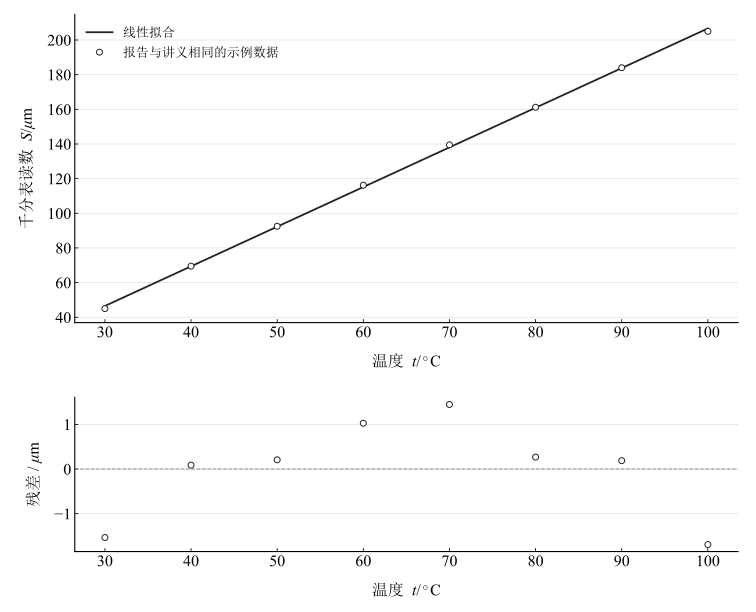

# 金属线膨胀系数的测量

## 实验名称

金属线胀系数的测量

## 实验目的

1. 了解固体线热膨胀的基本规律及线胀系数的物理意义。

2. 掌握用千分表测量金属杆微小长度变化的方法，熟悉温度控制器和Pt100温度传感器的使用。

3. 采用逐差法和最小二乘法处理温度---伸长量数据，测定紫铜棒在一定温度范围内的平均线胀系数。

## 实验原理

### **（一）固体的线热膨胀**

在一定温度范围内，固体受热时各方向的线度均会发生变化。若温度变化不大，可认为金属杆的伸长量与原长及温度变化量成正比，即：

$$\Delta L = \alpha L\Delta t$$

式中，$L$为金属杆初始长度，$\Delta L$为温度升高$\Delta t$时的伸长量，$\alpha$为材料的线胀系数，单位为 $\mathrm{K}^{-1}$。由上式可得：

$$\alpha =\frac{\Delta L}{L\Delta t}$$

本实验中，千分表读数的变化量用于表征金属杆的伸长量。在测量温度范围内若$\alpha$近似为常量，则千分表读数 $S$ 与温度 $t$ 之间应满足线性关系。

$$S = S_{0} + \alpha L(t - t_{0}) = a + kt$$

其中直线斜率$k=\alpha L$，因此可由拟合斜率求得线胀系数：

$$\alpha =\frac{k}{L}$$

### **（二）逐差法**

为充分利用等间隔测量数据，并减小初始读数偏移对结果的影响，将第 $i$ 个数据与第 $i+4$ 个数据配对，定义：

$$\Delta S_{i} = S_{i+4} - S_{i}\quad \Delta T = t_{i+4} - t_{i} = 40 {}^{\circ}\mathrm{C}$$

各组线胀系数及其平均值分别为：

$$\alpha _{i} =\frac{\Delta S_{i}}{L\Delta T}\quad \overline{\alpha} =\frac{\overline{\Delta S}}{L\Delta T}$$

### **（三）最小二乘法及不确定度**

用最小二乘法将 $S$ 与 $t$ 拟合为直线 $S=a+kt$。斜率 $k$ 的标准不确定度可按下式估计：

$$u(k) = \sqrt{\frac{\sum (S_{i} - kt_{i} - a)^{2}}{(n - 2)\sum (t_{i} - \overline{t})^{2}}\text{}}$$

线胀系数的标准不确定度和相对标准不确定度分别为：

$$u(\alpha ) =\frac{u(k)}{L}\quad u_{r}(\alpha ) =\frac{u(\alpha )}{\alpha }\times 100\%$$

## 主要仪器设备

DH4608T热学综合实验仪---温度控制器、透光真空管式炉、千分表（分度值0.001 mm）、Pt100温度传感器、紫铜棒（标称长度150 mm）、连接导线等。

## 实验步骤

(1) 将温度传感器由左端插入管式炉，在样品两端分别装入石英棒，使金属棒位于炉管中心位置；调节预紧微调螺钉，使千分表长指针预压到约20格，保证测头与样品充分接触。

(2) 连接Pt100温度传感器、加热电流输出端和温控器，检查接线无误后接通电源。

(3) 将温控器设定值调至110.0 ℃，加热电流调至约0.300 A，使样品缓慢连续升温。

(4) 待温度依次达到30、40、50、60、70、80、90和100 ℃时，分别记录千分表读数S。读数过程中避免振动仪器和实验台。

(5) 以温度t为横轴、千分表读数S为纵轴绘制关系图；采用逐差法和最小二乘法计算紫铜棒的平均线胀系数，并与参考值比较。

## 原始数据记录

### **（一）实验条件**

表 1　实验条件

| 项目 | 符号或型号 | 数值 | 单位/说明 |
| --- | --- | --- | --- |
| 待测样品 | — | 紫铜棒 | — |
| 初始长度 | L | 150 | mm |
| 千分表分度值 | — | 0.001 | mm（1 μm） |
| 加热电流 | I | 0.300 | A |
| 温控设定值 | SV | 110.0 | ℃ |
| 记录温度范围 | t | 30～100 | ℃ |
| 相邻温度间隔 | — | 10 | ℃ |

### **（二）原始测量数据**

表 2　温度与千分表读数

| 测量序号 | 1 | 2 | 3 | 4 | 5 | 6 | 7 | 8 |
| --- | --- | --- | --- | --- | --- | --- | --- | --- |
| 实测温度 tᵢ / ℃ | 30 | 40 | 50 | 60 | 70 | 80 | 90 | 100 |
| 千分表读数 Sᵢ / μm | 45.0 | 69.5 | 92.5 | 116.2 | 139.5 | 161.2 | 184.0 | 205.0 |

说明：千分表读数单位统一换算为$\mu m$；该组八个温度及千分表读数与配套讲义示例完全一致，按这些数据复算，不能认定为独立新增测量。

## 数据处理

### （一）逐差法计算

取 $L=150\,\mathrm{mm}=150000\,\mu\mathrm m$，四个不重叠配对的温差均为 $40\,\mathrm K$。

表 3　相隔四点的逐差计算

| 配对 | $t_i$ / °C | $t_{i+4}$ / °C | $S_i$ / μm | $S_{i+4}$ / μm | $\Delta S_i$ / μm | $\alpha_i$ / K$^{-1}$ |
| --- | --- | --- | --- | --- | --- | --- |
| 1–5 | 30 | 70 | 45 | 139.5 | 94.5 | $1.575\times10^{-5}$ |
| 2–6 | 40 | 80 | 69.5 | 161.2 | 91.7 | $1.5283333\times10^{-5}$ |
| 3–7 | 50 | 90 | 92.5 | 184 | 91.5 | $1.525\times10^{-5}$ |
| 4–8 | 60 | 100 | 116.2 | 205 | 88.8 | $1.48\times10^{-5}$ |

平均伸长差为 $91.625\,\mu\mathrm m$，逐差线胀系数均值为 $15.270833\times10^{-6}\,\mathrm K^{-1}$。

### （二）最小二乘法拟合

表 4　最小二乘辅助计算表

| 序号 | 温度 $t$ / °C | 读数 $S$ / μm | $t^2$ / °C$^2$ | $tS$ / (°C·μm) |
| --- | --- | --- | --- | --- |
| 1 | 30 | 45 | 900 | 1350 |
| 2 | 40 | 69.5 | 1600 | 2780 |
| 3 | 50 | 92.5 | 2500 | 4625 |
| 4 | 60 | 116.2 | 3600 | 6972 |
| 5 | 70 | 139.5 | 4900 | 9765 |
| 6 | 80 | 161.2 | 6400 | 12896 |
| 7 | 90 | 184 | 8100 | 16560 |
| 8 | 100 | 205 | 10000 | 20500 |
| 合计 | 520 | 1012.9 | 38000 | 75448 |

全部八点带截距拟合为

$$
S/\mu\mathrm m=-22.10595238+2.28797619\,(t/^\circ\mathrm C),\qquad R^2=0.99961257.
$$

图 1　温度与千分表读数的拟合及残差

### （三）拟合不确定度

表 5　拟合与残差传播分量

| 项目 | 计算结果 |
| --- | --- |
| 斜率 / (μm/K) | 2.2879762 |
| 残差斜率标准误 / (μm/K) | 0.018389036 |
| 线胀系数 / K⁻¹ | $1.5253175\times10^{-5}$ |
| 仅残差传播分量 / K⁻¹ | $1.2259357\times10^{-7}$ |
| 相对残差分量 / % | 0.80372498 |

由 $\alpha=k/L$，得到 $\alpha=15.253175\times10^{-6}\,\mathrm K^{-1}$；仅残差传播的标准误为 $0.122594\times10^{-6}\,\mathrm K^{-1}$。该值依赖温度自变量无误差、等权独立残差与标称长度精确的假设，不包括有效受热长度、温度滞后、千分表分度和支架传递分量，不能作为完整合成不确定度。

### （四）与参考值比较

按指定紫铜参考范围 $17.0$ 至 $17.5\times10^{-6}\,\mathrm K^{-1}$ 的中值 $17.25\times10^{-6}\,\mathrm K^{-1}$，拟合结果的相对差为 $11.5758\%$。参考值是比较输入，未附样品的独立校准值。

## 实验结果与讨论

### （一）实验规律

温度从 $30$ 至 $100^\circ\mathrm C$ 时读数增加 $160.0\,\mu\mathrm m$，数据近似线性，符合在有限温区内以常数线胀系数描述的模型；这些读数与讲义示例相同，结论用于该数据的复算。

### （二）两种数据处理方法的比较

逐差得到约 $15.27\times10^{-6}\,\mathrm K^{-1}$，最小二乘得到约 $15.25\times10^{-6}\,\mathrm K^{-1}$。两种方法都使用同一组数据，一致性不能作为独立实验重复性检验。

### （三）误差分析

结果低于指定参考中值约 $11.6\%$，大于残差分量，提示仅用随机拟合离散不能解释比较差。温度滞后、测头预紧和接触、石英棒与炉管的摩擦、支架形变、指针视差、实际受热长度与标称长度不同，以及升温过快均可能影响斜率。未单独测量这些因素，不能确认其中哪一项为主因。

### （四）实验结论

按所列八组数据和标称长度，线胀系数拟合估计为约 $15.25\times10^{-6}\,\mathrm K^{-1}$。读数线性较好，但来源与讲义示例相同且完整系统误差未给出，不能将拟合标准误当作独立实际测量的全部不确定度。
