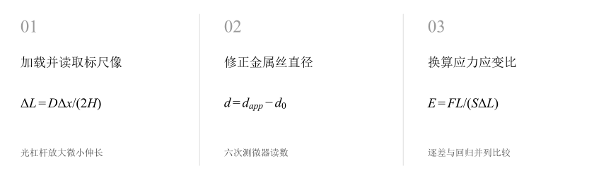
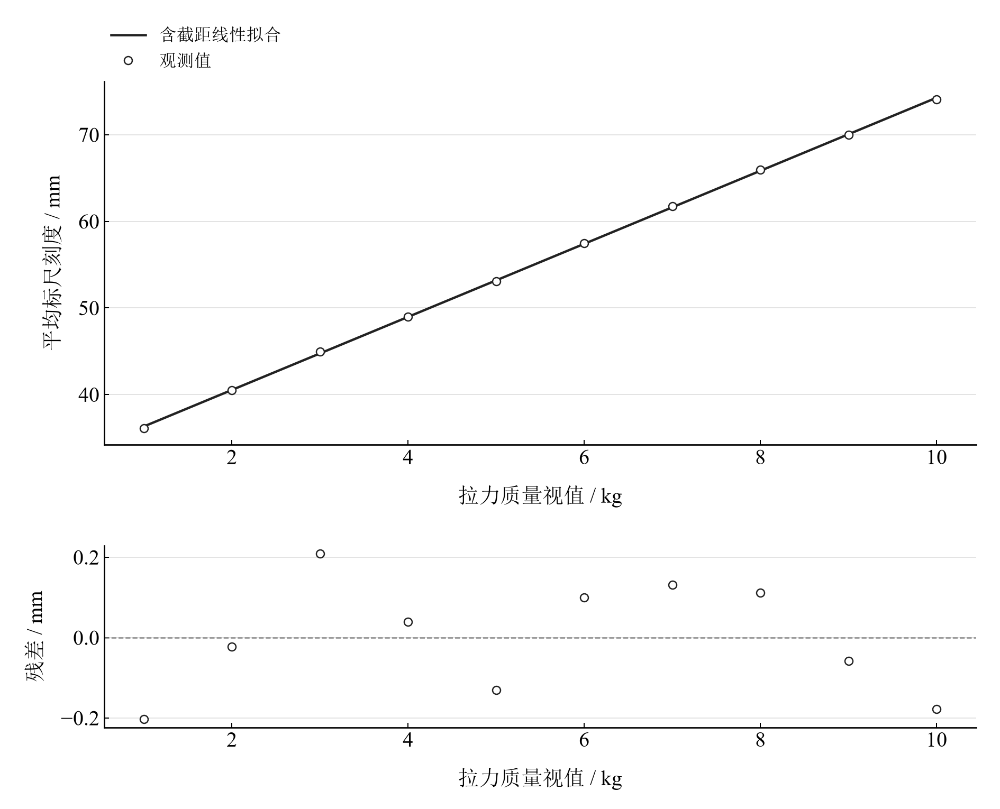
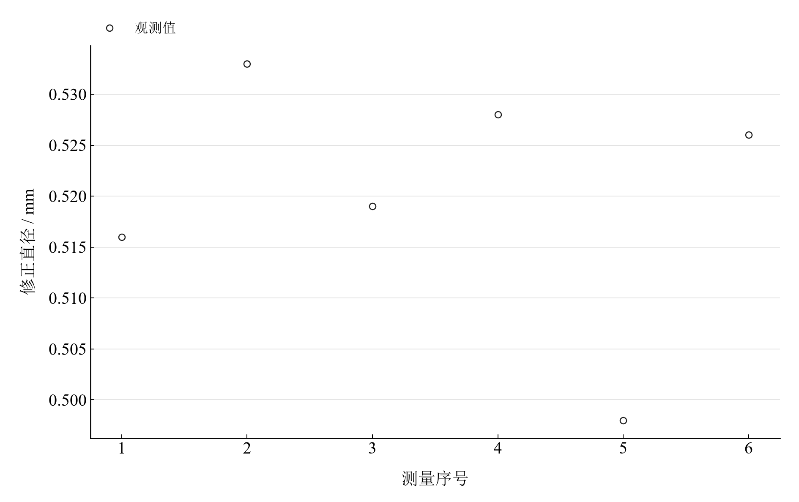

[普通物理实验 2](../README.md) · [项目首页](../../../README.md) · [使用指南](../../../docs/usage.md)

<!-- virtual-laboratory-entry -->
[在线虚拟实验](https://hnnuyuxuan.github.io/general-physics-lab/simulations/young-modulus/) · [模型依据与参数来源](../../../docs/young-modulus-model-evidence.md)

# 杨氏模量的测量

**用光杠杆放大微小伸长，读出金属丝的弹性。**

加载金属丝，将微小伸长转化为标尺位移。对加减载读数作逐差与回归，再沿直径的平方关系追踪测微器零差的影响。

[读实验报告](report/report.md) · [HTML 阅读与探索](https://hnnuyuxuan.github.io/general-physics-lab/experiments/course-02/young-modulus/notebooks/analysis.html) · [Python 笔记本](notebooks/analysis.ipynb) · [Wolfram 笔记本](../../../notebook/paclets/YoungModulusLab/Notebooks/YoungModulusLab.nb)



图 1　杨氏模量的测量：测量与计算主线

## 选择你的入口

|用途|入口|打开方式|
|---|---|---|
|阅读原理、记录、计算与结论|[Markdown 报告](report/report.md) · [排版阅读版](https://hnnuyuxuan.github.io/general-physics-lab/experiments/course-02/young-modulus/report/report.html)|GitHub、Markdown 阅读器或浏览器|
|浏览计算图表、操作交互控件|[HTML 阅读版](https://hnnuyuxuan.github.io/general-physics-lab/experiments/course-02/young-modulus/notebooks/analysis.html)|直接在线打开，也可下载到本机|
|逐步执行和修改 Python 计算|[Jupyter Notebook](notebooks/analysis.ipynb)|JupyterLab 或 VS Code|
|原生数学排版与 Wolfram 计算|[Wolfram Notebook](../../../notebook/paclets/YoungModulusLab/Notebooks/YoungModulusLab.nb) · [Paclet 安装包](../../../notebook/paclets/YoungModulusLab/dist/YoungModulusLab-0.1.0.paclet)|Wolfram 前端|
|对照原始报告|[源报告 PDF](../../../pdf/course-02/02-杨氏模量的测量/实验报告-拉伸法测量金属杨氏模量.pdf)|GitHub 或 PDF 阅读器|

## 从记录到物理量

10 个载荷等级的加减力标尺读数、6 次直径视值；丝长 720 mm、镜距 690 mm、光杠杆常数 35.26 mm，正零差 0.062 mm。

核心计算关系为：

$$
\Delta L=\frac{D\Delta x}{2H},\qquad E=\frac{8mgLH}{\pi d^2D\Delta x}.
$$

模型采用弹性范围内的均匀圆金属丝及光杠杆小角度近似。修正直径进入截面积，因而直径误差对杨氏模量的影响较为显著。

表 1　关键计算结果

|物理量|计算值|单位|
|---|---:|---|
|零差修正直径均值|0.52|mm|
|逐差杨氏模量|$3.0755572\times10^{11}$|Pa|
|回归杨氏模量|$3.0818302\times10^{11}$|Pa|

逐差和回归结果分别约 3.0756 × 10¹¹ Pa 与 3.0818 × 10¹¹ Pa。二者共享几何与直径输入；条件预算沿用报告给定的标准不确定度，测微器零点和几何标定可进一步复核。

## 沿着图像理解结果



图 2　十个载荷等级的加减载平均标尺读数及线性拟合



图 3　六次直径读数经同一正零差修正后的序列

完整记录、计算过程与结果讨论见[实验报告](report/report.md)。图中拟合与模型的物理含义可在 Notebook 中逐步计算。

## 在参数变化中继续探索

|操作|参数范围与默认值|观察什么|
|---|---|---|
|假设测微器零差滑块|0.040–0.080 mm，默认 0.062 mm|固定直径视值与回归斜率，观察修正直径和杨氏模量的敏感关系。|

在 [HTML](https://hnnuyuxuan.github.io/general-physics-lab/experiments/course-02/young-modulus/notebooks/analysis.html) 中操作已有控件；在 [Jupyter](notebooks/analysis.ipynb) 或 [Wolfram](../../../notebook/paclets/YoungModulusLab/Notebooks/YoungModulusLab.nb) 中运行全部单元，可继续修改输入与计算。

## 在本机打开

环境安装见[使用指南](../../../docs/usage.md)。在仓库根目录启动：

```powershell
.\.venv\Scripts\python.exe -m jupyterlab experiments/course-02/young-modulus/notebooks/analysis.ipynb
```

Wolfram 安装独立包后，通过包入口打开 Notebook。将仓库路径改为本机路径：

```wolfram
PacletInstall["D:/general-physics-lab/notebook/paclets/YoungModulusLab/dist/YoungModulusLab-0.1.0.paclet"];
Needs["YoungModulusLab`"];
YoungModulusLab`OpenNotebook[]
```

## 数据与计算实现

|内容|文件|
|---|---|
|直径视值|[diameters.csv](data/diameters.csv)|
|加减力与标尺读数|[loading.csv](data/loading.csv)|
|单位、参数与模型条件|[experiment.json](experiment.json)|
|Python 实现|[young_modulus.py](../../../src/physicslab/experiments/young_modulus.py)|
|Wolfram 实现|[YoungModulusLab.wl](../../../notebook/paclets/YoungModulusLab/Kernel/YoungModulusLab.wl)|

[数据来源](data/provenance.json) · [返回课程目录](../README.md)
