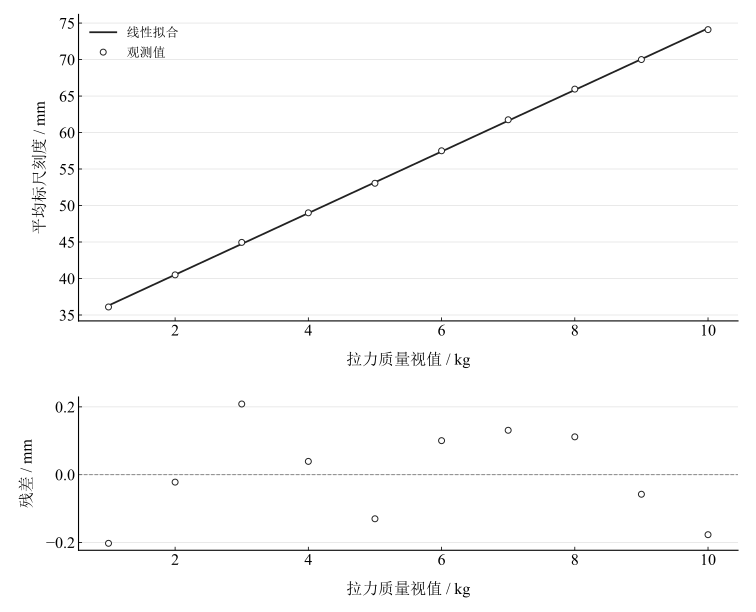
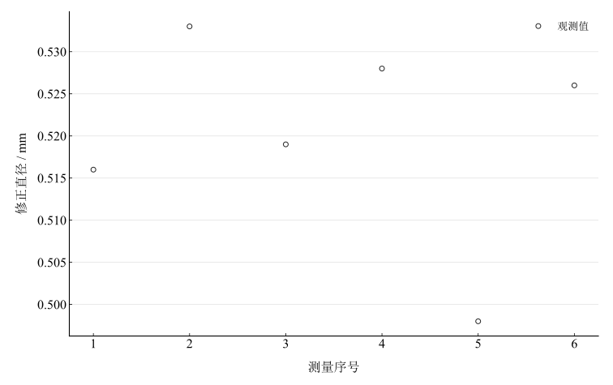

# 拉伸法测量金属杨氏模量实验报告

淮南师范学院　电子工程学院　物理学专业

## 一、实验名称

拉伸法测量金属杨氏模量。

## 二、实验目的

学习拉伸法测杨氏模量、光杠杆放大法测微小伸长；掌握卷尺、卡尺、测微器和数字拉力计的使用；用逐差和最小二乘法处理数据，评估不确定度并规范表达结果。

## 三、实验原理

### 1. 杨氏模量

弹性限度内，应力与应变成正比：

$$
\sigma=\frac FS=E\frac{\Delta L}{L},\qquad
S=\frac{\pi d^2}4,\qquad
E=\frac{4mgL}{\pi d^2\Delta L}.
$$

### 2. 光杠杆

光杠杆动足随金属丝伸长下降，镜面转过小角度，反射光转角为两倍。设镜至标尺距离为 $H$、光杠杆常数为 $D$、标尺位移为 $\Delta x$，则

$$
\Delta L=\frac{D\Delta x}{2H},\qquad
E=\frac{8mgLH}{\pi d^2D\Delta x}.
$$

### 3. 逐差与回归

同一载荷的加减力读数取平均 $x_i=(x_i^++x_i^-)/2$。跨五个等级的逐差 $\Delta x_i=x_{i+5}-x_i$ 对应5.00 $\mathrm{kg}$增量，五组平均用于主计算。回归法拟合质量视值与标尺刻度 $x=km+b$，所有长度换算为米后，

$$
E_{\mathrm{LS}}=\frac{8gLH}{\pi d^2Dk}.
$$

## 四、主要仪器设备

ZKY-YM数显近距转镜式杨氏模量仪、数字拉力计、望远镜、光杠杆、薄膜标尺、钢卷尺、游标卡尺和螺旋测微器。重力加速度采用 $9.80\,\mathrm{m\,s^{-2}}$，测微器正零差为 $d_0=0.062\,\mathrm{mm}$。

## 五、实验步骤

检查金属丝夹头，连接拉力计与标尺背光，预热约10 $\mathrm{min}$。调动足高度，在纸上压出三足痕迹，用前足连线的高测量光杠杆常数。施加约3 $\mathrm{kg}$预拉力拉直金属丝，测原长和镜至标尺距离。记录测微器零差，在不同位置和方向测六次直径。调节望远镜和镜面使刻度像与分划线清晰，拉力计清零后每增加1 $\mathrm{kg}$记录刻度，到最大值后按相同等级减力复测。结束后整理仪器，分别作逐差、回归和不确定度分析。

## 六、原始数据记录

表 1　一次性几何测量

{{tables.geometry}}

表 2　金属丝直径视值及零差修正

{{tables.diameters}}

表 3　加减力与标尺记录（1–5级）

{{tables.loading_first}}

表 4　加减力与标尺记录（6–10级）及逐差

{{tables.loading_second}}

平均刻度和修正直径为派生列，由程序重算，不作新增测量。

## 七、数据处理

### 1. 直径与逐差

按 $d_i=d_{\mathrm{apparent},i}-d_0$ 修正，平均直径为 {{metrics.mean_corrected_diameter}} $\mathrm{mm}$，其均值A类标准不确定度为 {{metrics.diameter_uncertainty_a}} $\mathrm{mm}$。五个逐差为21.40、21.25、21.00、21.00和21.05 $\mathrm{mm}$，平均为 {{metrics.mean_extension_difference}} $\mathrm{mm}$。

### 2. 逐差法和回归法

代入原长720 $\mathrm{mm}$、镜距690 $\mathrm{mm}$、光杠杆常数35.26 $\mathrm{mm}$及未修约直径、逐差，逐差法得 {{metrics.young_modulus_difference}} $\mathrm{Pa}$。回归得到斜率 {{metrics.fit_slope}} $\mathrm{mm\,kg^{-1}}$、截距 {{metrics.fit_intercept}} $\mathrm{mm}$、相关系数 {{metrics.correlation}}，由斜率换算得 {{metrics.young_modulus_regression}} $\mathrm{Pa}$。

图 1　平均标尺刻度与质量视值的线性拟合及残差

图 2　六次零差修正后的金属丝直径

### 3. 条件标准不确定度

以下标准不确定度数值来自已有预算；其具体仪器误差限及零差相关性未充分给出，因此以条件输入使用。

表 5　已有标准不确定度输入

{{tables.uncertainty}}

逐差法按独立输入近似传播：

$$
\left(\frac{u(E)}E\right)^2=
\left(\frac{u(m)}m\right)^2+
\left(\frac{u(L)}L\right)^2+
\left(\frac{u(H)}H\right)^2+
\left(\frac{2u(d)}d\right)^2+
\left(\frac{u(D)}D\right)^2+
\left(\frac{u(\Delta x)}{\Delta x}\right)^2.
$$

回归法用残差给出的斜率标准误差 {{metrics.slope_uncertainty}} $\mathrm{mm\,kg^{-1}}$替换逐差相对项，质量标度项仍暂取已有5 $\mathrm{kg}$增量相对标准不确定度。逐差条件标准不确定度为 {{metrics.conditional_uncertainty_difference}} $\mathrm{Pa}$，回归条件标准不确定度为 {{metrics.conditional_uncertainty_regression}} $\mathrm{Pa}$。两者共用几何和直径输入，不能当作两次独立测量再平均。

## 八、实验结果与讨论

两种估值接近，杨氏模量约为 $3.08\times10^{11}\,\mathrm{Pa}$；载荷和平均标尺刻度高度线性，支持本加载范围内的弹性伸长趋势。较高相关系数不单独保证系统误差可忽略，测量准确度仍受直径零差和几何定位影响。

6–8 $\mathrm{kg}$附近减力刻度略高，最大差约0.6 $\mathrm{mm}$，可能涉及夹头微滑移、机构摩擦或弹性滞后。平均读数能减小部分回程效应，无法排除共同偏差。直径以平方出现在分母，零差、位置不均和估读误差尤为敏感。光杠杆几何、镜面晃动、望远镜对准及台面振动也会影响读数。

小角度模型假定金属丝均匀且轴向受力；初始弯曲和装置偏斜可产生偏差。后续应复核测微器零差及其不确定度、端点定位和拉力计校准，并补充相关性信息。模型探索固定所有视值与回归斜率，仅改变假设零差，展示直径修正为何会放大到杨氏模量。
