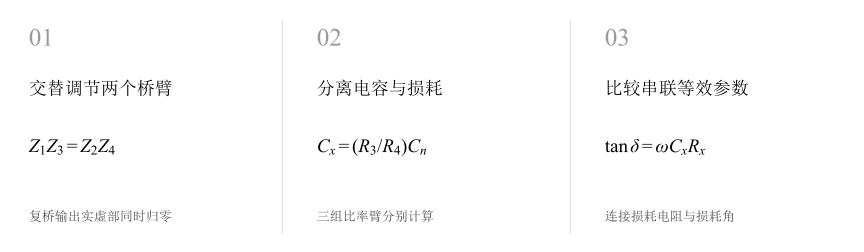
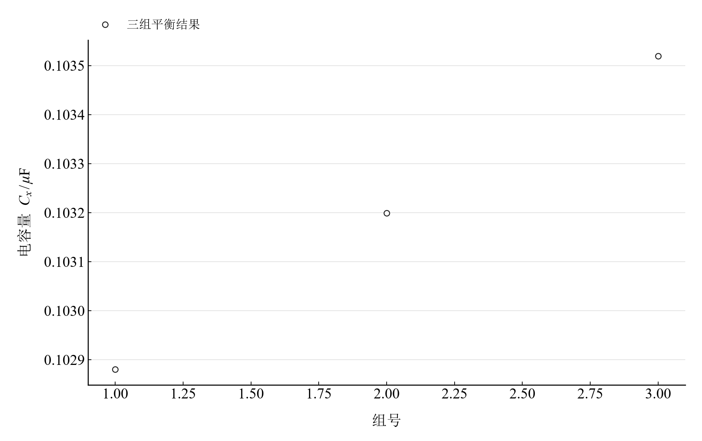
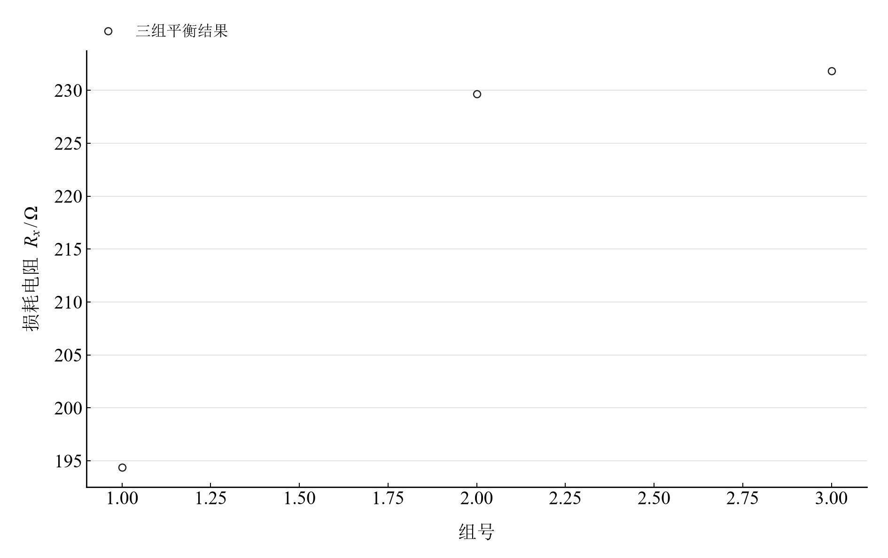

[普通物理实验 3](../README.md) · [项目首页](../../../README.md) · [使用指南](../../../docs/usage.md)

<!-- virtual-laboratory-entry -->
[在线虚拟实验](https://hnnuyuxuan.github.io/general-physics-lab/simulations/ac-bridge/) · [模型依据与参数来源](../../../docs/ac-bridge-model-evidence.md)

# 交流电桥

**实部与虚部同时归零，读出电容和损耗。**

改变比率臂并交替调节标准串联电阻，使交流电桥平衡。由三组平衡参数计算电容量、串联损耗电阻和损耗因数，再在复平面中观察双参数调节为何缺一不可。

[读实验报告](report/report.md) · [浏览器交互](https://hnnuyuxuan.github.io/general-physics-lab/experiments/course-03/ac-bridge/notebooks/analysis.html) · [Python 笔记本](notebooks/analysis.ipynb) · [Wolfram 笔记本](../../../notebook/paclets/ACBridgeLab/Notebooks/ACBridgeLab.nb)



图 1　交替调节两个桥臂 → 分离电容与损耗 → 比较串联等效参数

## 选择你的入口

|用途|入口|打开方式|
|---|---|---|
|阅读原理、记录与结论|[Markdown 实验报告](report/report.md) · [排版阅读版](https://hnnuyuxuan.github.io/general-physics-lab/experiments/course-03/ac-bridge/report/report.html)|GitHub、Markdown 阅读器或本地浏览器|
|改变参数、查看曲线响应|[HTML 交互阅读版](https://hnnuyuxuan.github.io/general-physics-lab/experiments/course-03/ac-bridge/notebooks/analysis.html)|直接在线打开，也可下载到本机|
|运行 Python 计算与探索|[Jupyter Notebook](notebooks/analysis.ipynb)|JupyterLab 或 VS Code|
|运行原生数学排版与交互计算|[Wolfram Notebook](../../../notebook/paclets/ACBridgeLab/Notebooks/ACBridgeLab.nb) · [Paclet 安装包](../../../notebook/paclets/ACBridgeLab/dist/ACBridgeLab-0.1.0.paclet)|Wolfram 前端|
|对照源实验记录|[源报告 PDF](../../../pdf/course-03/12交流电桥/实验报告-交流电桥.pdf)|GitHub 或 PDF 阅读器|

## 从记录到计算

三组记录均采用频率 1000 Hz、标准电容 0.1 μF，分别保留标准串联电阻、两比率臂和指零仪增益。增益是测量条件，阻抗计算由桥臂比率决定。

待测电容采用理想电容与损耗电阻串联的等效模型。交流平衡要求复数方程同时满足；计算分别从实部、虚部得到损耗电阻与电容量。

$$
R_x=\frac{R_4}{R_3}R_n,\qquad C_x=\frac{R_3}{R_4}C_n,\qquad \tan\delta=\omega C_xR_x=\omega C_nR_n.
$$

表 1　关键计算结果

|计算量|数值|单位|
|---|---:|---|
|三组电容量均值|$1.0319983\times10^{-7}$|F|
|三组串联损耗电阻均值|$218.631$|Ω|
|三组损耗因数均值|$0.141791$|1|
|电容量极差相对均值|$0.619197$|%|

三组电容量接近 0.1032 μF，损耗电阻的组间变化更明显。各组对应不同的比率臂和增益设置，散布可与复平面平衡的调节形状一起阅读。

## 分开看电容量与损耗参数

<table>
  <tr>
    <td width="50%" align="center" valign="top">
      <a href="assets/readme-capacitance.svg"></a>
    </td>
    <td width="50%" align="center" valign="top">
      <a href="assets/readme-loss_resistance.svg"></a>
    </td>
  </tr>
  <tr>
    <td align="center" valign="top">
      <strong>图 2</strong><br>三种比率臂设置分别计算的电容量
    </td>
    <td align="center" valign="top">
      <strong>图 3</strong><br>相同三组设置分别计算的串联损耗电阻
    </td>
  </tr>
</table>

两幅图使用相同组号，但物理量与单位不同。电容量变化较小、损耗参数变化较大，说明两类平衡条件具有不同的调节敏感性。

## 在 Notebook 中探索

|操作|参数与范围|观察什么|
|---|---|---|
|改变比率臂偏离|选择 $R_4/R_{4,bal}=0.95,1,1.05$，标准串联电阻扫描 100–300 Ω|观察归一化复桥输出轨迹与原点的关系|

[HTML 阅读版](https://hnnuyuxuan.github.io/general-physics-lab/experiments/course-03/ac-bridge/notebooks/analysis.html) 包含上述控件；[Jupyter](notebooks/analysis.ipynb) 与 [Wolfram Notebook](../../../notebook/paclets/ACBridgeLab/Notebooks/ACBridgeLab.nb) 沿报告章节展开公式、数据处理和模型计算。

建议按以下顺序阅读：

1. 先依据三组桥臂参数独立计算电容和损耗电阻。
2. 比较两种损耗因数表达的恒等关系。
3. 在复平面模型中切换比率偏离，寻找实部与虚部同时为零的条件。

## 在本机打开

环境安装与字体设置见[使用指南](../../../docs/usage.md)。在仓库根目录启动本实验：

```powershell
.\.venv\Scripts\python.exe -m jupyterlab experiments/course-03/ac-bridge/notebooks/analysis.ipynb
```

安装 Paclet 后，通过包入口打开 Wolfram Notebook。将安装路径改为本机仓库所在位置：

```wolfram
PacletInstall["D:/general-physics-lab/notebook/paclets/ACBridgeLab/dist/ACBridgeLab-0.1.0.paclet"];
Needs["ACBridgeLab`"];
ACBridgeLab`OpenNotebook[]
```

## 数据与计算实现

|内容|入口|
|---|---|
|规范观测数据|[balance.csv](data/balance.csv)|
|单位、参数与模型条件|[experiment.json](experiment.json)|
|Python 计算模块|[ac_bridge.py](../../../src/physicslab/experiments/ac_bridge.py)|
|Wolfram 计算实现|[analysis.wl](../../../notebook/paclets/ACBridgeLab/Kernel/analysis.wl)|
|计算结果与数表|[python.json](results/python.json)|
|数据来源与整理记录|[provenance.json](data/provenance.json)|

[返回课程目录](../README.md) · [浏览全部实验](../../../README.md)
