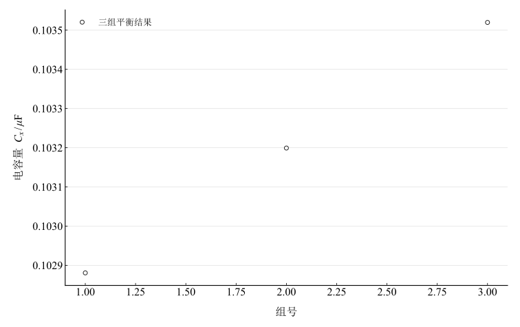
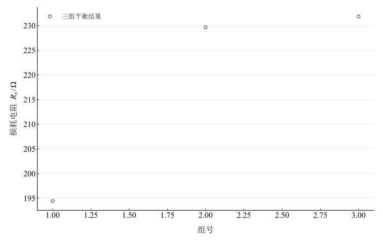

# 交流电桥

淮南师范学院实验报告

学院：电子工程学院　专业：物理学　班级：24 物理 1 班

姓名：缪雨轩　学号：2414050120　实验日期：2025 年 12 月 3 日

## 一、实验名称

交流电桥。

## 二、实验目的

1. 理解交流电桥的复数平衡及比较测量思想。
2. 掌握 DH4518 交流电桥的调节方法。
3. 测量实际电容器的电容量、串联损耗电阻及损耗因数。

## 三、实验原理

### 1. 交流平衡

四臂依次定义为 $Z_1,Z_2,Z_3,Z_4$，在与本次接线对应的编号下，平衡条件为

$$
Z_1Z_3=Z_2Z_4.
$$

复数平衡要求模和相角同时满足

$$
|Z_1||Z_3|=|Z_2||Z_4|,\qquad\varphi_1+\varphi_3=\varphi_2+\varphi_4.
$$

相角等式按模 $2\pi$ 理解。通常需要交替调节两个独立参数，不是只使单个实数幅值接近零。

### 2. 串联电阻式电容桥

待测臂为 $Z_1=R_x+1/(j\omega C_x)$，标准臂为 $Z_2=R_n+1/(j\omega C_n)$，比率臂为 $Z_3=R_3,Z_4=R_4$。代入得到

$$
\left(R_x+\frac1{j\omega C_x}\right)R_3=\left(R_n+\frac1{j\omega C_n}\right)R_4.
$$

分别比较实部和虚部：

$$
R_x=\frac{R_4}{R_3}R_n,\qquad C_x=\frac{R_3}{R_4}C_n.
$$

串联损耗模型的损耗因数及损耗角为

$$
\tan\delta=\omega C_xR_x=\omega C_nR_n,\qquad\delta=\arctan(\omega C_nR_n),\qquad\omega=2\pi f.
$$

理想开路桥检流端的归一化复电压可写为 $Z_2/(Z_1+Z_2)-R_3/(R_3+R_4)$，在平衡时实部与虚部同时为零，用于解释调节过程。

## 四、主要仪器设备

DH4518 交流电桥实验仪，内置约 $1\,\mathrm{kHz}$ 正弦源、指零仪、标准电阻及电容；待测电容盒和导线。

## 五、实验步骤

1. 熟悉信号源、灵敏度和端子，按串联电阻式接线。
2. 频率设为 $1000\,\mathrm{Hz}$，标准电容取 $0.1\,\mu\mathrm F$。
3. 低灵敏度粗调比率与标准串联电阻，逐渐增益后交替细调至指零。
4. 记录平衡参数，改变比率臂，重复三组。

## 六、原始数据记录

$f=1000\,\mathrm{Hz}$，$C_n=0.1\,\mu\mathrm F=10^{-7}\,\mathrm F$；计算使用未修约的 $2\pi f$。

表 1　三组平衡参数

{{tables.observations}}

指零仪增益保留为测量条件，不当作待测阻抗的乘数。

## 七、数据处理

第一组有 $R_x=9720/10000\times200=194.4\,\Omega$、$C_x=10000/9720\times0.1\,\mu\mathrm F$，损耗因数直接由 $\omega C_nR_n$ 计算。

表 2　各组电容、损耗电阻、损耗角和阻抗

{{tables.results}}

表 3　三组分别计算后的算术均值

{{tables.summary}}

图 1　三组平衡电容量比较

图 2　三组串联损耗电阻比较

每组独立核验 $\omega C_xR_x-\omega C_nR_n$。均值使用各组损耗因数的平均，避免用已修约的平均电阻、电容重新相乘引入不同处理定义。

## 八、实验结果与讨论

1. 电容量平均约 $0.1032\,\mu\mathrm F$，损耗电阻平均 ${{metrics.Rx_mean}}\,\Omega$，损耗因数平均 ${{metrics.loss_mean}}$。这些结果适用于 $1\,\mathrm{kHz}$ 的串联等效模型。
2. 电容量极差相对均值为 ${{metrics.capacitance_spread_percent}}\%$；损耗电阻极差相对均值为 ${{metrics.resistance_spread_percent}}\%$，损耗参数的组间变化更大。小散布不等同已知高准确度，三组设置不同也不能直接看成同条件重复性。
3. 比率臂变化、残余分布参数、接触和干扰均可能影响平衡，尤其较大阻值时需注意分布电容。现有记录不能确定第一组偏小的唯一原因。
4. 需要交替调节比率和标准串联电阻才能使复电压归零。模型展示解释其双条件，不把根据平衡公式构造的零点作为独立实验验证。
5. 未给标准元件、频率和读数限差，未输出完整不确定度或给出超出记录支持的准确度等级。
