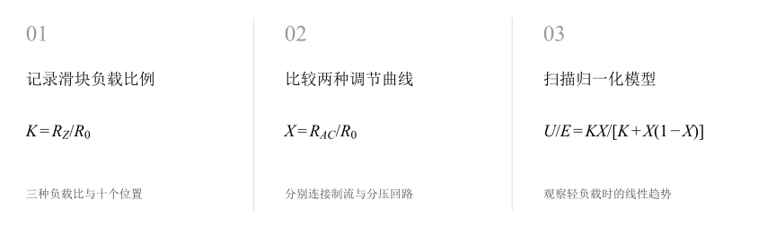
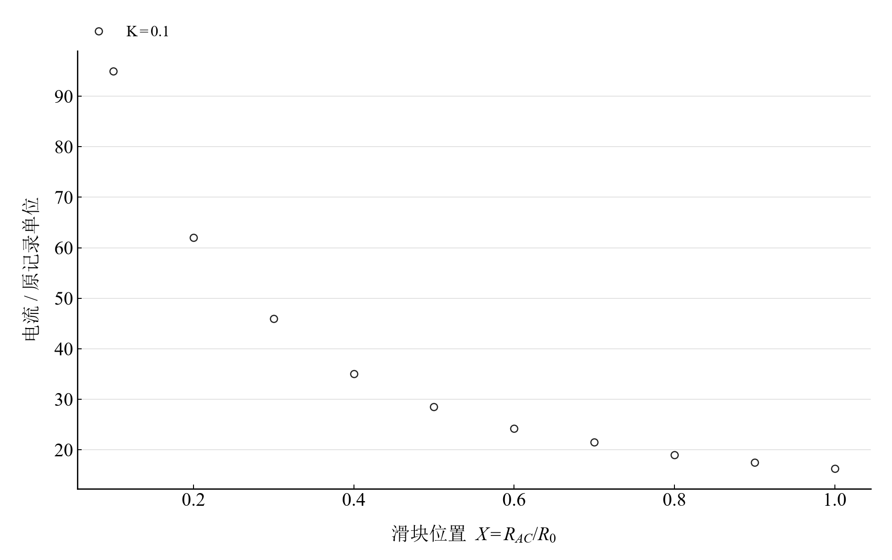
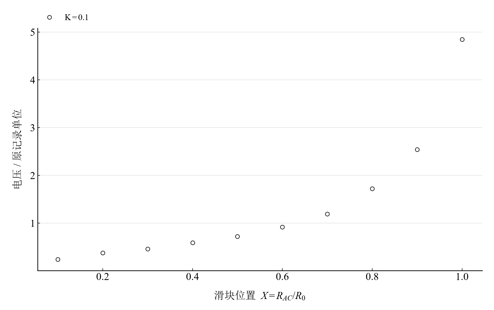
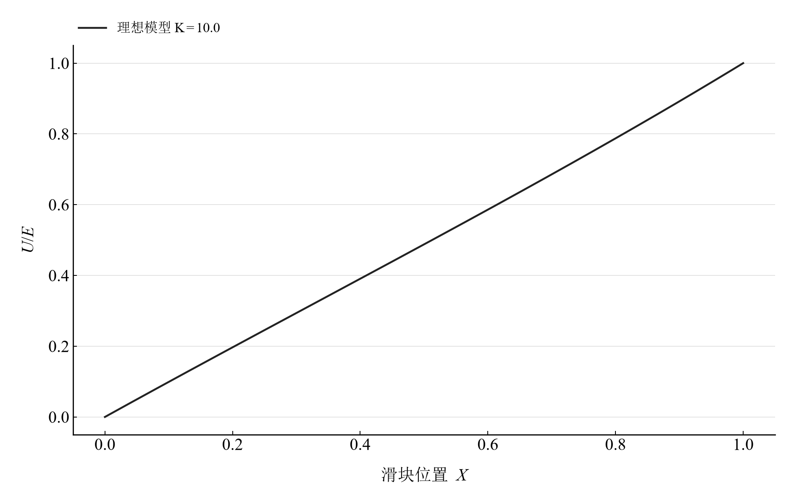

[普通物理实验 3](../README.md) · [项目首页](../../../README.md) · [使用指南](../../../docs/usage.md)

<!-- virtual-laboratory-entry -->
[在线虚拟实验](https://hnnuyuxuan.github.io/general-physics-lab/simulations/current-voltage-divider/) · [模型依据与参数来源](../../../docs/current-voltage-divider-model-evidence.md)

# 制流分压电路

**同一只滑动变阻器，两种接法，两种调节曲线。**

分别连接制流与分压电路，改变滑块位置并记录负载响应。用负载比与滑块比消去绝对标度，从观测曲线走向调节范围、线性度和负载效应。

[读实验报告](report/report.md) · [浏览器交互](https://hnnuyuxuan.github.io/general-physics-lab/experiments/course-03/current-voltage-divider/notebooks/analysis.html) · [Python 笔记本](notebooks/analysis.ipynb) · [Wolfram 笔记本](../../../notebook/paclets/DividerCircuitsLab/Notebooks/DividerCircuitsLab.nb)



图 1　记录滑块负载比例 → 比较两种调节曲线 → 扫描归一化模型

## 选择你的入口

|用途|入口|打开方式|
|---|---|---|
|阅读原理、记录与结论|[Markdown 实验报告](report/report.md) · [排版阅读版](https://hnnuyuxuan.github.io/general-physics-lab/experiments/course-03/current-voltage-divider/report/report.html)|GitHub、Markdown 阅读器或本地浏览器|
|改变参数、查看曲线响应|[HTML 交互阅读版](https://hnnuyuxuan.github.io/general-physics-lab/experiments/course-03/current-voltage-divider/notebooks/analysis.html)|直接在线打开，也可下载到本机|
|运行 Python 计算与探索|[Jupyter Notebook](notebooks/analysis.ipynb)|JupyterLab 或 VS Code|
|运行原生数学排版与交互计算|[Wolfram Notebook](../../../notebook/paclets/DividerCircuitsLab/Notebooks/DividerCircuitsLab.nb) · [Paclet 安装包](../../../notebook/paclets/DividerCircuitsLab/dist/DividerCircuitsLab-0.1.0.paclet)|Wolfram 前端|
|对照源实验记录|[源报告 PDF](../../../pdf/course-03/2制流分压电路/实验报告-制流分压电.pdf)|GitHub 或 PDF 阅读器|

## 从记录到计算

记录包含 $K=0.1,0.5,1$ 三种负载比，每种接法各有十个滑块位置。定义 $K=R_Z/R_0$、$X=R_{AC}/R_0$；电流和电压沿用源表的记录标度。

模型采用理想恒压电源、均匀变阻器和电阻负载。固定 $K$ 后，用一个幅度参数比较曲线形状；归一化扫描则直接呈现两种接法的调节特性。

$$
\frac{I}{I_{\max}}=\frac{K}{K+X},\qquad \frac{U_{AC}}{E}=\frac{KX}{K+X(1-X)}.
$$

表 1　关键计算结果

|计算量|数值|单位|
|---|---:|---|
|制流 K=0.1：均方根残差|$1.637172$|原记录电流单位|
|制流 K=1：均方根残差|$0.118407$|原记录电流单位|
|理想分压 K=1、X=0.5：U/E|$0.4$|1|

较小 $K$ 的制流曲线在低位置段更陡；较大 $K$ 的分压曲线更接近线性。均方根残差描述读数与固定形状模型的差距，归一化中点值描述理想电路。

## 从观测形状看负载效应



图 2　K=0.1 的制流电流观测，标度沿用源记录

<table>
  <tr>
    <td width="50%" align="center" valign="top"><a href="assets/readme-voltage_K0p1.svg"></a></td>
    <td width="50%" align="center" valign="top"><a href="assets/readme-model_voltage_K10p0.svg"></a></td>
  </tr>
  <tr>
    <td align="center" valign="top"><strong>图 3</strong><br>K=0.1 的分压电压观测，标度沿用源记录</td>
    <td align="center" valign="top"><strong>图 4</strong><br>K=10 时的理想分压归一化模型</td>
  </tr>
</table>

前两幅采用同一负载比，分别显示电流下降和分压电压上升。第三幅选择轻负载模型，以滑块位置与归一化电压的接近程度理解线性调节。

## 在 Notebook 中探索

|操作|参数与范围|观察什么|
|---|---|---|
|切换负载比 K|在 $0.1,0.5,1,2,10$ 间选择|同步比较归一化电流与电压；2 和 10 对应模型探索|

[HTML 阅读版](https://hnnuyuxuan.github.io/general-physics-lab/experiments/course-03/current-voltage-divider/notebooks/analysis.html) 包含上述控件；[Jupyter](notebooks/analysis.ipynb) 与 [Wolfram Notebook](../../../notebook/paclets/DividerCircuitsLab/Notebooks/DividerCircuitsLab.nb) 沿报告章节展开公式、数据处理和模型计算。

建议按以下顺序阅读：

1. 先查看三种负载比的原记录表，确认滑块位置均从 0.1 开始。
2. 将模型滑块由 K=0.1 移至 K=10，比较两张归一化曲线的调节范围与形状。
3. 运行幅度估计与残差单元，查找偏离集中的滑块区间。

## 在本机打开

环境安装与字体设置见[使用指南](../../../docs/usage.md)。在仓库根目录启动本实验：

```powershell
.\.venv\Scripts\python.exe -m jupyterlab experiments/course-03/current-voltage-divider/notebooks/analysis.ipynb
```

安装 Paclet 后，通过包入口打开 Wolfram Notebook。将安装路径改为本机仓库所在位置：

```wolfram
PacletInstall["D:/general-physics-lab/notebook/paclets/DividerCircuitsLab/dist/DividerCircuitsLab-0.1.0.paclet"];
Needs["DividerCircuitsLab`"];
DividerCircuitsLab`OpenNotebook[]
```

## 数据与计算实现

|内容|入口|
|---|---|
|规范观测数据|[observations.csv](data/observations.csv)|
|单位、参数与模型条件|[experiment.json](experiment.json)|
|Python 计算模块|[current_voltage_divider.py](../../../src/physicslab/experiments/current_voltage_divider.py)|
|Wolfram 计算实现|[analysis.wl](../../../notebook/paclets/DividerCircuitsLab/Kernel/analysis.wl)|
|计算结果与数表|[python.json](results/python.json)|
|数据来源与整理记录|[provenance.json](data/provenance.json)|

[返回课程目录](../README.md) · [浏览全部实验](../../../README.md)
