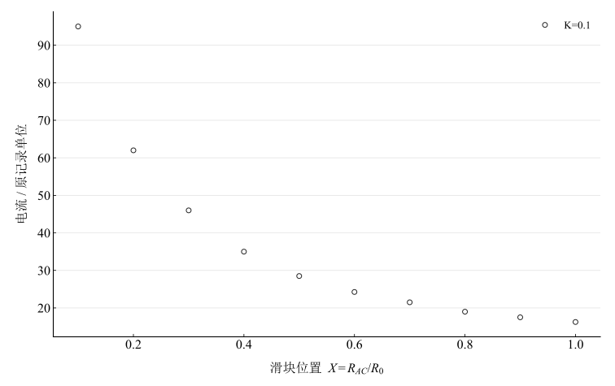
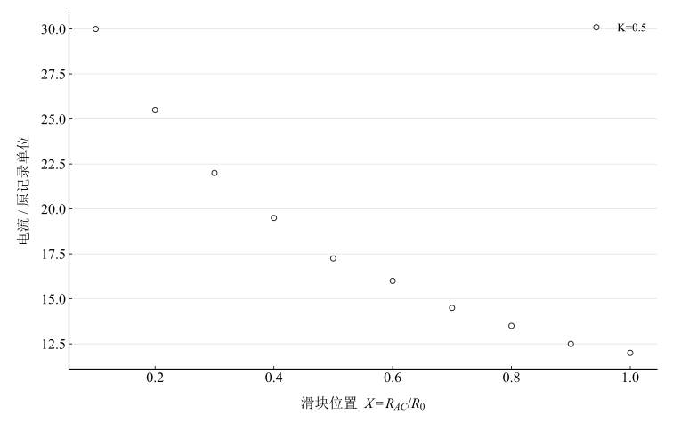
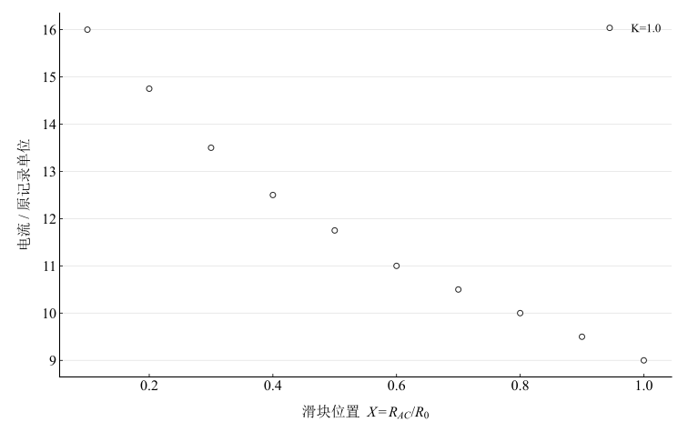
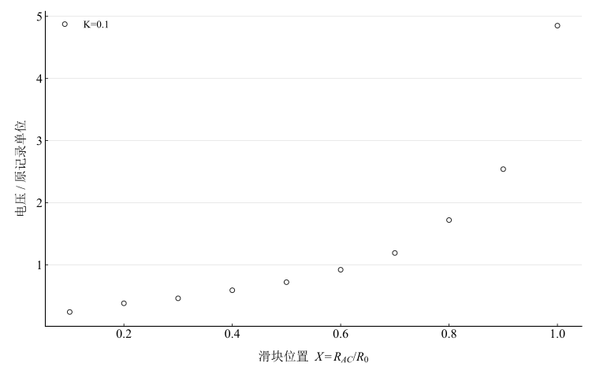
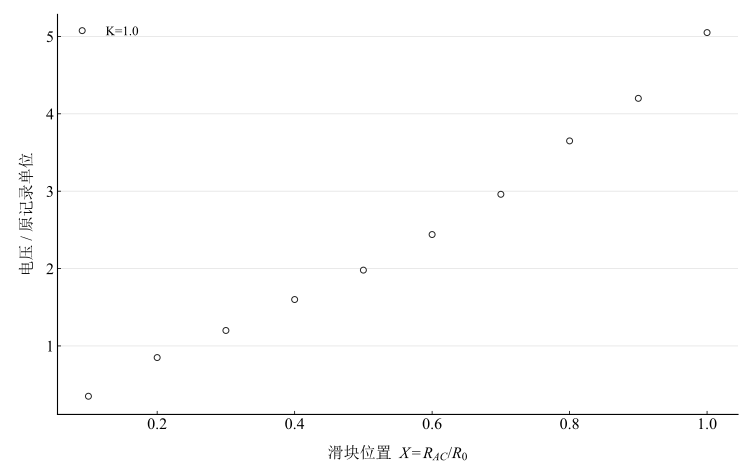

# 制流分压电路

淮南师范学院实验报告

学院：电子工程学院　专业：物理学　班级：24 物理 1 班

姓名：缪雨轩　学号：2414050120　实验日期：2025 年 9 月 17 日

## 一、实验名称

制流分压电路。

## 二、实验目的

1. 掌握制流电路、分压电路的连接方法、性能和适用条件。
2. 使用滑动变阻器实现电流或电压连续可调。
3. 对给定 $K=R_Z/R_0$、$X=R_{AC}/R_0$ 建立特性曲线，分析线性度和调节范围。

## 三、实验原理

### 1. 制流电路

滑动变阻器接入电阻 $R_{AC}=XR_0$，与负载 $R_Z$ 串联，理想电源电动势为 $E$。于是

$$
I=\frac{E}{R_Z+R_{AC}}=\frac{E/R_0}{K+X},\qquad I_{\max}=\frac{E}{R_Z},\qquad \frac{I}{I_{\max}}=\frac{K}{K+X}.
$$

$X$ 从 0 变化至 1，电流调节范围为 $E/(R_Z+R_0)$ 至 $E/R_Z$，负载电压为 $U_Z=IR_Z$。制流接法不能使电流下降至零。$K$ 大时相对调节范围小；小 $K$ 时曲线在 $X$ 接近 0 处更陡，难以均匀细调。

### 2. 分压电路

变阻器全阻 $R_0$ 跨接电源，负载跨接 $AC$ 段。该段等效电阻为 $R_Z\parallel R_{AC}$，另一段为 $R_{BC}=(1-X)R_0$，得

$$
\frac{U_{AC}}{E}=\frac{KX}{K+X(1-X)}.
$$

理想模型的电压范围为 $0\leq U_{AC}\leq E$。$K$ 越大，负载越轻，曲线越接近 $U_{AC}/E=X$；$K=2$ 可作为较均匀调节的模型示例，是否满足实际均匀度要求还需明确容许偏差。

## 四、主要仪器设备

直流稳压电源、电流表、电压表、滑动变阻器、电阻箱或定值负载、单刀开关及导线。

## 五、实验步骤

1. 断电接线，电源调至最小，表头选合适量程并校零。
2. 设置变阻器全阻与负载，确定 $K=R_Z/R_0$。
3. 制流接法中改变 $X$，记录电流。
4. 分压接法中改变 $X$，记录 $U_{AC}$。
5. 分别对 $K=0.1,0.5,1.0$ 完成两类特性记录。

## 六、原始数据记录

表 1　制流电路读数

| $K$ | $X=0.1$ | $X=0.2$ | $X=0.3$ | $X=0.4$ | $X=0.5$ | $X=0.6$ | $X=0.7$ | $X=0.8$ | $X=0.9$ | $X=1$ |
| --- | --- | --- | --- | --- | --- | --- | --- | --- | --- | --- |
| 0.1 | 95 | 62 | 46 | 35 | 28.5 | 24.25 | 21.5 | 19 | 17.5 | 16.25 |
| 0.5 | 30 | 25.5 | 22 | 19.5 | 17.25 | 16 | 14.5 | 13.5 | 12.5 | 12 |
| 1 | 16 | 14.75 | 13.5 | 12.5 | 11.75 | 11 | 10.5 | 10 | 9.5 | 9 |

表 2　分压电路读数

| $K$ | $X=0.1$ | $X=0.2$ | $X=0.3$ | $X=0.4$ | $X=0.5$ | $X=0.6$ | $X=0.7$ | $X=0.8$ | $X=0.9$ | $X=1$ |
| --- | --- | --- | --- | --- | --- | --- | --- | --- | --- | --- |
| 0.1 | 0.24 | 0.38 | 0.46 | 0.59 | 0.72 | 0.92 | 1.19 | 1.72 | 2.54 | 4.85 |
| 0.5 | 0.39 | 0.7 | 1.03 | 1.34 | 1.64 | 2.04 | 2.52 | 3.25 | 3.95 | 5 |
| 1 | 0.35 | 0.85 | 1.2 | 1.6 | 1.98 | 2.44 | 2.96 | 3.65 | 4.2 | 5.05 |

原记录表没有明确写出电流及电压单位，也未给出电源、电阻绝对值；以下保留原标度，用“原记录单位”标注，不擅自换算为毫安或伏。观测从 $X=0.1$ 开始，没有 $X=0$ 的实测点。

## 七、数据处理

### 1. 物理模型幅度与残差

制流取 $I=A/(K+X)$，其中 $A=E/R_0$；分压取 $U=E\,KX/[K+X(1-X)]$。固定 $K$ 后，两式都只有一个幅度参数。令已知形状函数为 $w_i$，读数为 $y_i$，最小二乘幅度为

$$
\widehat a=\frac{\sum_i w_i y_i}{\sum_i w_i^2},\qquad e_i=y_i-\widehat a w_i.
$$

幅度拟合用于比较记录形状，不能代替实际电源电动势或电阻的独立测量。最大相对残差取 $\max_i\vert e_i/y_i\vert $。

表 3　固定 $K$ 的物理模型幅度及残差

| 接法 | 参数 $K$ | 模型幅度（原记录单位） | 均方根残差（原记录单位） | 最大相对残差 / % |
| --- | --- | --- | --- | --- |
| 制流 | 0.1 | 18.441021 | 1.637172 | 8.636 |
| 制流 | 0.5 | 17.699964 | 0.261975 | 2.608 |
| 制流 | 1 | 17.693665 | 0.118407 | 1.974 |
| 分压 | 0.1 | 5.003222 | 0.095487 | 10.497 |
| 分压 | 0.5 | 5.091991 | 0.073453 | 10.647 |
| 分压 | 1 | 5.085168 | 0.067067 | 33.294 |

### 2. 制流曲线

图 1　$K=0.1$ 的制流电流记录

图 2　$K=0.5$ 的制流电流记录

图 3　$K=1.0$ 的制流电流记录

### 3. 分压曲线

图 4　$K=0.1$ 的分压电压记录

图 5　$K=0.5$ 的分压电压记录

图 6　$K=1.0$ 的分压电压记录

## 八、实验结果与讨论

1. 制流记录随 $X$ 增大而减小；在相同 $X$ 下，记录中的 $K$ 越大，电流越小。模型预测的归一化细调范围随 $K$ 增大缩小。实际幅度及残差见表 3，缺少电源和电阻绝对值，不能仅凭趋势确认所有参数均准确。
2. 分压记录随 $X$ 增大升高，$X=1$ 的读数为 $4.85,5.00,5.05$（原记录电压单位），可作为各组端点幅度的观测。模型从零到电源电压连续可调，零端点未在本次记录中测量。
3. 各组物理模型存在可见残差，应以表 3 的最大相对残差评价，不把全部读数笼统称为“偏差小于数个百分点”。可能来源包括电源变化、滑动变阻器线性和接触、仪表加载以及 $K,X$ 设置误差；现有记录不能唯一分离其贡献。
4. 当要求负载电压覆盖较大范围且调节较均匀时，可优先考虑分压接法并取较大的 $K$；需要限制电流并在较小范围内调节时，可考虑制流接法。模型未包含变阻器功率与电流限制，实际选型仍须依据仪器额定值。
5. 缺少量程限差和重复测量，未给出完整不确定度；绝对单位缺失限制了对电源与阻值的进一步反演。
