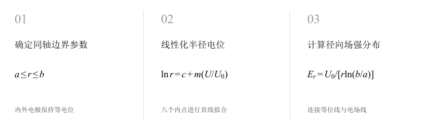
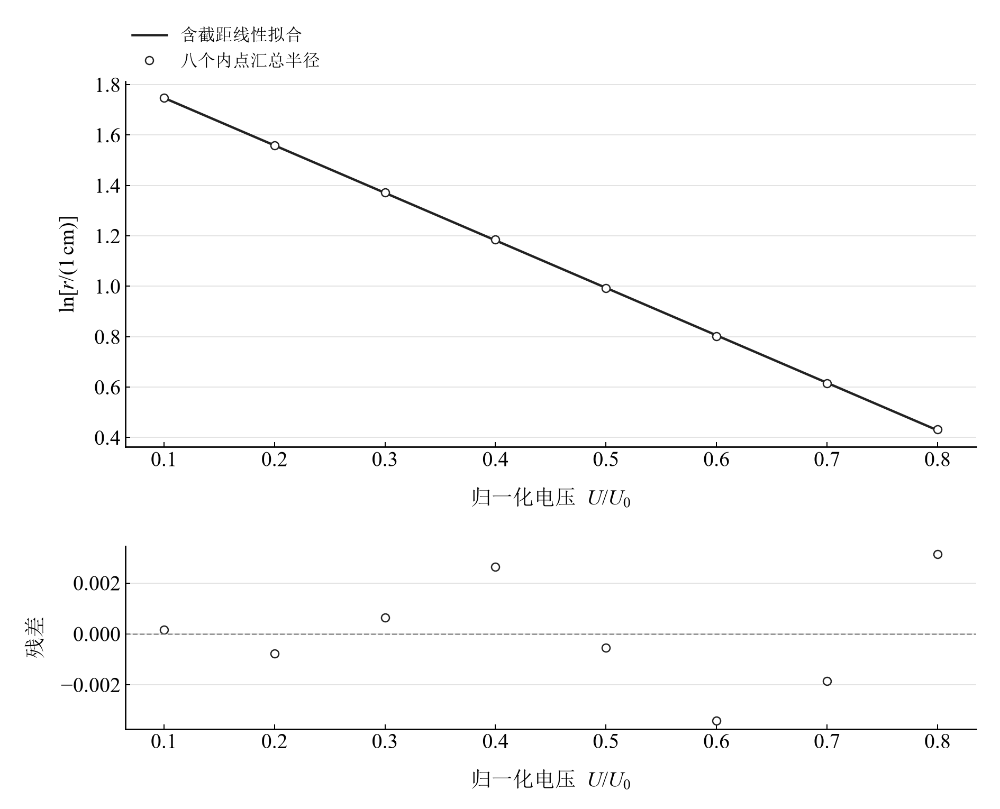
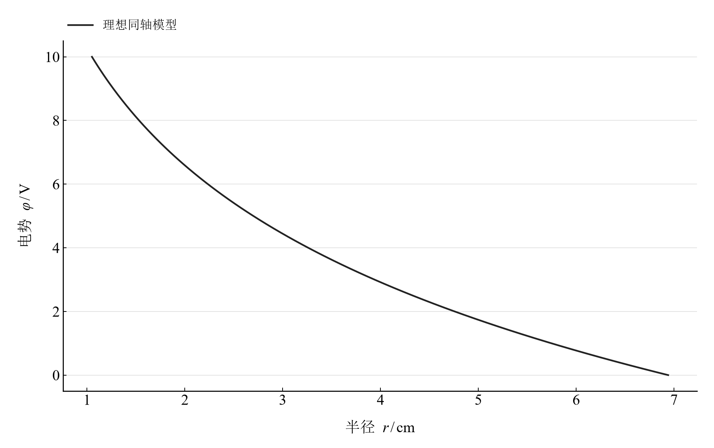
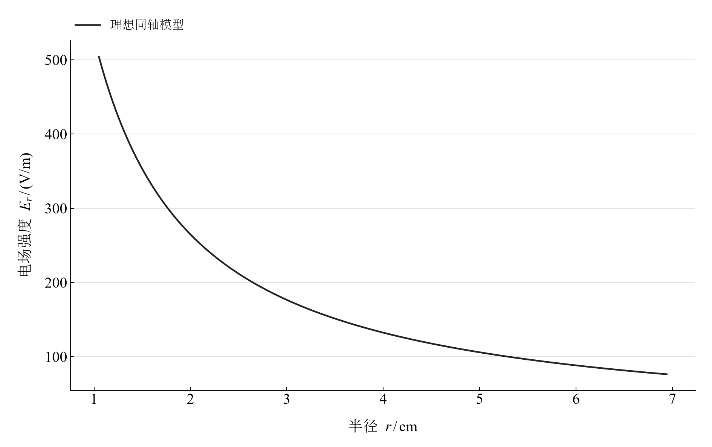

[普通物理实验 3](../README.md) · [项目首页](../../../README.md) · [使用指南](../../../docs/usage.md)

# 用稳恒电场模拟静电场

**沿同轴电极的半径走一遍，从电位读出场的形状。**

用均匀导电介质中的稳恒电流场模拟无自由电荷区域的静电场。将同轴电极间的汇总半径线性化，再计算径向电位与场强，连接测绘、边界条件和拉普拉斯方程。

[读实验报告](report/report.md) · [浏览器交互](https://hnnuyuxuan.github.io/general-physics-lab/experiments/course-03/electrostatic-field/notebooks/analysis.html) · [Python 笔记本](notebooks/analysis.ipynb) · [Wolfram 笔记本](../../../notebook/paclets/ElectrostaticFieldLab/Notebooks/ElectrostaticFieldLab.nb)



图 1　确定同轴边界参数 → 线性化半径电位 → 计算径向场强分布

## 选择你的入口

|用途|入口|打开方式|
|---|---|---|
|阅读原理、记录与结论|[Markdown 实验报告](report/report.md) · [排版阅读版](https://hnnuyuxuan.github.io/general-physics-lab/experiments/course-03/electrostatic-field/report/report.html)|GitHub、Markdown 阅读器或本地浏览器|
|改变参数、查看曲线响应|[HTML 交互阅读版](https://hnnuyuxuan.github.io/general-physics-lab/experiments/course-03/electrostatic-field/notebooks/analysis.html)|直接在线打开，也可下载到本机|
|运行 Python 计算与探索|[Jupyter Notebook](notebooks/analysis.ipynb)|JupyterLab 或 VS Code|
|运行原生数学排版与交互计算|[Wolfram Notebook](../../../notebook/paclets/ElectrostaticFieldLab/Notebooks/ElectrostaticFieldLab.nb) · [Paclet 安装包](../../../notebook/paclets/ElectrostaticFieldLab/dist/ElectrostaticFieldLab-0.1.0.paclet)|Wolfram 前端|
|对照源实验记录|[源报告 PDF](../../../pdf/course-03/3用稳恒电场模拟静电场/实验报告-用稳恒电场模拟静电场.pdf)|GitHub 或 PDF 阅读器|

## 从记录到计算

边界参数为内半径 $a=1.05\ \mathrm{cm}$、外半径 $b=6.94\ \mathrm{cm}$，电压差 $U_0=10\ \mathrm{V}$。数据包含八个内点的电位与汇总半径，以及两个边界；拟合使用八个内点。

均匀各向同性介质、同心等位电极和可忽略的边缘效应给出理想同轴模型。将 $\ln[r/(1\ \mathrm{cm})]$ 对 $U/U_0$ 拟合，斜率可直接与 $-\ln(b/a)$ 比较。

$$
\varphi(r)=U_0\frac{\ln(b/r)}{\ln(b/a)},\qquad E_r(r)=\frac{U_0}{r\ln(b/a)}.
$$

表 1　关键计算结果

|计算量|数值|单位|
|---|---:|---|
|八内点线性化斜率|$-1.883763$|1|
|同轴模型理论斜率|$-1.888512$|1|
|八内点最大理论电压差绝对值|$0.028011$|V|

汇总半径呈清楚的对数线性关系。源数据的粒度是电位对应的半径汇总；它适合比较径向形状和边界模型，逐方向的测绘细节见原报告示意。

## 线性化与径向模型互相补充



图 2　八内点汇总半径的对数线性拟合与残差

<table>
  <tr>
    <td width="50%" align="center" valign="top"><a href="assets/readme-potential_profile.svg"></a></td>
    <td width="50%" align="center" valign="top"><a href="assets/readme-field_profile.svg"></a></td>
  </tr>
  <tr>
    <td align="center" valign="top"><strong>图 3</strong><br>a=1.05 cm、b=6.94 cm、U₀=10 V 的理想径向电位</td>
    <td align="center" valign="top"><strong>图 4</strong><br>同一边界参数下的理想径向场强，半径换算为米</td>
  </tr>
</table>

第一幅检视汇总数据与直线模型，后两幅由同轴解计算。电位向外单调下降，场强按半径倒数衰减；两条曲线共同解释等位线间隔的变化。

## 在 Notebook 中探索

|操作|参数与范围|观察什么|
|---|---|---|
|改变内电极电压|选择 $U_0=5,10,15\ \mathrm{V}$，固定两电极半径|同步观察电位与场强的线性尺度响应|

[HTML 阅读版](https://hnnuyuxuan.github.io/general-physics-lab/experiments/course-03/electrostatic-field/notebooks/analysis.html) 包含上述控件；[Jupyter](notebooks/analysis.ipynb) 与 [Wolfram Notebook](../../../notebook/paclets/ElectrostaticFieldLab/Notebooks/ElectrostaticFieldLab.nb) 沿报告章节展开公式、数据处理和模型计算。

建议按以下顺序阅读：

1. 先查看边界尺寸，再核对八个拟合内点与两个边界点的身份。
2. 从对数线性图读出斜率和残差，比较理论斜率。
3. 在交互模型中切换内电极电压，比较电位和场强幅值。

## 在本机打开

环境安装与字体设置见[使用指南](../../../docs/usage.md)。在仓库根目录启动本实验：

```powershell
.\.venv\Scripts\python.exe -m jupyterlab experiments/course-03/electrostatic-field/notebooks/analysis.ipynb
```

安装 Paclet 后，通过包入口打开 Wolfram Notebook。将安装路径改为本机仓库所在位置：

```wolfram
PacletInstall["D:/general-physics-lab/notebook/paclets/ElectrostaticFieldLab/dist/ElectrostaticFieldLab-0.1.0.paclet"];
Needs["ElectrostaticFieldLab`"];
ElectrostaticFieldLab`OpenNotebook[]
```

## 数据与计算实现

|内容|入口|
|---|---|
|规范观测数据|[reported_radii.csv](data/reported_radii.csv)|
|单位、参数与模型条件|[experiment.json](experiment.json)|
|Python 计算模块|[electrostatic_field.py](../../../src/physicslab/experiments/electrostatic_field.py)|
|Wolfram 计算实现|[analysis.wl](../../../notebook/paclets/ElectrostaticFieldLab/Kernel/analysis.wl)|
|计算结果与数表|[python.json](results/python.json)|
|数据来源与整理记录|[provenance.json](data/provenance.json)|

[返回课程目录](../README.md) · [浏览全部实验](../../../README.md)
