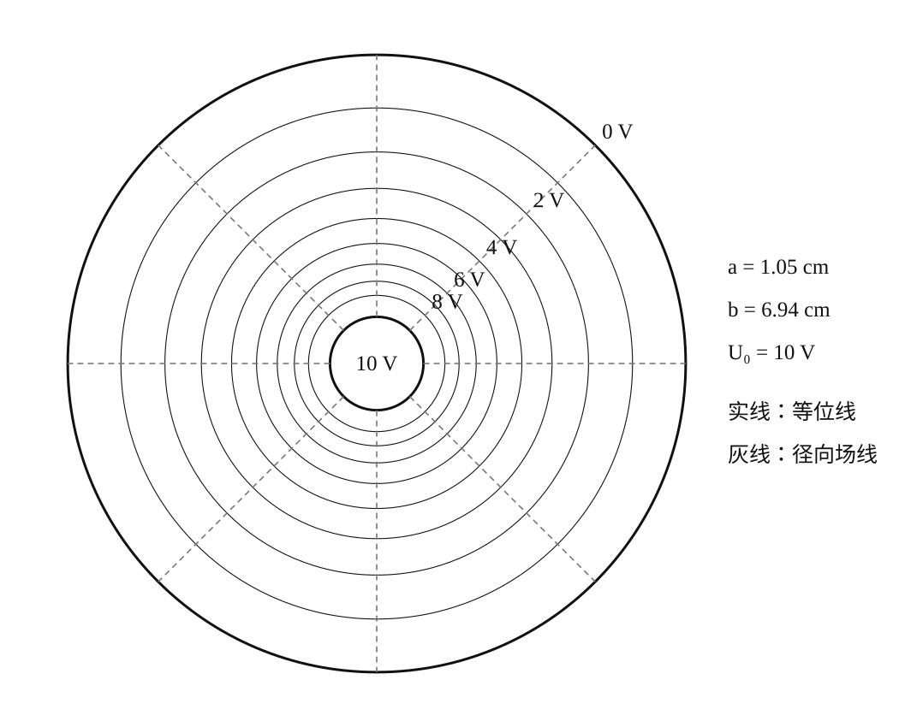
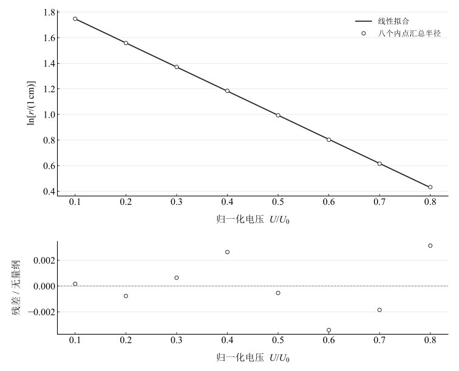
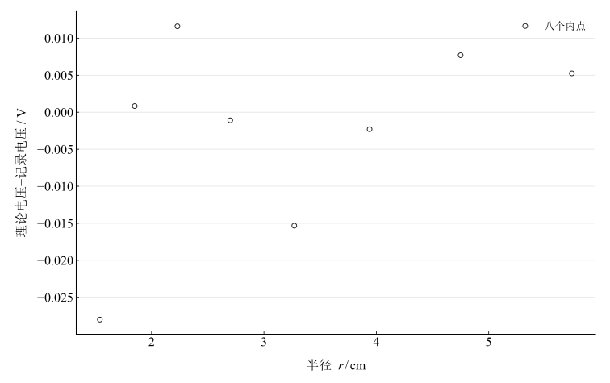
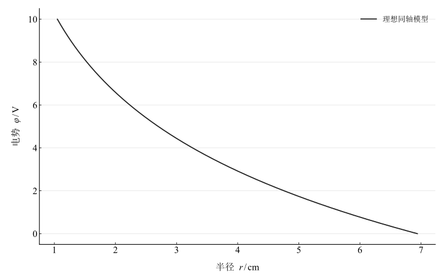
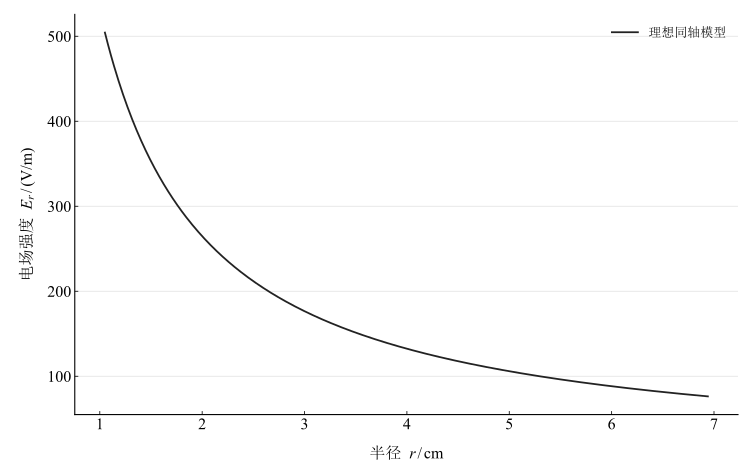

# 用稳恒电场模拟静电场

淮南师范学院实验报告

学院：电子工程学院　专业：物理学　班级：24 物理 1 班

姓名：缪雨轩　学号：2414050120　实验日期：2025 年 9 月 24 日

## 一、实验名称

用稳恒电场模拟静电场。

## 二、实验目的

1. 理解静电场电位、等位线与电场线的关系。
2. 掌握稳恒电流场模拟静电场的条件和方法。
3. 在同轴圆柱电极模型下描绘等位线及电场线，用线性化关系比较理论与记录。

## 三、实验原理

### 1. 直接测量与模拟思想

静电场中缺少供磁电式仪表直接检测的稳恒电流，探针也可能因感应电荷扰动场。模拟法选择便于实现、测量的稳恒电流场，要求对应物理量满足相同形式的方程和边界条件。

### 2. 场方程和模拟条件

无自由电荷的均匀介质静电场满足

$$
\mathbf E=-\nabla\varphi,\qquad\nabla\cdot\mathbf E=0,\qquad\nabla\times\mathbf E=0.
$$

稳恒电流满足 $\nabla\cdot\mathbf J=0$，各向同性欧姆介质满足 $\mathbf J=\sigma\mathbf E$。当电导率 $\sigma$ 均匀时，电位也满足拉普拉斯方程

$$
\nabla^2\varphi=0.
$$

此时电流密度方向对应静电场方向；$\mathbf J$ 无旋的结论依赖上述均匀标量电导率条件。模拟真空或空气中的静电场时，导电介质应均匀，电极应保持等电位，并与被模拟边界具有对应几何形状。

### 3. 同轴圆柱电极

内半径 $a$、外半径 $b$，内电极电压 $U_0$，外电极为零。忽略边缘效应，在 $a\leq r\leq b$ 有

$$
\varphi(r)=U_0\frac{\ln(b/r)}{\ln(b/a)},\qquad E_r(r)=\frac{U_0}{r\ln(b/a)}.
$$

因此

$$
\ln\left(\frac r{1\,\mathrm{cm}}\right)=\ln\left(\frac b{1\,\mathrm{cm}}\right)-\ln\left(\frac ba\right)\frac{\varphi}{U_0}.
$$

等位线为同心圆，电场线沿径向并垂直等位线；同样电位间隔对应的空间间隔在外侧较大。

图 1　按记录边界参数计算的理想等位线和径向场线（模型图）

## 四、主要仪器设备

静电场描绘仪、同步探针、游标卡尺、坐标纸及导线。

## 五、实验步骤

1. 连接电路并检查接线后接通电源。
2. 在不同位置测量内电极直径、外电极半径，按步骤计划各重复六次。
3. 固定坐标纸，使上下探针保持铅垂对齐，以内电极中心定位。
4. 将内外电极电压调整至 $10\,\mathrm{V}$。
5. 沿八条等角度辐射线定位 $1$–$8\,\mathrm{V}$ 等位点并打孔。
6. 描绘等位线和径向场线，测量对应半径，比较对数半径与归一化电压。

## 六、原始数据记录

现有记录提供描点示意和后续汇总半径，未提供八方向逐点坐标及六次电极尺寸原始读数。可计算的数值汇总在下一节保留；不把汇总半径当成六次独立测量，亦不据此估计重复性。

## 七、数据处理

### 1. 汇总记录与单位

内电极半径 $a=1.05\,\mathrm{cm}$，外电极半径 $b=6.94\,\mathrm{cm}$，内外电压差 $U_0=10\,\mathrm{V}$。源表对数列与带单位半径分别保留。

表 1　电压、半径及已有处理列汇总

{{tables.source_summary}}

半径与直径列的修约并非完全一致。以下统一以 $r/\mathrm{cm}$ 列重算，不利用直径列增加虚假的精度。

### 2. 理论电压与线性化

用八个内点拟合 $y=mx+c$，其中 $x=U/U_0$、$y=\ln[r/(1\,\mathrm{cm})]$；内外两个边界只定义理论曲线，不加入该拟合。

表 2　对数半径重算及理论电压比较

{{tables.recalculated}}

表 3　八内点线性化参数及理论比较

{{tables.fit}}

图 2　八个内点的对数半径线性拟合及残差

图 3　同轴理论电压与汇总电压之差

### 3. 电场分布

图 4　记录边界参数对应的理想径向电位

图 5　记录边界参数对应的理想径向电场强度

电场计算时半径从厘米换算为米。内、外边界的理想电场分别为 ${{metrics.inner_field}}\,\mathrm{V/m}$ 和 ${{metrics.outer_field}}\,\mathrm{V/m}$。

## 八、实验结果与讨论

1. 汇总记录中电位增大时半径减小，对数半径与归一化电压近似线性。八内点斜率 ${{metrics.lnr_slope}}$ 与同轴理论斜率 ${{metrics.theory_slope}}$ 可直接比较，最大理论电压差绝对值为 ${{metrics.max_voltage_difference}}\,\mathrm{V}$。
2. 该比较说明汇总数值与同轴模型近似相容；由于缺少逐方向原始读数及数据处理过程，不能把近线性关系视作独立高精度验证，也不据决定系数代替测量不确定度。
3. 测量应保持电极电压恒定、上下探针铅垂对齐、记录纸平整且固定，避免电压变化和定位偏移造成图形失真。
4. 可能偏差包括介质不均匀、电极偏心、接触及探针扰动、有限边界与半径读数分辨率。未提供仪器限差和重复数据，未给出完整不确定度。
