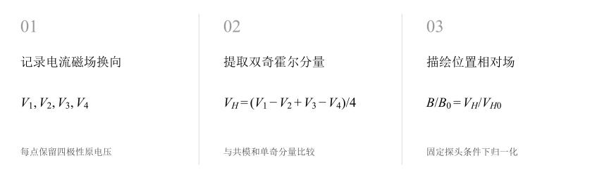
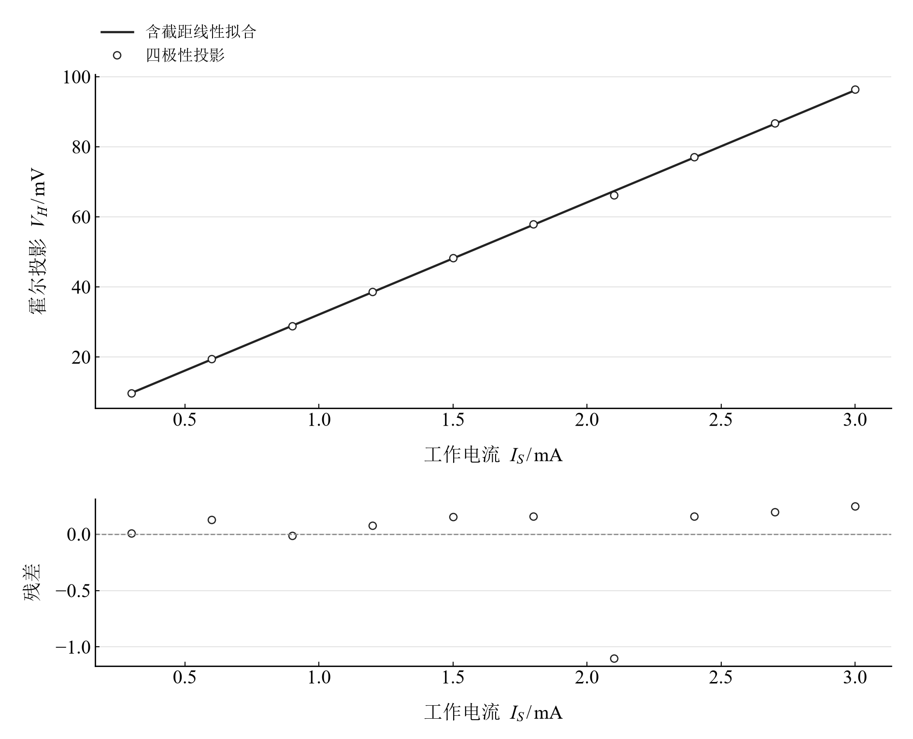
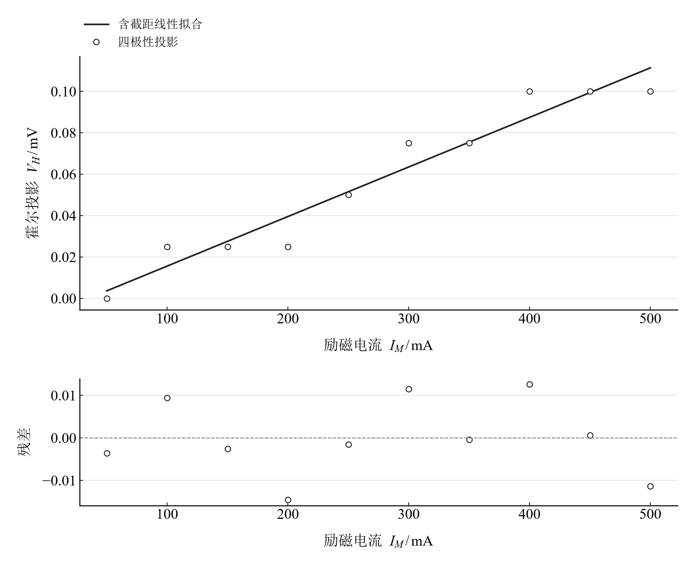
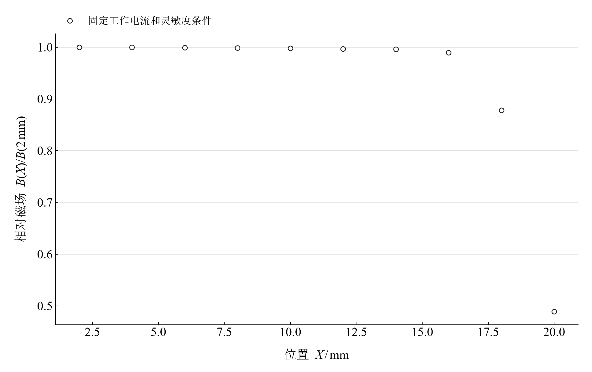

[普通物理实验 3](../README.md) · [项目首页](../../../README.md) · [使用指南](../../../docs/usage.md)

# 霍尔效应的实验研究

**四次换向，把霍尔投影和背景电压分开看。**

对工作电流、励磁电流和探头位置进行三组扫描。由四种电流与磁场极性组合分解电压，比较霍尔投影、共模及单奇分量，再以位置扫描描绘相对场。

[读实验报告](report/report.md) · [浏览器交互](notebooks/analysis.html) · [Python 笔记本](notebooks/analysis.ipynb) · [Wolfram 笔记本](../../../notebook/paclets/HallEffectLab/Notebooks/HallEffectLab.nb)



图 1　记录电流磁场换向 → 提取双奇霍尔分量 → 描绘位置相对场

## 选择你的入口

|用途|入口|打开方式|
|---|---|---|
|阅读原理、记录与结论|[Markdown 实验报告](report/report.md) · [排版阅读版](report/report.html)|GitHub、Markdown 阅读器或本地浏览器|
|改变参数、查看曲线响应|[HTML 交互阅读版](notebooks/analysis.html)|下载后用浏览器打开|
|运行 Python 计算与探索|[Jupyter Notebook](notebooks/analysis.ipynb)|JupyterLab 或 VS Code|
|运行原生数学排版与交互计算|[Wolfram Notebook](../../../notebook/paclets/HallEffectLab/Notebooks/HallEffectLab.nb) · [Paclet 安装包](../../../notebook/paclets/HallEffectLab/dist/HallEffectLab-0.1.0.paclet)|Wolfram 前端|
|对照源实验记录|[源报告 PDF](../../../pdf/course-03/5霍尔效应的实验研究/实验报告-霍尔效应的实验研究.pdf)|GitHub 或 PDF 阅读器|

## 从记录到计算

三组扫描各有十个点，每点保留四极性电压。读数顺序为 $(+B,+I),(-B,+I),(-B,-I),(+B,-I)$；相对场以位置 2 mm 的霍尔投影为参照。

霍尔投影对磁场和工作电流都为奇。相对场的换算采用探头方向、灵敏度和工作电流保持不变的条件；三组扫描分别分析其记录关系。

$$
V_H=\frac{V_1-V_2+V_3-V_4}{4},\qquad V_H=K_HI_SB,\qquad \frac{B(X)}{B(X_0)}=\frac{V_H(X)}{V_H(X_0)}.
$$

表 1　关键计算结果

|计算量|数值|单位|
|---|---:|---|
|工作电流扫描拟合斜率|$32.007727$|mV/mA|
|20 mm 相对 2 mm 的场投影比|$0.489152$|1|
|2–14 mm 投影相对变化范围|$0.407454$|%|

工作电流扫描的霍尔投影近似线性，位置扫描在靠后位置明显下降。励磁扫描的主要电压落在“电流奇、磁场偶”分量；同标记设置的两表投影相差约 964 倍，是极性、量程与批次核查的关键。

## 先分解信号，再讨论磁场关系



图 2　工作电流扫描的四极性霍尔投影拟合与残差

<table>
  <tr>
    <td width="50%" align="center" valign="top"><a href="assets/readme-magnet_current.svg"></a></td>
    <td width="50%" align="center" valign="top"><a href="assets/readme-relative_field.svg"></a></td>
  </tr>
  <tr>
    <td align="center" valign="top"><strong>图 3</strong><br>励磁电流扫描中重算的霍尔投影及残差</td>
    <td align="center" valign="top"><strong>图 4</strong><br>固定探头条件下以 2 mm 位置归一化的相对场投影</td>
  </tr>
</table>

前两幅分别使用各自的电压标度，斜率量级差异与背景分解共同阅读。相对场图采用位置系列自身的参照点，展示该系列的空间变化。

## 在 Notebook 中探索

|操作|参数与范围|观察什么|
|---|---|---|
|逐点切换换向记录|在工作电流、励磁电流、位置三组共 30 个记录中选择|左侧看四极性原读数，右侧看霍尔、共模、电流奇和磁场奇分量|

[HTML 阅读版](notebooks/analysis.html) 包含上述控件；[Jupyter](notebooks/analysis.ipynb) 与 [Wolfram Notebook](../../../notebook/paclets/HallEffectLab/Notebooks/HallEffectLab.nb) 沿报告章节展开公式、数据处理和模型计算。

建议按以下顺序阅读：

1. 从四极性次序开始，复算一个点的霍尔投影。
2. 在交互图中切换到励磁扫描，比较原通道与分解分量的量级。
3. 阅读相对场曲线，再对照三组扫描的共同设置和读数身份。

## 在本机打开

环境安装与字体设置见[使用指南](../../../docs/usage.md)。在仓库根目录启动本实验：

```powershell
.\.venv\Scripts\python.exe -m jupyterlab experiments/course-03/hall-effect/notebooks/analysis.ipynb
```

安装 Paclet 后，通过包入口打开 Wolfram Notebook。将安装路径改为本机仓库所在位置：

```wolfram
PacletInstall["D:/general-physics-lab/notebook/paclets/HallEffectLab/dist/HallEffectLab-0.1.0.paclet"];
Needs["HallEffectLab`"];
HallEffectLab`OpenNotebook[]
```

## 数据与计算实现

|内容|入口|
|---|---|
|规范观测数据|[magnet_current.csv](data/magnet_current.csv) · [position.csv](data/position.csv) · [working_current.csv](data/working_current.csv)|
|单位、参数与模型条件|[experiment.json](experiment.json)|
|Python 计算模块|[hall_effect.py](../../../src/physicslab/experiments/hall_effect.py)|
|Wolfram 计算实现|[analysis.wl](../../../notebook/paclets/HallEffectLab/Kernel/analysis.wl)|
|计算结果与数表|[python.json](results/python.json)|
|数据来源与整理记录|[provenance.json](data/provenance.json)|

[返回课程目录](../README.md) · [浏览全部实验](../../../README.md)
