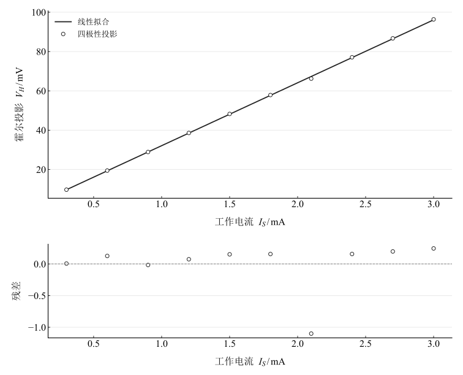
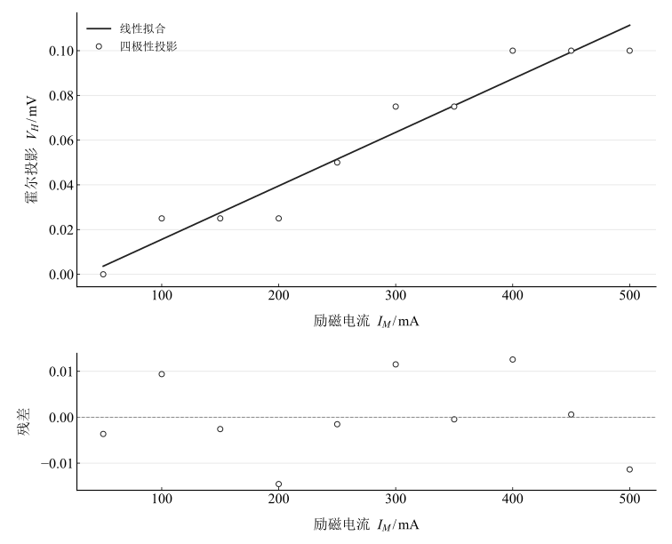
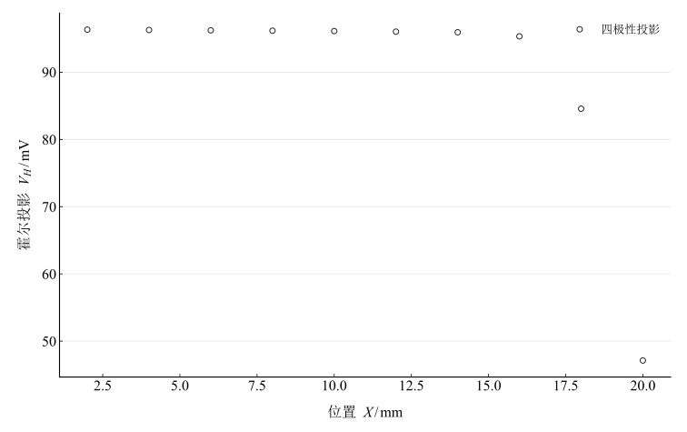
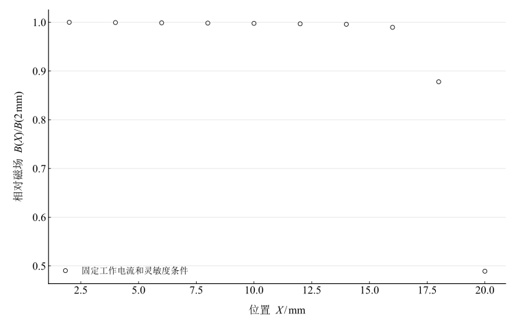

# 霍尔效应的实验研究

淮南师范学院实验报告

学院：电子工程学院　专业：物理学　班级：24 物理 1 班

姓名：缪雨轩　学号：2414050120　实验日期：2025 年 10 月 15 日

## 一、实验名称

霍尔效应的实验研究。

## 二、实验目的

1. 理解霍尔效应、霍尔系数和灵敏度。
2. 测绘霍尔投影与工作电流、励磁电流的关系。
3. 学习利用霍尔元件描述气隙或轴向磁场分布。
4. 用对称交换法分离不同电流、磁场奇偶性的电压分量。

## 三、实验原理

### 1. 横向电场与霍尔系数

载流子在磁场中受洛伦兹力 $\mathbf F=q\mathbf v_d\times\mathbf B$，横向积累形成电场；稳态时电场力与磁力平衡。对单一多数载流子模型，工作电流、横向电压满足

$$
I_S=n|q|v_dbd,\qquad |V_H|=\frac{I_SB}{n|q|d},\qquad V_H=\frac{R_H I_SB}{d}=K_H I_SB.
$$

厚度为 $d$，宽度为 $b$；$R_H$ 的符号由电荷类型及电压引线约定共同决定。理想单载流子情形 $R_H=1/(nq)$，$K_H=R_H/d$。已知磁场和工作电流时

$$
K_H=\frac{V_H}{I_SB},\qquad B=\frac{V_H}{K_HI_S},\qquad R_H=\frac{dV_H}{I_SB}.
$$

如引入霍尔因子 $r_H$，则 $R_H=r_H/(nq)$、$n=r_H/(|qR_H|)$。$3\pi/8\approx1.178$ 是特定输运模型下的因子，不能不经材料和散射机制确认就作为所有霍尔元件常数。本次没有厚度、灵敏度及独立磁场记录，不求载流子浓度。

### 2. 对称交换与奇偶投影

四次读数依次为 $(+B,+I)$、$(-B,+I)$、$(-B,-I)$、$(+B,-I)$。定义

$$
V_H=\frac{V_1-V_2+V_3-V_4}{4},\qquad V_0=\frac{V_1+V_2+V_3+V_4}{4},
$$

$$
V_I=\frac{V_1+V_2-V_3-V_4}{4},\qquad V_B=\frac{V_1-V_2-V_3+V_4}{4}.
$$

$V_H$ 是磁场与电流均为奇的投影，$V_0$ 为共模，$V_I$ 为电流奇、磁场偶分量，$V_B$ 为磁场奇、电流偶分量。该组合可消除对应的非霍尔奇偶分量，但不能保证消除与霍尔项具有相同奇偶性的副效应。

### 3. 磁场分布

工作电流和灵敏度不变时，相对场可由 $B(X)/B(X_0)=V_H(X)/V_H(X_0)$ 得到。绝对磁场仍需要灵敏度校准。电磁铁在较大励磁电流下可能非线性，但须先确认观测信号确实为霍尔信号，不能用本次冲突记录直接判定饱和。

## 四、主要仪器设备

HL-10 型霍尔效应仪、QS 型测试仪或 DH4512 型霍尔效应实验仪及相应连接线、电磁铁和探头。

## 五、实验步骤

1. 将励磁输出、工作电流输出、霍尔电压输入正确连接；通电前电流调至最小并断开换向开关。
2. 将元件定位于气隙中心，按四个磁场/工作电流极性顺序记录。
3. 保持励磁电流不变，扫描工作电流；再保持工作电流不变，扫描励磁电流。
4. 固定两个电流，移动探头记录位置分布。

操作计划写有 $1000\,\mathrm{mA}$、$10\,\mathrm{mA}$ 及 $5\,\mathrm{mm}$ 步进；实际记录表为 $500\,\mathrm{mA}$、$3\,\mathrm{mA}$ 及 $2\,\mathrm{mm}$ 步进，计算按实际表头和位置列进行。

## 六、原始数据记录

表 1　工作电流扫描（励磁电流 $500\,\mathrm{mA}$）

{{tables.working_current_observations}}

表 2　励磁电流扫描（工作电流 $3\,\mathrm{mA}$）

{{tables.magnet_current_observations}}

表 3　位置扫描（励磁电流 $500\,\mathrm{mA}$，工作电流 $3\,\mathrm{mA}$）

{{tables.position_observations}}

所有电压读数按原表的毫伏单位保留。第一表 $2.1\,\mathrm{mA}$ 行第三通道为 $61.81\,\mathrm{mV}$，与邻近变化存在疑点，但没有依据擅改。

## 七、数据处理

### 1. 四极性独立复算

表 4　工作电流记录的奇偶分解

{{tables.working_current_decomposition}}

表 5　励磁电流记录的奇偶分解

{{tables.magnet_current_decomposition}}

表 6　位置记录的奇偶分解

{{tables.position_decomposition}}

### 2. 电流关系与单位核查

表 7　两类电流扫描的含截距拟合

{{tables.fit_summary}}

图 1　霍尔投影与工作电流的拟合及残差

图 2　励磁电流扫描的奇磁场奇电流投影及拟合残差

第一组斜率单位为 $\mathrm{mV/mA}$，不是 $\mu\mathrm{V/mA}$。在两表共同标记的 $I_S=3\,\mathrm{mA},I_M=500\,\mathrm{mA}$ 条件下，表 1 投影为 $96.3675\,\mathrm{mV}$，表 2 为 $0.1\,\mathrm{mV}$，相差 ${{metrics.same_setting_voltage_ratio}}$ 倍。两组数据不能作为同一校准关系合并，也不能声称在 $4\%$ 内一致。

### 3. 相对位置分布

图 3　位置扫描的霍尔投影

图 4　以 $2\,\mathrm{mm}$ 为参考的相对场投影

$2$–$14\,\mathrm{mm}$ 记录变化范围约 ${{metrics.field_inner_spread_percent}}\%$；$20\,\mathrm{mm}$ 与 $2\,\mathrm{mm}$ 的投影比为 ${{metrics.field_end_ratio}}$。该相对关系以探头灵敏度、工作电流和方向均保持不变为条件，位置原点未被确认是几何中心。

## 八、实验结果与讨论

1. 工作电流扫描显示近似线性，但异常通道与残差应保留核查；不能用拟合自动修正原读数。
2. 励磁扫描原始四通道主要为电流奇、磁场偶的大信号，奇磁场奇电流投影仅为约 $0$–$0.1\,\mathrm{mV}$。这与同标记设置下另一表约 $96\,\mathrm{mV}$ 的投影矛盾，应检查极性标签、接线、量程、记录批次及背景项；现有数据不能确定唯一原因。
3. 位置记录在较小位置范围变化较小，靠后位置明显下降，符合存在边缘弱化的形状；没有几何原点和绝对灵敏度校准，结论限于相对分布。
4. 对称交换只分离指定奇偶性，不能据截距接近零宣称所有副效应已消除。建议同步核查各换向状态、重复测量并使用独立磁场标定。
5. 未提供仪器限差、重复性、$K_H$、$B$、$d$，没有给出绝对场、载流子浓度或完整不确定度。
