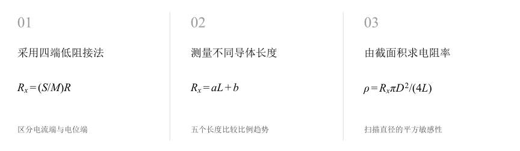
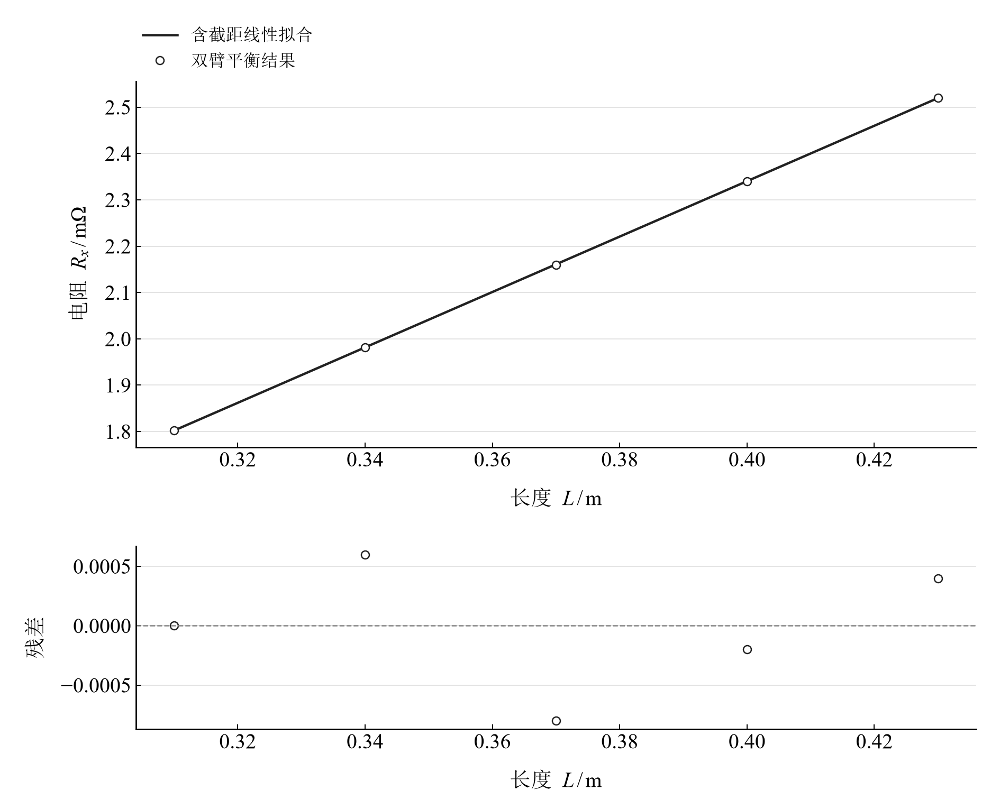
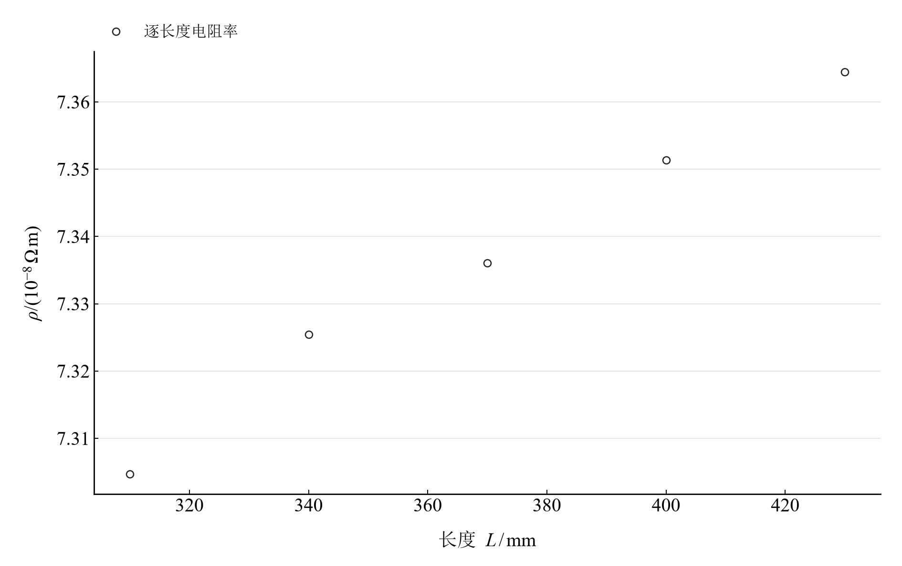

[普通物理实验 3](../README.md) · [项目首页](../../../README.md) · [使用指南](../../../docs/usage.md)

<!-- virtual-laboratory-entry -->
[在线虚拟实验](https://hnnuyuxuan.github.io/general-physics-lab/simulations/kelvin-bridge/) · [模型依据与参数来源](../../../docs/kelvin-bridge-model-evidence.md)

# 直流双臂电桥测低电阻

**把电流端和电位端分开，从毫欧读数求导体电阻率。**

使用开尔文双臂电桥测量同一导体不同长度的低电阻。由四端接法、比率臂与圆截面几何求电阻率，同时比较逐长度平均和含截距拟合，理解共用直径带来的敏感性。

[读实验报告](report/report.md) · [浏览器交互](https://hnnuyuxuan.github.io/general-physics-lab/experiments/course-03/kelvin-bridge/notebooks/analysis.html) · [Python 笔记本](notebooks/analysis.ipynb) · [Wolfram 笔记本](../../../notebook/paclets/KelvinBridgeLab/Notebooks/KelvinBridgeLab.nb)



图 1　采用四端低阻接法 → 测量不同导体长度 → 由截面积求电阻率

## 选择你的入口

|用途|入口|打开方式|
|---|---|---|
|阅读原理、记录与结论|[Markdown 实验报告](report/report.md) · [排版阅读版](https://hnnuyuxuan.github.io/general-physics-lab/experiments/course-03/kelvin-bridge/report/report.html)|GitHub、Markdown 阅读器或本地浏览器|
|改变参数、查看曲线响应|[HTML 交互阅读版](https://hnnuyuxuan.github.io/general-physics-lab/experiments/course-03/kelvin-bridge/notebooks/analysis.html)|直接在线打开，也可下载到本机|
|运行 Python 计算与探索|[Jupyter Notebook](notebooks/analysis.ipynb)|JupyterLab 或 VS Code|
|运行原生数学排版与交互计算|[Wolfram Notebook](../../../notebook/paclets/KelvinBridgeLab/Notebooks/KelvinBridgeLab.nb) · [Paclet 安装包](../../../notebook/paclets/KelvinBridgeLab/dist/KelvinBridgeLab-0.1.0.paclet)|Wolfram 前端|
|对照源实验记录|[源报告 PDF](../../../pdf/course-03/10用直流双臂电桥测低电阻/实验报告-直流双臂电桥测低电阻.pdf)|GitHub 或 PDF 阅读器|

## 从记录到计算

五个电位端间距为 310、340、370、400、430 mm，直径汇总值为 4.00 mm。面板比率 $S/M=0.01/1000=10^{-5}$，将比较臂示值换算成毫欧量级平衡电阻。

均匀圆截面模型将电阻与长度联系起来。逐长度电阻率取算术平均；含截距拟合则由斜率计算 $\rho_{fit}=aA$，两者对应不同处理定义。

$$
R_x=\frac SM R,\qquad A=\frac{\pi D^2}4,\qquad \rho=\frac{R_xA}{L},\qquad R_x=aL+b.
$$

表 1　关键计算结果

|计算量|数值|单位|
|---|---:|---|
|五长度电阻率均值|$7.3364025\times10^{-8}$|Ω·m|
|含截距拟合电阻率|$7.5146896\times10^{-8}$|Ω·m|
|电阻–长度拟合斜率|$0.00598$|Ω/m|

平衡电阻随长度近似线性增加，五个长度共享同一直径和比率臂。电阻率散布描述长度系列的变化，直径敏感性由平方关系单独展开。

## 比较长度趋势和直径敏感性

<table>
  <tr>
    <td width="50%" align="center" valign="top">
      <a href="assets/readme-R_length.svg"></a>
    </td>
    <td width="50%" align="center" valign="top">
      <a href="assets/readme-rho_length.svg"></a>
    </td>
  </tr>
  <tr>
    <td align="center" valign="top">
      <strong>图 2</strong><br>五个长度平衡电阻的含截距直线拟合与残差
    </td>
    <td align="center" valign="top">
      <strong>图 3</strong><br>使用直径 4.00 mm 分别计算的五个长度电阻率
    </td>
  </tr>
</table>

第一幅检查比例趋势与截距，第二幅展示逐长度估计。将两种结果放在一起，可分辨“平均单点比值”和“由直线斜率反演”的区别。

## 在 Notebook 中探索

|操作|参数与范围|观察什么|
|---|---|---|
|改变模型直径|选择 $D=3.9,4.0,4.1\ \mathrm{mm}$，保持长度与电阻读数|观察整组电阻率按 $D^2$ 同步变化|

[HTML 阅读版](https://hnnuyuxuan.github.io/general-physics-lab/experiments/course-03/kelvin-bridge/notebooks/analysis.html) 包含上述控件；[Jupyter](notebooks/analysis.ipynb) 与 [Wolfram Notebook](../../../notebook/paclets/KelvinBridgeLab/Notebooks/KelvinBridgeLab.nb) 沿报告章节展开公式、数据处理和模型计算。

建议按以下顺序阅读：

1. 先核对面板比率，再从比较臂读数得到毫欧量级电阻。
2. 比较逐长度电阻率均值和含截距拟合结果。
3. 扫描直径模型，观察共用尺寸对全部长度估计的共同影响。

## 在本机打开

环境安装与字体设置见[使用指南](../../../docs/usage.md)。在仓库根目录启动本实验：

```powershell
.\.venv\Scripts\python.exe -m jupyterlab experiments/course-03/kelvin-bridge/notebooks/analysis.ipynb
```

安装 Paclet 后，通过包入口打开 Wolfram Notebook。将安装路径改为本机仓库所在位置：

```wolfram
PacletInstall["D:/general-physics-lab/notebook/paclets/KelvinBridgeLab/dist/KelvinBridgeLab-0.1.0.paclet"];
Needs["KelvinBridgeLab`"];
KelvinBridgeLab`OpenNotebook[]
```

## 数据与计算实现

|内容|入口|
|---|---|
|规范观测数据|[balance.csv](data/balance.csv)|
|单位、参数与模型条件|[experiment.json](experiment.json)|
|Python 计算模块|[kelvin_bridge.py](../../../src/physicslab/experiments/kelvin_bridge.py)|
|Wolfram 计算实现|[analysis.wl](../../../notebook/paclets/KelvinBridgeLab/Kernel/analysis.wl)|
|计算结果与数表|[python.json](results/python.json)|
|数据来源与整理记录|[provenance.json](data/provenance.json)|

[返回课程目录](../README.md) · [浏览全部实验](../../../README.md)
