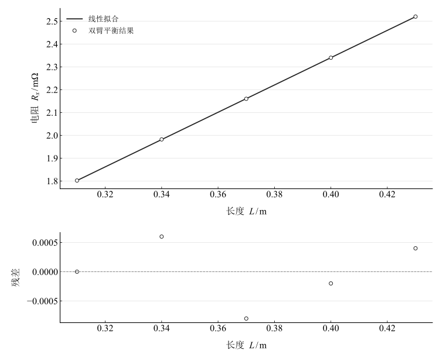
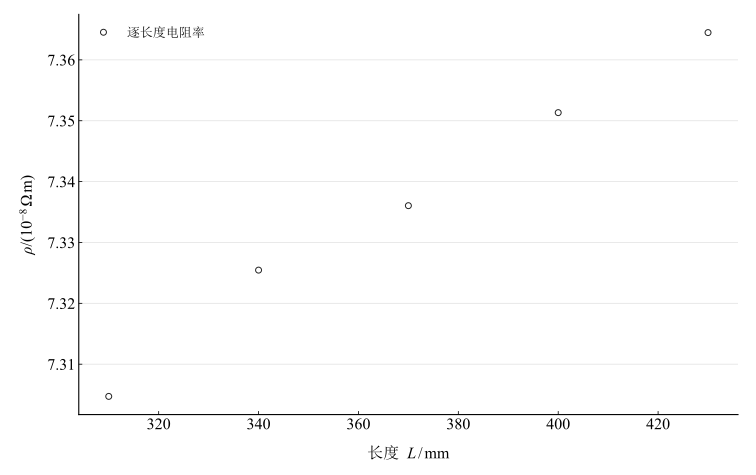

# 直流双臂电桥测低电阻

淮南师范学院实验报告

学院：电子工程学院　专业：物理学　班级：24 物理 1 班

姓名：缪雨轩　学号：2414050120　实验日期：2025 年 11 月 5 日

## 一、实验名称

直流双臂电桥测低电阻。

## 二、实验目的

1. 理解开尔文双臂电桥测低电阻的结构与原理。
2. 掌握 QJ47 双臂电桥四端接法。
3. 测量导体不同长度的低电阻，由直径和长度计算电阻率。

## 三、实验原理

### 1. 低阻测量与四端连接

两端测量会包含导线和接触电阻：$R_m=R_x+r_w+r_c$。四端接法将大电流端与电位端分开，减小电位引线电流导致的压降影响；不意味着所有接触、热电势和比率失配均自动消失。

### 2. 双臂平衡条件

主比率 $M_b=R_a/R_b$，副臂 $R_a',R_b'$，连接电阻 $r$，比较电阻 $R$。源回路方程为

$$
I_1R_a=I_2R_x+I_3R_a',\qquad I_1R_b=I_2R+I_3R_b',\qquad\frac{I_3}{I_2}=\frac{r}{R_a'+R_b'+r}.
$$

解得量纲一致的平衡式

$$
R_x=M_bR+\frac{r(M_bR_b'-R_a')}{R_a'+R_b'+r}.
$$

当主、副比率相等时修正项为零，$R_x=M_bR$。QJ47 双桥的面板设定以 $S/M$ 表示这一比率：

$$
R_x=\frac SM R.
$$

这里面板 $M$ 与前面的无量纲 $M_b$ 区分，$S$、$M$ 为仪器比率臂设定。

### 3. 电阻率

均匀圆截面导体满足

$$
R_x=\rho\frac LA,\qquad A=\frac{\pi D^2}4,\qquad\rho=R_x\frac{\pi D^2}{4L}.
$$

除了逐长度结果，也可拟合 $R_x=aL+b$，以 $\rho_{\mathrm{fit}}=aA$ 比较比例关系；非零截距是诊断信息，不能直接当作已知接触电阻。

## 四、主要仪器设备

QJ47 直流单双臂电桥、金属导体、螺旋测微器、米尺、连接线和电位探针。

## 五、实验步骤

1. 熟悉双桥电流端、电位端、比率和比较臂，指零仪内接调零。
2. 计划在多个位置测量直径并平均；现有记录只保留直径汇总。
3. 用四端方式接入导体，电流端接两端，电位端限定所测长度。
4. 选 $S=0.01,M=1000$，移动电位探针至约 $310,340,370,400,430\,\mathrm{mm}$。
5. 先粗后细、先高后低调平衡，记录长度和比较臂。
6. 重算平衡电阻、各长度电阻率、平均及拟合关系，核对允许误差的适用条件。

## 六、原始数据记录

直径汇总为 $D=4.00\,\mathrm{mm}$，横截面积按 $\pi D^2/4$ 独立计算。

表 1　长度、比率臂和比较臂记录（源错误处理列保留以区分）

| 长度 / mm | $S/\Omega$ | $M/\Omega$ | 比较臂 / Ω | 源原始表Rx列 / Ω | 直径 / mm |
| --- | --- | --- | --- | --- | --- |
| 310 | 0.01 | 1000 | 180.2 | 1.802 | 4 |
| 340 | 0.01 | 1000 | 198.2 | 1.982 | 4 |
| 370 | 0.01 | 1000 | 216 | 2.16 | 4 |
| 400 | 0.01 | 1000 | 234 | 2.34 | 4 |
| 430 | 0.01 | 1000 | 252 | 2.52 | 4 |

$0.01/1000=10^{-5}$，因此 $180.20\,\Omega$ 的比较臂对应 $0.0018020\,\Omega$，不是源原始表处理列的 $1.8020\,\Omega$。以下统一按比率计算；未改动实际比较臂读数。

## 七、数据处理

### 1. 平衡电阻和电阻率

表 2　独立重算的低电阻与电阻率

| 序号 | 长度 / m | 平衡电阻 / Ω | 电阻率 / (Ω·m) |
| --- | --- | --- | --- |
| 1 | 0.31 | 0.001802 | $7.3047096\times10^{-8}$ |
| 2 | 0.34 | 0.001982 | $7.3254549\times10^{-8}$ |
| 3 | 0.37 | 0.00216 | $7.3360434\times10^{-8}$ |
| 4 | 0.4 | 0.00234 | $7.3513268\times10^{-8}$ |
| 5 | 0.43 | 0.00252 | $7.3644777\times10^{-8}$ |

### 2. 均值和长度拟合

$$
\overline\rho=\frac15\sum_{i=1}^5\rho_i.
$$

表 3　面积、均值、描述性散布和拟合结果

| 指标 | 数值 | 单位 |
| --- | --- | --- |
| 导体横截面积 | $1.2566371\times10^{-5}$ | m² |
| 五长度电阻率均值 | $7.3364025\times10^{-8}$ | Ω·m |
| 五长度电阻率描述性标准差 | $2.3105018\times10^{-10}$ | Ω·m |
| 含截距R–L拟合电阻率 | $7.5146896\times10^{-8}$ | Ω·m |
| R–L斜率 | 0.00598 | Ω/m |
| R–L截距 | $-5.18\times10^{-5}$ | Ω |

图 1　平衡电阻与长度的含截距拟合及残差

图 2　五个长度分别计算的电阻率

不同长度共用同一直径和比率臂，系统影响相关；五个电阻率的标准差只描述散布，不直接等同重复测量的 A 类标准不确定度。

### 3. 允许误差的条件核查

配套说明书的最低双桥区间 $10^{-3}$–$10^{-2}\,\Omega$ 等级指数为 $0.5\%$，并给出 $E_{\mathrm{lim}}=\pm c(R_N/10+X)$，不是源段落使用的 $0.2\%$ 和 $R_N+X$。本次 $R_N$、参考温度与标度示值的适用换算未完整核定，不照录源 $\pm6$–$7\,\mu\Omega$ 作为新验证限差。

直径、长度、比率和比较臂的不确定度均会进入 $\rho$，直径影响为平方关系。缺少限差及重复记录，未给出完整合成不确定度。

## 八、实验结果与讨论

1. 按实际 $S/M$ 得到低电阻 $0.0018020$–$0.0025200\,\Omega$，长度增加时电阻近似线性上升。
2. 电阻率均值为 $7.336402471\times10^{-8}\,\Omega\,\mathrm m$；含截距长度拟合得到 $7.514689627\times10^{-8}\,\Omega\,\mathrm m$。两种估计的不同反映截距和处理假设，不以源已经修约的电阻率列代替计算。
3. 四端及匹配副比率有利于减小导线影响，但并未实际测出所有系统项。直径只有汇总值，不能声称已经测得完整精度或确定金属成分。
4. 建议完整记录直径重复读数、温度、零点和电位探针定位；核对说明书基准与误差定义后再报告允许误差及扩展不确定度。
