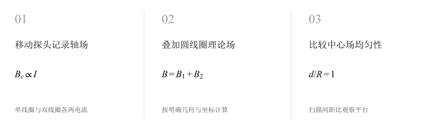
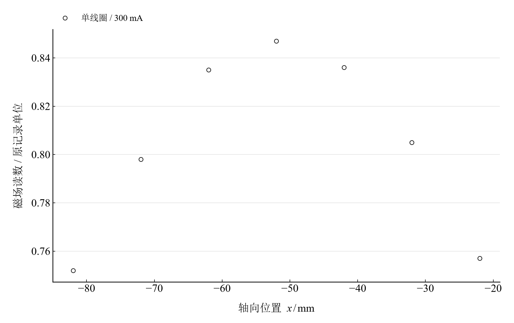
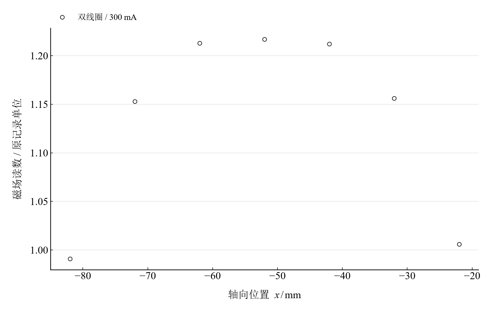
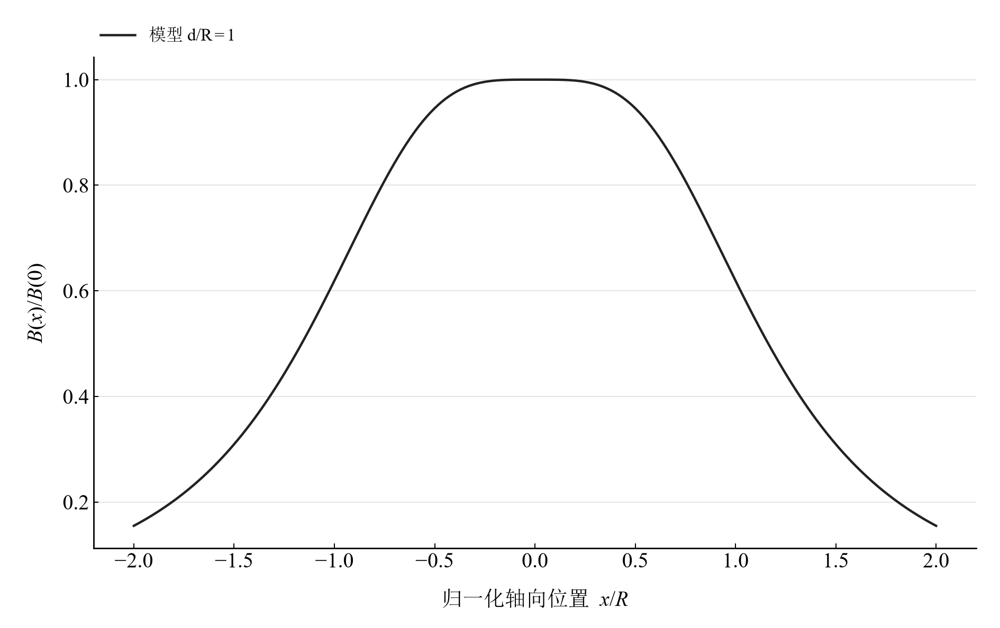

[普通物理实验 3](../README.md) · [项目首页](../../../README.md) · [使用指南](../../../docs/usage.md)

# 磁场的描绘

**叠加两只圆线圈，看看中心附近为什么更均匀。**

在两种励磁电流下测量单线圈和双线圈轴向响应。将共同读数标度的电流比例与几何理论分开比较，再扫描线圈间距，理解亥姆霍兹条件的中心均匀性。

[读实验报告](report/report.md) · [浏览器交互](notebooks/analysis.html) · [Python 笔记本](notebooks/analysis.ipynb) · [Wolfram 笔记本](../../../notebook/paclets/MagneticFieldLab/Notebooks/MagneticFieldLab.nb)



图 1　移动探头记录轴场 → 叠加圆线圈理论场 → 比较中心场均匀性

## 选择你的入口

|用途|入口|打开方式|
|---|---|---|
|阅读原理、记录与结论|[Markdown 实验报告](report/report.md) · [排版阅读版](report/report.html)|GitHub、Markdown 阅读器或本地浏览器|
|改变参数、查看曲线响应|[HTML 交互阅读版](notebooks/analysis.html)|下载后用浏览器打开|
|运行 Python 计算与探索|[Jupyter Notebook](notebooks/analysis.ipynb)|JupyterLab 或 VS Code|
|运行原生数学排版与交互计算|[Wolfram Notebook](../../../notebook/paclets/MagneticFieldLab/Notebooks/MagneticFieldLab.nb) · [Paclet 安装包](../../../notebook/paclets/MagneticFieldLab/dist/MagneticFieldLab-0.1.0.paclet)|Wolfram 前端|
|对照源实验记录|[源报告 PDF](../../../pdf/course-03/7磁场的描绘/实验报告-磁场的描绘.pdf)|GitHub 或 PDF 阅读器|

## 从记录到计算

每个线圈配置在 300、500 mA 下各有七个轴向记录点。几何参数为半径 $R=105\ \mathrm{mm}$、匝数 $N=500$、间距 $d=105\ \mathrm{mm}$；理论坐标原点取双线圈中点。

圆线圈理论采用细线圈近似及经典磁常数。实验读数沿用原表标度，理论场以 mT 表示；电流比例与归一化形状各自使用同系列参照。

$$
B_c(x)=\frac{\mu_0NIR^2}{2[R^2+(x-x_c)^2]^{3/2}},\qquad B_{pair}(x)=B_{-d/2}(x)+B_{d/2}(x).
$$

表 1　关键计算结果

|计算量|数值|单位|
|---|---:|---|
|单线圈 300 mA 记录峰值位置|$-52$|mm|
|单线圈电流响应比相对 5/3 最大偏差|$0.827068$|%|
|双线圈电流响应比相对 5/3 最大偏差|$1.003460$|%|

单线圈峰值接近模型中心 −52.5 mm；双线圈记录在约 −52 至 −42 mm 附近出现峰值，而中点坐标模型向零位置逐渐形成平台。两种形状的比较提供坐标原点与接线核查的线索。

## 把轴向观测与间距模型并排阅读



图 2　单线圈 300 mA 的七点轴向观测，纵轴为原记录单位

<table>
  <tr>
    <td width="50%" align="center" valign="top"><a href="assets/readme-double_300.svg"></a></td>
    <td width="50%" align="center" valign="top"><a href="assets/readme-spacing_1.svg"></a></td>
  </tr>
  <tr>
    <td align="center" valign="top"><strong>图 3</strong><br>双线圈 300 mA 的七点轴向观测，纵轴为原记录单位</td>
    <td align="center" valign="top"><strong>图 4</strong><br>d/R=1 的理想亥姆霍兹双线圈归一化轴向场</td>
  </tr>
</table>

前两幅显示记录位置范围内的响应。第三幅覆盖完整的中心邻域，展示间距等于半径时的平坦形状；阅读时分别使用图轴声明的坐标和标度。

## 在 Notebook 中探索

|操作|参数与范围|观察什么|
|---|---|---|
|改变线圈间距比|选择 $d/R=0.5,1,1.5$|比较归一化场的中心峰、平台与双峰趋势|

[HTML 阅读版](notebooks/analysis.html) 包含上述控件；[Jupyter](notebooks/analysis.ipynb) 与 [Wolfram Notebook](../../../notebook/paclets/MagneticFieldLab/Notebooks/MagneticFieldLab.nb) 沿报告章节展开公式、数据处理和模型计算。

建议按以下顺序阅读：

1. 先查看线圈几何与坐标约定，再定位单线圈记录峰值。
2. 比较两电流响应的比例，然后阅读双线圈观测与理论形状。
3. 切换间距比，观察亥姆霍兹条件附近的中心均匀性。

## 在本机打开

环境安装与字体设置见[使用指南](../../../docs/usage.md)。在仓库根目录启动本实验：

```powershell
.\.venv\Scripts\python.exe -m jupyterlab experiments/course-03/magnetic-field/notebooks/analysis.ipynb
```

安装 Paclet 后，通过包入口打开 Wolfram Notebook。将安装路径改为本机仓库所在位置：

```wolfram
PacletInstall["D:/general-physics-lab/notebook/paclets/MagneticFieldLab/dist/MagneticFieldLab-0.1.0.paclet"];
Needs["MagneticFieldLab`"];
MagneticFieldLab`OpenNotebook[]
```

## 数据与计算实现

|内容|入口|
|---|---|
|规范观测数据|[readings.csv](data/readings.csv)|
|单位、参数与模型条件|[experiment.json](experiment.json)|
|Python 计算模块|[magnetic_field.py](../../../src/physicslab/experiments/magnetic_field.py)|
|Wolfram 计算实现|[analysis.wl](../../../notebook/paclets/MagneticFieldLab/Kernel/analysis.wl)|
|计算结果与数表|[python.json](results/python.json)|
|数据来源与整理记录|[provenance.json](data/provenance.json)|

[返回课程目录](../README.md) · [浏览全部实验](../../../README.md)
