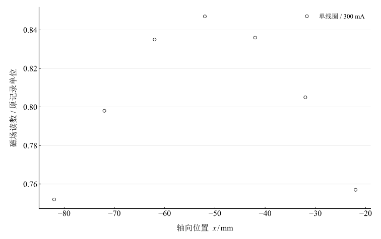
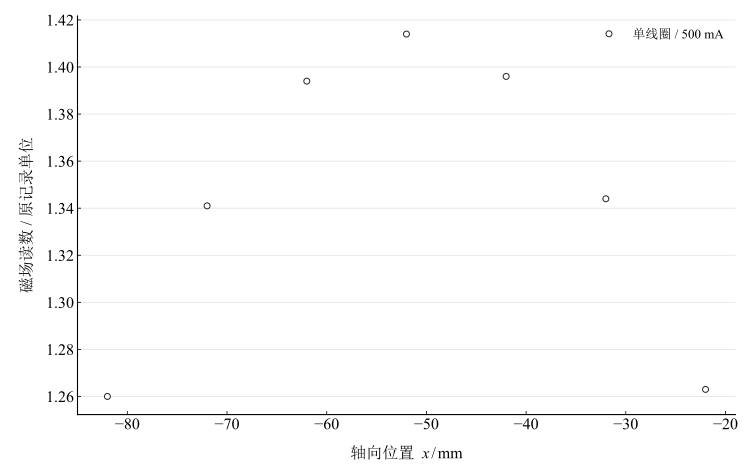
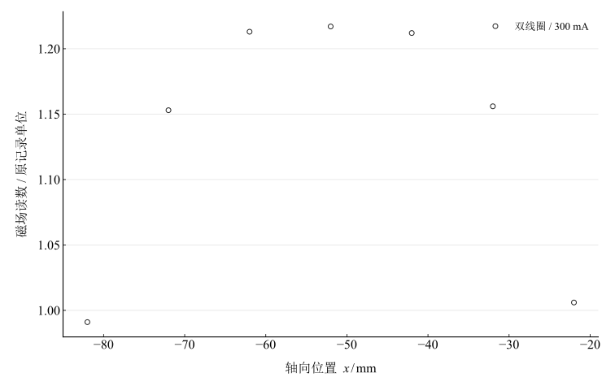
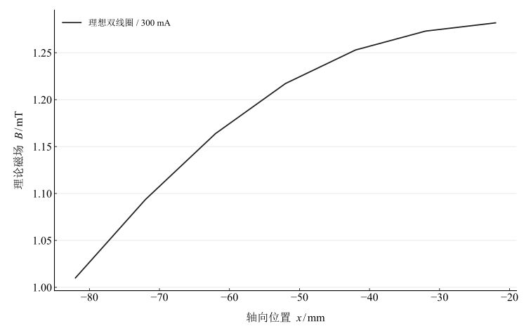

# 磁场的描绘

淮南师范学院实验报告

学院：电子工程学院　专业：物理学　班级：24 物理 1 班

姓名：缪雨轩　学号：2414050120　实验日期：2025 年 10 月 29 日

## 一、实验名称

磁场的描绘。

## 二、实验目的

1. 掌握感应法测磁场的原理与方法。
2. 描绘载流圆线圈轴向磁场，比较毕奥–萨伐尔定律的预测。
3. 描绘双线圈磁场并学习亥姆霍兹线圈的均匀场条件。

## 三、实验原理

### 1. 毕奥–萨伐尔定律

$$
\mathrm d\mathbf B=\frac{\mu_0 I}{4\pi}\frac{\mathrm d\boldsymbol\ell\times\mathbf r}{r^3},\qquad\mathbf B=\int\mathrm d\mathbf B.
$$

计算采用经典近似 $\mu_0\approx4\pi\times10^{-7}\,\mathrm{H/m}$。磁场遵循矢量叠加。

### 2. 单线圈与双线圈

半径 $R$、匝数 $N$、电流 $I$ 的细圆线圈，中心位于 $x_c$ 时轴向场为

$$
B_c(x)=\frac{\mu_0NIR^2}{2[R^2+(x-x_c)^2]^{3/2}}.
$$

双线圈中心在 $x=\pm d/2$，同向等电流时

$$
B_{\mathrm{pair}}(x)=B_{-d/2}(x)+B_{d/2}(x).
$$

亥姆霍兹条件为 $d=R$；中点二阶导数为零，使中心附近更均匀。中心和单线圈中心场分别为

$$
B_{\mathrm{pair}}(0)=\left(\frac45\right)^{3/2}\frac{\mu_0NI}{R},\qquad B_c(x_c)=\frac{\mu_0NI}{2R}.
$$

### 3. 感应测量

固定频率、方向和探头匝面积时，感应电压与交变磁场幅值成正比。若 $B=B_0\cos(\omega t)$，则峰值感应电压为 $\mathcal E_0=N_pS\omega B_0$；实际数值换算还需确认峰值或有效值、频率与探头校准，本次未提供这些参数。

## 四、主要仪器设备

DH4501A 型亥姆霍兹线圈实验仪及感应探测头。

## 五、实验步骤

1. 接入单线圈，开机预热约五分钟并调零。
2. 分别在 $300\,\mathrm{mA}$、$500\,\mathrm{mA}$ 下移动探头，记录轴向位置与读数。
3. 关闭电源后同向串联两线圈，重复两种励磁电流的记录。
4. 比较单/双线圈分布、励磁电流比例及理论形状。

## 六、原始数据记录

参数为 $R=105\,\mathrm{mm}$、$N=500$、$d=105\,\mathrm{mm}$，坐标原点约定在双线圈中点，中心为 $\pm52.5\,\mathrm{mm}$。原说明的 $\pm52\,\mathrm{mm}$ 为近似。

表 1　磁场读数（单位原表未注明；列标题为位置毫米数）

{{tables.observations}}

磁场表没有标明读数单位，后续保留“原记录单位”，不把数值直接视为已确认的毫特斯拉。源理论列另在表 2 保留。

## 七、数据处理

### 1. 物理理论重算

按参数和明确坐标约定独立计算理论，结果以 $\mathrm{mT}$ 表示；源理论与重算理论保持独立。

表 2　原测量、源理论和独立理论比较

{{tables.comparison}}

### 2. 单线圈分布与励磁比例

图 1　单线圈 $300\,\mathrm{mA}$ 的轴向读数

图 2　单线圈 $500\,\mathrm{mA}$ 的轴向读数

单线圈两组峰值均在记录点 $-52\,\mathrm{mm}$，接近其模型中心 $-52.5\,\mathrm{mm}$。$500/300\,\mathrm{mA}$ 的响应比相对 $5/3$ 的最大偏差为 ${{metrics.single_current_ratio_max_deviation}}\%$，可检验共同读数标度下的电流比例。

### 3. 双线圈分布与坐标核查

图 3　双线圈 $300\,\mathrm{mA}$ 的轴向读数

图 4　按报告几何约定重算的双线圈 $300\,\mathrm{mA}$ 理论场

图 5　双线圈 $500\,\mathrm{mA}$ 的轴向读数

按中点为零的模型，负位置向零靠近时应逐渐趋于中部平台；源双线圈数据却在约 $-52$ 至 $-42\,\mathrm{mm}$ 附近出现峰值后下降。两者形状不一致，须核查坐标原点、表格批次或几何接线。没有依据平移数据以追求吻合。

## 八、实验结果与讨论

1. 单线圈记录峰值接近线圈中心并向两侧降低，趋势与圆线圈模型相符。绝对单位与感应校准缺失，不能给出经过确认的绝对场误差。
2. 双线圈读数整体大于单线圈，符合增加同向线圈可能增强磁场的趋势；但没有两个单线圈分别的独立数据，且双线圈坐标形状存在冲突，不能单凭大小比较声称定量验证叠加等式。
3. 同一接法不同电流的比值可独立检查比例关系，双线圈相对 $5/3$ 的最大偏差为 ${{metrics.double_current_ratio_max_deviation}}\%$。仍需确认电流稳定与共同读数标度。
4. 可能偏差涉及几何参数、探头定位与角度、感应灵敏度、电流波动和接触。缺少重复读数、频率与校准记录，未给出完整不确定度。
